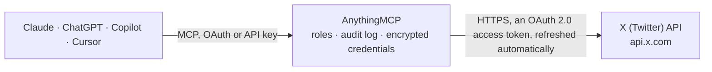

<!-- Generated by scripts/export-github-catalog.mjs in the anythingmcp-website repository. Do not edit by hand. -->

# X (Twitter) MCP connector

Let your AI work with X (formerly Twitter): read and search posts, your timeline, mentions, bookmarks, Lists and direct messages, look up accounts and followers, and publish posts, replies and … The AnythingMCP connector gives Claude, ChatGPT, Microsoft Copilot, Cursor and Gemini 41 MCP tools for X (Twitter): 26 read and 15 can change data.

**Category:** [Social Media](../social.md) · **Tools:** 41 · **Setup guide:** [anythingmcp.com](https://anythingmcp.com/guides/x-to-mcp) · [Deutsch](https://anythingmcp.com/de/guides/x-to-mcp) · [Italiano](https://anythingmcp.com/it/guides/x-to-mcp) · [Español](https://anythingmcp.com/es/guides/x-to-mcp) · [日本語](https://anythingmcp.com/ja/guides/x-to-mcp) · [Русский](https://anythingmcp.com/ru/guides/x-to-mcp) · [中文](https://anythingmcp.com/zh/guides/x-to-mcp)

## Start without code

No installation and no terminal: AnythingMCP Cloud runs the X (Twitter) connector for you, operated by helpcode.ai in Frankfurt, Germany.

1. **Click the button above** and create an account or sign in. The X (Twitter) connector opens, ready to install.
2. **Sign in with your X (Twitter) account** when AnythingMCP asks. The first time, an admin creates a small app in the X (Twitter) developer console. Every click is in the [step-by-step guide](https://anythingmcp.com/guides/x-to-mcp).
3. **Click Install.** AnythingMCP shows the address of your MCP server.
4. **Add that address to your assistant:** [Claude](https://anythingmcp.com/guides/connect-x-to-claude) · [ChatGPT](https://anythingmcp.com/guides/connect-x-to-chatgpt) · [Microsoft Copilot](https://anythingmcp.com/guides/connect-x-to-copilot) · [Cursor](https://anythingmcp.com/guides/connect-x-to-cursor) · [Gemini CLI](https://anythingmcp.com/guides/connect-x-to-gemini) · [Meta Muse](https://anythingmcp.com/guides/connect-x-to-muse).
5. **Ask your first question**, for example: *Read post 17284500123456789012: show text, author and time, I need it for invoice INV-2026-089.*

Prefer help with the setup? [Talk to us](https://anythingmcp.com/contact).

## How it works

- **The AI client** speaks MCP (Streamable HTTP) to AnythingMCP and only sees tool names, descriptions and results. It never gets the X (Twitter) credentials.
- **AnythingMCP** checks the client's role, builds the call from the tool definition, adds the credentials (an OAuth 2.0 access token, refreshed automatically), calls X (Twitter), logs the call and returns the result.
- **X (Twitter)** sees an ordinary API client with the rights of the account the credentials belong to.

## Tools

| Tool | What it does | Access |
|---|---|---|
| [`x_get_me`](#x_get_me) | Read the X account that authorized the connector: id, name, @username and the user fields asked for. | read |
| [`x_get_user_by_username`](#x_get_user_by_username) | Look up one X account by its @username (without the @): id, name, bio, follower and post counts and more. | read |
| [`x_get_users_by_usernames`](#x_get_users_by_usernames) | Look up up to 100 X accounts by @username in one call. | read |
| [`x_get_user`](#x_get_user) | Look up one X account by its numeric user id: name, @username, bio, counts and the user fields asked for. | read |
| [`x_search_users`](#x_search_users) | Find X accounts by name or @username keywords. | read |
| [`x_get_post`](#x_get_post) | Read one post by id: text, author_id, time, metrics and the fields asked for. | read |
| [`x_get_posts`](#x_get_posts) | Read up to 100 posts by id in one call. | read |
| [`x_list_user_posts`](#x_list_user_posts) | List the most recent posts of an account (up to the last 3,200), newest first. | read |
| [`x_list_user_mentions`](#x_list_user_mentions) | List the most recent posts that mention an account (up to the last 800), newest first. | read |
| [`x_get_home_timeline`](#x_get_home_timeline) | Read your home timeline in reverse chronological order: posts and reposts from you and the accounts you follow. | read |
| [`x_search_recent_posts`](#x_search_recent_posts) | Search posts from the last 7 days with X search operators, e.g. "anythingmcp lang:en -is:retweet", from:username, to:username, #hashtag, "exact phrase",… | read |
| [`x_count_recent_posts`](#x_count_recent_posts) | Count the posts of the last 7 days that match a search query, per minute, hour or day, without reading them. | read |
| [`x_list_quote_posts`](#x_list_quote_posts) | List the posts that quote a given post, newest first, with the quoting text and author_id. | read |
| [`x_list_reposted_by`](#x_list_reposted_by) | List the accounts that reposted a post, with the user fields asked for. | read |
| [`x_list_liking_users`](#x_list_liking_users) | List the accounts that liked a post. | read |
| [`x_create_post`](#x_create_post) | Publish a new post on the authorized account, visible to everyone at once. | write |
| [`x_reply_to_post`](#x_reply_to_post) | Publish a reply to a post, visible to everyone at once. | write |
| [`x_quote_post`](#x_quote_post) | Publish a post that quotes another post with your comment, visible to everyone at once. | write |
| [`x_delete_post`](#x_delete_post) | Delete one of your own posts for good. | write |
| [`x_list_liked_posts`](#x_list_liked_posts) | List the posts an account liked, newest like first. | read |
| [`x_like_post`](#x_like_post) | Like a post as the authorized account. | write |
| [`x_unlike_post`](#x_unlike_post) | Remove your like from a post you liked before. | write |
| [`x_repost`](#x_repost) | Repost a post to your followers, visible to everyone at once. | write |
| [`x_undo_repost`](#x_undo_repost) | Take back your repost of a post; the original post stays. | write |
| [`x_list_bookmarks`](#x_list_bookmarks) | List your bookmarked posts, most recently bookmarked first (up to the last 800). | read |
| [`x_add_bookmark`](#x_add_bookmark) | Bookmark a post. | write |
| [`x_remove_bookmark`](#x_remove_bookmark) | Remove a post from your bookmarks. | write |
| [`x_list_followers`](#x_list_followers) | List the accounts that follow an account, newest follower first. | read |
| [`x_list_following`](#x_list_following) | List the accounts an account follows, most recently followed first. | read |
| [`x_follow_user`](#x_follow_user) | Follow an account as the authorized account; the other account is notified. | write |
| [`x_unfollow_user`](#x_unfollow_user) | Stop following an account as the authorized account. | write |
| [`x_list_owned_lists`](#x_list_owned_lists) | List the X Lists an account owns: id, name, description, member and follower counts. | read |
| [`x_list_followed_lists`](#x_list_followed_lists) | List the X Lists an account follows: id, name, description, member and follower counts. | read |
| [`x_get_list`](#x_get_list) | Read one X List: name, description, member and follower counts, whether it is private and when it was created. | read |
| [`x_list_list_posts`](#x_list_list_posts) | Read the latest posts from the members of an X List, newest first. | read |
| [`x_list_list_members`](#x_list_list_members) | List the accounts that are members of an X List, with the user fields asked for. | read |
| [`x_list_dm_events`](#x_list_dm_events) | List your recent direct messages across all conversations (the last 30 days), newest first. | read |
| [`x_list_dm_conversation_with_user`](#x_list_dm_conversation_with_user) | Read your one-to-one direct message conversation with another account (the last 30 days), newest first. | read |
| [`x_send_dm`](#x_send_dm) | Send a direct message to an account, in your one-to-one conversation with it (created when needed). | write |
| [`x_send_dm_to_conversation`](#x_send_dm_to_conversation) | Send a direct message into an existing conversation (one-to-one or group) by its dm_conversation_id from x_list_dm_events. | write |
| [`x_delete_dm`](#x_delete_dm) | Delete one of your direct messages, for you only (the other side keeps it). | write |

## Tool reference

Every parameter as the AI client sees it in `tools/list`. Source: [`packages/backend/src/adapters/intl/x.json`](../../../packages/backend/src/adapters/intl/x.json).

### `x_get_me`

Read the X account that authorized the connector: id, name, @username and the user fields asked for. Call it first: the id is needed by the tools that act on your own account (home timeline, bookmarks, likes, reposts, follows).

**Access:** read · **Call:** `GET /users/me`

| Parameter | Type | Required | Description |
|---|---|---|---|
| `user_fields` | string | no | Comma-separated user fields to return. Values: created_at, description, entities, id, location, name, profile_image_url, protected, public_metrics, url, username, verified, verified_type, withheld. Default: created_at,description,location,public_metrics,verified,verified_type,profile_image_url,url,protected. |

### `x_get_user_by_username`

Look up one X account by its @username (without the @): id, name, bio, follower and post counts and more.

**Access:** read · **Call:** `GET /users/by/username/{username}`

| Parameter | Type | Required | Description |
|---|---|---|---|
| `username` | string | yes | The @username without the @, e.g. XDevelopers. |
| `user_fields` | string | no | Comma-separated user fields to return. Values: created_at, description, entities, id, location, name, profile_image_url, protected, public_metrics, url, username, verified, verified_type, withheld. Default: created_at,description,location,public_metrics,verified,verified_type,profile_image_url,url,protected. |

### `x_get_users_by_usernames`

Look up up to 100 X accounts by @username in one call. Names that do not exist come back in errors, the others in data.

**Access:** read · **Call:** `GET /users/by`

| Parameter | Type | Required | Description |
|---|---|---|---|
| `usernames` | string | yes | Comma-separated @usernames without the @, up to 100, e.g. XDevelopers,XData. |
| `user_fields` | string | no | Comma-separated user fields to return. Values: created_at, description, entities, id, location, name, profile_image_url, protected, public_metrics, url, username, verified, verified_type, withheld. Default: created_at,description,location,public_metrics,verified,verified_type,profile_image_url,url,protected. |

### `x_get_user`

Look up one X account by its numeric user id: name, @username, bio, counts and the user fields asked for.

**Access:** read · **Call:** `GET /users/{user_id}`

| Parameter | Type | Required | Description |
|---|---|---|---|
| `user_id` | string | yes | The numeric user id. |
| `user_fields` | string | no | Comma-separated user fields to return. Values: created_at, description, entities, id, location, name, profile_image_url, protected, public_metrics, url, username, verified, verified_type, withheld. Default: created_at,description,location,public_metrics,verified,verified_type,profile_image_url,url,protected. |

### `x_search_users`

Find X accounts by name or @username keywords. Letters, digits, underscores, apostrophes and spaces only, up to 50 characters.

**Access:** read · **Call:** `GET /users/search`

| Parameter | Type | Required | Description |
|---|---|---|---|
| `query` | string | yes | Words to look for in names and @usernames. |
| `max_results` | integer | no | Accounts per page, 1 to 1000 (default 20). Every account returned is billed as a read, so ask for what you need. |
| `next_token` | string | no | meta.next_token of the previous page, for the next one. |
| `user_fields` | string | no | Comma-separated user fields to return. Values: created_at, description, entities, id, location, name, profile_image_url, protected, public_metrics, url, username, verified, verified_type, withheld. Default: created_at,description,location,public_metrics,verified,verified_type,profile_image_url,url,protected. |

### `x_get_post`

Read one post by id: text, author_id, time, metrics and the fields asked for. The id is the number at the end of a post link (x.com/<user>/status/<id>).

**Access:** read · **Call:** `GET /tweets/{post_id}`

| Parameter | Type | Required | Description |
|---|---|---|---|
| `post_id` | string | yes | The post id. |
| `tweet_fields` | string | no | Comma-separated post fields to return. Values: attachments, author_id, context_annotations, conversation_id, created_at, edit_controls, entities, geo, id, in_reply_to_user_id, lang, note_tweet (full text of long posts), possibly_sensitive, public_metrics, referenced_tweets, reply_settings, source, text, withheld; non_public_metrics and organic_metrics only for your own posts of the last 30 days. Default: created_at,author_id,conversation_id,in_reply_to_user_id,referenced_tweets,public_metrics,lang,entities,reply_settings,note_tweet. |
| `expansions` | string | no | Optional comma-separated expansions; the expanded objects come back in includes and are billed as extra reads. Values: author_id, referenced_tweets.id, in_reply_to_user_id, attachments.media_keys, attachments.poll_ids, entities.mentions.username, geo.place_id. Leave empty to keep the call cheap. |
| `user_fields` | string | no | Comma-separated user fields to return for expanded users (with expansions author_id and similar). Values: created_at, description, entities, id, location, name, profile_image_url, protected, public_metrics, url, username, verified, verified_type, withheld. Default: created_at,description,location,public_metrics,verified,verified_type,profile_image_url,url,protected. |

### `x_get_posts`

Read up to 100 posts by id in one call. Deleted or protected posts come back in errors, the others in data.

**Access:** read · **Call:** `GET /tweets`

| Parameter | Type | Required | Description |
|---|---|---|---|
| `ids` | string | yes | Comma-separated post ids, up to 100. |
| `tweet_fields` | string | no | Comma-separated post fields to return. Values: attachments, author_id, context_annotations, conversation_id, created_at, edit_controls, entities, geo, id, in_reply_to_user_id, lang, note_tweet (full text of long posts), possibly_sensitive, public_metrics, referenced_tweets, reply_settings, source, text, withheld; non_public_metrics and organic_metrics only for your own posts of the last 30 days. Default: created_at,author_id,conversation_id,in_reply_to_user_id,referenced_tweets,public_metrics,lang,entities,reply_settings,note_tweet. |
| `expansions` | string | no | Optional comma-separated expansions; the expanded objects come back in includes and are billed as extra reads. Values: author_id, referenced_tweets.id, in_reply_to_user_id, attachments.media_keys, attachments.poll_ids, entities.mentions.username, geo.place_id. Leave empty to keep the call cheap. |
| `user_fields` | string | no | Comma-separated user fields to return for expanded users (with expansions author_id and similar). Values: created_at, description, entities, id, location, name, profile_image_url, protected, public_metrics, url, username, verified, verified_type, withheld. Default: created_at,description,location,public_metrics,verified,verified_type,profile_image_url,url,protected. |

### `x_list_user_posts`

List the most recent posts of an account (up to the last 3,200), newest first. Use exclude to leave out replies or reposts.

**Access:** read · **Call:** `GET /users/{user_id}/tweets`

| Parameter | Type | Required | Description |
|---|---|---|---|
| `user_id` | string | yes | The numeric user id (x_get_user_by_username gives it). |
| `exclude` | string | no | Optional: replies, retweets or replies,retweets. |
| `start_time` | string | no | Oldest UTC time to include, ISO 8601 (e.g. 2026-10-01T00:00:00Z). |
| `end_time` | string | no | Newest UTC time to include, ISO 8601. |
| `since_id` | string | no | Only posts newer than this post id. |
| `until_id` | string | no | Only posts older than this post id. |
| `max_results` | integer | no | Posts per page, 5 to 100 (default 10). Every post returned is billed as a read, so ask for what you need. |
| `pagination_token` | string | no | meta.next_token of the previous page, for the next one. |
| `tweet_fields` | string | no | Comma-separated post fields to return. Values: attachments, author_id, context_annotations, conversation_id, created_at, edit_controls, entities, geo, id, in_reply_to_user_id, lang, note_tweet (full text of long posts), possibly_sensitive, public_metrics, referenced_tweets, reply_settings, source, text, withheld; non_public_metrics and organic_metrics only for your own posts of the last 30 days. Default: created_at,author_id,conversation_id,in_reply_to_user_id,referenced_tweets,public_metrics,lang,entities,reply_settings,note_tweet. |
| `expansions` | string | no | Optional comma-separated expansions; the expanded objects come back in includes and are billed as extra reads. Values: author_id, referenced_tweets.id, in_reply_to_user_id, attachments.media_keys, attachments.poll_ids, entities.mentions.username, geo.place_id. Leave empty to keep the call cheap. |
| `user_fields` | string | no | Comma-separated user fields to return for expanded users (with expansions author_id and similar). Values: created_at, description, entities, id, location, name, profile_image_url, protected, public_metrics, url, username, verified, verified_type, withheld. Default: created_at,description,location,public_metrics,verified,verified_type,profile_image_url,url,protected. |

### `x_list_user_mentions`

List the most recent posts that mention an account (up to the last 800), newest first.

**Access:** read · **Call:** `GET /users/{user_id}/mentions`

| Parameter | Type | Required | Description |
|---|---|---|---|
| `user_id` | string | yes | The numeric user id; your own from x_get_me for your mentions. |
| `start_time` | string | no | Oldest UTC time to include, ISO 8601 (e.g. 2026-10-01T00:00:00Z). |
| `end_time` | string | no | Newest UTC time to include, ISO 8601. |
| `since_id` | string | no | Only posts newer than this post id. |
| `until_id` | string | no | Only posts older than this post id. |
| `max_results` | integer | no | Posts per page, 5 to 100 (default 10). Every post returned is billed as a read, so ask for what you need. |
| `pagination_token` | string | no | meta.next_token of the previous page, for the next one. |
| `tweet_fields` | string | no | Comma-separated post fields to return. Values: attachments, author_id, context_annotations, conversation_id, created_at, edit_controls, entities, geo, id, in_reply_to_user_id, lang, note_tweet (full text of long posts), possibly_sensitive, public_metrics, referenced_tweets, reply_settings, source, text, withheld; non_public_metrics and organic_metrics only for your own posts of the last 30 days. Default: created_at,author_id,conversation_id,in_reply_to_user_id,referenced_tweets,public_metrics,lang,entities,reply_settings,note_tweet. |
| `expansions` | string | no | Optional comma-separated expansions; the expanded objects come back in includes and are billed as extra reads. Values: author_id, referenced_tweets.id, in_reply_to_user_id, attachments.media_keys, attachments.poll_ids, entities.mentions.username, geo.place_id. Leave empty to keep the call cheap. |
| `user_fields` | string | no | Comma-separated user fields to return for expanded users (with expansions author_id and similar). Values: created_at, description, entities, id, location, name, profile_image_url, protected, public_metrics, url, username, verified, verified_type, withheld. Default: created_at,description,location,public_metrics,verified,verified_type,profile_image_url,url,protected. |

### `x_get_home_timeline`

Read your home timeline in reverse chronological order: posts and reposts from you and the accounts you follow. Only works for your own user id.

**Access:** read · **Call:** `GET /users/{user_id}/timelines/reverse_chronological`

| Parameter | Type | Required | Description |
|---|---|---|---|
| `user_id` | string | yes | Your own user id (the id from x_get_me, not the @username). |
| `exclude` | string | no | Optional: replies, retweets or replies,retweets. |
| `start_time` | string | no | Oldest UTC time to include, ISO 8601 (e.g. 2026-10-01T00:00:00Z). |
| `end_time` | string | no | Newest UTC time to include, ISO 8601. |
| `since_id` | string | no | Only posts newer than this post id. |
| `until_id` | string | no | Only posts older than this post id. |
| `max_results` | integer | no | Posts per page, 1 to 100 (default 10). Every post returned is billed as a read, so ask for what you need. |
| `pagination_token` | string | no | meta.next_token of the previous page, for the next one. |
| `tweet_fields` | string | no | Comma-separated post fields to return. Values: attachments, author_id, context_annotations, conversation_id, created_at, edit_controls, entities, geo, id, in_reply_to_user_id, lang, note_tweet (full text of long posts), possibly_sensitive, public_metrics, referenced_tweets, reply_settings, source, text, withheld; non_public_metrics and organic_metrics only for your own posts of the last 30 days. Default: created_at,author_id,conversation_id,in_reply_to_user_id,referenced_tweets,public_metrics,lang,entities,reply_settings,note_tweet. |
| `expansions` | string | no | Optional comma-separated expansions; the expanded objects come back in includes and are billed as extra reads. Values: author_id, referenced_tweets.id, in_reply_to_user_id, attachments.media_keys, attachments.poll_ids, entities.mentions.username, geo.place_id. Leave empty to keep the call cheap. |
| `user_fields` | string | no | Comma-separated user fields to return for expanded users (with expansions author_id and similar). Values: created_at, description, entities, id, location, name, profile_image_url, protected, public_metrics, url, username, verified, verified_type, withheld. Default: created_at,description,location,public_metrics,verified,verified_type,profile_image_url,url,protected. |

### `x_search_recent_posts`

Search posts from the last 7 days with X search operators, e.g. "anythingmcp lang:en -is:retweet", from:username, to:username, #hashtag, "exact phrase", has:links, is:reply. Up to 512 characters.

**Access:** read · **Call:** `GET /tweets/search/recent`

| Parameter | Type | Required | Description |
|---|---|---|---|
| `query` | string | yes | The search query with operators. |
| `sort_order` | `recency` \| `relevancy` | no | recency (default) or relevancy. |
| `start_time` | string | no | Oldest UTC time, ISO 8601, within the last 7 days. |
| `end_time` | string | no | Newest UTC time to include, ISO 8601. |
| `since_id` | string | no | Only posts newer than this post id. |
| `until_id` | string | no | Only posts older than this post id. |
| `max_results` | integer | no | Posts per page, 10 to 100 (default 10). Every post returned is billed as a read, so ask for what you need. |
| `next_token` | string | no | meta.next_token of the previous page, for the next one. |
| `tweet_fields` | string | no | Comma-separated post fields to return. Values: attachments, author_id, context_annotations, conversation_id, created_at, edit_controls, entities, geo, id, in_reply_to_user_id, lang, note_tweet (full text of long posts), possibly_sensitive, public_metrics, referenced_tweets, reply_settings, source, text, withheld; non_public_metrics and organic_metrics only for your own posts of the last 30 days. Default: created_at,author_id,conversation_id,in_reply_to_user_id,referenced_tweets,public_metrics,lang,entities,reply_settings,note_tweet. |
| `expansions` | string | no | Optional comma-separated expansions; the expanded objects come back in includes and are billed as extra reads. Values: author_id, referenced_tweets.id, in_reply_to_user_id, attachments.media_keys, attachments.poll_ids, entities.mentions.username, geo.place_id. Leave empty to keep the call cheap. |
| `user_fields` | string | no | Comma-separated user fields to return for expanded users (with expansions author_id and similar). Values: created_at, description, entities, id, location, name, profile_image_url, protected, public_metrics, url, username, verified, verified_type, withheld. Default: created_at,description,location,public_metrics,verified,verified_type,profile_image_url,url,protected. |

### `x_count_recent_posts`

Count the posts of the last 7 days that match a search query, per minute, hour or day, without reading them. Same operators as x_search_recent_posts.

**Access:** read · **Call:** `GET /tweets/counts/recent`

| Parameter | Type | Required | Description |
|---|---|---|---|
| `query` | string | yes | The search query with operators. |
| `granularity` | `minute` \| `hour` \| `day` | no | minute, hour (default) or day. |
| `start_time` | string | no | Oldest UTC time, ISO 8601, within the last 7 days. |
| `end_time` | string | no | Newest UTC time to include, ISO 8601. |
| `next_token` | string | no | meta.next_token of the previous page, for the next one. |

### `x_list_quote_posts`

List the posts that quote a given post, newest first, with the quoting text and author_id.

**Access:** read · **Call:** `GET /tweets/{post_id}/quote_tweets`

| Parameter | Type | Required | Description |
|---|---|---|---|
| `post_id` | string | yes | The quoted post id. |
| `exclude` | string | no | Optional: replies, retweets or replies,retweets. |
| `max_results` | integer | no | Posts per page, 10 to 100 (default 10). Every post returned is billed as a read, so ask for what you need. |
| `pagination_token` | string | no | meta.next_token of the previous page, for the next one. |
| `tweet_fields` | string | no | Comma-separated post fields to return. Values: attachments, author_id, context_annotations, conversation_id, created_at, edit_controls, entities, geo, id, in_reply_to_user_id, lang, note_tweet (full text of long posts), possibly_sensitive, public_metrics, referenced_tweets, reply_settings, source, text, withheld; non_public_metrics and organic_metrics only for your own posts of the last 30 days. Default: created_at,author_id,conversation_id,in_reply_to_user_id,referenced_tweets,public_metrics,lang,entities,reply_settings,note_tweet. |
| `expansions` | string | no | Optional comma-separated expansions; the expanded objects come back in includes and are billed as extra reads. Values: author_id, referenced_tweets.id, in_reply_to_user_id, attachments.media_keys, attachments.poll_ids, entities.mentions.username, geo.place_id. Leave empty to keep the call cheap. |
| `user_fields` | string | no | Comma-separated user fields to return for expanded users (with expansions author_id and similar). Values: created_at, description, entities, id, location, name, profile_image_url, protected, public_metrics, url, username, verified, verified_type, withheld. Default: created_at,description,location,public_metrics,verified,verified_type,profile_image_url,url,protected. |

### `x_list_reposted_by`

List the accounts that reposted a post, with the user fields asked for.

**Access:** read · **Call:** `GET /tweets/{post_id}/retweeted_by`

| Parameter | Type | Required | Description |
|---|---|---|---|
| `post_id` | string | yes | The post id. |
| `max_results` | integer | no | Accounts per page, 1 to 100 (default 20). Every account returned is billed as a read, so ask for what you need. |
| `pagination_token` | string | no | meta.next_token of the previous page, for the next one. |
| `user_fields` | string | no | Comma-separated user fields to return. Values: created_at, description, entities, id, location, name, profile_image_url, protected, public_metrics, url, username, verified, verified_type, withheld. Default: created_at,description,location,public_metrics,verified,verified_type,profile_image_url,url,protected. |

### `x_list_liking_users`

List the accounts that liked a post. X only shows this for your own posts.

**Access:** read · **Call:** `GET /tweets/{post_id}/liking_users`

| Parameter | Type | Required | Description |
|---|---|---|---|
| `post_id` | string | yes | The post id. |
| `max_results` | integer | no | Accounts per page, 1 to 100 (default 20). Every account returned is billed as a read, so ask for what you need. |
| `pagination_token` | string | no | meta.next_token of the previous page, for the next one. |
| `user_fields` | string | no | Comma-separated user fields to return. Values: created_at, description, entities, id, location, name, profile_image_url, protected, public_metrics, url, username, verified, verified_type, withheld. Default: created_at,description,location,public_metrics,verified,verified_type,profile_image_url,url,protected. |

### `x_create_post`

Publish a new post on the authorized account, visible to everyone at once. Show the user the exact text and get a yes first. Up to 280 characters (more with X Premium); a post with a link costs more credits than one without. Returns the new post id. Optional poll: {"options": ["Yes", "No"], "duration_minutes": 1440}.

**Access:** write · **Call:** `POST /tweets`

| Parameter | Type | Required | Description |
|---|---|---|---|
| `text` | string | yes | The text of the post. |
| `reply_settings` | `following` \| `mentionedUsers` \| `subscribers` \| `verified` | no | Who may reply: following, mentionedUsers, subscribers or verified. Leave empty for everyone. |
| `poll` | object | no | Optional poll instead of media: options (2 to 4 strings, 25 characters each) and duration_minutes (5 to 10080). |

### `x_reply_to_post`

Publish a reply to a post, visible to everyone at once. Show the user the exact text and get a yes first. X only accepts replies from the API when the author of the post mentioned or quoted the account, or when the reply is in your own thread; other replies come back 403.

**Access:** write · **Call:** `POST /tweets`

| Parameter | Type | Required | Description |
|---|---|---|---|
| `post_id` | string | yes | The id of the post to reply to. |
| `text` | string | yes | The text of the reply. |

### `x_quote_post`

Publish a post that quotes another post with your comment, visible to everyone at once. Show the user the exact text and get a yes first.

**Access:** write · **Call:** `POST /tweets`

| Parameter | Type | Required | Description |
|---|---|---|---|
| `post_id` | string | yes | The id of the post to quote. |
| `text` | string | yes | Your comment above the quoted post. |

### `x_delete_post`

Delete one of your own posts for good. Installed switched off; confirm with the user first.

**Access:** write · **Call:** `DELETE /tweets/{post_id}`

| Parameter | Type | Required | Description |
|---|---|---|---|
| `post_id` | string | yes | The id of your post. |

### `x_list_liked_posts`

List the posts an account liked, newest like first. Likes are private on X: this works for your own user id.

**Access:** read · **Call:** `GET /users/{user_id}/liked_tweets`

| Parameter | Type | Required | Description |
|---|---|---|---|
| `user_id` | string | yes | Your own user id (the id from x_get_me, not the @username). |
| `max_results` | integer | no | Posts per page, 5 to 100 (default 10). Every post returned is billed as a read, so ask for what you need. |
| `pagination_token` | string | no | meta.next_token of the previous page, for the next one. |
| `tweet_fields` | string | no | Comma-separated post fields to return. Values: attachments, author_id, context_annotations, conversation_id, created_at, edit_controls, entities, geo, id, in_reply_to_user_id, lang, note_tweet (full text of long posts), possibly_sensitive, public_metrics, referenced_tweets, reply_settings, source, text, withheld; non_public_metrics and organic_metrics only for your own posts of the last 30 days. Default: created_at,author_id,conversation_id,in_reply_to_user_id,referenced_tweets,public_metrics,lang,entities,reply_settings,note_tweet. |
| `expansions` | string | no | Optional comma-separated expansions; the expanded objects come back in includes and are billed as extra reads. Values: author_id, referenced_tweets.id, in_reply_to_user_id, attachments.media_keys, attachments.poll_ids, entities.mentions.username, geo.place_id. Leave empty to keep the call cheap. |
| `user_fields` | string | no | Comma-separated user fields to return for expanded users (with expansions author_id and similar). Values: created_at, description, entities, id, location, name, profile_image_url, protected, public_metrics, url, username, verified, verified_type, withheld. Default: created_at,description,location,public_metrics,verified,verified_type,profile_image_url,url,protected. |

### `x_like_post`

Like a post as the authorized account. Likes are private on X. Answers liked: true.

**Access:** write · **Call:** `POST /users/{user_id}/likes`

| Parameter | Type | Required | Description |
|---|---|---|---|
| `user_id` | string | yes | Your own user id (the id from x_get_me, not the @username). |
| `post_id` | string | yes | The id of the post to like. |

### `x_unlike_post`

Remove your like from a post you liked before. Answers liked: false.

**Access:** write · **Call:** `DELETE /users/{user_id}/likes/{post_id}`

| Parameter | Type | Required | Description |
|---|---|---|---|
| `user_id` | string | yes | Your own user id (the id from x_get_me, not the @username). |
| `post_id` | string | yes | The id of the post. |

### `x_repost`

Repost a post to your followers, visible to everyone at once. Confirm with the user first. Answers retweeted: true.

**Access:** write · **Call:** `POST /users/{user_id}/retweets`

| Parameter | Type | Required | Description |
|---|---|---|---|
| `user_id` | string | yes | Your own user id (the id from x_get_me, not the @username). |
| `post_id` | string | yes | The id of the post to repost. |

### `x_undo_repost`

Take back your repost of a post; the original post stays. Answers retweeted: false.

**Access:** write · **Call:** `DELETE /users/{user_id}/retweets/{post_id}`

| Parameter | Type | Required | Description |
|---|---|---|---|
| `user_id` | string | yes | Your own user id (the id from x_get_me, not the @username). |
| `post_id` | string | yes | The id of the original post (not of your repost). |

### `x_list_bookmarks`

List your bookmarked posts, most recently bookmarked first (up to the last 800).

**Access:** read · **Call:** `GET /users/{user_id}/bookmarks`

| Parameter | Type | Required | Description |
|---|---|---|---|
| `user_id` | string | yes | Your own user id (the id from x_get_me, not the @username). |
| `max_results` | integer | no | Posts per page, 1 to 100 (default 10). Every post returned is billed as a read, so ask for what you need. |
| `pagination_token` | string | no | meta.next_token of the previous page, for the next one. |
| `tweet_fields` | string | no | Comma-separated post fields to return. Values: attachments, author_id, context_annotations, conversation_id, created_at, edit_controls, entities, geo, id, in_reply_to_user_id, lang, note_tweet (full text of long posts), possibly_sensitive, public_metrics, referenced_tweets, reply_settings, source, text, withheld; non_public_metrics and organic_metrics only for your own posts of the last 30 days. Default: created_at,author_id,conversation_id,in_reply_to_user_id,referenced_tweets,public_metrics,lang,entities,reply_settings,note_tweet. |
| `expansions` | string | no | Optional comma-separated expansions; the expanded objects come back in includes and are billed as extra reads. Values: author_id, referenced_tweets.id, in_reply_to_user_id, attachments.media_keys, attachments.poll_ids, entities.mentions.username, geo.place_id. Leave empty to keep the call cheap. |
| `user_fields` | string | no | Comma-separated user fields to return for expanded users (with expansions author_id and similar). Values: created_at, description, entities, id, location, name, profile_image_url, protected, public_metrics, url, username, verified, verified_type, withheld. Default: created_at,description,location,public_metrics,verified,verified_type,profile_image_url,url,protected. |

### `x_add_bookmark`

Bookmark a post. Bookmarks are private. Answers bookmarked: true.

**Access:** write · **Call:** `POST /users/{user_id}/bookmarks`

| Parameter | Type | Required | Description |
|---|---|---|---|
| `user_id` | string | yes | Your own user id (the id from x_get_me, not the @username). |
| `post_id` | string | yes | The id of the post to bookmark. |

### `x_remove_bookmark`

Remove a post from your bookmarks. Answers bookmarked: false.

**Access:** write · **Call:** `DELETE /users/{user_id}/bookmarks/{post_id}`

| Parameter | Type | Required | Description |
|---|---|---|---|
| `user_id` | string | yes | Your own user id (the id from x_get_me, not the @username). |
| `post_id` | string | yes | The id of the bookmarked post. |

### `x_list_followers`

List the accounts that follow an account, newest follower first. Each account returned is billed as a read: keep max_results small for large accounts.

**Access:** read · **Call:** `GET /users/{user_id}/followers`

| Parameter | Type | Required | Description |
|---|---|---|---|
| `user_id` | string | yes | The numeric user id. |
| `max_results` | integer | no | Accounts per page, 1 to 1000 (default 20). Every account returned is billed as a read, so ask for what you need. |
| `pagination_token` | string | no | meta.next_token of the previous page, for the next one. |
| `user_fields` | string | no | Comma-separated user fields to return. Values: created_at, description, entities, id, location, name, profile_image_url, protected, public_metrics, url, username, verified, verified_type, withheld. Default: created_at,description,location,public_metrics,verified,verified_type,profile_image_url,url,protected. |

### `x_list_following`

List the accounts an account follows, most recently followed first.

**Access:** read · **Call:** `GET /users/{user_id}/following`

| Parameter | Type | Required | Description |
|---|---|---|---|
| `user_id` | string | yes | The numeric user id. |
| `max_results` | integer | no | Accounts per page, 1 to 1000 (default 20). Every account returned is billed as a read, so ask for what you need. |
| `pagination_token` | string | no | meta.next_token of the previous page, for the next one. |
| `user_fields` | string | no | Comma-separated user fields to return. Values: created_at, description, entities, id, location, name, profile_image_url, protected, public_metrics, url, username, verified, verified_type, withheld. Default: created_at,description,location,public_metrics,verified,verified_type,profile_image_url,url,protected. |

### `x_follow_user`

Follow an account as the authorized account; the other account is notified. Confirm with the user first. For a protected account this sends a follow request (pending_follow: true).

**Access:** write · **Call:** `POST /users/{user_id}/following`

| Parameter | Type | Required | Description |
|---|---|---|---|
| `user_id` | string | yes | Your own user id (the id from x_get_me, not the @username). |
| `target_user_id` | string | yes | The numeric id of the account to follow. |

### `x_unfollow_user`

Stop following an account as the authorized account. Confirm with the user first.

**Access:** write · **Call:** `DELETE /users/{user_id}/following/{target_user_id}`

| Parameter | Type | Required | Description |
|---|---|---|---|
| `user_id` | string | yes | Your own user id (the id from x_get_me, not the @username). |
| `target_user_id` | string | yes | The numeric id of the account to unfollow. |

### `x_list_owned_lists`

List the X Lists an account owns: id, name, description, member and follower counts.

**Access:** read · **Call:** `GET /users/{user_id}/owned_lists`

| Parameter | Type | Required | Description |
|---|---|---|---|
| `user_id` | string | yes | The numeric user id; your own from x_get_me for your Lists. |
| `max_results` | integer | no | Lists per page, 1 to 100 (default 20). Every list returned is billed as a read, so ask for what you need. |
| `pagination_token` | string | no | meta.next_token of the previous page, for the next one. |
| `list_fields` | string | no | Comma-separated list fields to return. Values: created_at, description, follower_count, id, member_count, name, private. Default: created_at,description,follower_count,member_count,private. |

### `x_list_followed_lists`

List the X Lists an account follows: id, name, description, member and follower counts.

**Access:** read · **Call:** `GET /users/{user_id}/followed_lists`

| Parameter | Type | Required | Description |
|---|---|---|---|
| `user_id` | string | yes | The numeric user id. |
| `max_results` | integer | no | Lists per page, 1 to 100 (default 20). Every list returned is billed as a read, so ask for what you need. |
| `pagination_token` | string | no | meta.next_token of the previous page, for the next one. |
| `list_fields` | string | no | Comma-separated list fields to return. Values: created_at, description, follower_count, id, member_count, name, private. Default: created_at,description,follower_count,member_count,private. |

### `x_get_list`

Read one X List: name, description, member and follower counts, whether it is private and when it was created.

**Access:** read · **Call:** `GET /lists/{list_id}`

| Parameter | Type | Required | Description |
|---|---|---|---|
| `list_id` | string | yes | The List id (the number in x.com/i/lists/<id>). |
| `list_fields` | string | no | Comma-separated list fields to return. Values: created_at, description, follower_count, id, member_count, name, private. Default: created_at,description,follower_count,member_count,private. |

### `x_list_list_posts`

Read the latest posts from the members of an X List, newest first.

**Access:** read · **Call:** `GET /lists/{list_id}/tweets`

| Parameter | Type | Required | Description |
|---|---|---|---|
| `list_id` | string | yes | The List id. |
| `max_results` | integer | no | Posts per page, 1 to 100 (default 10). Every post returned is billed as a read, so ask for what you need. |
| `pagination_token` | string | no | meta.next_token of the previous page, for the next one. |
| `tweet_fields` | string | no | Comma-separated post fields to return. Values: attachments, author_id, context_annotations, conversation_id, created_at, edit_controls, entities, geo, id, in_reply_to_user_id, lang, note_tweet (full text of long posts), possibly_sensitive, public_metrics, referenced_tweets, reply_settings, source, text, withheld; non_public_metrics and organic_metrics only for your own posts of the last 30 days. Default: created_at,author_id,conversation_id,in_reply_to_user_id,referenced_tweets,public_metrics,lang,entities,reply_settings,note_tweet. |
| `expansions` | string | no | Optional comma-separated expansions; the expanded objects come back in includes and are billed as extra reads. Values: author_id, referenced_tweets.id, in_reply_to_user_id, attachments.media_keys, attachments.poll_ids, entities.mentions.username, geo.place_id. Leave empty to keep the call cheap. |
| `user_fields` | string | no | Comma-separated user fields to return for expanded users (with expansions author_id and similar). Values: created_at, description, entities, id, location, name, profile_image_url, protected, public_metrics, url, username, verified, verified_type, withheld. Default: created_at,description,location,public_metrics,verified,verified_type,profile_image_url,url,protected. |

### `x_list_list_members`

List the accounts that are members of an X List, with the user fields asked for.

**Access:** read · **Call:** `GET /lists/{list_id}/members`

| Parameter | Type | Required | Description |
|---|---|---|---|
| `list_id` | string | yes | The List id. |
| `max_results` | integer | no | Accounts per page, 1 to 100 (default 20). Every account returned is billed as a read, so ask for what you need. |
| `pagination_token` | string | no | meta.next_token of the previous page, for the next one. |
| `user_fields` | string | no | Comma-separated user fields to return. Values: created_at, description, entities, id, location, name, profile_image_url, protected, public_metrics, url, username, verified, verified_type, withheld. Default: created_at,description,location,public_metrics,verified,verified_type,profile_image_url,url,protected. |

### `x_list_dm_events`

List your recent direct messages across all conversations (the last 30 days), newest first. Needs the app permission Read, write and Direct messages.

**Access:** read · **Call:** `GET /dm_events`

| Parameter | Type | Required | Description |
|---|---|---|---|
| `event_types` | string | no | Comma-separated event types: MessageCreate, ParticipantsJoin, ParticipantsLeave. Default: MessageCreate (messages only). |
| `max_results` | integer | no | Messages per page, 1 to 100 (default 20). Every message returned is billed as a read, so ask for what you need. |
| `pagination_token` | string | no | meta.next_token of the previous page, for the next one. |
| `dm_event_fields` | string | no | Comma-separated message fields. Values: attachments, created_at, dm_conversation_id, entities, event_type, id, text. Default: id,text,event_type,created_at,dm_conversation_id,attachments. |
| `expansions` | string | no | Comma-separated expansions. sender_id (default) adds the sender to each message and the sender accounts to includes.users; also participant_ids and attachments.media_keys. |
| `user_fields` | string | no | Comma-separated user fields to return for the expanded senders. Values: created_at, description, entities, id, location, name, profile_image_url, protected, public_metrics, url, username, verified, verified_type, withheld. Default: created_at,description,location,public_metrics,verified,verified_type,profile_image_url,url,protected. |

### `x_list_dm_conversation_with_user`

Read your one-to-one direct message conversation with another account (the last 30 days), newest first.

**Access:** read · **Call:** `GET /dm_conversations/with/{participant_id}/dm_events`

| Parameter | Type | Required | Description |
|---|---|---|---|
| `participant_id` | string | yes | The numeric user id of the other account. |
| `event_types` | string | no | Comma-separated event types: MessageCreate, ParticipantsJoin, ParticipantsLeave. Default: MessageCreate (messages only). |
| `max_results` | integer | no | Messages per page, 1 to 100 (default 20). Every message returned is billed as a read, so ask for what you need. |
| `pagination_token` | string | no | meta.next_token of the previous page, for the next one. |
| `dm_event_fields` | string | no | Comma-separated message fields. Values: attachments, created_at, dm_conversation_id, entities, event_type, id, text. Default: id,text,event_type,created_at,dm_conversation_id,attachments. |
| `expansions` | string | no | Comma-separated expansions. sender_id (default) adds the sender to each message and the sender accounts to includes.users; also participant_ids and attachments.media_keys. |
| `user_fields` | string | no | Comma-separated user fields to return for the expanded senders. Values: created_at, description, entities, id, location, name, profile_image_url, protected, public_metrics, url, username, verified, verified_type, withheld. Default: created_at,description,location,public_metrics,verified,verified_type,profile_image_url,url,protected. |

### `x_send_dm`

Send a direct message to an account, in your one-to-one conversation with it (created when needed). The recipient sees it at once: show the user the exact text and get a yes first. Fails with 403 when the recipient does not accept messages from you.

**Access:** write · **Call:** `POST /dm_conversations/with/{participant_id}/messages`

| Parameter | Type | Required | Description |
|---|---|---|---|
| `participant_id` | string | yes | The numeric user id of the recipient. |
| `text` | string | yes | The message text. |

### `x_send_dm_to_conversation`

Send a direct message into an existing conversation (one-to-one or group) by its dm_conversation_id from x_list_dm_events. Everyone in it sees it at once: show the user the exact text and get a yes first.

**Access:** write · **Call:** `POST /dm_conversations/{dm_conversation_id}/messages`

| Parameter | Type | Required | Description |
|---|---|---|---|
| `dm_conversation_id` | string | yes | The conversation id, e.g. 123-456 for one-to-one or a number for a group. |
| `text` | string | yes | The message text. |

### `x_delete_dm`

Delete one of your direct messages, for you only (the other side keeps it). Installed switched off; confirm with the user first.

**Access:** write · **Call:** `DELETE /dm_events/{event_id}`

| Parameter | Type | Required | Description |
|---|---|---|---|
| `event_id` | string | yes | The id of the message event. |

## Run it yourself

AnythingMCP is open source (AGPL-3.0). [Run it with Docker](../../../README.md#run-it-yourself), open **Connectors → Store**, pick **X (Twitter)** and enter `X_CLIENT_ID`, `X_CLIENT_SECRET`, then add your MCP server URL to the AI client.

[← Social Media connectors](../social.md) · [All categories](../README.md)
