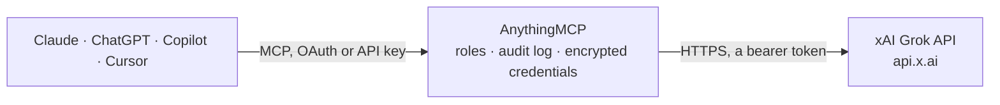

<!-- Generated by scripts/export-github-catalog.mjs in the anythingmcp-website repository. Do not edit by hand. -->

# xAI Grok MCP connector

Let your AI ask Grok with your own xAI API key: answers from Grok models, answers grounded in live web or X search with sources, long answers in the background, and pictures generated or edited with … The AnythingMCP connector gives Claude, ChatGPT, Microsoft Copilot, Cursor and Gemini 14 MCP tools for xAI Grok: 10 read and 4 can change data.

**Category:** [Public Data](../data.md) · **Tools:** 14 · **Setup guide:** [anythingmcp.com](https://anythingmcp.com/guides/xai-to-mcp) · [Deutsch](https://anythingmcp.com/de/guides/xai-to-mcp) · [Italiano](https://anythingmcp.com/it/guides/xai-to-mcp) · [Español](https://anythingmcp.com/es/guides/xai-to-mcp) · [日本語](https://anythingmcp.com/ja/guides/xai-to-mcp) · [Русский](https://anythingmcp.com/ru/guides/xai-to-mcp) · [中文](https://anythingmcp.com/zh/guides/xai-to-mcp)

## Start without code

No installation and no terminal: AnythingMCP Cloud runs the xAI Grok connector for you, operated by helpcode.ai in Frankfurt, Germany.

1. **Click the button above** and create an account or sign in. The xAI Grok connector opens, ready to install.
2. **Paste the API key or token from your xAI Grok account.** Every click is in the [step-by-step guide](https://anythingmcp.com/guides/xai-to-mcp).
3. **Click Install.** AnythingMCP shows the address of your MCP server.
4. **Add that address to your assistant:** [Claude](https://anythingmcp.com/guides/connect-xai-to-claude) · [ChatGPT](https://anythingmcp.com/guides/connect-xai-to-chatgpt) · [Microsoft Copilot](https://anythingmcp.com/guides/connect-xai-to-copilot) · [Cursor](https://anythingmcp.com/guides/connect-xai-to-cursor) · [Gemini CLI](https://anythingmcp.com/guides/connect-xai-to-gemini) · [Meta Muse](https://anythingmcp.com/guides/connect-xai-to-muse).
5. **Ask your first question**, for example: *Show the stored Grok response rsp_84217 about invoice INV-2026-042 for Kestrel GmbH dated 2026-08-11*

Prefer help with the setup? [Talk to us](https://anythingmcp.com/contact).

## How it works

- **The AI client** speaks MCP (Streamable HTTP) to AnythingMCP and only sees tool names, descriptions and results. It never gets the xAI Grok credentials.
- **AnythingMCP** checks the client's role, builds the call from the tool definition, adds the credentials (a bearer token), calls xAI Grok, logs the call and returns the result.
- **xAI Grok** sees an ordinary API client with the rights of the account the credentials belong to.

## Tools

| Tool | What it does | Access |
|---|---|---|
| [`xai_list_language_models`](#xai_list_language_models) | List the Grok language models the API key can use, with id, aliases, input and output modalities, and prices. | read |
| [`xai_list_models`](#xai_list_models) | List every model id the xAI API key can use (language, image and video models) with owner and creation time. | read |
| [`xai_list_image_models`](#xai_list_image_models) | List the Grok Imagine image models the key can use, with id, aliases, maximum prompt length and price per image (pricing lists price_per_image by quality… | read |
| [`xai_create_response`](#xai_create_response) | Ask Grok and get its answer through xAI's Responses API, the API xAI recommends. | read |
| [`xai_web_search`](#xai_web_search) | Ask Grok a question it answers by searching the web itself (Responses API with the web_search server-side tool; the old Live Search search_parameters are… | read |
| [`xai_x_search`](#xai_x_search) | Ask Grok a question it answers by searching posts on X (Responses API with the x_search server-side tool), optionally limited to some handles and a date range. | read |
| [`xai_get_response`](#xai_get_response) | Get a stored xAI response by id (one created with store true), with output_text, citations, status and usage. | read |
| [`xai_delete_response`](#xai_delete_response) | Delete a stored xAI response, so it can no longer be read or continued. | write |
| [`xai_start_deferred_completion`](#xai_start_deferred_completion) | Start a long Grok answer in the background (deferred chat completion) and get a request_id at once, for questions that may take longer than 30 seconds, e.g.… | write |
| [`xai_get_deferred_completion`](#xai_get_deferred_completion) | Fetch the result of a deferred Grok answer started with xai_start_deferred_completion. | read |
| [`xai_generate_image`](#xai_generate_image) | Create pictures from a text description with Grok Imagine and return them as images the user can see. | write |
| [`xai_edit_image`](#xai_edit_image) | Change a picture with Grok Imagine from a text instruction (e.g. 'make the sky stormy', 'remove the car') and return the result as an image the user can see. | write |
| [`xai_tokenize_text`](#xai_tokenize_text) | Count the tokens a text uses with a Grok model's tokenizer, and list them, e.g. to estimate the cost of a long prompt. | read |
| [`xai_get_api_key_info`](#xai_get_api_key_info) | Get the details of the xAI API key in use: redacted key, name, team id, permissions (acls) and whether the key or the team is blocked or disabled. | read |

## Tool reference

Every parameter as the AI client sees it in `tools/list`. Source: [`packages/backend/src/adapters/intl/xai.json`](../../../packages/backend/src/adapters/intl/xai.json).

### `xai_list_language_models`

List the Grok language models the API key can use, with id, aliases, input and output modalities, and prices. Prices are in US cents per 100 million tokens: divide by 10,000 for dollars per million tokens (12500 means $1.25). Free. Read-only.

**Access:** read · **Call:** `GET /language-models`

No parameters.

### `xai_list_models`

List every model id the xAI API key can use (language, image and video models) with owner and creation time. For prices use xai_list_language_models or xai_list_image_models. Free. Read-only.

**Access:** read · **Call:** `GET /models`

No parameters.

### `xai_list_image_models`

List the Grok Imagine image models the key can use, with id, aliases, maximum prompt length and price per image (pricing lists price_per_image by quality and resolution in ticks: 10,000,000,000 ticks are one US dollar). Free. Read-only.

**Access:** read · **Call:** `GET /image-generation-models`

No parameters.

### `xai_create_response`

Ask Grok and get its answer through xAI's Responses API, the API xAI recommends. input is a prompt string or a list of items (images by public link, earlier turns). Billed per token to the user's xAI credits; the default grok-4.3 is xAI's cheapest general model. Returns output_text, citations (when tools searched), status (incomplete means cut) and usage with cost_in_usd_ticks (10,000,000,000 ticks are one US dollar). Read-only: nothing is stored unless store is true.

**Access:** read · **Call:** `POST /responses`

| Parameter | Type | Required | Description |
|---|---|---|---|
| `input` | string,array | yes | The prompt as text, or a list of input items, e.g. [{"role": "user", "content": [{"type": "input_text", "text": "What is in this picture?"}, {"type": "input_image", "image_url": "https://..."}]}] for images by public link, or earlier turns for a conversation. |
| `model` | string | no | Model id. Default grok-4.3 (about $1.25 per million input and $2.50 per million output tokens, 1M context, reasoning effort low by default). grok-4.7 is the flagship ($2 and $6). Others: xai_list_language_models. |
| `instructions` | string | no | System instructions: role, tone, language, format. Cannot be combined with previous_response_id. |
| `max_output_tokens` | integer | no | Upper limit for the visible answer in tokens. |
| `reasoning` | object | no | Reasoning settings, e.g. {"effort": "low"} (none, low, medium, high, xhigh on models that support it). Lower is faster and cheaper. |
| `previous_response_id` | string | no | id of an earlier stored response to continue that conversation without resending it. |
| `store` | boolean | no | Keep the request and answer at xAI for 30 days so previous_response_id can continue it. Default false here. |
| `temperature` | number | no | Randomness from 0 to 2. Model default when left out. |
| `text` | object | no | Output format, e.g. {"format": {"type": "json_schema", "name": "invoice", "schema": {...}}} or {"format": {"type": "json_object"}}. |
| `tools` | any[] | no | Server-side tools xAI runs itself, each billed per call or per item on top of tokens: [{"type": "web_search"}], [{"type": "x_search"}], [{"type": "code_interpreter"}]. For searching, xai_web_search and xai_x_search are simpler. Leave out for a plain answer. |

### `xai_web_search`

Ask Grok a question it answers by searching the web itself (Responses API with the web_search server-side tool; the old Live Search search_parameters are not used). Billed to the user's xAI credits: tokens plus about $5 per 1,000 web searches, and one question can run several searches. Returns output_text, citations (source URLs) and usage with num_sources_used and cost_in_usd_ticks. Read-only.

**Access:** read · **Call:** `POST /responses`

| Parameter | Type | Required | Description |
|---|---|---|---|
| `input` | string | yes | The question, as the user would write it. |
| `model` | string | no | Model id. Default grok-4.3 (about $1.25 per million input and $2.50 per million output tokens, 1M context, reasoning effort low by default). grok-4.7 is the flagship ($2 and $6). Others: xai_list_language_models. |
| `instructions` | string | no | System instructions: role, tone, language, format. Cannot be combined with previous_response_id. |
| `max_output_tokens` | integer | no | Upper limit for the visible answer in tokens. |
| `reasoning` | object | no | Reasoning settings, e.g. {"effort": "low"} (none, low, medium, high, xhigh on models that support it). Lower is faster and cheaper. |
| `allowed_domains` | string[] | no | Search only these sites, up to 5 domains without protocol, e.g. ["europa.eu"]. Not together with excluded_domains. |
| `excluded_domains` | string[] | no | Never use these sites, up to 5 domains. Not together with allowed_domains. |
| `enable_image_understanding` | boolean | no | Let Grok look at images on the pages it reads (more tokens). |

### `xai_x_search`

Ask Grok a question it answers by searching posts on X (Responses API with the x_search server-side tool), optionally limited to some handles and a date range. Billed to the user's xAI credits: tokens plus about $5 per 1,000 posts and $10 per 1,000 profiles fetched. Returns output_text, citations (post URLs) and usage with cost_in_usd_ticks. Read-only.

**Access:** read · **Call:** `POST /responses`

| Parameter | Type | Required | Description |
|---|---|---|---|
| `input` | string | yes | The question, e.g. 'What are people on X saying about the new EU AI rules this week?'. |
| `model` | string | no | Model id. Default grok-4.3 (about $1.25 per million input and $2.50 per million output tokens, 1M context, reasoning effort low by default). grok-4.7 is the flagship ($2 and $6). Others: xai_list_language_models. |
| `instructions` | string | no | System instructions: role, tone, language, format. Cannot be combined with previous_response_id. |
| `max_output_tokens` | integer | no | Upper limit for the visible answer in tokens. |
| `reasoning` | object | no | Reasoning settings, e.g. {"effort": "low"} (none, low, medium, high, xhigh on models that support it). Lower is faster and cheaper. |
| `allowed_x_handles` | string[] | no | Only posts from these X handles, without @, up to 10. Not together with excluded_x_handles. |
| `excluded_x_handles` | string[] | no | Never posts from these handles, up to 10. |
| `from_date` | string | no | Only posts from this day on, YYYY-MM-DD. |
| `to_date` | string | no | Only posts before this day, YYYY-MM-DD. |
| `enable_image_understanding` | boolean | no | Let Grok look at images in posts (more tokens). |
| `enable_video_understanding` | boolean | no | Let Grok watch videos in posts (more tokens). |

### `xai_get_response`

Get a stored xAI response by id (one created with store true), with output_text, citations, status and usage. Free. Read-only.

**Access:** read · **Call:** `GET /responses/{response_id}`

| Parameter | Type | Required | Description |
|---|---|---|---|
| `response_id` | string | yes | The id of the response. |

### `xai_delete_response`

Delete a stored xAI response, so it can no longer be read or continued. It cannot be restored, and an application that stored it may still need it. Confirm with the user first. Installed switched off.

**Access:** write · **Call:** `DELETE /responses/{response_id}`

| Parameter | Type | Required | Description |
|---|---|---|---|
| `response_id` | string | yes | The id of the response. |

### `xai_start_deferred_completion`

Start a long Grok answer in the background (deferred chat completion) and get a request_id at once, for questions that may take longer than 30 seconds, e.g. with high reasoning effort. Billed per token to the user's xAI credits like a normal answer. Then call xai_get_deferred_completion every 10 to 30 seconds; the result can be fetched once, within 24 hours.

**Access:** write · **Call:** `POST /chat/completions`

| Parameter | Type | Required | Description |
|---|---|---|---|
| `messages` | object[] | yes | The conversation, e.g. [{"role": "system", "content": "Be concise."}, {"role": "user", "content": "..."}]. |
| `model` | string | no | Model id. Default grok-4.3 (about $1.25 per million input and $2.50 per million output tokens, 1M context, reasoning effort low by default). grok-4.7 is the flagship ($2 and $6). Others: xai_list_language_models. |
| `max_completion_tokens` | integer | no | Upper limit for the answer in tokens, reasoning included. |
| `reasoning_effort` | `none` \| `low` \| `medium` \| `high` \| `xhigh` | no | How much the model thinks first, on models that support it. |
| `temperature` | number | no | Randomness from 0 to 2. |

### `xai_get_deferred_completion`

Fetch the result of a deferred Grok answer started with xai_start_deferred_completion. While it is still running the result is pending true: call again in 10 to 30 seconds. Once done it returns answer, finish_reason and usage, and the result is gone afterwards (it can be fetched once, within 24 hours). Free. Read-only.

**Access:** read · **Call:** `GET /chat/deferred-completion/{request_id}`

| Parameter | Type | Required | Description |
|---|---|---|---|
| `request_id` | string | yes | The request_id from xai_start_deferred_completion. |

### `xai_generate_image`

Create pictures from a text description with Grok Imagine and return them as images the user can see. COSTS MONEY, billed to the user's xAI credits per picture: the default grok-imagine-image about $0.02, grok-imagine-image-2.0 about $0.04. Confirm with the user before calling, and before calling it again; keep n at 1 unless they ask for more.

**Access:** write · **Call:** `POST /images/generations`

| Parameter | Type | Required | Description |
|---|---|---|---|
| `prompt` | string | yes | A full description of the picture: subject, setting, style, lighting, any text to show. |
| `model` | string | no | Image model. Default grok-imagine-image (cheapest); grok-imagine-image-2.0 for higher quality. See xai_list_image_models. |
| `n` | integer | no | Number of pictures, 1 to 4 (each one is billed). Default 1. |
| `aspect_ratio` | `1:1` \| `3:4` \| `4:3` \| `9:16` \| `16:9` \| `2:3` \| `3:2` \| `9:19.5` \| `19.5:9` \| `9:20` \| `20:9` \| `1:2` \| `2:1` \| `21:9` \| `5:2` \| `auto` | no | Shape of the picture. Default auto. |
| `resolution` | `1k` \| `1.5k` \| `2k` | no | 1k (default), 1.5k or 2k. Larger pictures may exceed the 4 MB that can be shown in the chat. |

### `xai_edit_image`

Change a picture with Grok Imagine from a text instruction (e.g. 'make the sky stormy', 'remove the car') and return the result as an image the user can see. The source picture is given by public link. COSTS MONEY, billed to the user's xAI credits per output picture (about $0.02 with grok-imagine-image). Confirm with the user before calling.

**Access:** write · **Call:** `POST /images/edits`

| Parameter | Type | Required | Description |
|---|---|---|---|
| `prompt` | string | yes | What to change. |
| `image_url` | string | yes | Public HTTPS link (or a base64 data URL) of the JPEG, PNG or WebP picture to edit. |
| `model` | string | no | Image model. Default grok-imagine-image. |
| `n` | integer | no | Number of variants, 1 to 4 (each one is billed). Default 1. |
| `resolution` | `1k` \| `1.5k` \| `2k` | no | Output resolution. Default 1k. |

### `xai_tokenize_text`

Count the tokens a text uses with a Grok model's tokenizer, and list them, e.g. to estimate the cost of a long prompt. Free. Read-only.

**Access:** read · **Call:** `POST /tokenize-text`

| Parameter | Type | Required | Description |
|---|---|---|---|
| `text` | string | yes | The text to tokenize. |
| `model` | string | no | Model whose tokenizer to use. Default grok-4.3. |

### `xai_get_api_key_info`

Get the details of the xAI API key in use: redacted key, name, team id, permissions (acls) and whether the key or the team is blocked or disabled. Free; also a quick check that the key works. Read-only.

**Access:** read · **Call:** `GET /api-key`

No parameters.

## Run it yourself

AnythingMCP is open source (AGPL-3.0). [Run it with Docker](../../../README.md#run-it-yourself), open **Connectors → Store**, pick **xAI Grok** and enter `XAI_API_KEY`, then add your MCP server URL to the AI client.

[← Public Data connectors](../data.md) · [All categories](../README.md)
