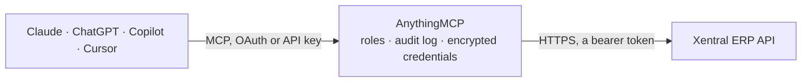

<!-- Generated by scripts/export-github-catalog.mjs in the anythingmcp-website repository. Do not edit by hand. -->

# Xentral ERP MCP connector

Connect Xentral ERP to your AI: search products and stock per warehouse and storage location, customers and suppliers, sales orders, delivery notes with tracking, invoices with payment status, credit … The AnythingMCP connector gives Claude, ChatGPT, Microsoft Copilot, Cursor and Gemini 30 MCP tools for Xentral ERP: 28 read and 2 can change data.

**Category:** [ERP](../erp.md) · **Tools:** 30 · **Setup guide:** [anythingmcp.com](https://anythingmcp.com/guides/xentral-to-mcp) · [Deutsch](https://anythingmcp.com/de/guides/xentral-to-mcp) · [Italiano](https://anythingmcp.com/it/guides/xentral-to-mcp) · [Español](https://anythingmcp.com/es/guides/xentral-to-mcp) · [日本語](https://anythingmcp.com/ja/guides/xentral-to-mcp) · [Русский](https://anythingmcp.com/ru/guides/xentral-to-mcp) · [中文](https://anythingmcp.com/zh/guides/xentral-to-mcp)

## Start without code

No installation and no terminal: AnythingMCP Cloud runs the Xentral ERP connector for you, operated by helpcode.ai in Frankfurt, Germany.

1. **Click the button above** and create an account or sign in. The Xentral ERP connector opens, ready to install.
2. **Paste the API key or token from your Xentral ERP account.** Every click is in the [step-by-step guide](https://anythingmcp.com/guides/xentral-to-mcp).
3. **Click Install.** AnythingMCP shows the address of your MCP server.
4. **Add that address to your assistant:** [Claude](https://anythingmcp.com/guides/connect-xentral-to-claude) · [ChatGPT](https://anythingmcp.com/guides/connect-xentral-to-chatgpt) · [Microsoft Copilot](https://anythingmcp.com/guides/connect-xentral-to-copilot) · [Cursor](https://anythingmcp.com/guides/connect-xentral-to-cursor) · [Gemini CLI](https://anythingmcp.com/guides/connect-xentral-to-gemini) · [Meta Muse](https://anythingmcp.com/guides/connect-xentral-to-muse).
5. **Ask your first question**, for example: *Show invoice INV-2026-089 for Kunde Heizprofi GmbH and its payment status*

Prefer help with the setup? [Talk to us](https://anythingmcp.com/contact).

## How it works

- **The AI client** speaks MCP (Streamable HTTP) to AnythingMCP and only sees tool names, descriptions and results. It never gets the Xentral ERP credentials.
- **AnythingMCP** checks the client's role, builds the call from the tool definition, adds the credentials (a bearer token), calls Xentral ERP, logs the call and returns the result.
- **Xentral ERP** sees an ordinary API client with the rights of the account the credentials belong to.

## Tools

| Tool | What it does | Access |
|---|---|---|
| [`xentral_list_products`](#xentral_list_products) | List or search products (Artikel) in Xentral: product number, name, EAN, manufacturer, prices and stock counts. | read |
| [`xentral_get_product`](#xentral_get_product) | Get one product by its Xentral id: number, name, descriptions, EAN, unit, prices, measurements, customs data, category and stock settings. | read |
| [`xentral_get_product_stock`](#xentral_get_product_stock) | Stock of one product: totals (physical, sellable, reserved, open sales order quantity, calculated, producible) and the same figures per warehouse and per… | read |
| [`xentral_list_product_storage_locations`](#xentral_list_product_storage_locations) | Where one product is stored: each storage location (Lagerplatz) that holds it, with its warehouse and the quantity there. | read |
| [`xentral_list_warehouses`](#xentral_list_warehouses) | List the active warehouses (Lager) with their id and designation. | read |
| [`xentral_list_storage_locations`](#xentral_list_storage_locations) | List the storage locations (Lagerplaetze: shelves, bins, pallet spaces) of one warehouse. | read |
| [`xentral_list_storage_location_items`](#xentral_list_storage_location_items) | What lies in one storage location: each product with its quantity, plus batch, serial number and best-before data where tracked. | read |
| [`xentral_list_customers`](#xentral_list_customers) | List customers (Kunden) with customer number, name, type, address, email and phone. | read |
| [`xentral_get_customer`](#xentral_get_customer) | Get one customer by Xentral id: master data, contact details, payment and delivery terms, tax and credit settings. | read |
| [`xentral_list_customer_addresses`](#xentral_list_customer_addresses) | List the addresses of one customer: the master address (type masterdata), the billing address (billingaddress) and every delivery address (deliveryaddress). | read |
| [`xentral_list_suppliers`](#xentral_list_suppliers) | List suppliers (Lieferanten) with supplier number, name, address and contact details. | read |
| [`xentral_get_supplier`](#xentral_get_supplier) | Get one supplier by Xentral id: address, contact details, bank and tax data, payment terms. | read |
| [`xentral_list_sales_orders`](#xentral_list_sales_orders) | List sales orders (Auftraege) with number, date, status, customer, totals and payment method. | read |
| [`xentral_get_sales_order`](#xentral_get_sales_order) | Get one sales order by Xentral id with its line items (product, quantity, price, delivery date), addresses, totals, payment and shipping details. | read |
| [`xentral_list_delivery_notes`](#xentral_list_delivery_notes) | List delivery notes (Lieferscheine) with number, date, status, customer, related sales order and invoice. | read |
| [`xentral_get_delivery_note`](#xentral_get_delivery_note) | Get one delivery note by Xentral id with its line items, delivery address and links to the sales order and invoice. | read |
| [`xentral_list_delivery_note_shipments`](#xentral_list_delivery_note_shipments) | Shipments of one delivery note: carrier and shipping method, tracking number and link, ship date and extra packages. | read |
| [`xentral_list_invoices`](#xentral_list_invoices) | List outgoing invoices (Rechnungen) with number, date, status, payment status, customer, totals and dunning level. | read |
| [`xentral_get_invoice`](#xentral_get_invoice) | Get one invoice by Xentral id with its line items, billing address, totals, tax, payment terms, payment status and dunning settings. | read |
| [`xentral_get_invoice_balance`](#xentral_get_invoice_balance) | Payment balance of one invoice: the payments booked against it (date, amount, method) and the related documents, to tell how much is still open. | read |
| [`xentral_list_credit_notes`](#xentral_list_credit_notes) | List credit notes (Gutschriften) with number, date, status, payment status, customer, totals and the invoice they refer to. | read |
| [`xentral_get_credit_note`](#xentral_get_credit_note) | Get one credit note by Xentral id with its line items, address, totals and the invoice it corrects. | read |
| [`xentral_get_credit_note_balance`](#xentral_get_credit_note_balance) | Payment balance of one credit note: refunds or offsets booked against it and the related documents. | read |
| [`xentral_list_purchase_orders`](#xentral_list_purchase_orders) | List purchase orders (Bestellungen) to suppliers with number, date, status, supplier, confirmed and desired delivery dates and totals. | read |
| [`xentral_get_purchase_order`](#xentral_get_purchase_order) | Get one purchase order by Xentral id with its line items (product, supplier product number, quantity, price, delivery date), supplier address and totals. | read |
| [`xentral_list_liabilities`](#xentral_list_liabilities) | List liabilities (Verbindlichkeiten, incoming supplier invoices) with supplier, amounts, due date, status and payment state. | read |
| [`xentral_list_payment_methods`](#xentral_list_payment_methods) | List the payment methods (Zahlungsweisen) configured in Xentral with id, name and type, e.g. Rechnung, Vorkasse, PayPal, Lastschrift. | read |
| [`xentral_list_projects`](#xentral_list_projects) | List the projects (Projekte) of the Xentral instance with id, name and short name. | read |
| [`xentral_create_sales_order`](#xentral_create_sales_order) | Create a sales order as a draft (status draft, no order number yet) for an existing customer. | write |
| [`xentral_delete_sales_order_draft`](#xentral_delete_sales_order_draft) | Delete a sales order that is still a draft, e.g. one created by mistake with xentral_create_sales_order. | write |

## Tool reference

Every parameter as the AI client sees it in `tools/list`. Source: [`packages/backend/src/adapters/de/xentral.json`](../../../packages/backend/src/adapters/de/xentral.json).

### `xentral_list_products`

List or search products (Artikel) in Xentral: product number, name, EAN, manufacturer, prices and stock counts. Filter by product number, name, EAN, manufacturer, category, project or supplier. Use xentral_get_product_stock for per-warehouse stock.

**Access:** read · **Call:** `GET /api/v2/products`

| Parameter | Type | Required | Description |
|---|---|---|---|
| `filter` | object[] | no | Filter conditions, all of which must match. Examples: [{"key": "number", "op": "equals", "value": "700123"}], [{"key": "name", "op": "contains", "value": "Schraube"}], [{"key": "ean", "op": "equals", "value": "4006381333931"}]. updatedAt takes an ISO 8601 date-time with offset, e.g. 2026-10-01T00:00:00+02:00. |
| `order` | object[] | no | Sort order, most important first, e.g. [{"field": "name", "dir": "asc"}]. |
| `page` | integer | no | Page number, starting at 1. |
| `pageSize` | integer | no | Results per page, 10 to 50. |

### `xentral_get_product`

Get one product by its Xentral id: number, name, descriptions, EAN, unit, prices, measurements, customs data, category and stock settings.

**Access:** read · **Call:** `GET /api/v2/products/{id}`

| Parameter | Type | Required | Description |
|---|---|---|---|
| `id` | string | yes | Xentral product id (the id field from xentral_list_products, not the product number). |

### `xentral_get_product_stock`

Stock of one product: totals (physical, sellable, reserved, open sales order quantity, calculated, producible) and the same figures per warehouse and per sales channel. sellable is what can still be promised to customers.

**Access:** read · **Call:** `GET /api/v1/products/{id}/stocks`

| Parameter | Type | Required | Description |
|---|---|---|---|
| `id` | string | yes | Xentral product id. |

### `xentral_list_product_storage_locations`

Where one product is stored: each storage location (Lagerplatz) that holds it, with its warehouse and the quantity there.

**Access:** read · **Call:** `GET /api/v1/products/{id}/storageLocations`

| Parameter | Type | Required | Description |
|---|---|---|---|
| `id` | string | yes | Xentral product id. |
| `order` | object[] | no | Sort order, most important first, e.g. [{"field": "name", "dir": "asc"}]. |
| `page` | integer | no | Page number, starting at 1. |
| `pageSize` | integer | no | Results per page, 10 to 50. |

### `xentral_list_warehouses`

List the active warehouses (Lager) with their id and designation. The ids are what xentral_list_storage_locations needs.

**Access:** read · **Call:** `GET /api/v1/warehouses`

| Parameter | Type | Required | Description |
|---|---|---|---|
| `filter` | object[] | no | Optional, e.g. [{"key": "designation", "op": "equals", "value": "Hauptlager"}]. |
| `page` | integer | no | Page number, starting at 1. |
| `pageSize` | integer | no | Results per page, 10 to 50. |

### `xentral_list_storage_locations`

List the storage locations (Lagerplaetze: shelves, bins, pallet spaces) of one warehouse.

**Access:** read · **Call:** `GET /api/v1/warehouses/{warehouseId}/storageLocations`

| Parameter | Type | Required | Description |
|---|---|---|---|
| `warehouseId` | string | yes | Warehouse id from xentral_list_warehouses. |
| `filter` | object[] | no | Optional, e.g. [{"key": "designation", "op": "startsWith", "value": "A-01"}]. |
| `page` | integer | no | Page number, starting at 1. |
| `pageSize` | integer | no | Results per page, 10 to 50. |

### `xentral_list_storage_location_items`

What lies in one storage location: each product with its quantity, plus batch, serial number and best-before data where tracked.

**Access:** read · **Call:** `GET /api/v2/warehouses/{warehouseId}/storageLocations/{storageLocationId}/items`

| Parameter | Type | Required | Description |
|---|---|---|---|
| `warehouseId` | string | yes | Warehouse id. |
| `storageLocationId` | string | yes | Storage location id from xentral_list_storage_locations. |

### `xentral_list_customers`

List customers (Kunden) with customer number, name, type, address, email and phone. Filters match exactly: Xentral's customer list has no partial-name search, so to find a customer by part of the name search their documents (xentral_list_invoices or xentral_list_sales_orders with search) and take address.id from there.

**Access:** read · **Call:** `GET /api/v2/customers`

| Parameter | Type | Required | Description |
|---|---|---|---|
| `filter` | object[] | no | Exact-match conditions, all of which must match. Examples: [{"key": "number", "op": "equals", "value": "10001"}], [{"key": "email", "op": "equals", "value": "einkauf@beispiel.de"}], [{"key": "city", "op": "equals", "value": "Freiburg"}]. |
| `page` | integer | no | Page number, starting at 1. |
| `pageSize` | integer | no | Results per page, 10 to 50. |

### `xentral_get_customer`

Get one customer by Xentral id: master data, contact details, payment and delivery terms, tax and credit settings. The id is also the address id that documents and xentral_create_sales_order use.

**Access:** read · **Call:** `GET /api/v2/customers/{id}`

| Parameter | Type | Required | Description |
|---|---|---|---|
| `id` | string | yes | Xentral customer id (not the customer number). |

### `xentral_list_customer_addresses`

List the addresses of one customer: the master address (type masterdata), the billing address (billingaddress) and every delivery address (deliveryaddress).

**Access:** read · **Call:** `GET /api/v2/customers/{customerId}/addresses`

| Parameter | Type | Required | Description |
|---|---|---|---|
| `customerId` | string | yes | Xentral customer id. |
| `page` | integer | no | Page number, starting at 1. |
| `pageSize` | integer | no | Results per page, 10 to 50. |

### `xentral_list_suppliers`

List suppliers (Lieferanten) with supplier number, name, address and contact details. Filter by number, name, city, country, VAT number or tag.

**Access:** read · **Call:** `GET /api/v1/suppliers`

| Parameter | Type | Required | Description |
|---|---|---|---|
| `filter` | object[] | no | Conditions, all of which must match. Examples: [{"key": "name", "op": "contains", "value": "Wuerth"}], [{"key": "number", "op": "equals", "value": "70001"}]. |
| `order` | object[] | no | Sort order, most important first, e.g. [{"field": "name", "dir": "asc"}]. |
| `page` | integer | no | Page number, starting at 1. |
| `pageSize` | integer | no | Results per page, 10 to 50. |

### `xentral_get_supplier`

Get one supplier by Xentral id: address, contact details, bank and tax data, payment terms.

**Access:** read · **Call:** `GET /api/v1/suppliers/{id}`

| Parameter | Type | Required | Description |
|---|---|---|---|
| `id` | string | yes | Xentral supplier id. |

### `xentral_list_sales_orders`

List sales orders (Auftraege) with number, date, status, customer, totals and payment method. Search by order or customer number, customer name or a shop order number, or filter by status, date range, customer or product. Add include=lineItems for the positions.

**Access:** read · **Call:** `GET /api/v3/salesOrders`

| Parameter | Type | Required | Description |
|---|---|---|---|
| `search` | string | no | Free text over order number, date, customer name, email, ZIP, customer number, customer order number, external order number and id, transaction number and internal designation. |
| `filter` | object[] | no | Conditions, all of which must match. status is draft, released, completed or cancelled. Examples: [{"key": "status", "op": "equals", "value": "released"}], [{"key": "customerNumber", "op": "equals", "value": "10001"}], [{"key": "documentDate", "op": "greaterThanOrEquals", "value": "2026-10-01"}]. Dates are YYYY-MM-DD. |
| `sort` | string | no | Comma-separated sort fields; a leading minus sorts descending, e.g. -documentDate. Allowed: id, documentNumber, documentDate, customerNumber, documentAddress.country, project.id, createdAt, updatedAt. |
| `include` | string | no | Comma-separated related data to embed, e.g. lineItems,address. Allowed: lineItems, project, address, lineItems.product, lineItems.product.salesPrices, lineItems.product.customFields, tags, activity, customFields, lineItems.customFields, trafficLights, relatedDocuments, files. |
| `page` | integer | no | Page number, starting at 1. |
| `perPage` | integer | no | Results per page (Xentral default 15, maximum 1000). |
| `pagination` | `simple` \| `table` | no | simple (default) is fastest; table also returns the total number of matches (meta.total) at the cost of a count query. |

### `xentral_get_sales_order`

Get one sales order by Xentral id with its line items (product, quantity, price, delivery date), addresses, totals, payment and shipping details. include=trafficLights adds the dispatch checks (payment, stock, address, credit limit) that decide whether the order can ship.

**Access:** read · **Call:** `GET /api/v3/salesOrders/{id}`

| Parameter | Type | Required | Description |
|---|---|---|---|
| `id` | string | yes | Xentral sales order id (the id field, not the order number). |
| `include` | string | no | Comma-separated related data to embed. Allowed: lineItems, project, address, lineItems.product, lineItems.product.salesPrices, lineItems.product.customFields, tags, activity, customFields, lineItems.customFields, trafficLights, printDetails, relatedDocuments, files. |

### `xentral_list_delivery_notes`

List delivery notes (Lieferscheine) with number, date, status, customer, related sales order and invoice. Filter by sales order, customer, date or status, e.g. to see what was shipped for an order.

**Access:** read · **Call:** `GET /api/v3/deliveryNotes`

| Parameter | Type | Required | Description |
|---|---|---|---|
| `search` | string | no | Free text over delivery note number, date, customer name, email, ZIP, customer number, customer order number and internal designation. |
| `filter` | object[] | no | Conditions, all of which must match. status is draft, released, sent, completed or cancelled. Examples: [{"key": "salesOrder.id", "op": "equals", "value": "4711"}], [{"key": "documentDate", "op": "greaterThanOrEquals", "value": "2026-10-01"}]. Dates are YYYY-MM-DD. |
| `sort` | string | no | Comma-separated sort fields; a leading minus sorts descending, e.g. -documentDate. Allowed: id, documentNumber, documentDate, customerNumber, documentAddress.country, project.id, createdAt, updatedAt. |
| `include` | string | no | Comma-separated related data to embed, e.g. lineItems,address. Allowed: lineItems, project, address, lineItems.product, lineItems.product.salesPrices, lineItems.product.customFields, tags, activity, customFields, lineItems.customFields, lineItems.stockMovements, relatedDocuments, files. |
| `page` | integer | no | Page number, starting at 1. |
| `perPage` | integer | no | Results per page (Xentral default 15, maximum 1000). |
| `pagination` | `simple` \| `table` | no | simple (default) is fastest; table also returns the total number of matches (meta.total) at the cost of a count query. |

### `xentral_get_delivery_note`

Get one delivery note by Xentral id with its line items, delivery address and links to the sales order and invoice. include=lineItems.stockMovements shows from which storage locations the goods were taken.

**Access:** read · **Call:** `GET /api/v3/deliveryNotes/{id}`

| Parameter | Type | Required | Description |
|---|---|---|---|
| `id` | string | yes | Xentral delivery note id. |
| `include` | string | no | Comma-separated related data to embed. Allowed: lineItems, project, address, lineItems.product, lineItems.product.salesPrices, lineItems.product.customFields, tags, activity, customFields, lineItems.customFields, lineItems.stockMovements, relatedDocuments, files. |

### `xentral_list_delivery_note_shipments`

Shipments of one delivery note: carrier and shipping method, tracking number and link, ship date and extra packages. Use it to answer where a parcel is.

**Access:** read · **Call:** `GET /api/v1/deliveryNotes/{id}/shipments`

| Parameter | Type | Required | Description |
|---|---|---|---|
| `id` | string | yes | Xentral delivery note id. |

### `xentral_list_invoices`

List outgoing invoices (Rechnungen) with number, date, status, payment status, customer, totals and dunning level. Filter open invoices by paymentStatus, or by customer, date range, amount or sales order. Use xentral_get_invoice_balance for the payments booked against one invoice.

**Access:** read · **Call:** `GET /api/v3/invoices`

| Parameter | Type | Required | Description |
|---|---|---|---|
| `search` | string | no | Free text over invoice number, date, customer name, email, ZIP, customer number, customer order number and internal designation. |
| `filter` | object[] | no | Conditions, all of which must match. status is draft, released, sent, completed, cancelled or partiallyCancelled; paymentStatus is pending, paid, partiallyPaid, cancelled, partiallyCancelled, badDebt or debited. Open invoices: [{"key": "paymentStatus", "op": "in", "value": ["pending", "partiallyPaid"]}]. Invoices of one customer this year: [{"key": "customerNumber", "op": "equals", "value": "10001"}, {"key": "documentDate", "op": "greaterThanOrEquals", "value": "2026-01-01"}]. Dates are YYYY-MM-DD. |
| `sort` | string | no | Comma-separated sort fields; a leading minus sorts descending, e.g. -documentDate. Allowed: id, documentNumber, documentDate, createdAt, updatedAt, customerNumber, documentAddress.name, documentAddress.country, project.id, totals.gross.amount, totals.gross.currency, financials.paymentMethod.id, paymentStatus. |
| `include` | string | no | Comma-separated related data to embed, e.g. lineItems,address. Allowed: address, lineItems, customFields, lineItems.customFields, lineItems.product, lineItems.product.salesPrices, lineItems.product.customFields, project, tags, activity, relatedDocuments, files. |
| `page` | integer | no | Page number, starting at 1. |
| `perPage` | integer | no | Results per page (Xentral default 15, maximum 1000). |
| `pagination` | `simple` \| `table` | no | simple (default) is fastest; table also returns the total number of matches (meta.total) at the cost of a count query. |

### `xentral_get_invoice`

Get one invoice by Xentral id with its line items, billing address, totals, tax, payment terms, payment status and dunning settings.

**Access:** read · **Call:** `GET /api/v3/invoices/{id}`

| Parameter | Type | Required | Description |
|---|---|---|---|
| `id` | string | yes | Xentral invoice id (the id field, not the invoice number). |
| `include` | string | no | Comma-separated related data to embed. Allowed: address, lineItems, customFields, lineItems.customFields, lineItems.product, lineItems.product.salesPrices, lineItems.product.customFields, project, tags, activity, relatedDocuments, files. |

### `xentral_get_invoice_balance`

Payment balance of one invoice: the payments booked against it (date, amount, method) and the related documents, to tell how much is still open.

**Access:** read · **Call:** `GET /api/v1/invoices/{id}/balance`

| Parameter | Type | Required | Description |
|---|---|---|---|
| `id` | string | yes | Xentral invoice id. |

### `xentral_list_credit_notes`

List credit notes (Gutschriften) with number, date, status, payment status, customer, totals and the invoice they refer to. Filter by customer, invoice, date or payment status.

**Access:** read · **Call:** `GET /api/v3/creditNotes`

| Parameter | Type | Required | Description |
|---|---|---|---|
| `search` | string | no | Free text over credit note number, date, customer name, email, ZIP, customer number, customer order number and internal designation. |
| `filter` | object[] | no | Conditions, all of which must match. paymentStatus is pending, paid, partiallyPaid, cancelled, partiallyCancelled, badDebt or debited. Example: credit notes for one invoice [{"key": "invoice.id", "op": "equals", "value": "815"}]. Dates are YYYY-MM-DD. |
| `sort` | string | no | Comma-separated sort fields; a leading minus sorts descending, e.g. -documentDate. Allowed: id, documentNumber, documentDate, customerNumber, documentAddress.country, project.id, createdAt, updatedAt. |
| `include` | string | no | Comma-separated related data to embed, e.g. lineItems,address. Allowed: address, lineItems, lineItems.customFields, customFields, lineItems.product, lineItems.product.salesPrices, lineItems.product.customFields, project, tags, activity, relatedDocuments, files. |
| `page` | integer | no | Page number, starting at 1. |
| `perPage` | integer | no | Results per page (Xentral default 15, maximum 1000). |
| `pagination` | `simple` \| `table` | no | simple (default) is fastest; table also returns the total number of matches (meta.total) at the cost of a count query. |

### `xentral_get_credit_note`

Get one credit note by Xentral id with its line items, address, totals and the invoice it corrects.

**Access:** read · **Call:** `GET /api/v3/creditNotes/{id}`

| Parameter | Type | Required | Description |
|---|---|---|---|
| `id` | string | yes | Xentral credit note id. |
| `include` | string | no | Comma-separated related data to embed. Allowed: lineItems, project, address, customFields, lineItems.product, lineItems.product.salesPrices, lineItems.product.customFields, tags, activity, lineItems.customFields, relatedDocuments, files. |

### `xentral_get_credit_note_balance`

Payment balance of one credit note: refunds or offsets booked against it and the related documents.

**Access:** read · **Call:** `GET /api/v1/creditNotes/{id}/balance`

| Parameter | Type | Required | Description |
|---|---|---|---|
| `id` | string | yes | Xentral credit note id. |

### `xentral_list_purchase_orders`

List purchase orders (Bestellungen) to suppliers with number, date, status, supplier, confirmed and desired delivery dates and totals. Filter by supplier, status, product or date, e.g. to see what is still on order for a product.

**Access:** read · **Call:** `GET /api/v3/purchaseOrders`

| Parameter | Type | Required | Description |
|---|---|---|---|
| `search` | string | no | Free text over order number, date, supplier name, email, ZIP, supplier number, supplier order and offer number, internal designation and product numbers on the lines. |
| `filter` | object[] | no | Conditions, all of which must match. status is draft, released, sent, completed or cancelled. Examples: [{"key": "supplierNumber", "op": "equals", "value": "70001"}], [{"key": "status", "op": "in", "value": ["released", "sent"]}], [{"key": "lineItems.product.id", "op": "equals", "value": "123"}]. Dates are YYYY-MM-DD. |
| `sort` | string | no | Comma-separated sort fields; a leading minus sorts descending, e.g. -documentDate. Allowed: id, documentNumber, documentDate, customerNumber, documentAddress.country, project.id, createdAt, updatedAt. |
| `include` | string | no | Comma-separated related data to embed, e.g. lineItems,address. Allowed: lineItems, project, address, lineItems.product, lineItems.product.salesPrices, lineItems.product.customFields, tags, activity, customFields, lineItems.customFields, relatedDocuments, files. |
| `page` | integer | no | Page number, starting at 1. |
| `perPage` | integer | no | Results per page (Xentral default 15, maximum 1000). |
| `pagination` | `simple` \| `table` | no | simple (default) is fastest; table also returns the total number of matches (meta.total) at the cost of a count query. |

### `xentral_get_purchase_order`

Get one purchase order by Xentral id with its line items (product, supplier product number, quantity, price, delivery date), supplier address and totals.

**Access:** read · **Call:** `GET /api/v3/purchaseOrders/{id}`

| Parameter | Type | Required | Description |
|---|---|---|---|
| `id` | string | yes | Xentral purchase order id. |
| `include` | string | no | Comma-separated related data to embed. Allowed: lineItems, project, address, lineItems.product, lineItems.product.salesPrices, lineItems.product.customFields, tags, activity, customFields, lineItems.customFields, relatedDocuments, files. |

### `xentral_list_liabilities`

List liabilities (Verbindlichkeiten, incoming supplier invoices) with supplier, amounts, due date, status and payment state. Filter by supplier, status or due date to see what has to be paid.

**Access:** read · **Call:** `GET /api/v1/liabilities`

| Parameter | Type | Required | Description |
|---|---|---|---|
| `filter` | object[] | no | Conditions, all of which must match. supplier takes the supplier id. Example: due before a date [{"key": "dueDate", "op": "lessThan", "value": "2026-11-01"}]. |
| `order` | object[] | no | Sort order, most important first, e.g. [{"field": "name", "dir": "asc"}]. |
| `page` | integer | no | Page number, starting at 1. |
| `pageSize` | integer | no | Results per page, 10 to 50. |

### `xentral_list_payment_methods`

List the payment methods (Zahlungsweisen) configured in Xentral with id, name and type, e.g. Rechnung, Vorkasse, PayPal, Lastschrift. The ids are what the financials.paymentMethod.id filters take.

**Access:** read · **Call:** `GET /api/v1/paymentMethods`

| Parameter | Type | Required | Description |
|---|---|---|---|
| `page` | integer | no | Page number, starting at 1. |
| `pageSize` | integer | no | Results per page, 10 to 50. |

### `xentral_list_projects`

List the projects (Projekte) of the Xentral instance with id, name and short name. Projects separate shops, brands or companies; their ids are what the project filters and xentral_create_sales_order take.

**Access:** read · **Call:** `GET /api/v1/projects`

| Parameter | Type | Required | Description |
|---|---|---|---|
| `page` | integer | no | Page number, starting at 1. |
| `pageSize` | integer | no | Results per page, 10 to 50. |

### `xentral_create_sales_order`

Create a sales order as a draft (status draft, no order number yet) for an existing customer. Nothing is released, reserved or shipped: the draft waits in Xentral for a person to check and release it, and can still be deleted. Prices default to the customer's and product's prices in Xentral when left out.

**Access:** write · **Call:** `POST /api/v3/salesOrders`

| Parameter | Type | Required | Description |
|---|---|---|---|
| `addressId` | string | yes | Xentral customer id (the id from xentral_list_customers or address.id on a document). |
| `lineItems` | object[] | yes | Order lines, at most 100. |
| `project` | object | no | Project of the order, e.g. {"id": "1"}. Defaults to the token user's preferred project, else the customer's. |
| `documentDate` | string | no | Order date, YYYY-MM-DD. Defaults to today. |
| `customerOrderNumber` | string | no | The customer's own order number (Bestellnummer des Kunden). |
| `externalOrderNumber` | string | no | Order number in a shop or another system. |
| `desiredDeliveryDate` | string | no | Desired delivery date, YYYY-MM-DD. |
| `internalComment` | string | no | Internal note on the order, not printed. |

### `xentral_delete_sales_order_draft`

Delete a sales order that is still a draft, e.g. one created by mistake with xentral_create_sales_order. Xentral refuses to delete released, completed or cancelled orders.

**Access:** write · **Call:** `DELETE /api/v3/salesOrders/{id}`

| Parameter | Type | Required | Description |
|---|---|---|---|
| `id` | string | yes | Xentral id of the draft sales order. |

## Run it yourself

AnythingMCP is open source (AGPL-3.0). [Run it with Docker](../../../README.md#run-it-yourself), open **Connectors → Store**, pick **Xentral ERP** and enter `XENTRAL_URL`, `XENTRAL_TOKEN`, then add your MCP server URL to the AI client.

[← ERP connectors](../erp.md) · [All categories](../README.md)
