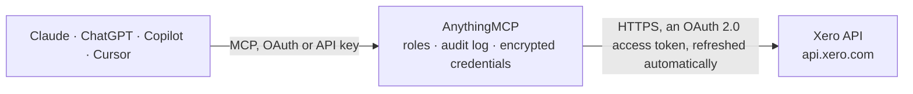

<!-- Generated by scripts/export-github-catalog.mjs in the anythingmcp-website repository. Do not edit by hand. -->

# Xero MCP connector

Read a Xero organisation's invoices, bills, contacts, chart of accounts, Trial Balance and Profit and Loss reports. 10 GET-only tools with OAuth2; xero_list_connections finds the tenant ID after authorisation. The AnythingMCP connector gives Claude, ChatGPT, Microsoft Copilot, Cursor and Gemini 10 MCP tools for Xero, all read-only.

**Category:** [Accounting](../accounting.md) · **Tools:** 10 · **Setup guide:** [anythingmcp.com](https://anythingmcp.com/guides/xero-to-mcp) · [Deutsch](https://anythingmcp.com/de/guides/xero-to-mcp) · [Italiano](https://anythingmcp.com/it/guides/xero-to-mcp) · [Español](https://anythingmcp.com/es/guides/xero-to-mcp) · [日本語](https://anythingmcp.com/ja/guides/xero-to-mcp) · [Русский](https://anythingmcp.com/ru/guides/xero-to-mcp) · [中文](https://anythingmcp.com/zh/guides/xero-to-mcp)

## Start without code

No installation and no terminal: AnythingMCP Cloud runs the Xero connector for you, operated by helpcode.ai in Frankfurt, Germany.

1. **Click the button above** and create an account or sign in. The Xero connector opens, ready to install.
2. **Sign in with your Xero account** when AnythingMCP asks. The first time, an admin creates a small app in the Xero developer console. Every click is in the [step-by-step guide](https://anythingmcp.com/guides/xero-to-mcp).
3. **Click Install.** AnythingMCP shows the address of your MCP server.
4. **Add that address to your assistant:** [Claude](https://anythingmcp.com/guides/connect-xero-to-claude) · [ChatGPT](https://anythingmcp.com/guides/connect-xero-to-chatgpt) · [Microsoft Copilot](https://anythingmcp.com/guides/connect-xero-to-copilot) · [Cursor](https://anythingmcp.com/guides/connect-xero-to-cursor) · [Gemini CLI](https://anythingmcp.com/guides/connect-xero-to-gemini) · [Meta Muse](https://anythingmcp.com/guides/connect-xero-to-muse).
5. **Ask your first question**, for example: *Show me contact record and outstanding balance for Nordic Solar Oy contact name 'Tuomas Lahti'*

Prefer help with the setup? [Talk to us](https://anythingmcp.com/contact).

## How it works

- **The AI client** speaks MCP (Streamable HTTP) to AnythingMCP and only sees tool names, descriptions and results. It never gets the Xero credentials.
- **AnythingMCP** checks the client's role, builds the call from the tool definition, adds the credentials (an OAuth 2.0 access token, refreshed automatically), calls Xero, logs the call and returns the result.
- **Xero** sees an ordinary API client with the rights of the account the credentials belong to.

## Tools

| Tool | What it does | Access |
|---|---|---|
| [`xero_list_connections`](#xero_list_connections) | List the Xero organisations this authorisation can read, with tenantId, tenantName and tenantType. | read |
| [`xero_get_organisation`](#xero_get_organisation) | Read the configured organisation's name, base currency and settings. | read |
| [`xero_list_invoices`](#xero_list_invoices) | List sales invoices and purchase bills with totals, status and line items, one page at a time. | read |
| [`xero_get_invoice`](#xero_get_invoice) | Read one invoice or bill with its line items, amounts and payment details. | read |
| [`xero_list_contacts`](#xero_list_contacts) | List customer and supplier contacts one page at a time. | read |
| [`xero_get_contact`](#xero_get_contact) | Read one customer or supplier contact, including its addresses, contact people and balances. | read |
| [`xero_list_accounts`](#xero_list_accounts) | Read the chart of accounts with account codes, names, types, tax types and status. | read |
| [`xero_get_account`](#xero_get_account) | Read one account's code, name, type, tax type and status. | read |
| [`xero_get_trial_balance`](#xero_get_trial_balance) | Read the Trial Balance as at a specified date, including debit, credit and year-to-date values. | read |
| [`xero_get_profit_and_loss`](#xero_get_profit_and_loss) | Read income, expenses and profit for a date range. | read |

## Tool reference

Every parameter as the AI client sees it in `tools/list`. Source: [`packages/backend/src/adapters/intl/xero.json`](../../../packages/backend/src/adapters/intl/xero.json).

### `xero_list_connections`

List the Xero organisations this authorisation can read, with tenantId, tenantName and tenantType. Call with {} after Authorize with Provider, then copy the intended ORGANISATION's tenantId (not its connection id) into XERO_TENANT_ID.

**Access:** read · **Call:** `GET https://api.xero.com/connections`

No parameters.

### `xero_get_organisation`

Read the configured organisation's name, base currency and settings. Call with {} to verify authentication and the tenant selection before reading financial data.

**Access:** read · **Call:** `GET /Organisation`

No parameters.

### `xero_list_invoices`

List sales invoices and purchase bills with totals, status and line items, one page at a time. Filter with where, for example Type=="ACCREC" for sales invoices or Type=="ACCPAY" for bills. Returns Xero's response envelope; invoice records are in the Invoices array.

**Access:** read · **Call:** `GET /Invoices`

| Parameter | Type | Required | Description |
|---|---|---|---|
| `page` | integer | no | 1-based page number. |
| `pageSize` | integer | no | Records per page, up to 100. |
| `where` | string | no | Xero filter expression, for example Type=="ACCREC" AND Status=="AUTHORISED". |
| `order` | string | no | Xero sort expression, for example InvoiceNumber ASC. |

### `xero_get_invoice`

Read one invoice or bill with its line items, amounts and payment details. Use InvoiceID from xero_list_invoices, not InvoiceNumber.

**Access:** read · **Call:** `GET /Invoices/{invoiceId}`

| Parameter | Type | Required | Description |
|---|---|---|---|
| `invoiceId` | string | yes | InvoiceID UUID returned by xero_list_invoices. |

### `xero_list_contacts`

List customer and supplier contacts one page at a time. Search by name or email, filter with where and optionally include archived contacts. Returns Xero's response envelope; contact records are in the Contacts array.

**Access:** read · **Call:** `GET /Contacts`

| Parameter | Type | Required | Description |
|---|---|---|---|
| `page` | integer | no | 1-based page number. |
| `pageSize` | integer | no | Records per page, up to 100. |
| `searchTerm` | string | no | Case-insensitive search across Name, FirstName, LastName, ContactNumber and EmailAddress. |
| `where` | string | no | Xero filter expression, for example ContactStatus=="ACTIVE". |
| `order` | string | no | Xero sort expression, for example Name ASC. |
| `includeArchived` | boolean | no | Include contacts with ARCHIVED status when true. |

### `xero_get_contact`

Read one customer or supplier contact, including its addresses, contact people and balances. Use ContactID from xero_list_contacts.

**Access:** read · **Call:** `GET /Contacts/{contactId}`

| Parameter | Type | Required | Description |
|---|---|---|---|
| `contactId` | string | yes | ContactID UUID returned by xero_list_contacts. |

### `xero_list_accounts`

Read the chart of accounts with account codes, names, types, tax types and status. Accounts is not paginated; optionally filter or sort the Accounts array.

**Access:** read · **Call:** `GET /Accounts`

| Parameter | Type | Required | Description |
|---|---|---|---|
| `where` | string | no | Xero filter expression, for example Status=="ACTIVE". |
| `order` | string | no | Xero sort expression, for example Code ASC. |

### `xero_get_account`

Read one account's code, name, type, tax type and status. Use AccountID from xero_list_accounts, not its chart-of-accounts code.

**Access:** read · **Call:** `GET /Accounts/{accountId}`

| Parameter | Type | Required | Description |
|---|---|---|---|
| `accountId` | string | yes | AccountID UUID returned by xero_list_accounts. |

### `xero_get_trial_balance`

Read the Trial Balance as at a specified date, including debit, credit and year-to-date values. Returns Xero's Reports with nested Rows and Cells. Accrual by default; paymentsOnly=true requests cash basis.

**Access:** read · **Call:** `GET /Reports/TrialBalance`

| Parameter | Type | Required | Description |
|---|---|---|---|
| `date` | string | yes | Report date in YYYY-MM-DD format. |
| `paymentsOnly` | boolean | no | True for cash basis; false for accrual basis. |

### `xero_get_profit_and_loss`

Read income, expenses and profit for a date range. Returns Xero's Reports with nested Rows and Cells. Accrual by default; optionally request cash basis and comparison periods.

**Access:** read · **Call:** `GET /Reports/ProfitAndLoss`

| Parameter | Type | Required | Description |
|---|---|---|---|
| `fromDate` | string | yes | Start date in YYYY-MM-DD format; no later than toDate. |
| `toDate` | string | yes | End date in YYYY-MM-DD format. |
| `paymentsOnly` | boolean | no | True for cash basis; false for accrual basis. |
| `periods` | integer | no | Number of comparison periods, from 1 to 12. Use with timeframe. |
| `timeframe` | `MONTH` \| `QUARTER` \| `YEAR` | no | Comparison period size. Use with periods. |

## Run it yourself

AnythingMCP is open source (AGPL-3.0). [Run it with Docker](../../../README.md#run-it-yourself), open **Connectors → Store**, pick **Xero** and enter `XERO_CLIENT_ID`, `XERO_CLIENT_SECRET`, then add your MCP server URL to the AI client.

[← Accounting connectors](../accounting.md) · [All categories](../README.md)
