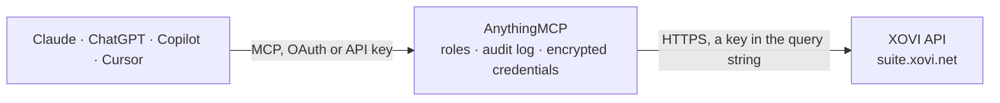

<!-- Generated by scripts/export-github-catalog.mjs in the anythingmcp-website repository. Do not edit by hand. -->

# XOVI MCP connector

XOVI Suite SEO data, read-only: API credit balance, visibility index (OVI) history, ranking keywords, ranking value and keyword history of any domain, and the daily keyword monitoring of your projects. The AnythingMCP connector gives Claude, ChatGPT, Microsoft Copilot, Cursor and Gemini 17 MCP tools for XOVI, all read-only.

**Category:** [Analytics](../analytics.md) · **Tools:** 17 · **Setup guide:** [anythingmcp.com](https://anythingmcp.com/guides/xovi-to-mcp) · [Deutsch](https://anythingmcp.com/de/guides/xovi-to-mcp) · [Italiano](https://anythingmcp.com/it/guides/xovi-to-mcp) · [Español](https://anythingmcp.com/es/guides/xovi-to-mcp) · [日本語](https://anythingmcp.com/ja/guides/xovi-to-mcp) · [Русский](https://anythingmcp.com/ru/guides/xovi-to-mcp) · [中文](https://anythingmcp.com/zh/guides/xovi-to-mcp)

## Start without code

No installation and no terminal: AnythingMCP Cloud runs the XOVI connector for you, operated by helpcode.ai in Frankfurt, Germany.

1. **Click the button above** and create an account or sign in. The XOVI connector opens, ready to install.
2. **Paste the API key or token from your XOVI account.** Every click is in the [step-by-step guide](https://anythingmcp.com/guides/xovi-to-mcp).
3. **Click Install.** AnythingMCP shows the address of your MCP server.
4. **Add that address to your assistant:** [Claude](https://anythingmcp.com/guides/connect-xovi-to-claude) · [ChatGPT](https://anythingmcp.com/guides/connect-xovi-to-chatgpt) · [Microsoft Copilot](https://anythingmcp.com/guides/connect-xovi-to-copilot) · [Cursor](https://anythingmcp.com/guides/connect-xovi-to-cursor) · [Gemini CLI](https://anythingmcp.com/guides/connect-xovi-to-gemini) · [Meta Muse](https://anythingmcp.com/guides/connect-xovi-to-muse).
5. **Ask your first question**, for example: *What's our XOVI API credit balance and last refill date for the account?*

Prefer help with the setup? [Talk to us](https://anythingmcp.com/contact).

## How it works

- **The AI client** speaks MCP (Streamable HTTP) to AnythingMCP and only sees tool names, descriptions and results. It never gets the XOVI credentials.
- **AnythingMCP** checks the client's role, builds the call from the tool definition, adds the credentials (a key in the query string), calls XOVI, logs the call and returns the result.
- **XOVI** sees an ordinary API client with the rights of the account the credentials belong to.

## Tools

| Tool | What it does | Access |
|---|---|---|
| [`xovi_get_credit_state`](#xovi_get_credit_state) | Get the API credit balance: credits per interval, additionally booked credits, credits used and left, and the last refill date. | read |
| [`xovi_get_limits`](#xovi_get_limits) | Get the usage limits of the XOVI account per tool area (name and value), e.g. API credits and free export credits. | read |
| [`xovi_list_search_engines`](#xovi_list_search_engines) | List the search engines XOVI crawls: id, host (e.g. google.de), country and city. | read |
| [`xovi_get_ovi_trend`](#xovi_get_ovi_trend) | Get the weekly visibility index (OVI) history of a domain, subdomain, directory or URL in one search engine: date and staticOvi per week. | read |
| [`xovi_list_ranking_keywords`](#xovi_list_ranking_keywords) | List the keywords a domain or URL ranks for in one search engine in a weekly crawl: keyword, best ranking URL, position, change to the previous week (N for… | read |
| [`xovi_get_ranking_value`](#xovi_get_ranking_value) | Get the ranking value of a domain or directory: its traffic value computed from positions, search volume, CPC and click share, for one week. | read |
| [`xovi_get_ranking_trend`](#xovi_get_ranking_trend) | Get the weekly history of a domain: number of ranking keywords, rankings and keywords on page one per date. | read |
| [`xovi_get_keyword_trend`](#xovi_get_keyword_trend) | Get the weekly ranking history of one keyword for a domain: date, position and ranking URL. | read |
| [`xovi_get_keyword_serp`](#xovi_get_keyword_serp) | Get the ranking URLs and positions for one keyword in a search engine (the search result page of the weekly crawl). | read |
| [`xovi_list_projects`](#xovi_list_projects) | List the XOVI projects: hash (projhash for the monitoring OVI), name, main domain and competitors. | read |
| [`xovi_list_labels`](#xovi_list_labels) | List the labels with hash, name and categories; a hash is the labelid of the monitoring tools. | read |
| [`xovi_list_monitoring_domains`](#xovi_list_monitoring_domains) | List the domains in the daily keyword monitoring, optionally for one search engine. | read |
| [`xovi_list_monitoring_keywords`](#xovi_list_monitoring_keywords) | List the keywords in the daily monitoring with their latest position, change to the previous day, ranking URL, universal search type, search volume, CPC,… | read |
| [`xovi_get_monitoring_keyword_trend`](#xovi_get_monitoring_keyword_trend) | Get the daily ranking history of a monitored keyword for a domain: crawl date and time, position, change, URL and universal search type. | read |
| [`xovi_get_monitoring_serp`](#xovi_get_monitoring_serp) | Get the top 100 search results of a monitored keyword on a day: domain, URL, page, position and universal search type. | read |
| [`xovi_get_monitoring_ovi_trend`](#xovi_get_monitoring_ovi_trend) | Get the daily monitoring OVI history of a project domain, optionally per device, search engine, label or competitor. | read |
| [`xovi_get_monitoring_keyword_limits`](#xovi_get_monitoring_keyword_limits) | Get how many monitoring keyword credits the account has in total and how many are used. | read |

## Tool reference

Every parameter as the AI client sees it in `tools/list`. Source: [`packages/backend/src/adapters/de/xovi.json`](../../../packages/backend/src/adapters/de/xovi.json).

### `xovi_get_credit_state`

Get the API credit balance: credits per interval, additionally booked credits, credits used and left, and the last refill date. Costs no credits; use it to check the key.

**Access:** read · **Call:** `GET /user/getCreditstate`

No parameters.

### `xovi_get_limits`

Get the usage limits of the XOVI account per tool area (name and value), e.g. API credits and free export credits.

**Access:** read · **Call:** `GET /user/getXoviLimits`

No parameters.

### `xovi_list_search_engines`

List the search engines XOVI crawls: id, host (e.g. google.de), country and city. Weekly engines are used by the domain analysis tools (sengine), daily engines by the keyword monitoring tools (sengineid).

**Access:** read · **Call:** `GET /keywords/getSearchEngines`

| Parameter | Type | Required | Description |
|---|---|---|---|
| `interval` | `weekly` \| `daily` | no | weekly (default, for domain analysis) or daily (for keyword monitoring). |
| `limit` | integer | no | Rows to return, at most 1000 (default 100). |
| `skip` | integer | no | Pages to skip; one page is limit rows (default 0). |

### `xovi_get_ovi_trend`

Get the weekly visibility index (OVI) history of a domain, subdomain, directory or URL in one search engine: date and staticOvi per week.

**Access:** read · **Call:** `GET /keywords/getStaticOviTrend`

| Parameter | Type | Required | Description |
|---|---|---|---|
| `urlpattern` | string | yes | Domain or URL pattern, e.g. www.example.com, example.com/* for all subdomains, or www.example.com/blog/* for a directory. |
| `sengine` | string | yes | Weekly crawled search engine host, e.g. google.de, google.at, google.ch; see xovi_list_search_engines. |
| `limit` | integer | no | Rows to return, at most 1000 (default 100). |
| `skip` | integer | no | Pages to skip; one page is limit rows (default 0). |
| `date` | string | no | Date YYYY-MM-DD. Start from this crawl date; default the latest. |

### `xovi_list_ranking_keywords`

List the keywords a domain or URL ranks for in one search engine in a weekly crawl: keyword, best ranking URL, position, change to the previous week (N for new), CPC, search volume (sevo) and competition.

**Access:** read · **Call:** `GET /keywords/getKeywords`

| Parameter | Type | Required | Description |
|---|---|---|---|
| `urlpattern` | string | yes | Domain or URL pattern, e.g. www.example.com, example.com/* for all subdomains, or www.example.com/blog/* for a directory. |
| `sengine` | string | yes | Weekly crawled search engine host, e.g. google.de, google.at, google.ch; see xovi_list_search_engines. |
| `limit` | integer | no | Rows to return, at most 1000 (default 100). |
| `skip` | integer | no | Pages to skip; one page is limit rows (default 0). |
| `date` | string | no | Date YYYY-MM-DD. The Sunday of the crawl week; default the latest week. |

### `xovi_get_ranking_value`

Get the ranking value of a domain or directory: its traffic value computed from positions, search volume, CPC and click share, for one week.

**Access:** read · **Call:** `GET /keywords/getRankingValue`

| Parameter | Type | Required | Description |
|---|---|---|---|
| `urlpattern` | string | yes | Domain or URL pattern, e.g. www.example.com, example.com/* for all subdomains, or www.example.com/blog/* for a directory. |
| `sengine` | string | yes | Weekly crawled search engine host, e.g. google.de, google.at, google.ch; see xovi_list_search_engines. |
| `date` | string | no | Date YYYY-MM-DD. Default the previous week. |

### `xovi_get_ranking_trend`

Get the weekly history of a domain: number of ranking keywords, rankings and keywords on page one per date.

**Access:** read · **Call:** `GET /keywords/getRankingTrend`

| Parameter | Type | Required | Description |
|---|---|---|---|
| `urlpattern` | string | yes | Domain or URL pattern, e.g. www.example.com, example.com/* for all subdomains, or www.example.com/blog/* for a directory. |
| `sengine` | string | yes | Weekly crawled search engine host, e.g. google.de, google.at, google.ch; see xovi_list_search_engines. |
| `date` | string | no | Date YYYY-MM-DD. Start date of the history. |
| `limit` | integer | no | Rows to return, at most 1000 (default 100). |
| `skip` | integer | no | Pages to skip; one page is limit rows (default 0). |

### `xovi_get_keyword_trend`

Get the weekly ranking history of one keyword for a domain: date, position and ranking URL.

**Access:** read · **Call:** `GET /keywords/getKeywordTrend`

| Parameter | Type | Required | Description |
|---|---|---|---|
| `urlpattern` | string | yes | Domain or URL pattern, e.g. www.example.com, example.com/* for all subdomains, or www.example.com/blog/* for a directory. |
| `keyword` | string | yes | The keyword, e.g. seo tool. |
| `sengine` | string | yes | Weekly crawled search engine host, e.g. google.de, google.at, google.ch; see xovi_list_search_engines. |
| `limit` | integer | no | Rows to return, at most 1000 (default 100). |
| `skip` | integer | no | Pages to skip; one page is limit rows (default 0). |
| `date` | string | no | Date YYYY-MM-DD. Default today. |

### `xovi_get_keyword_serp`

Get the ranking URLs and positions for one keyword in a search engine (the search result page of the weekly crawl).

**Access:** read · **Call:** `GET /keywords/getKeywordRankings`

| Parameter | Type | Required | Description |
|---|---|---|---|
| `keyword` | string | yes | The keyword. |
| `sengine` | string | yes | Weekly crawled search engine host, e.g. google.de, google.at, google.ch; see xovi_list_search_engines. |
| `limit` | integer | no | Rows to return, at most 1000 (default 10). |
| `skip` | integer | no | Pages to skip; one page is limit rows (default 0). |
| `date` | string | no | Date YYYY-MM-DD. Default the previous week. |

### `xovi_list_projects`

List the XOVI projects: hash (projhash for the monitoring OVI), name, main domain and competitors. Filter by domain.

**Access:** read · **Call:** `GET /project/getProjects`

| Parameter | Type | Required | Description |
|---|---|---|---|
| `domain` | string | no | Only projects of this domain. |
| `limit` | integer | no | Rows to return, at most 1000 (default 10). |
| `skip` | integer | no | Pages to skip; one page is limit rows (default 0). |

### `xovi_list_labels`

List the labels with hash, name and categories; a hash is the labelid of the monitoring tools.

**Access:** read · **Call:** `GET /project/getLabels`

| Parameter | Type | Required | Description |
|---|---|---|---|
| `category` | string | no | Only labels of this category, e.g. projects. |
| `limit` | integer | no | Rows to return, at most 1000 (default 100). |
| `skip` | integer | no | Pages to skip; one page is limit rows (default 0). |

### `xovi_list_monitoring_domains`

List the domains in the daily keyword monitoring, optionally for one search engine.

**Access:** read · **Call:** `GET /monitor/getDomains`

| Parameter | Type | Required | Description |
|---|---|---|---|
| `limit` | integer | no | Rows to return, at most 1000 (default 50). |
| `skip` | integer | no | Pages to skip; one page is limit rows (default 0). |
| `sengineid` | string | no | Id of a daily crawled search engine, from xovi_list_search_engines with interval daily. |

### `xovi_list_monitoring_keywords`

List the keywords in the daily monitoring with their latest position, change to the previous day, ranking URL, universal search type, search volume, CPC, device and labels. Filter by keyword, domain, search engine, label, ranking state, position range, URL, date or device.

**Access:** read · **Call:** `GET /monitor/getKeywords`

| Parameter | Type | Required | Description |
|---|---|---|---|
| `limit` | integer | no | Rows to return, at most 1000 (default 100). |
| `skip` | integer | no | Pages to skip; one page is limit rows (default 0). |
| `keyword` | string | no | Only this keyword. |
| `domain` | string | no | Only this monitored domain. |
| `sengineid` | string | no | Id of a daily crawled search engine, from xovi_list_search_engines with interval daily. |
| `labelid` | string | no | Label hash, from xovi_list_labels. |
| `isRanking` | `-1` \| `1` \| `2` | no | -1 all (default), 1 only ranking, 2 only not ranking. |
| `posMin` | integer | no | Lowest position (default 0). |
| `posMax` | integer | no | Highest position (default 120). |
| `url` | string | no | Only keywords whose best ranking URL is this one. |
| `date` | string | no | Date YYYY-MM-DD. Crawl day; default each keyword's latest crawl. |
| `device` | `1` \| `2` \| `3` | no | 1 desktop, 2 tablet, 3 smartphone. |

### `xovi_get_monitoring_keyword_trend`

Get the daily ranking history of a monitored keyword for a domain: crawl date and time, position, change, URL and universal search type.

**Access:** read · **Call:** `GET /monitor/getKeywordTrend`

| Parameter | Type | Required | Description |
|---|---|---|---|
| `sengineid` | string | yes | Id of a daily crawled search engine, from xovi_list_search_engines with interval daily. |
| `domain` | string | yes | Monitored domain, e.g. www.example.com. |
| `keyword` | string | yes | Monitored keyword. |
| `limit` | integer | no | Rows to return, at most 1000 (default 1). |
| `skip` | integer | no | Pages to skip; one page is limit rows (default 0). |
| `ignoreUSearch` | `-1` \| `1` \| `2` | no | -1 all (default), 1 only where universal search is ignored, 2 only where it counts. |

### `xovi_get_monitoring_serp`

Get the top 100 search results of a monitored keyword on a day: domain, URL, page, position and universal search type.

**Access:** read · **Call:** `GET /monitor/getKeywordRankings`

| Parameter | Type | Required | Description |
|---|---|---|---|
| `keyword` | string | yes | Monitored keyword. |
| `sengineid` | string | yes | Id of a daily crawled search engine, from xovi_list_search_engines with interval daily. |
| `limit` | integer | no | Rows to return, at most 1000 (default 120). |
| `skip` | integer | no | Pages to skip; one page is limit rows (default 0). |
| `date` | string | no | Date YYYY-MM-DD. Default yesterday. |

### `xovi_get_monitoring_ovi_trend`

Get the daily monitoring OVI history of a project domain, optionally per device, search engine, label or competitor.

**Access:** read · **Call:** `GET /monitor/getOviTrend`

| Parameter | Type | Required | Description |
|---|---|---|---|
| `projhash` | string | yes | Project hash, from xovi_list_projects. |
| `limit` | integer | no | Rows to return, at most 1000 (default 100). |
| `skip` | integer | no | Pages to skip; one page is limit rows (default 0). |
| `device` | `1` \| `2` \| `3` | no | 1 desktop (default), 2 tablet, 3 smartphone. |
| `sengineid` | string | no | Id of a daily crawled search engine, from xovi_list_search_engines with interval daily. |
| `labelid` | string | no | Label hash, from xovi_list_labels. |
| `date` | string | no | Date YYYY-MM-DD. Start date; the nearest earlier OVI is used when none exists that day. |
| `competitor` | string | no | Competitor domain of the project. |

### `xovi_get_monitoring_keyword_limits`

Get how many monitoring keyword credits the account has in total and how many are used.

**Access:** read · **Call:** `GET /monitor/getKeywordLimits`

No parameters.

## Run it yourself

AnythingMCP is open source (AGPL-3.0). [Run it with Docker](../../../README.md#run-it-yourself), open **Connectors → Store**, pick **XOVI** and enter `XOVI_API_KEY`, then add your MCP server URL to the AI client.

[← Analytics connectors](../analytics.md) · [All categories](../README.md)
