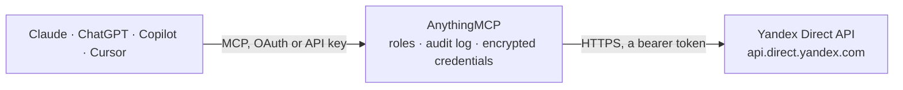

<!-- Generated by scripts/export-github-catalog.mjs in the anythingmcp-website repository. Do not edit by hand. -->

# Yandex Direct MCP connector

Let your AI analyse your Yandex Direct advertising, read-only: campaigns, ad groups, ads, keywords and bids, sitelinks and callouts, agency clients, dictionaries, change tracking and statistics … The AnythingMCP connector gives Claude, ChatGPT, Microsoft Copilot, Cursor and Gemini 14 MCP tools for Yandex Direct, all read-only.

**Category:** [Advertising](../advertising.md) · **Tools:** 14 · **Setup guide:** [anythingmcp.com](https://anythingmcp.com/guides/yandex-direct-to-mcp) · [Deutsch](https://anythingmcp.com/de/guides/yandex-direct-to-mcp) · [Italiano](https://anythingmcp.com/it/guides/yandex-direct-to-mcp) · [Español](https://anythingmcp.com/es/guides/yandex-direct-to-mcp) · [日本語](https://anythingmcp.com/ja/guides/yandex-direct-to-mcp) · [Русский](https://anythingmcp.com/ru/guides/yandex-direct-to-mcp) · [中文](https://anythingmcp.com/zh/guides/yandex-direct-to-mcp)

## Start without code

No installation and no terminal: AnythingMCP Cloud runs the Yandex Direct connector for you, operated by helpcode.ai in Frankfurt, Germany.

1. **Click the button above** and create an account or sign in. The Yandex Direct connector opens, ready to install.
2. **Paste the API key or token from your Yandex Direct account.** Every click is in the [step-by-step guide](https://anythingmcp.com/guides/yandex-direct-to-mcp).
3. **Click Install.** AnythingMCP shows the address of your MCP server.
4. **Add that address to your assistant:** [Claude](https://anythingmcp.com/guides/connect-yandex-direct-to-claude) · [ChatGPT](https://anythingmcp.com/guides/connect-yandex-direct-to-chatgpt) · [Microsoft Copilot](https://anythingmcp.com/guides/connect-yandex-direct-to-copilot) · [Cursor](https://anythingmcp.com/guides/connect-yandex-direct-to-cursor) · [Gemini CLI](https://anythingmcp.com/guides/connect-yandex-direct-to-gemini) · [Meta Muse](https://anythingmcp.com/guides/connect-yandex-direct-to-muse).
5. **Ask your first question**, for example: *What's the campaign id and status for the advertiser login solarshop_eu's 'Nordic Solar - Search' campaign?*

Prefer help with the setup? [Talk to us](https://anythingmcp.com/contact).

## How it works

- **The AI client** speaks MCP (Streamable HTTP) to AnythingMCP and only sees tool names, descriptions and results. It never gets the Yandex Direct credentials.
- **AnythingMCP** checks the client's role, builds the call from the tool definition, adds the credentials (a bearer token), calls Yandex Direct, logs the call and returns the result.
- **Yandex Direct** sees an ordinary API client with the rights of the account the credentials belong to.

## Tools

| Tool | What it does | Access |
|---|---|---|
| [`yandex_direct_get_client`](#yandex_direct_get_client) | Read the advertiser account the token acts for (or the Client-Login one): ClientId, Login, ClientInfo (name), Currency, CountryId, Type, VatRate,… | read |
| [`yandex_direct_list_campaigns`](#yandex_direct_list_campaigns) | List campaigns: Id, Name, Type (TEXT_CAMPAIGN, UNIFIED_CAMPAIGN, SMART_CAMPAIGN, MOBILE_APP_CAMPAIGN, CPM_BANNER_CAMPAIGN ...), Status, State (ON, OFF,… | read |
| [`yandex_direct_list_ad_groups`](#yandex_direct_list_ad_groups) | List ad groups of up to 10 campaigns (or by id): Id, Name, CampaignId, Type, Status, ServingStatus, RegionIds, NegativeKeywords, TrackingParams. | read |
| [`yandex_direct_list_ads`](#yandex_direct_list_ads) | List ads of up to 10 campaigns, up to 1000 ad groups, or by id: Id, CampaignId, AdGroupId, Type, Status, State, StatusClarification, and for text ads Title,… | read |
| [`yandex_direct_list_keywords`](#yandex_direct_list_keywords) | List keywords and autotargeting of up to 10 campaigns, up to 1000 ad groups, or by id: Id, Keyword, State, Status, ServingStatus, AdGroupId, CampaignId, Bid… | read |
| [`yandex_direct_list_keyword_bids`](#yandex_direct_list_keyword_bids) | Read keyword bids with the auction picture: for each keyword the search and network bid and, on search, the bids and traffic volume needed for each position… | read |
| [`yandex_direct_list_sitelinks`](#yandex_direct_list_sitelinks) | Read sitelink sets by id (SitelinkSetId from yandex_direct_list_ads): each sitelink's Title, Href and Description. | read |
| [`yandex_direct_list_ad_extensions`](#yandex_direct_list_ad_extensions) | List ad extensions (callouts) of the account: Id, Type, Status, Associated and the callout text. | read |
| [`yandex_direct_list_negative_keyword_sets`](#yandex_direct_list_negative_keyword_sets) | Read shared negative keyword sets by id (NegativeKeywordSharedSetIds of campaigns and ad groups): Id, Name, NegativeKeywords, Associated. | read |
| [`yandex_direct_list_retargeting_lists`](#yandex_direct_list_retargeting_lists) | List retargeting and audience lists: Id, Name, Type, Description, Rules (Metrica goals and segments), IsAvailable, Scope. | read |
| [`yandex_direct_list_agency_clients`](#yandex_direct_list_agency_clients) | For agency accounts: list the agency's advertisers with Login, ClientId, ClientInfo, Currency and Archived. | read |
| [`yandex_direct_get_dictionaries`](#yandex_direct_get_dictionaries) | Read reference dictionaries: Currencies (with bid limits), GeoRegions (region ids used in RegionIds), TimeZones, Constants, AdCategories, Interests,… | read |
| [`yandex_direct_check_campaign_changes`](#yandex_direct_check_campaign_changes) | Which campaigns changed since a moment: for each changed campaign, whether the campaign itself (SELF), its groups, ads or keywords (CHILDREN) or its… | read |
| [`yandex_direct_get_report`](#yandex_direct_get_report) | Run a statistics report (Reports service) and return it as tab-separated text: a column header row, one row per line, money as decimals in the account currency. | read |

## Tool reference

Every parameter as the AI client sees it in `tools/list`. Source: [`packages/backend/src/adapters/intl/yandex-direct.json`](../../../packages/backend/src/adapters/intl/yandex-direct.json).

### `yandex_direct_get_client`

Read the advertiser account the token acts for (or the Client-Login one): ClientId, Login, ClientInfo (name), Currency, CountryId, Type, VatRate, AccountQuality, Archived, CreatedAt and the account's restrictions. Checks the token. Read-only.

**Access:** read · **Call:** `POST /clients`

| Parameter | Type | Required | Description |
|---|---|---|---|
| `field_names` | string[] | no | Fields to return. |

### `yandex_direct_list_campaigns`

List campaigns: Id, Name, Type (TEXT_CAMPAIGN, UNIFIED_CAMPAIGN, SMART_CAMPAIGN, MOBILE_APP_CAMPAIGN, CPM_BANNER_CAMPAIGN ...), Status, State (ON, OFF, SUSPENDED, ENDED, ARCHIVED), StatusPayment, StartDate, EndDate, Currency, Funds and Statistics (all-time clicks and impressions). Optionally the bidding strategy and settings of text or unified campaigns. Read-only.

**Access:** read · **Call:** `POST /campaigns`

| Parameter | Type | Required | Description |
|---|---|---|---|
| `ids` | integer[] | no | Only these campaign ids. |
| `states` | `ON` \| `OFF` \| `SUSPENDED` \| `ENDED` \| `CONVERTED` \| `ARCHIVED`[] | no | Only campaigns in these states. |
| `statuses` | `ACCEPTED` \| `DRAFT` \| `MODERATION` \| `REJECTED`[] | no | Only campaigns with these moderation statuses. |
| `types` | string[] | no | Only these campaign types, e.g. TEXT_CAMPAIGN, UNIFIED_CAMPAIGN. |
| `field_names` | string[] | no | Fields to return. |
| `text_campaign_field_names` | string[] | no | Optional extra fields of text campaigns: BiddingStrategy, Settings, CounterIds, PriorityGoals, AttributionModel, RelevantKeywords, NegativeKeywordSharedSetIds. |
| `unified_campaign_field_names` | string[] | no | Optional extra fields of unified performance campaigns: BiddingStrategy, Settings, CounterIds, PriorityGoals, AttributionModel, TrackingParams, NegativeKeywordSharedSetIds. |
| `limit` | integer | no | Objects per page, at most 10000. Default 500. When the answer has LimitedBy, there are more: pass it as offset. |
| `offset` | integer | no | Skip this many objects (the LimitedBy value of the previous page). |

### `yandex_direct_list_ad_groups`

List ad groups of up to 10 campaigns (or by id): Id, Name, CampaignId, Type, Status, ServingStatus, RegionIds, NegativeKeywords, TrackingParams. Needs campaign_ids or ids. Read-only.

**Access:** read · **Call:** `POST /adgroups`

| Parameter | Type | Required | Description |
|---|---|---|---|
| `campaign_ids` | integer[] | no | Campaign ids, at most 10. |
| `ids` | integer[] | no | Ad group ids. |
| `field_names` | string[] | no | Fields to return. |
| `limit` | integer | no | Objects per page, at most 10000. Default 500. When the answer has LimitedBy, there are more: pass it as offset. |
| `offset` | integer | no | Skip this many objects (the LimitedBy value of the previous page). |

### `yandex_direct_list_ads`

List ads of up to 10 campaigns, up to 1000 ad groups, or by id: Id, CampaignId, AdGroupId, Type, Status, State, StatusClarification, and for text ads Title, Title2, Text, Href, DisplayUrlPath. Needs campaign_ids, ad_group_ids or ids. Read-only.

**Access:** read · **Call:** `POST /ads`

| Parameter | Type | Required | Description |
|---|---|---|---|
| `campaign_ids` | integer[] | no | Campaign ids, at most 10. |
| `ad_group_ids` | integer[] | no | Ad group ids, at most 1000. |
| `ids` | integer[] | no | Ad ids. |
| `states` | `ON` \| `OFF` \| `OFF_BY_MONITORING` \| `SUSPENDED` \| `ARCHIVED`[] | no | Only ads in these states. |
| `field_names` | string[] | no | Fields to return. |
| `text_ad_field_names` | string[] | no | Fields of text ads. |
| `limit` | integer | no | Objects per page, at most 10000. Default 500. When the answer has LimitedBy, there are more: pass it as offset. |
| `offset` | integer | no | Skip this many objects (the LimitedBy value of the previous page). |

### `yandex_direct_list_keywords`

List keywords and autotargeting of up to 10 campaigns, up to 1000 ad groups, or by id: Id, Keyword, State, Status, ServingStatus, AdGroupId, CampaignId, Bid and ContextBid (in micros: 2500000 = 2.5 of the currency), Productivity and search and network statistics. Read-only.

**Access:** read · **Call:** `POST /keywords`

| Parameter | Type | Required | Description |
|---|---|---|---|
| `campaign_ids` | integer[] | no | Campaign ids, at most 10. |
| `ad_group_ids` | integer[] | no | Ad group ids, at most 1000. |
| `ids` | integer[] | no | Keyword ids. |
| `field_names` | string[] | no | Fields to return. |
| `limit` | integer | no | Objects per page, at most 10000. Default 500. When the answer has LimitedBy, there are more: pass it as offset. |
| `offset` | integer | no | Skip this many objects (the LimitedBy value of the previous page). |

### `yandex_direct_list_keyword_bids`

Read keyword bids with the auction picture: for each keyword the search and network bid and, on search, the bids and traffic volume needed for each position (AuctionBids). Money in micros. Needs campaign_ids, ad_group_ids or keyword_ids. Read-only.

**Access:** read · **Call:** `POST /keywordbids`

| Parameter | Type | Required | Description |
|---|---|---|---|
| `campaign_ids` | integer[] | no | Campaign ids, at most 10. |
| `ad_group_ids` | integer[] | no | Ad group ids, at most 1000. |
| `keyword_ids` | integer[] | no | Keyword ids. |
| `field_names` | string[] | no | Fields to return. |
| `search_field_names` | string[] | no | Search fields. |
| `network_field_names` | string[] | no | Network fields. |
| `limit` | integer | no | Objects per page, at most 10000. Default 500. When the answer has LimitedBy, there are more: pass it as offset. |
| `offset` | integer | no | Skip this many objects (the LimitedBy value of the previous page). |

### `yandex_direct_list_sitelinks`

Read sitelink sets by id (SitelinkSetId from yandex_direct_list_ads): each sitelink's Title, Href and Description. Read-only.

**Access:** read · **Call:** `POST /sitelinks`

| Parameter | Type | Required | Description |
|---|---|---|---|
| `ids` | integer[] | yes | Sitelink set ids. |
| `sitelink_field_names` | string[] | no | Fields of each sitelink. |
| `limit` | integer | no | Objects per page, at most 10000. Default 500. When the answer has LimitedBy, there are more: pass it as offset. |
| `offset` | integer | no | Skip this many objects (the LimitedBy value of the previous page). |

### `yandex_direct_list_ad_extensions`

List ad extensions (callouts) of the account: Id, Type, Status, Associated and the callout text. Read-only.

**Access:** read · **Call:** `POST /adextensions`

| Parameter | Type | Required | Description |
|---|---|---|---|
| `ids` | integer[] | no | Only these extension ids. |
| `limit` | integer | no | Objects per page, at most 10000. Default 500. When the answer has LimitedBy, there are more: pass it as offset. |
| `offset` | integer | no | Skip this many objects (the LimitedBy value of the previous page). |

### `yandex_direct_list_negative_keyword_sets`

Read shared negative keyword sets by id (NegativeKeywordSharedSetIds of campaigns and ad groups): Id, Name, NegativeKeywords, Associated. Read-only.

**Access:** read · **Call:** `POST /negativekeywordsharedsets`

| Parameter | Type | Required | Description |
|---|---|---|---|
| `ids` | integer[] | yes | Set ids, at most 30. |
| `limit` | integer | no | Objects per page, at most 10000. Default 500. When the answer has LimitedBy, there are more: pass it as offset. |
| `offset` | integer | no | Skip this many objects (the LimitedBy value of the previous page). |

### `yandex_direct_list_retargeting_lists`

List retargeting and audience lists: Id, Name, Type, Description, Rules (Metrica goals and segments), IsAvailable, Scope. Read-only.

**Access:** read · **Call:** `POST /retargetinglists`

| Parameter | Type | Required | Description |
|---|---|---|---|
| `ids` | integer[] | no | Only these list ids. |
| `limit` | integer | no | Objects per page, at most 10000. Default 500. When the answer has LimitedBy, there are more: pass it as offset. |
| `offset` | integer | no | Skip this many objects (the LimitedBy value of the previous page). |

### `yandex_direct_list_agency_clients`

For agency accounts: list the agency's advertisers with Login, ClientId, ClientInfo, Currency and Archived. Use a Login as Client-Login (YANDEX_DIRECT_CLIENT_LOGIN) to read that advertiser. Answers an error for a direct advertiser account. Read-only.

**Access:** read · **Call:** `POST /agencyclients`

| Parameter | Type | Required | Description |
|---|---|---|---|
| `logins` | string[] | no | Only these advertiser logins. |
| `archived` | `YES` \| `NO` | no | YES for archived advertisers only, NO for active ones. |
| `field_names` | string[] | no | Fields to return. |
| `limit` | integer | no | Objects per page, at most 10000. Default 500. When the answer has LimitedBy, there are more: pass it as offset. |
| `offset` | integer | no | Skip this many objects (the LimitedBy value of the previous page). |

### `yandex_direct_get_dictionaries`

Read reference dictionaries: Currencies (with bid limits), GeoRegions (region ids used in RegionIds), TimeZones, Constants, AdCategories, Interests, AudienceCriteriaTypes and more. GeoRegions is large: ask for it only when needed. Read-only.

**Access:** read · **Call:** `POST /dictionaries`

| Parameter | Type | Required | Description |
|---|---|---|---|
| `dictionary_names` | `Currencies` \| `MetroStations` \| `GeoRegions` \| `TimeZones` \| `Constants` \| `AdCategories` \| `OperationSystemVersions` \| `ProductivityAssertions` \| `SupplySidePlatforms` \| `Interests` \| `AudienceCriteriaTypes` \| `AudienceDemographicProfiles` \| `AudienceInterests` \| `FilterSchemas`[] | yes | Dictionaries to read. |

### `yandex_direct_check_campaign_changes`

Which campaigns changed since a moment: for each changed campaign, whether the campaign itself (SELF), its groups, ads or keywords (CHILDREN) or its statistics (STAT) changed. Pass the Timestamp of the previous answer next time. Read-only.

**Access:** read · **Call:** `POST /changes`

| Parameter | Type | Required | Description |
|---|---|---|---|
| `timestamp` | string | yes | UTC time, YYYY-MM-DDThh:mm:ssZ, e.g. 2026-10-18T00:00:00Z. |

### `yandex_direct_get_report`

Run a statistics report (Reports service) and return it as tab-separated text: a column header row, one row per line, money as decimals in the account currency. Common: CAMPAIGN_PERFORMANCE_REPORT with Date, CampaignName, Impressions, Clicks, Ctr, Cost, AvgCpc, Conversions; SEARCH_QUERY_PERFORMANCE_REPORT for search terms (offline only); CUSTOM_REPORT for any combination. If the answer is empty and the retryin header is set (HTTP 201 or 202), the report is being built offline: call again with exactly the same parameters and report_name after that many seconds. Read-only, free apart from API points.

**Access:** read · **Call:** `POST /reports`

| Parameter | Type | Required | Description |
|---|---|---|---|
| `report_name` | string | yes | A name unique for this set of parameters, e.g. campaigns-2026-10-01-2026-10-18. Reuse it only to poll the same report. |
| `report_type` | `ACCOUNT_PERFORMANCE_REPORT` \| `CAMPAIGN_PERFORMANCE_REPORT` \| `ADGROUP_PERFORMANCE_REPORT` \| `AD_PERFORMANCE_REPORT` \| `CRITERIA_PERFORMANCE_REPORT` \| `CUSTOM_REPORT` \| `SEARCH_QUERY_PERFORMANCE_REPORT` \| `REACH_AND_FREQUENCY_PERFORMANCE_REPORT` | no | Report type. Default CAMPAIGN_PERFORMANCE_REPORT. |
| `date_range_type` | `TODAY` \| `YESTERDAY` \| `LAST_3_DAYS` \| `LAST_5_DAYS` \| `LAST_7_DAYS` \| `LAST_14_DAYS` \| `LAST_30_DAYS` \| `LAST_90_DAYS` \| `LAST_365_DAYS` \| `THIS_WEEK_MON_TODAY` \| `LAST_WEEK` \| `LAST_BUSINESS_WEEK` \| `THIS_MONTH` \| `LAST_MONTH` \| `ALL_TIME` \| `CUSTOM_DATE` \| `AUTO` | no | Period. CUSTOM_DATE needs date_from and date_to; other values forbid them. Default LAST_7_DAYS. |
| `date_from` | string | no | With CUSTOM_DATE: first day, YYYY-MM-DD. |
| `date_to` | string | no | With CUSTOM_DATE: last day, YYYY-MM-DD. |
| `field_names` | string[] | no | Columns, e.g. Date, CampaignId, CampaignName, AdGroupName, Criterion, Query, Device, LocationOfPresenceName, Impressions, Clicks, Ctr, Cost, AvgCpc, Conversions, CostPerConversion, ConversionRate, Revenue, Bounces. Not every column exists in every report type. |
| `filter` | object[] | no | Optional filters: [{"Field":"CampaignId","Operator":"IN","Values":["123"]}]. Operators EQUALS, NOT_EQUALS, IN, NOT_IN, LESS_THAN, GREATER_THAN, STARTS_WITH_IGNORE_CASE ... Money values in micros. |
| `goals` | string[] | no | Optional Metrica goal ids (at most 10) for Conversions columns. |
| `attribution_models` | `FC` \| `LC` \| `LSC` \| `LYDC` \| `FCCD` \| `LSCCD` \| `LYDCCD` \| `AUTO`[] | no | Optional attribution models for conversions. |
| `order_by` | object[] | no | Optional sort: [{"Field":"Clicks","SortOrder":"DESCENDING"}]. |
| `include_vat` | `YES` \| `NO` | no | Money with VAT (YES, default) or without. |
| `limit` | integer | no | Maximum rows. Default 1000. |
| `processing_mode` | `auto` \| `online` \| `offline` | no | auto (default) lets Yandex decide; offline always queues. |

## Run it yourself

AnythingMCP is open source (AGPL-3.0). [Run it with Docker](../../../README.md#run-it-yourself), open **Connectors → Store**, pick **Yandex Direct** and enter `YANDEX_DIRECT_TOKEN`, then add your MCP server URL to the AI client.

[← Advertising connectors](../advertising.md) · [All categories](../README.md)
