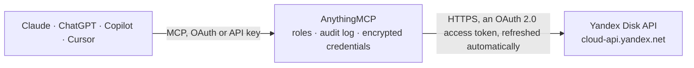

<!-- Generated by scripts/export-github-catalog.mjs in the anythingmcp-website repository. Do not edit by hand. -->

# Yandex Disk MCP connector

Let your AI work in Yandex Disk: browse folders, list all files or recent uploads, read file details, get download links, create folders, copy, move, publish or unpublish files, save a file from a … The AnythingMCP connector gives Claude, ChatGPT, Microsoft Copilot, Cursor and Gemini 18 MCP tools for Yandex Disk: 10 read and 8 can change data.

**Category:** [File Storage](../storage.md) · **Tools:** 18 · **Setup guide:** [anythingmcp.com](https://anythingmcp.com/guides/yandex-disk-to-mcp) · [Deutsch](https://anythingmcp.com/de/guides/yandex-disk-to-mcp) · [Italiano](https://anythingmcp.com/it/guides/yandex-disk-to-mcp) · [Español](https://anythingmcp.com/es/guides/yandex-disk-to-mcp) · [日本語](https://anythingmcp.com/ja/guides/yandex-disk-to-mcp) · [Русский](https://anythingmcp.com/ru/guides/yandex-disk-to-mcp) · [中文](https://anythingmcp.com/zh/guides/yandex-disk-to-mcp)

## Start without code

No installation and no terminal: AnythingMCP Cloud runs the Yandex Disk connector for you, operated by helpcode.ai in Frankfurt, Germany.

1. **Click the button above** and create an account or sign in. The Yandex Disk connector opens, ready to install.
2. **Sign in with your Yandex Disk account** when AnythingMCP asks. The first time, an admin creates a small app in the Yandex Disk developer console. Every click is in the [step-by-step guide](https://anythingmcp.com/guides/yandex-disk-to-mcp).
3. **Click Install.** AnythingMCP shows the address of your MCP server.
4. **Add that address to your assistant:** [Claude](https://anythingmcp.com/guides/connect-yandex-disk-to-claude) · [ChatGPT](https://anythingmcp.com/guides/connect-yandex-disk-to-chatgpt) · [Microsoft Copilot](https://anythingmcp.com/guides/connect-yandex-disk-to-copilot) · [Cursor](https://anythingmcp.com/guides/connect-yandex-disk-to-cursor) · [Gemini CLI](https://anythingmcp.com/guides/connect-yandex-disk-to-gemini) · [Meta Muse](https://anythingmcp.com/guides/connect-yandex-disk-to-muse).
5. **Ask your first question**, for example: *Where is the signed Novatek contract PDF and when was it last modified? (client Novatek LLC)*

Prefer help with the setup? [Talk to us](https://anythingmcp.com/contact).

## How it works

- **The AI client** speaks MCP (Streamable HTTP) to AnythingMCP and only sees tool names, descriptions and results. It never gets the Yandex Disk credentials.
- **AnythingMCP** checks the client's role, builds the call from the tool definition, adds the credentials (an OAuth 2.0 access token, refreshed automatically), calls Yandex Disk, logs the call and returns the result.
- **Yandex Disk** sees an ordinary API client with the rights of the account the credentials belong to.

## Tools

| Tool | What it does | Access |
|---|---|---|
| [`yandex_disk_get_disk_info`](#yandex_disk_get_disk_info) | Get the Disk's totals: total_space, used_space and trash_size in bytes, the owner (login, display_name), whether the account is paid, the upload size limit… | read |
| [`yandex_disk_list_folder`](#yandex_disk_list_folder) | List what is inside one folder of the Disk (files and subfolders), one page at a time. | read |
| [`yandex_disk_get_resource`](#yandex_disk_get_resource) | Get the details of one file or folder by its path (disk:/folder/file): name, type, size, mime_type, media_type, md5 and sha256, created and modified,… | read |
| [`yandex_disk_list_files`](#yandex_disk_list_files) | List every file on the Disk as one flat list, across all folders (folders themselves are not listed), optionally only certain kinds such as images or documents. | read |
| [`yandex_disk_list_last_uploaded`](#yandex_disk_list_last_uploaded) | List the files uploaded most recently, newest first, optionally only certain kinds such as images. | read |
| [`yandex_disk_get_download_link`](#yandex_disk_get_download_link) | Get a temporary download URL for a file or folder (a folder downloads as a zip archive). | read |
| [`yandex_disk_list_public`](#yandex_disk_list_public) | List the files and folders the user has published (shared by public link). | read |
| [`yandex_disk_get_public_resource`](#yandex_disk_get_public_resource) | Read the details of a public Yandex Disk link, the user's own or anyone's: name, type, size, owner and, for a folder, its contents (_embedded.items). | read |
| [`yandex_disk_create_folder`](#yandex_disk_create_folder) | Create a folder. | write |
| [`yandex_disk_copy`](#yandex_disk_copy) | Copy a file or folder to a new path. | write |
| [`yandex_disk_move`](#yandex_disk_move) | Move or rename a file or folder. | write |
| [`yandex_disk_publish`](#yandex_disk_publish) | Publish a file or folder: anyone with the link can then open and download it. | write |
| [`yandex_disk_unpublish`](#yandex_disk_unpublish) | Stop sharing a published file or folder: its public link stops working (publishing again creates a new link). | write |
| [`yandex_disk_upload_from_url`](#yandex_disk_upload_from_url) | Save a file from a public internet URL onto the Disk. | write |
| [`yandex_disk_get_operation_status`](#yandex_disk_get_operation_status) | Check a background operation started by upload from URL, copy, move, restore or delete: status is in-progress, success or failed. | read |
| [`yandex_disk_list_trash`](#yandex_disk_list_trash) | List what is in the Trash. | read |
| [`yandex_disk_restore_from_trash`](#yandex_disk_restore_from_trash) | Restore an entry from the Trash to where it was deleted from (origin_path), optionally under a new name. | write |
| [`yandex_disk_delete`](#yandex_disk_delete) | Delete a file or folder. | write |

## Tool reference

Every parameter as the AI client sees it in `tools/list`. Source: [`packages/backend/src/adapters/intl/yandex-disk.json`](../../../packages/backend/src/adapters/intl/yandex-disk.json).

### `yandex_disk_get_disk_info`

Get the Disk's totals: total_space, used_space and trash_size in bytes, the owner (login, display_name), whether the account is paid, the upload size limit (max_file_size) and the paths of the system folders (system_folders, e.g. downloads, photostream). Read-only.

**Access:** read · **Call:** `GET /disk`

No parameters.

### `yandex_disk_list_folder`

List what is inside one folder of the Disk (files and subfolders), one page at a time. Paths look like disk:/folder/file. Returns path, total, limit, offset and items (name, path, type file or dir, size, mime_type, media_type, created, modified, public_url when published). There is no search endpoint in the Yandex Disk API: to find a file by name, list its folder, or use yandex_disk_list_files and compare names. Read-only.

**Access:** read · **Call:** `GET /disk/resources`

| Parameter | Type | Required | Description |
|---|---|---|---|
| `path` | string | no | The folder to list, e.g. disk:/Documents/Contracts. Default disk:/ (the root). |
| `limit` | integer | no | How many entries to return, 1 to 1000 (default 20). |
| `offset` | integer | no | How many entries to skip, for the next page: previous offset plus limit. |
| `sort` | `name` \| `-name` \| `path` \| `-path` \| `created` \| `-created` \| `modified` \| `-modified` \| `size` \| `-size` | no | Sort by this field; a leading minus sorts descending (e.g. -modified for newest first). Default: by name. |

### `yandex_disk_get_resource`

Get the details of one file or folder by its path (disk:/folder/file): name, type, size, mime_type, media_type, md5 and sha256, created and modified, public_key and public_url when it is published, custom_properties, and preview URLs. The folder's contents are left out here; use yandex_disk_list_folder for those. Read-only.

**Access:** read · **Call:** `GET /disk/resources`

| Parameter | Type | Required | Description |
|---|---|---|---|
| `path` | string | yes | Path on the Disk, written as disk:/folder/file.txt (disk:/ is the root). A path without the disk:/ prefix is read from the root too. |

### `yandex_disk_list_files`

List every file on the Disk as one flat list, across all folders (folders themselves are not listed), optionally only certain kinds such as images or documents. Paths look like disk:/folder/file. Returns limit, offset and items (name, path, size, mime_type, media_type, created, modified, public_url). Useful to look for a file when you do not know its folder: page through and compare names, since the API has no search. Read-only.

**Access:** read · **Call:** `GET /disk/resources/files`

| Parameter | Type | Required | Description |
|---|---|---|---|
| `media_type` | string | no | Only files of these kinds, comma-separated, e.g. image,video or document,spreadsheet. Kinds: audio, backup, book, compressed, data, development, diskimage, document, encoded, executable, flash, font, image, settings, spreadsheet, text, unknown, video, web. |
| `limit` | integer | no | How many entries to return, 1 to 1000 (default 20). |
| `offset` | integer | no | How many entries to skip, for the next page: previous offset plus limit. |
| `sort` | `name` \| `-name` \| `path` \| `-path` \| `created` \| `-created` \| `modified` \| `-modified` \| `size` \| `-size` | no | Sort by this field; a leading minus sorts descending. Default: by name. |

### `yandex_disk_list_last_uploaded`

List the files uploaded most recently, newest first, optionally only certain kinds such as images. Paths look like disk:/folder/file. Returns limit and items (name, path, size, mime_type, media_type, created, modified). Read-only.

**Access:** read · **Call:** `GET /disk/resources/last-uploaded`

| Parameter | Type | Required | Description |
|---|---|---|---|
| `media_type` | string | no | Only files of these kinds, comma-separated, e.g. image,video or document,spreadsheet. Kinds: audio, backup, book, compressed, data, development, diskimage, document, encoded, executable, flash, font, image, settings, spreadsheet, text, unknown, video, web. |
| `limit` | integer | no | How many entries to return, 1 to 1000 (default 20). |

### `yandex_disk_get_download_link`

Get a temporary download URL for a file or folder (a folder downloads as a zip archive). Returns href, the link to open or fetch, valid for a few hours; it does not return the file's content. Paths look like disk:/folder/file. Read-only.

**Access:** read · **Call:** `GET /disk/resources/download`

| Parameter | Type | Required | Description |
|---|---|---|---|
| `path` | string | yes | Path on the Disk, written as disk:/folder/file.txt (disk:/ is the root). A path without the disk:/ prefix is read from the root too. |

### `yandex_disk_list_public`

List the files and folders the user has published (shared by public link). Returns limit, offset and items with name, path (disk:/...), type and public_url. Read-only.

**Access:** read · **Call:** `GET /disk/resources/public`

| Parameter | Type | Required | Description |
|---|---|---|---|
| `type` | `file` \| `dir` | no | Only files (file) or only folders (dir). |
| `limit` | integer | no | How many entries to return, 1 to 1000 (default 20). |
| `offset` | integer | no | How many entries to skip, for the next page: previous offset plus limit. |

### `yandex_disk_get_public_resource`

Read the details of a public Yandex Disk link, the user's own or anyone's: name, type, size, owner and, for a folder, its contents (_embedded.items). Pass the public URL (https://disk.yandex.ru/d/...) or the public_key. Read-only.

**Access:** read · **Call:** `GET /disk/public/resources`

| Parameter | Type | Required | Description |
|---|---|---|---|
| `public_key` | string | yes | The public link (e.g. https://disk.yandex.ru/d/AbCdEf123) or its public_key. |
| `path` | string | no | Inside a public folder: the path of an entry relative to it, e.g. /photos/1.jpg. |
| `limit` | integer | no | How many entries to return, 1 to 1000 (default 20). |
| `offset` | integer | no | How many entries to skip, for the next page: previous offset plus limit. |

### `yandex_disk_create_folder`

Create a folder. The parent folder must exist (create nested folders one level at a time). Paths look like disk:/folder/new-folder. Returns href of the new folder; 409 means it already exists or the parent is missing. Confirm the path with the user before creating.

**Access:** write · **Call:** `PUT /disk/resources`

| Parameter | Type | Required | Description |
|---|---|---|---|
| `path` | string | yes | The folder to create, e.g. disk:/Projects/2026. |

### `yandex_disk_copy`

Copy a file or folder to a new path. Paths look like disk:/folder/file. With overwrite true an existing file at the target is replaced, so ask the user first. Returns 201 with href to the copy, or 202 for a large copy: When Yandex runs it in the background the answer is 202 with href ending in /operations/<operation_id>: pass that id to yandex_disk_get_operation_status until status is success or failed. Confirm source and target with the user before copying.

**Access:** write · **Call:** `POST /disk/resources/copy`

| Parameter | Type | Required | Description |
|---|---|---|---|
| `from` | string | yes | What to copy, e.g. disk:/Reports/q3.xlsx. |
| `path` | string | yes | The new path including the name, e.g. disk:/Archive/q3.xlsx. |
| `overwrite` | boolean | no | Replace an existing file or folder at the target (default false: 409 instead). |
| `force_async` | boolean | no | Always run in the background and return an operation. |

### `yandex_disk_move`

Move or rename a file or folder. Paths look like disk:/folder/file; to rename, keep the folder and change the name. With overwrite true an existing file at the target is replaced, so ask the user first. Returns 201 with href to the new location, or 202 for a large move: When Yandex runs it in the background the answer is 202 with href ending in /operations/<operation_id>: pass that id to yandex_disk_get_operation_status until status is success or failed. Confirm source and target with the user before moving.

**Access:** write · **Call:** `POST /disk/resources/move`

| Parameter | Type | Required | Description |
|---|---|---|---|
| `from` | string | yes | What to move, e.g. disk:/Inbox/scan.pdf. |
| `path` | string | yes | The new path including the name, e.g. disk:/Invoices/2026/scan.pdf. |
| `overwrite` | boolean | no | Replace an existing file or folder at the target (default false: 409 instead). |
| `force_async` | boolean | no | Always run in the background and return an operation. |

### `yandex_disk_publish`

Publish a file or folder: anyone with the link can then open and download it. Returns href to the resource; call yandex_disk_get_resource on the same path to read the public_url to share. Paths look like disk:/folder/file. This makes the content public, so confirm with the user before publishing.

**Access:** write · **Call:** `PUT /disk/resources/publish`

| Parameter | Type | Required | Description |
|---|---|---|---|
| `path` | string | yes | Path on the Disk, written as disk:/folder/file.txt (disk:/ is the root). A path without the disk:/ prefix is read from the root too. |

### `yandex_disk_unpublish`

Stop sharing a published file or folder: its public link stops working (publishing again creates a new link). Paths look like disk:/folder/file. Confirm with the user first, since people holding the link lose access.

**Access:** write · **Call:** `PUT /disk/resources/unpublish`

| Parameter | Type | Required | Description |
|---|---|---|---|
| `path` | string | yes | Path on the Disk, written as disk:/folder/file.txt (disk:/ is the root). A path without the disk:/ prefix is read from the root too. |

### `yandex_disk_upload_from_url`

Save a file from a public internet URL onto the Disk. Yandex downloads it in the background: the answer is 202 with href ending in /operations/<operation_id>; call yandex_disk_get_operation_status with that id until status is success (the file is there) or failed. The target folder must exist and the target path must not (409 otherwise). Paths look like disk:/folder/file. Confirm the URL and target with the user before uploading.

**Access:** write · **Call:** `POST /disk/resources/upload`

| Parameter | Type | Required | Description |
|---|---|---|---|
| `url` | string | yes | The file's address on the internet, http or https. |
| `path` | string | yes | Where to save it, including the file name, e.g. disk:/Downloads/report.pdf. |
| `disable_redirects` | boolean | no | Do not follow redirects of the URL. |

### `yandex_disk_get_operation_status`

Check a background operation started by upload from URL, copy, move, restore or delete: status is in-progress, success or failed. The operation_id is the last part of the href those tools return (…/v1/disk/operations/<operation_id>). Poll every few seconds, not in a tight loop. Read-only.

**Access:** read · **Call:** `GET /disk/operations/{operation_id}`

| Parameter | Type | Required | Description |
|---|---|---|---|
| `operation_id` | string | yes | The id at the end of the operation href. |

### `yandex_disk_list_trash`

List what is in the Trash. Entries have trash paths (trash:/name_with_suffix); deleted is when they were removed and origin_path where they came from. Returns total, limit, offset and items. Read-only.

**Access:** read · **Call:** `GET /disk/trash/resources`

| Parameter | Type | Required | Description |
|---|---|---|---|
| `path` | string | no | trash:/ for the whole Trash (default), or a deleted folder inside it. |
| `limit` | integer | no | How many entries to return, 1 to 1000 (default 20). |
| `offset` | integer | no | How many entries to skip, for the next page: previous offset plus limit. |
| `sort` | `deleted` \| `-deleted` \| `created` \| `-created` | no | Sort by deletion or creation date; a leading minus sorts descending (-deleted: most recently deleted first). |

### `yandex_disk_restore_from_trash`

Restore an entry from the Trash to where it was deleted from (origin_path), optionally under a new name. Pass its trash path (trash:/...) from yandex_disk_list_trash. With overwrite true an existing file of the same name is replaced, so ask first. Returns 201 with href, or 202 for a large folder: When Yandex runs it in the background the answer is 202 with href ending in /operations/<operation_id>: pass that id to yandex_disk_get_operation_status until status is success or failed. Confirm with the user before restoring.

**Access:** write · **Call:** `PUT /disk/trash/resources/restore`

| Parameter | Type | Required | Description |
|---|---|---|---|
| `path` | string | yes | The entry's path in the Trash, e.g. trash:/report.pdf_6a8c1f... |
| `name` | string | no | Restore under this name instead of the original one. |
| `overwrite` | boolean | no | Replace an existing file with the same name (default false: 409 instead). |
| `force_async` | boolean | no | Always run in the background and return an operation. |

### `yandex_disk_delete`

Delete a file or folder. By default (permanently false) it goes to the Trash and can be brought back with yandex_disk_restore_from_trash; permanently true deletes it for good. Paths look like disk:/folder/file. Returns 204 when done, or 202 for a large folder: When Yandex runs it in the background the answer is 202 with href ending in /operations/<operation_id>: pass that id to yandex_disk_get_operation_status until status is success or failed. Installed switched off. Always confirm the exact path with the user before deleting, and never set permanently without an explicit request.

**Access:** write · **Call:** `DELETE /disk/resources`

| Parameter | Type | Required | Description |
|---|---|---|---|
| `path` | string | yes | Path on the Disk, written as disk:/folder/file.txt (disk:/ is the root). A path without the disk:/ prefix is read from the root too. |
| `permanently` | boolean | no | Delete without moving to the Trash. Default false: the entry goes to the Trash. |
| `md5` | string | no | Only delete the file if its MD5 still equals this (protects against deleting a changed file). |
| `force_async` | boolean | no | Always run in the background and return an operation. |

## Run it yourself

AnythingMCP is open source (AGPL-3.0). [Run it with Docker](../../../README.md#run-it-yourself), open **Connectors → Store**, pick **Yandex Disk** and enter `YANDEX_DISK_CLIENT_ID`, `YANDEX_DISK_CLIENT_SECRET`, then add your MCP server URL to the AI client.

[← File Storage connectors](../storage.md) · [All categories](../README.md)
