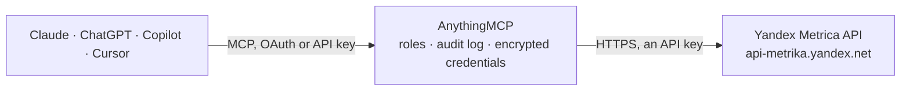

<!-- Generated by scripts/export-github-catalog.mjs in the anythingmcp-website repository. Do not edit by hand. -->

# Yandex Metrica MCP connector

Let your AI analyse Yandex Metrica web analytics: counters, goals, filters and segments, table, time-series, drill-down and comparison reports on visits, sources, pages and conversions, and raw … The AnythingMCP connector gives Claude, ChatGPT, Microsoft Copilot, Cursor and Gemini 20 MCP tools for Yandex Metrica: 17 read and 3 can change data.

**Category:** [Analytics](../analytics.md) · **Tools:** 20 · **Setup guide:** [anythingmcp.com](https://anythingmcp.com/guides/yandex-metrica-to-mcp) · [Deutsch](https://anythingmcp.com/de/guides/yandex-metrica-to-mcp) · [Italiano](https://anythingmcp.com/it/guides/yandex-metrica-to-mcp) · [Español](https://anythingmcp.com/es/guides/yandex-metrica-to-mcp) · [日本語](https://anythingmcp.com/ja/guides/yandex-metrica-to-mcp) · [Русский](https://anythingmcp.com/ru/guides/yandex-metrica-to-mcp) · [中文](https://anythingmcp.com/zh/guides/yandex-metrica-to-mcp)

## Start without code

No installation and no terminal: AnythingMCP Cloud runs the Yandex Metrica connector for you, operated by helpcode.ai in Frankfurt, Germany.

1. **Click the button above** and create an account or sign in. The Yandex Metrica connector opens, ready to install.
2. **Paste the API key or token from your Yandex Metrica account.** Every click is in the [step-by-step guide](https://anythingmcp.com/guides/yandex-metrica-to-mcp).
3. **Click Install.** AnythingMCP shows the address of your MCP server.
4. **Add that address to your assistant:** [Claude](https://anythingmcp.com/guides/connect-yandex-metrica-to-claude) · [ChatGPT](https://anythingmcp.com/guides/connect-yandex-metrica-to-chatgpt) · [Microsoft Copilot](https://anythingmcp.com/guides/connect-yandex-metrica-to-copilot) · [Cursor](https://anythingmcp.com/guides/connect-yandex-metrica-to-cursor) · [Gemini CLI](https://anythingmcp.com/guides/connect-yandex-metrica-to-gemini) · [Meta Muse](https://anythingmcp.com/guides/connect-yandex-metrica-to-muse).
5. **Ask your first question.**

Prefer help with the setup? [Talk to us](https://anythingmcp.com/contact).

## How it works

- **The AI client** speaks MCP (Streamable HTTP) to AnythingMCP and only sees tool names, descriptions and results. It never gets the Yandex Metrica credentials.
- **AnythingMCP** checks the client's role, builds the call from the tool definition, adds the credentials (an API key), calls Yandex Metrica, logs the call and returns the result.
- **Yandex Metrica** sees an ordinary API client with the rights of the account the credentials belong to.

## Tools

| Tool | What it does | Access |
|---|---|---|
| [`yandex_metrica_list_counters`](#yandex_metrica_list_counters) | List the Metrica counters (tags) the token can read: id, name, site, status, owner_login, permission (own, view, edit), time zone, creation date and, with… | read |
| [`yandex_metrica_get_counter`](#yandex_metrica_get_counter) | Get one counter's settings: name, site and mirrors, status, time zone, code status, webvisor and e-commerce options, owner and, with field, goals, grants,… | read |
| [`yandex_metrica_list_goals`](#yandex_metrica_list_goals) | List the goals of a counter: id, name, type (url, action, number, step, phone, email, form, messenger ...), conditions, is_retargeting and default price. | read |
| [`yandex_metrica_get_goal`](#yandex_metrica_get_goal) | Get one goal of a counter by id: name, type, conditions, steps of a composite goal and price. | read |
| [`yandex_metrica_list_filters`](#yandex_metrica_list_filters) | List the data filters of a counter (include or exclude traffic by IP, URL, title, referrer ...): id, attr, type, value, action, status. | read |
| [`yandex_metrica_list_operations`](#yandex_metrica_list_operations) | List the URL operations of a counter (cut query parameters or fragments, merge to lowercase, replace domain): id, action, attr, value, status. | read |
| [`yandex_metrica_list_segments`](#yandex_metrica_list_segments) | List the saved segments of a counter: segment_id, name, expression (a filter you can pass as filters in reports), status, segment_source and create_time. | read |
| [`yandex_metrica_list_grants`](#yandex_metrica_list_grants) | List who has access to a counter: user_login, perm (view or edit), created_at and comment. | read |
| [`yandex_metrica_list_labels`](#yandex_metrica_list_labels) | List the user's counter labels (folders): id and name. | read |
| [`yandex_metrica_get_report`](#yandex_metrica_get_report) | Build a table report from the Reporting API: metrics grouped by dimensions over a date range, with filters, sorting and paging. | read |
| [`yandex_metrica_get_report_by_time`](#yandex_metrica_get_report_by_time) | Build a time series: the metrics per day, week, month, hour or other interval for the top rows of the dimensions. | read |
| [`yandex_metrica_get_drilldown`](#yandex_metrica_get_drilldown) | Build a tree report: the first dimension's values with their metrics, then expand one row into the next dimension with parent_id. | read |
| [`yandex_metrica_compare_segments`](#yandex_metrica_compare_segments) | Compare two segments or periods side by side: the same metrics and dimensions for segment A (date1_a, date2_a, filters_a) and segment B (date1_b, date2_b,… | read |
| [`yandex_metrica_evaluate_log_request`](#yandex_metrica_evaluate_log_request) | Check whether a Logs API request for raw visits or hits can be created: possible (true or false) and max_possible_day_quantity. | read |
| [`yandex_metrica_create_log_request`](#yandex_metrica_create_log_request) | Create a Logs API request that prepares raw, unsampled visits or hits for a date range on Yandex's side. | write |
| [`yandex_metrica_list_log_requests`](#yandex_metrica_list_log_requests) | List the Logs API requests of a counter: request_id, source, fields, attribution, status (created, processed, canceled, processing_failed, awaiting_retry,… | read |
| [`yandex_metrica_get_log_request`](#yandex_metrica_get_log_request) | Get one Logs API request: status and, once processed, the parts (part_number and size) to download. | read |
| [`yandex_metrica_download_log_part`](#yandex_metrica_download_log_part) | Download one part of a processed Logs API request as tab-separated text, the first line holding the field names. | read |
| [`yandex_metrica_cancel_log_request`](#yandex_metrica_cancel_log_request) | Cancel a Logs API request that is still being prepared (status created). | write |
| [`yandex_metrica_clean_log_request`](#yandex_metrica_clean_log_request) | Delete the prepared files of a processed Logs API request to free the counter's log storage quota. | write |

## Tool reference

Every parameter as the AI client sees it in `tools/list`. Source: [`packages/backend/src/adapters/intl/yandex-metrica.json`](../../../packages/backend/src/adapters/intl/yandex-metrica.json).

### `yandex_metrica_list_counters`

List the Metrica counters (tags) the token can read: id, name, site, status, owner_login, permission (own, view, edit), time zone, creation date and, with field, goals, mirrors, grants, filters, operations. Start here to get counter ids; also checks the token.

**Access:** read · **Call:** `GET /management/v1/counters`

| Parameter | Type | Required | Description |
|---|---|---|---|
| `search_string` | string | no | Substring of the counter name or site, or a full counter id. |
| `status` | `Active` \| `Deleted` | no | Default Active. |
| `permission` | string | no | Comma-separated access levels: own, view, edit. |
| `favorite` | boolean | no | Only counters in Favorites. |
| `label_id` | integer | no | Only counters with this label. |
| `type` | `simple` \| `partner` | no | simple (created in Metrica) or partner (imported from YAN). |
| `counter_ids` | string | no | Comma-separated counter ids to fetch. |
| `field` | string | no | Extra blocks, comma-separated: goals, mirrors, grants, filters, operations, counter_flags. |
| `sort` | `None` \| `Default` \| `Visits` \| `Hits` \| `Uniques` \| `Name` | no | Sort order. |
| `per_page` | integer | no | Counters per page, default 1000. |
| `offset` | integer | no | First counter, from 1. |

### `yandex_metrica_get_counter`

Get one counter's settings: name, site and mirrors, status, time zone, code status, webvisor and e-commerce options, owner and, with field, goals, grants, filters and operations.

**Access:** read · **Call:** `GET /management/v1/counter/{counterId}`

| Parameter | Type | Required | Description |
|---|---|---|---|
| `counterId` | integer | yes | Counter (tag) id from yandex_metrica_list_counters. |
| `field` | string | no | Extra blocks, comma-separated: goals, mirrors, grants, filters, operation, counter_flags. |

### `yandex_metrica_list_goals`

List the goals of a counter: id, name, type (url, action, number, step, phone, email, form, messenger ...), conditions, is_retargeting and default price. Use the goal ids in metrics such as ym:s:goal<id>reaches and ym:s:goal<id>conversionRate.

**Access:** read · **Call:** `GET /management/v1/counter/{counterId}/goals`

| Parameter | Type | Required | Description |
|---|---|---|---|
| `counterId` | integer | yes | Counter (tag) id from yandex_metrica_list_counters. |
| `useDeleted` | boolean | no | Include deleted goals. |

### `yandex_metrica_get_goal`

Get one goal of a counter by id: name, type, conditions, steps of a composite goal and price.

**Access:** read · **Call:** `GET /management/v1/counter/{counterId}/goal/{goalId}`

| Parameter | Type | Required | Description |
|---|---|---|---|
| `counterId` | integer | yes | Counter (tag) id from yandex_metrica_list_counters. |
| `goalId` | integer | yes | Goal id. |

### `yandex_metrica_list_filters`

List the data filters of a counter (include or exclude traffic by IP, URL, title, referrer ...): id, attr, type, value, action, status.

**Access:** read · **Call:** `GET /management/v1/counter/{counterId}/filters`

| Parameter | Type | Required | Description |
|---|---|---|---|
| `counterId` | integer | yes | Counter (tag) id from yandex_metrica_list_counters. |

### `yandex_metrica_list_operations`

List the URL operations of a counter (cut query parameters or fragments, merge to lowercase, replace domain): id, action, attr, value, status.

**Access:** read · **Call:** `GET /management/v1/counter/{counterId}/operations`

| Parameter | Type | Required | Description |
|---|---|---|---|
| `counterId` | integer | yes | Counter (tag) id from yandex_metrica_list_counters. |

### `yandex_metrica_list_segments`

List the saved segments of a counter: segment_id, name, expression (a filter you can pass as filters in reports), status, segment_source and create_time.

**Access:** read · **Call:** `GET /management/v1/counter/{counterId}/apisegment/segments`

| Parameter | Type | Required | Description |
|---|---|---|---|
| `counterId` | integer | yes | Counter (tag) id from yandex_metrica_list_counters. |

### `yandex_metrica_list_grants`

List who has access to a counter: user_login, perm (view or edit), created_at and comment.

**Access:** read · **Call:** `GET /management/v1/counter/{counterId}/grants`

| Parameter | Type | Required | Description |
|---|---|---|---|
| `counterId` | integer | yes | Counter (tag) id from yandex_metrica_list_counters. |

### `yandex_metrica_list_labels`

List the user's counter labels (folders): id and name. Filter yandex_metrica_list_counters by label_id.

**Access:** read · **Call:** `GET /management/v1/labels`

No parameters.

### `yandex_metrica_get_report`

Build a table report from the Reporting API: metrics grouped by dimensions over a date range, with filters, sorting and paging. Use it for most questions (traffic by source, conversions per goal, top pages, countries, devices). Answer: query, data (rows with dimensions and metrics), totals, min, max, total_rows, sampled and sample_share.

**Access:** read · **Call:** `GET /stat/v1/data`

| Parameter | Type | Required | Description |
|---|---|---|---|
| `ids` | string | yes | Counter id, or several comma-separated, e.g. 44147844. |
| `metrics` | string | no | Comma-separated metrics, at most 20, e.g. ym:s:visits,ym:s:users,ym:s:bounceRate,ym:s:pageDepth,ym:s:avgVisitDurationSeconds,ym:s:goal<goalId>reaches. Required unless preset is given. |
| `dimensions` | string | no | Comma-separated dimensions, at most 10, e.g. ym:s:date, ym:s:lastTrafficSource, ym:s:lastSearchEngine, ym:s:regionCountry, ym:s:deviceCategory, ym:s:startURL. |
| `date1` | string | no | Start date YYYY-MM-DD, or today, yesterday, NdaysAgo (e.g. 30daysAgo). Default 6daysAgo. |
| `date2` | string | no | End date YYYY-MM-DD, or today, yesterday, NdaysAgo. Default today. |
| `filters` | string | no | Segmentation filter, e.g. ym:s:trafficSource=='organic' AND ym:s:isRobot=='No'. |
| `preset` | string | no | Report preset instead of metrics/dimensions, e.g. sources_summary, sources_search_phrases, traffic, tech_platforms, geo_country. |
| `accuracy` | string | no | Sampling: low, medium, high, full, or a fraction like 0.1. Default: the API's choice. |
| `proposed_accuracy` | boolean | no | true lets the API raise accuracy automatically for small samples. |
| `include_undefined` | boolean | no | Include rows whose first dimension is undefined. |
| `direct_client_logins` | string | no | Comma-separated Yandex Direct client logins, for Direct cost reports. |
| `timezone` | string | no | Time zone as +hh:mm or -hh:mm. Default: the counter's. |
| `lang` | string | no | Language of dimension names, e.g. en, ru. |
| `sort` | string | no | Comma-separated metrics or dimensions; prefix - for descending, e.g. -ym:s:visits. |
| `limit` | integer | no | Rows per page, default 100. |
| `offset` | integer | no | First row, from 1. |

### `yandex_metrica_get_report_by_time`

Build a time series: the metrics per day, week, month, hour or other interval for the top rows of the dimensions. Use it for trends and charts. Answer: time_intervals and, per row, the metric values per interval, plus totals.

**Access:** read · **Call:** `GET /stat/v1/data/bytime`

| Parameter | Type | Required | Description |
|---|---|---|---|
| `ids` | string | yes | Counter id, or several comma-separated, e.g. 44147844. |
| `metrics` | string | no | Comma-separated metrics, at most 20, e.g. ym:s:visits,ym:s:users,ym:s:bounceRate,ym:s:pageDepth,ym:s:avgVisitDurationSeconds,ym:s:goal<goalId>reaches. Required unless preset is given. |
| `dimensions` | string | no | Comma-separated dimensions, at most 10, e.g. ym:s:date, ym:s:lastTrafficSource, ym:s:lastSearchEngine, ym:s:regionCountry, ym:s:deviceCategory, ym:s:startURL. |
| `date1` | string | no | Start date YYYY-MM-DD, or today, yesterday, NdaysAgo (e.g. 30daysAgo). Default 6daysAgo. |
| `date2` | string | no | End date YYYY-MM-DD, or today, yesterday, NdaysAgo. Default today. |
| `filters` | string | no | Segmentation filter, e.g. ym:s:trafficSource=='organic' AND ym:s:isRobot=='No'. |
| `preset` | string | no | Report preset instead of metrics/dimensions, e.g. sources_summary, sources_search_phrases, traffic, tech_platforms, geo_country. |
| `accuracy` | string | no | Sampling: low, medium, high, full, or a fraction like 0.1. Default: the API's choice. |
| `proposed_accuracy` | boolean | no | true lets the API raise accuracy automatically for small samples. |
| `include_undefined` | boolean | no | Include rows whose first dimension is undefined. |
| `direct_client_logins` | string | no | Comma-separated Yandex Direct client logins, for Direct cost reports. |
| `timezone` | string | no | Time zone as +hh:mm or -hh:mm. Default: the counter's. |
| `lang` | string | no | Language of dimension names, e.g. en, ru. |
| `group` | `all` \| `auto` \| `minute` \| `dekaminute` \| `hour` \| `day` \| `week` \| `month` \| `quarter` \| `year` | no | Interval size. Default week. |
| `top_keys` | integer | no | Number of dimension rows to chart, default 7. |
| `keys_sort` | string | no | Sort used to pick the top rows, e.g. -ym:s:visits. |
| `include_annotations` | boolean | no | Include chart annotations (comments) of the counter. |

### `yandex_metrica_get_drilldown`

Build a tree report: the first dimension's values with their metrics, then expand one row into the next dimension with parent_id. Use it to explore a hierarchy (source, then engine, then phrase). Answer: query, data (rows with dimensions and metrics), totals, min, max, total_rows, sampled and sample_share.

**Access:** read · **Call:** `GET /stat/v1/data/drilldown`

| Parameter | Type | Required | Description |
|---|---|---|---|
| `ids` | string | yes | Counter id, or several comma-separated, e.g. 44147844. |
| `metrics` | string | no | Comma-separated metrics, at most 20, e.g. ym:s:visits,ym:s:users,ym:s:bounceRate,ym:s:pageDepth,ym:s:avgVisitDurationSeconds,ym:s:goal<goalId>reaches. Required unless preset is given. |
| `dimensions` | string | no | Comma-separated dimensions, at most 10, e.g. ym:s:date, ym:s:lastTrafficSource, ym:s:lastSearchEngine, ym:s:regionCountry, ym:s:deviceCategory, ym:s:startURL. |
| `date1` | string | no | Start date YYYY-MM-DD, or today, yesterday, NdaysAgo (e.g. 30daysAgo). Default 6daysAgo. |
| `date2` | string | no | End date YYYY-MM-DD, or today, yesterday, NdaysAgo. Default today. |
| `filters` | string | no | Segmentation filter, e.g. ym:s:trafficSource=='organic' AND ym:s:isRobot=='No'. |
| `preset` | string | no | Report preset instead of metrics/dimensions, e.g. sources_summary, sources_search_phrases, traffic, tech_platforms, geo_country. |
| `accuracy` | string | no | Sampling: low, medium, high, full, or a fraction like 0.1. Default: the API's choice. |
| `proposed_accuracy` | boolean | no | true lets the API raise accuracy automatically for small samples. |
| `include_undefined` | boolean | no | Include rows whose first dimension is undefined. |
| `direct_client_logins` | string | no | Comma-separated Yandex Direct client logins, for Direct cost reports. |
| `timezone` | string | no | Time zone as +hh:mm or -hh:mm. Default: the counter's. |
| `lang` | string | no | Language of dimension names, e.g. en, ru. |
| `parent_id` | string | no | JSON list of the keys of the row to expand, e.g. ["organic"]. Omit for the top level. |
| `sort` | string | no | Comma-separated metrics or dimensions; prefix - for descending, e.g. -ym:s:visits. |
| `limit` | integer | no | Rows per page, default 100. |
| `offset` | integer | no | First row, from 1. |

### `yandex_metrica_compare_segments`

Compare two segments or periods side by side: the same metrics and dimensions for segment A (date1_a, date2_a, filters_a) and segment B (date1_b, date2_b, filters_b). Use it for period-over-period or audience comparisons. Answer: rows with metrics a and b, and totals for both.

**Access:** read · **Call:** `GET /stat/v1/data/comparison`

| Parameter | Type | Required | Description |
|---|---|---|---|
| `ids` | string | yes | Counter id, or several comma-separated, e.g. 44147844. |
| `metrics` | string | no | Comma-separated metrics, at most 20, e.g. ym:s:visits,ym:s:users,ym:s:bounceRate,ym:s:pageDepth,ym:s:avgVisitDurationSeconds,ym:s:goal<goalId>reaches. Required unless preset is given. |
| `dimensions` | string | no | Comma-separated dimensions, at most 10, e.g. ym:s:date, ym:s:lastTrafficSource, ym:s:lastSearchEngine, ym:s:regionCountry, ym:s:deviceCategory, ym:s:startURL. |
| `filters` | string | no | Segmentation filter, e.g. ym:s:trafficSource=='organic' AND ym:s:isRobot=='No'. |
| `preset` | string | no | Report preset instead of metrics/dimensions, e.g. sources_summary, sources_search_phrases, traffic, tech_platforms, geo_country. |
| `accuracy` | string | no | Sampling: low, medium, high, full, or a fraction like 0.1. Default: the API's choice. |
| `proposed_accuracy` | boolean | no | true lets the API raise accuracy automatically for small samples. |
| `include_undefined` | boolean | no | Include rows whose first dimension is undefined. |
| `direct_client_logins` | string | no | Comma-separated Yandex Direct client logins, for Direct cost reports. |
| `timezone` | string | no | Time zone as +hh:mm or -hh:mm. Default: the counter's. |
| `lang` | string | no | Language of dimension names, e.g. en, ru. |
| `date1_a` | string | no | Start of period A (YYYY-MM-DD or NdaysAgo). |
| `date2_a` | string | no | End of period A. |
| `date1_b` | string | no | Start of period B. |
| `date2_b` | string | no | End of period B. |
| `filters_a` | string | no | Segment filter for A. |
| `filters_b` | string | no | Segment filter for B. |
| `sort` | string | no | Comma-separated metrics or dimensions; prefix - for descending, e.g. -ym:s:visits. |
| `limit` | integer | no | Rows per page, default 100. |
| `offset` | integer | no | First row, from 1. |

### `yandex_metrica_evaluate_log_request`

Check whether a Logs API request for raw visits or hits can be created: possible (true or false) and max_possible_day_quantity. Call it before yandex_metrica_create_log_request.

**Access:** read · **Call:** `GET /management/v1/counter/{counterId}/logrequests/evaluate`

| Parameter | Type | Required | Description |
|---|---|---|---|
| `counterId` | integer | yes | Counter (tag) id from yandex_metrica_list_counters. |
| `date1` | string | yes | First day, YYYY-MM-DD. |
| `date2` | string | yes | Last day, YYYY-MM-DD; not today. |
| `fields` | string | yes | Comma-separated Logs API fields of the chosen source, e.g. ym:s:visitID,ym:s:dateTime,ym:s:lastTrafficSource,ym:s:goalsID for visits or ym:pv:watchID,ym:pv:dateTime,ym:pv:URL for hits. |
| `source` | `visits` \| `hits` | yes | visits (sessions) or hits (pageviews and events). |

### `yandex_metrica_create_log_request`

Create a Logs API request that prepares raw, unsampled visits or hits for a date range on Yandex's side. Returns the log_request with request_id and status created; poll yandex_metrica_get_log_request until status is processed, then download its parts. Prepared logs count against the counter's log storage quota.

**Access:** write · **Call:** `POST /management/v1/counter/{counterId}/logrequests`

| Parameter | Type | Required | Description |
|---|---|---|---|
| `counterId` | integer | yes | Counter (tag) id from yandex_metrica_list_counters. |
| `date1` | string | yes | First day, YYYY-MM-DD. |
| `date2` | string | yes | Last day, YYYY-MM-DD; not today. |
| `fields` | string | yes | Comma-separated Logs API fields of the chosen source, e.g. ym:s:visitID,ym:s:dateTime,ym:s:lastTrafficSource,ym:s:goalsID for visits or ym:pv:watchID,ym:pv:dateTime,ym:pv:URL for hits. |
| `source` | `visits` \| `hits` | yes | visits (sessions) or hits (pageviews and events). |
| `attribution` | `FIRST` \| `LAST` \| `LASTSIGN` \| `LAST_YANDEX_DIRECT_CLICK` \| `CROSS_DEVICE_LAST_SIGNIFICANT` \| `CROSS_DEVICE_FIRST` \| `CROSS_DEVICE_LAST_YANDEX_DIRECT_CLICK` \| `CROSS_DEVICE_LAST` \| `AUTOMATIC` | no | Attribution model for source fields. Default LASTSIGN. |

### `yandex_metrica_list_log_requests`

List the Logs API requests of a counter: request_id, source, fields, attribution, status (created, processed, canceled, processing_failed, awaiting_retry, cleaned_by_user, cleaned_automatically_as_too_old), size and parts.

**Access:** read · **Call:** `GET /management/v1/counter/{counterId}/logrequests`

| Parameter | Type | Required | Description |
|---|---|---|---|
| `counterId` | integer | yes | Counter (tag) id from yandex_metrica_list_counters. |

### `yandex_metrica_get_log_request`

Get one Logs API request: status and, once processed, the parts (part_number and size) to download.

**Access:** read · **Call:** `GET /management/v1/counter/{counterId}/logrequest/{requestId}`

| Parameter | Type | Required | Description |
|---|---|---|---|
| `counterId` | integer | yes | Counter (tag) id from yandex_metrica_list_counters. |
| `requestId` | integer | yes | Log request id. |

### `yandex_metrica_download_log_part`

Download one part of a processed Logs API request as tab-separated text, the first line holding the field names. Parts can be large; download them one at a time and summarise.

**Access:** read · **Call:** `GET /management/v1/counter/{counterId}/logrequest/{requestId}/part/{partNumber}/download`

| Parameter | Type | Required | Description |
|---|---|---|---|
| `counterId` | integer | yes | Counter (tag) id from yandex_metrica_list_counters. |
| `requestId` | integer | yes | Log request id. |
| `partNumber` | integer | yes | part_number from yandex_metrica_get_log_request, from 0. |

### `yandex_metrica_cancel_log_request`

Cancel a Logs API request that is still being prepared (status created). Returns the request with status canceled.

**Access:** write · **Call:** `POST /management/v1/counter/{counterId}/logrequest/{requestId}/cancel`

| Parameter | Type | Required | Description |
|---|---|---|---|
| `counterId` | integer | yes | Counter (tag) id from yandex_metrica_list_counters. |
| `requestId` | integer | yes | Log request id. |

### `yandex_metrica_clean_log_request`

Delete the prepared files of a processed Logs API request to free the counter's log storage quota. The files cannot be downloaded afterwards. Irreversible; installed switched off.

**Access:** write · **Call:** `POST /management/v1/counter/{counterId}/logrequest/{requestId}/clean`

| Parameter | Type | Required | Description |
|---|---|---|---|
| `counterId` | integer | yes | Counter (tag) id from yandex_metrica_list_counters. |
| `requestId` | integer | yes | Log request id. |

## Run it yourself

AnythingMCP is open source (AGPL-3.0). [Run it with Docker](../../../README.md#run-it-yourself), open **Connectors → Store**, pick **Yandex Metrica** and enter `YANDEX_METRICA_TOKEN`, then add your MCP server URL to the AI client.

[← Analytics connectors](../analytics.md) · [All categories](../README.md)
