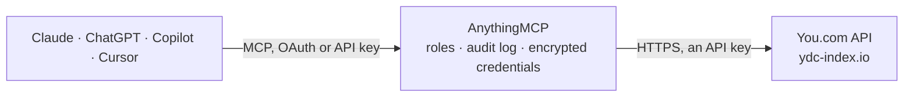

<!-- Generated by scripts/export-github-catalog.mjs in the anythingmcp-website repository. Do not edit by hand. -->

# You.com MCP connector

Web and news search from any AI agent via the You.com Search API. 2 tools, API-key auth. The AnythingMCP connector gives Claude, ChatGPT, Microsoft Copilot, Cursor and Gemini 2 MCP tools for You.com: 1 read and 1 can change data.

**Category:** [Public Data](../data.md) · **Tools:** 2 · **Setup guide:** [anythingmcp.com](https://anythingmcp.com/guides/youcom-to-mcp) · [Deutsch](https://anythingmcp.com/de/guides/youcom-to-mcp) · [Italiano](https://anythingmcp.com/it/guides/youcom-to-mcp) · [Español](https://anythingmcp.com/es/guides/youcom-to-mcp) · [日本語](https://anythingmcp.com/ja/guides/youcom-to-mcp) · [Русский](https://anythingmcp.com/ru/guides/youcom-to-mcp) · [中文](https://anythingmcp.com/zh/guides/youcom-to-mcp)

## Start without code

No installation and no terminal: AnythingMCP Cloud runs the You.com connector for you, operated by helpcode.ai in Frankfurt, Germany.

1. **Click the button above** and create an account or sign in. The You.com connector opens, ready to install.
2. **Paste the API key or token from your You.com account.** Every click is in the [step-by-step guide](https://anythingmcp.com/guides/youcom-to-mcp).
3. **Click Install.** AnythingMCP shows the address of your MCP server.
4. **Add that address to your assistant:** [Claude](https://anythingmcp.com/guides/connect-youcom-to-claude) · [ChatGPT](https://anythingmcp.com/guides/connect-youcom-to-chatgpt) · [Microsoft Copilot](https://anythingmcp.com/guides/connect-youcom-to-copilot) · [Cursor](https://anythingmcp.com/guides/connect-youcom-to-cursor) · [Gemini CLI](https://anythingmcp.com/guides/connect-youcom-to-gemini) · [Meta Muse](https://anythingmcp.com/guides/connect-youcom-to-muse).
5. **Ask your first question**, for example: *What's the VAT number and commercial register entry for Kestrel GmbH in Berlin?*

Prefer help with the setup? [Talk to us](https://anythingmcp.com/contact).

## How it works

- **The AI client** speaks MCP (Streamable HTTP) to AnythingMCP and only sees tool names, descriptions and results. It never gets the You.com credentials.
- **AnythingMCP** checks the client's role, builds the call from the tool definition, adds the credentials (an API key), calls You.com, logs the call and returns the result.
- **You.com** sees an ordinary API client with the rights of the account the credentials belong to.

## Tools

| Tool | What it does | Access |
|---|---|---|
| [`youcom_search`](#youcom_search) | Web search across the open web via You.com. | read |
| [`youcom_news`](#youcom_news) | News-only search via You.com. | write |

## Tool reference

Every parameter as the AI client sees it in `tools/list`. Source: [`packages/backend/src/adapters/intl/youcom.json`](../../../packages/backend/src/adapters/intl/youcom.json).

### `youcom_search`

Web search across the open web via You.com. Use when the agent needs current information, documentation, or facts not in its training data. Supports operators: site:, filetype:, +term, -term, AND/OR/NOT.

**Access:** read · **Call:** `POST /v1/search`

| Parameter | Type | Required | Description |
|---|---|---|---|
| `query` | string | yes | Search query. Supports site:, filetype:, +term/-term, AND/OR/NOT operators. |
| `count` | integer | no | Max results per section (web/news). Default varies; max 100. |
| `freshness` | string | no | Recency filter: 'day', 'week', 'month', 'year', or 'YYYY-MM-DDtoYYYY-MM-DD' custom range. |
| `country` | string | no | ISO 3166-1 alpha-2 country code (e.g. 'US', 'DE') to focus results geographically. |
| `language` | string | no | BCP 47 language code (e.g. 'EN', 'DE') to filter result language. |

### `youcom_news`

News-only search via You.com. Calls the same POST /v1/search endpoint as youcom_search and returns only the results.news section. Use when the user wants news coverage of a topic, company or event rather than general web results. Same query operators as youcom_search.

**Access:** write · **Call:** `POST /v1/search`

| Parameter | Type | Required | Description |
|---|---|---|---|
| `query` | string | yes | News search query. Supports the same operators as youcom_search. |
| `freshness` | string | no | Recency filter: 'day', 'week', 'month', 'year', or 'YYYY-MM-DDtoYYYY-MM-DD' custom range. |
| `count` | integer | no | Max results to return. Default varies; max 100. |

## Run it yourself

AnythingMCP is open source (AGPL-3.0). [Run it with Docker](../../../README.md#run-it-yourself), open **Connectors → Store**, pick **You.com** and enter `YDC_API_KEY`, then add your MCP server URL to the AI client.

[← Public Data connectors](../data.md) · [All categories](../README.md)
