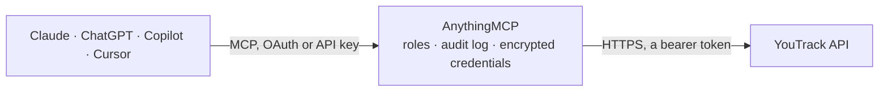

<!-- Generated by scripts/export-github-catalog.mjs in the anythingmcp-website repository. Do not edit by hand. -->

# YouTrack MCP connector

JetBrains YouTrack: issues with YouTrack's query language, their comments and work items, projects, agile boards, sprints and users. The AnythingMCP connector gives Claude, ChatGPT, Microsoft Copilot, Cursor and Gemini 10 MCP tools for YouTrack: 9 read and 1 can change data.

**Category:** [Project Management](../project-management.md) · **Tools:** 10 · **Setup guide:** [anythingmcp.com](https://anythingmcp.com/guides/youtrack-to-mcp) · [Deutsch](https://anythingmcp.com/de/guides/youtrack-to-mcp) · [Italiano](https://anythingmcp.com/it/guides/youtrack-to-mcp) · [Español](https://anythingmcp.com/es/guides/youtrack-to-mcp) · [日本語](https://anythingmcp.com/ja/guides/youtrack-to-mcp) · [Русский](https://anythingmcp.com/ru/guides/youtrack-to-mcp) · [中文](https://anythingmcp.com/zh/guides/youtrack-to-mcp)

## Start without code

No installation and no terminal: AnythingMCP Cloud runs the YouTrack connector for you, operated by helpcode.ai in Frankfurt, Germany.

1. **Click the button above** and create an account or sign in. The YouTrack connector opens, ready to install.
2. **Paste the API key or token from your YouTrack account.** Every click is in the [step-by-step guide](https://anythingmcp.com/guides/youtrack-to-mcp).
3. **Click Install.** AnythingMCP shows the address of your MCP server.
4. **Add that address to your assistant:** [Claude](https://anythingmcp.com/guides/connect-youtrack-to-claude) · [ChatGPT](https://anythingmcp.com/guides/connect-youtrack-to-chatgpt) · [Microsoft Copilot](https://anythingmcp.com/guides/connect-youtrack-to-copilot) · [Cursor](https://anythingmcp.com/guides/connect-youtrack-to-cursor) · [Gemini CLI](https://anythingmcp.com/guides/connect-youtrack-to-gemini) · [Meta Muse](https://anythingmcp.com/guides/connect-youtrack-to-muse).
5. **Ask your first question**, for example: *What's the status, reporter and assignee for issue INV-342 about the misplaced invoice for Nordica GmbH?*

Prefer help with the setup? [Talk to us](https://anythingmcp.com/contact).

## How it works

- **The AI client** speaks MCP (Streamable HTTP) to AnythingMCP and only sees tool names, descriptions and results. It never gets the YouTrack credentials.
- **AnythingMCP** checks the client's role, builds the call from the tool definition, adds the credentials (a bearer token), calls YouTrack, logs the call and returns the result.
- **YouTrack** sees an ordinary API client with the rights of the account the credentials belong to.

## Tools

| Tool | What it does | Access |
|---|---|---|
| [`youtrack_get_me`](#youtrack_get_me) | Read the user the token belongs to, with their login, full name and e-mail. | read |
| [`youtrack_search_issues`](#youtrack_search_issues) | Search issues with YouTrack's query language — the same grammar as the web UI's search box. | read |
| [`youtrack_get_issue`](#youtrack_get_issue) | Read one issue in full: summary, description, reporter, dates, and its custom fields — where state, priority and assignee actually live. | read |
| [`youtrack_list_issue_comments`](#youtrack_list_issue_comments) | Read the comments on one issue in order, with their author, text and creation time. | read |
| [`youtrack_list_issue_work_items`](#youtrack_list_issue_work_items) | Read the time logged against one issue: each entry's author, date, duration and work type — the effort behind a ticket. | read |
| [`youtrack_list_projects`](#youtrack_list_projects) | List projects with their short name, full name, description and leader — the short name is what a query's `project:` clause needs. | read |
| [`youtrack_list_agile_boards`](#youtrack_list_agile_boards) | List the agile boards with their name, the projects they cover and their current sprint, for a board-level view of the work. | read |
| [`youtrack_list_sprint_issues`](#youtrack_list_sprint_issues) | List the issues on one sprint of one agile board, with their state and assignee — the sprint contents an agent is usually asked about. | read |
| [`youtrack_list_users`](#youtrack_list_users) | List users with their login, full name and e-mail, to resolve who an issue is assigned to. | read |
| [`youtrack_add_comment`](#youtrack_add_comment) | Post a comment on an issue. | write |

## Tool reference

Every parameter as the AI client sees it in `tools/list`. Source: [`packages/backend/src/adapters/intl/youtrack.json`](../../../packages/backend/src/adapters/intl/youtrack.json).

### `youtrack_get_me`

Read the user the token belongs to, with their login, full name and e-mail. The fastest proof that URL and permanent token are both right.

**Access:** read · **Call:** `GET /users/me`

No parameters.

### `youtrack_search_issues`

Search issues with YouTrack's query language — the same grammar as the web UI's search box. `project: PROJ #Unresolved assignee: me` is a complete query.

**Access:** read · **Call:** `GET /issues`

| Parameter | Type | Required | Description |
|---|---|---|---|
| `query` | string | no | YouTrack query, e.g. `project: PROJ #Unresolved sort by: updated desc`. |
| `fields` | string | no | Field selector. Defaults to id, readable id, summary, resolved/updated dates, project and custom fields; override to add more, e.g. description or reporter(login). |
| `top` | number | no | Rows to return (default 50). |
| `skip` | number | no | Rows to skip, for paging. |

### `youtrack_get_issue`

Read one issue in full: summary, description, reporter, dates, and its custom fields — where state, priority and assignee actually live.

**Access:** read · **Call:** `GET /issues/{issueId}`

| Parameter | Type | Required | Description |
|---|---|---|---|
| `issueId` | string | yes | Issue id, e.g. PROJ-123 (the readable id works). |
| `fields` | string | no | Field selector. Defaults to summary, description, dates, project, reporter and custom fields; override for something else. |

### `youtrack_list_issue_comments`

Read the comments on one issue in order, with their author, text and creation time.

**Access:** read · **Call:** `GET /issues/{issueId}/comments`

| Parameter | Type | Required | Description |
|---|---|---|---|
| `issueId` | string | yes | Issue id, e.g. PROJ-123. |
| `top` | number | no | Comments to return. |
| `skip` | number | no | Comments to skip, for paging. |

### `youtrack_list_issue_work_items`

Read the time logged against one issue: each entry's author, date, duration and work type — the effort behind a ticket.

**Access:** read · **Call:** `GET /issues/{issueId}/timeTracking/workItems`

| Parameter | Type | Required | Description |
|---|---|---|---|
| `issueId` | string | yes | Issue id, e.g. PROJ-123. |

### `youtrack_list_projects`

List projects with their short name, full name, description and leader — the short name is what a query's `project:` clause needs.

**Access:** read · **Call:** `GET /admin/projects`

| Parameter | Type | Required | Description |
|---|---|---|---|
| `top` | number | no | Rows to return. |
| `skip` | number | no | Rows to skip, for paging. |

### `youtrack_list_agile_boards`

List the agile boards with their name, the projects they cover and their current sprint, for a board-level view of the work.

**Access:** read · **Call:** `GET /agiles`

| Parameter | Type | Required | Description |
|---|---|---|---|
| `top` | number | no | Rows to return. |
| `skip` | number | no | Rows to skip, for paging. |

### `youtrack_list_sprint_issues`

List the issues on one sprint of one agile board, with their state and assignee — the sprint contents an agent is usually asked about.

**Access:** read · **Call:** `GET /agiles/{agileId}/sprints/{sprintId}/issues`

| Parameter | Type | Required | Description |
|---|---|---|---|
| `agileId` | string | yes | Agile board id, from youtrack_list_agile_boards. |
| `sprintId` | string | yes | Sprint id from that board. |
| `top` | number | no | Rows to return. |

### `youtrack_list_users`

List users with their login, full name and e-mail, to resolve who an issue is assigned to. Requires a token with the low-level admin read permission.

**Access:** read · **Call:** `GET /users`

| Parameter | Type | Required | Description |
|---|---|---|---|
| `query` | string | no | Search fragment matched against login, name and e-mail. |
| `top` | number | no | Rows to return. |
| `skip` | number | no | Rows to skip, for paging. |

### `youtrack_add_comment`

Post a comment on an issue. Writes to the live instance and notifies the issue's watchers, so it is not a draft operation.

**Access:** write · **Call:** `POST /issues/{issueId}/comments`

| Parameter | Type | Required | Description |
|---|---|---|---|
| `issueId` | string | yes | Issue id, e.g. PROJ-123. |
| `text` | string | yes | Comment text. YouTrack markdown is accepted. |

## Run it yourself

AnythingMCP is open source (AGPL-3.0). [Run it with Docker](../../../README.md#run-it-yourself), open **Connectors → Store**, pick **YouTrack** and enter `YOUTRACK_URL`, `YOUTRACK_TOKEN`, then add your MCP server URL to the AI client.

[← Project Management connectors](../project-management.md) · [All categories](../README.md)
