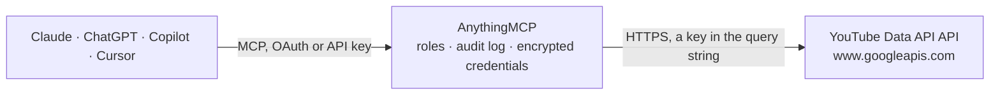

<!-- Generated by scripts/export-github-catalog.mjs in the anythingmcp-website repository. Do not edit by hand. -->

# YouTube Data API MCP connector

Read YouTube data — videos, channels, playlists, search, comments — and (with OAuth) manage your own uploads. 9 tools, API key + optional OAuth Bearer. The AnythingMCP connector gives Claude, ChatGPT, Microsoft Copilot, Cursor and Gemini 9 MCP tools for YouTube Data API, all read-only.

**Category:** [Social Media](../social.md) · **Tools:** 9 · **Setup guide:** [anythingmcp.com](https://anythingmcp.com/guides/youtube-data-to-mcp) · [Deutsch](https://anythingmcp.com/de/guides/youtube-data-to-mcp) · [Italiano](https://anythingmcp.com/it/guides/youtube-data-to-mcp) · [Español](https://anythingmcp.com/es/guides/youtube-data-to-mcp) · [日本語](https://anythingmcp.com/ja/guides/youtube-data-to-mcp) · [Русский](https://anythingmcp.com/ru/guides/youtube-data-to-mcp) · [中文](https://anythingmcp.com/zh/guides/youtube-data-to-mcp)

## Start without code

No installation and no terminal: AnythingMCP Cloud runs the YouTube Data API connector for you, operated by helpcode.ai in Frankfurt, Germany.

1. **Click the button above** and create an account or sign in. The YouTube Data API connector opens, ready to install.
2. **Paste the API key or token from your YouTube Data API account.** Every click is in the [step-by-step guide](https://anythingmcp.com/guides/youtube-data-to-mcp).
3. **Click Install.** AnythingMCP shows the address of your MCP server.
4. **Add that address to your assistant:** [Claude](https://anythingmcp.com/guides/connect-youtube-data-to-claude) · [ChatGPT](https://anythingmcp.com/guides/connect-youtube-data-to-chatgpt) · [Microsoft Copilot](https://anythingmcp.com/guides/connect-youtube-data-to-copilot) · [Cursor](https://anythingmcp.com/guides/connect-youtube-data-to-cursor) · [Gemini CLI](https://anythingmcp.com/guides/connect-youtube-data-to-gemini) · [Meta Muse](https://anythingmcp.com/guides/connect-youtube-data-to-muse).
5. **Ask your first question**, for example: *What's the subscriber count and channel creation date for @GreenFarmOfficial?*

Prefer help with the setup? [Talk to us](https://anythingmcp.com/contact).

## How it works

- **The AI client** speaks MCP (Streamable HTTP) to AnythingMCP and only sees tool names, descriptions and results. It never gets the YouTube Data API credentials.
- **AnythingMCP** checks the client's role, builds the call from the tool definition, adds the credentials (a key in the query string), calls YouTube Data API, logs the call and returns the result.
- **YouTube Data API** sees an ordinary API client with the rights of the account the credentials belong to.

## Tools

| Tool | What it does | Access |
|---|---|---|
| [`youtube_search`](#youtube_search) | Search videos / channels / playlists. | read |
| [`youtube_get_videos`](#youtube_get_videos) | Fetch video details by ID(s). | read |
| [`youtube_get_videos_chart`](#youtube_get_videos_chart) | Get videos from a chart (currently only 'mostPopular'). | read |
| [`youtube_get_channels`](#youtube_get_channels) | Fetch channel details by ID, handle (@username), forUsername (legacy), or 'mine' (requires OAuth). | read |
| [`youtube_list_playlists`](#youtube_list_playlists) | List playlists, filtered by channelId or 'mine' (OAuth). | read |
| [`youtube_list_playlist_items`](#youtube_list_playlist_items) | List items in a playlist (videos in playlist). | read |
| [`youtube_list_video_comments`](#youtube_list_video_comments) | List top-level comments on a video. | read |
| [`youtube_list_categories`](#youtube_list_categories) | List video categories for a region. | read |
| [`youtube_get_captions`](#youtube_get_captions) | List caption tracks available for a video. | read |

## Tool reference

Every parameter as the AI client sees it in `tools/list`. Source: [`packages/backend/src/adapters/intl/youtube-data.json`](../../../packages/backend/src/adapters/intl/youtube-data.json).

### `youtube_search`

Search videos / channels / playlists. Costs 100 quota units. Filter by type, order, region, language, date range.

**Access:** read · **Call:** `GET /search`

| Parameter | Type | Required | Description |
|---|---|---|---|
| `q` | string | yes | Search query. |
| `type` | string | no | channel, playlist, video, or comma-separated. |
| `order` | string | no | date, rating, relevance (default), title, viewCount, videoCount. |
| `regionCode` | string | no | ISO 3166-1 alpha-2. |
| `relevanceLanguage` | string | no | ISO 639-1. |
| `publishedAfter` | string | no | ISO 8601 datetime. |
| `publishedBefore` | string | no | ISO 8601 datetime. |
| `channelId` | string | no | Restrict to videos by this channel. |
| `videoDuration` | string | no | any, short (<4min), medium (4-20min), long (>20min). |
| `maxResults` | integer | no | 1-50 (default 5). |
| `pageToken` | string | no | Cursor for next page. |
| `part` | string | no | snippet (always for search). Other parts not available on search.list. |

### `youtube_get_videos`

Fetch video details by ID(s). Cheap (1 unit) — prefer this over search when you already have IDs.

**Access:** read · **Call:** `GET /videos`

| Parameter | Type | Required | Description |
|---|---|---|---|
| `id` | string | yes | Comma-separated video IDs (max 50). |
| `part` | string | yes | Comma-separated: snippet, contentDetails, statistics, status, player, topicDetails, recordingDetails, fileDetails, liveStreamingDetails. |

### `youtube_get_videos_chart`

Get videos from a chart (currently only 'mostPopular'). Region-specific.

**Access:** read · **Call:** `GET /videos`

| Parameter | Type | Required | Description |
|---|---|---|---|
| `chart` | string | yes | mostPopular. |
| `regionCode` | string | no | ISO 3166-1 alpha-2 country. |
| `videoCategoryId` | string | no | Restrict to a category. |
| `maxResults` | integer | no | 1-50. |
| `part` | string | yes | Parts. |

### `youtube_get_channels`

Fetch channel details by ID, handle (@username), forUsername (legacy), or 'mine' (requires OAuth).

**Access:** read · **Call:** `GET /channels`

| Parameter | Type | Required | Description |
|---|---|---|---|
| `id` | string | no | Comma-separated channel IDs. |
| `forHandle` | string | no | Channel handle (with or without leading @). |
| `forUsername` | string | no | Legacy username (mostly defunct). |
| `mine` | boolean | no | true = the OAuth-authenticated user's channel (requires OAuth scope). |
| `part` | string | yes | snippet, contentDetails, statistics, status, brandingSettings, topicDetails, localizations. |

### `youtube_list_playlists`

List playlists, filtered by channelId or 'mine' (OAuth).

**Access:** read · **Call:** `GET /playlists`

| Parameter | Type | Required | Description |
|---|---|---|---|
| `channelId` | string | no | Channel ID. |
| `id` | string | no | Comma-separated playlist IDs. |
| `mine` | boolean | no | OAuth user's playlists. |
| `maxResults` | integer | no | 1-50. |
| `pageToken` | string | no | Cursor. |
| `part` | string | yes | snippet, contentDetails, player, status. |

### `youtube_list_playlist_items`

List items in a playlist (videos in playlist).

**Access:** read · **Call:** `GET /playlistItems`

| Parameter | Type | Required | Description |
|---|---|---|---|
| `playlistId` | string | yes | Playlist ID. |
| `videoId` | string | no | Filter to one specific video. |
| `maxResults` | integer | no | 1-50. |
| `pageToken` | string | no | Cursor. |
| `part` | string | yes | snippet, contentDetails, status, id. |

### `youtube_list_video_comments`

List top-level comments on a video. Use commentThreads.list (not comments.list which is for child comments).

**Access:** read · **Call:** `GET /commentThreads`

| Parameter | Type | Required | Description |
|---|---|---|---|
| `videoId` | string | yes | Video ID. |
| `order` | string | no | time (default) or relevance. |
| `maxResults` | integer | no | 1-100. |
| `pageToken` | string | no | Cursor. |
| `searchTerms` | string | no | Filter to comments containing this text. |
| `part` | string | yes | snippet, replies, id. |

### `youtube_list_categories`

List video categories for a region.

**Access:** read · **Call:** `GET /videoCategories`

| Parameter | Type | Required | Description |
|---|---|---|---|
| `regionCode` | string | no | ISO 3166-1 alpha-2. |
| `part` | string | yes | snippet. |

### `youtube_get_captions`

List caption tracks available for a video.

**Access:** read · **Call:** `GET /captions`

| Parameter | Type | Required | Description |
|---|---|---|---|
| `videoId` | string | yes | Video ID. |
| `part` | string | yes | snippet, id. |

## Run it yourself

AnythingMCP is open source (AGPL-3.0). [Run it with Docker](../../../README.md#run-it-yourself), open **Connectors → Store**, pick **YouTube Data API** and enter `YOUTUBE_API_KEY`, then add your MCP server URL to the AI client.

[← Social Media connectors](../social.md) · [All categories](../README.md)
