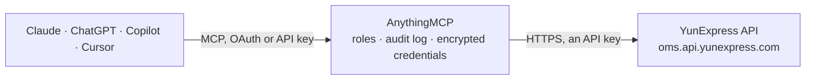

<!-- Generated by scripts/export-github-catalog.mjs in the anythingmcp-website repository. Do not edit by hand. -->

# YunExpress MCP connector

Ship cross-border parcels with YunExpress (云途物流) from an AI agent: destination countries, shipping methods and goods types, freight quotes, shipment orders with tracking numbers, labels, last-mile … The AnythingMCP connector gives Claude, ChatGPT, Microsoft Copilot, Cursor and Gemini 16 MCP tools for YunExpress: 12 read and 4 can change data.

**Category:** [Logistics](../logistics.md) · **Tools:** 16 · **Setup guide:** [anythingmcp.com](https://anythingmcp.com/guides/yunexpress-to-mcp) · [Deutsch](https://anythingmcp.com/de/guides/yunexpress-to-mcp) · [Italiano](https://anythingmcp.com/it/guides/yunexpress-to-mcp) · [Español](https://anythingmcp.com/es/guides/yunexpress-to-mcp) · [日本語](https://anythingmcp.com/ja/guides/yunexpress-to-mcp) · [Русский](https://anythingmcp.com/ru/guides/yunexpress-to-mcp) · [中文](https://anythingmcp.com/zh/guides/yunexpress-to-mcp)

## Start without code

No installation and no terminal: AnythingMCP Cloud runs the YunExpress connector for you, operated by helpcode.ai in Frankfurt, Germany.

1. **Click the button above** and create an account or sign in. The YunExpress connector opens, ready to install.
2. **Paste the API key or token from your YunExpress account.** Every click is in the [step-by-step guide](https://anythingmcp.com/guides/yunexpress-to-mcp).
3. **Click Install.** AnythingMCP shows the address of your MCP server.
4. **Add that address to your assistant:** [Claude](https://anythingmcp.com/guides/connect-yunexpress-to-claude) · [ChatGPT](https://anythingmcp.com/guides/connect-yunexpress-to-chatgpt) · [Microsoft Copilot](https://anythingmcp.com/guides/connect-yunexpress-to-copilot) · [Cursor](https://anythingmcp.com/guides/connect-yunexpress-to-cursor) · [Gemini CLI](https://anythingmcp.com/guides/connect-yunexpress-to-gemini) · [Meta Muse](https://anythingmcp.com/guides/connect-yunexpress-to-muse).
5. **Ask your first question**, for example: *Get the YunExpress order details for waybill WX2026-0897, I need receiver and billed fees.*

Prefer help with the setup? [Talk to us](https://anythingmcp.com/contact).

## How it works

- **The AI client** speaks MCP (Streamable HTTP) to AnythingMCP and only sees tool names, descriptions and results. It never gets the YunExpress credentials.
- **AnythingMCP** checks the client's role, builds the call from the tool definition, adds the credentials (an API key), calls YunExpress, logs the call and returns the result.
- **YunExpress** sees an ordinary API client with the rights of the account the credentials belong to.

## Tools

| Tool | What it does | Access |
|---|---|---|
| [`yunexpress_list_countries`](#yunexpress_list_countries) | List the destination countries YunExpress ships to with their two-letter codes and names, for CountryCode in quotes and orders. | read |
| [`yunexpress_list_shipping_methods`](#yunexpress_list_shipping_methods) | List the shipping methods (logistics products) of your account with code, Chinese and English name and whether they are tracked; with CountryCode only the… | read |
| [`yunexpress_list_goods_types`](#yunexpress_list_goods_types) | List the goods types (id and name) YunExpress distinguishes, e.g. general goods or goods with batteries. | read |
| [`yunexpress_get_price_quote`](#yunexpress_get_price_quote) | Quote the freight for a parcel to a country: per shipping method the base, registration, fuel and other fees, total, currency, billable weight and delivery… | read |
| [`yunexpress_get_tracking_numbers`](#yunexpress_get_tracking_numbers) | Get the tracking numbers of orders by your customer order numbers (comma-separated), for methods where the tracking number arrives after the order. | read |
| [`yunexpress_get_order`](#yunexpress_get_order) | Get one shipment order: waybill number, customer order number, tracking number, shipping method, status, weights, receiver, parcels (customs declaration)… | read |
| [`yunexpress_get_sender`](#yunexpress_get_sender) | Get the sender address YunExpress holds for an order (for methods that need a sender address). | read |
| [`yunexpress_get_tracking`](#yunexpress_get_tracking) | Track a parcel: package state, tracking status, last-mile carrier, proof of delivery and the events with time, place and description, shown as your tracking… | read |
| [`yunexpress_get_full_tracking`](#yunexpress_get_full_tracking) | Get the full tracking history of a parcel (origin and last-mile events) regardless of display settings, for the shipping methods that support it. | read |
| [`yunexpress_get_shipping_fee`](#yunexpress_get_shipping_fee) | Get the fees actually charged for a waybill (freight, surcharges, chargeable weight), once YunExpress has weighed and billed it. | read |
| [`yunexpress_get_labels`](#yunexpress_get_labels) | Get the shipping labels of up to 50 orders as a temporary PDF URL. | read |
| [`yunexpress_get_carriers`](#yunexpress_get_carriers) | Get the last-mile carrier and its tracking number for orders (waybill, customer order or tracking numbers), to track on the local carrier site. | read |
| [`yunexpress_create_orders`](#yunexpress_create_orders) | Create shipment orders (waybills), 1 to 10 per call. | write |
| [`yunexpress_update_weight`](#yunexpress_update_weight) | Change the forecast weight of a submitted order before YunExpress weighs it. | write |
| [`yunexpress_intercept_order`](#yunexpress_intercept_order) | Ask YunExpress to stop (intercept) a submitted or received order before it leaves, with a reason. | write |
| [`yunexpress_delete_order`](#yunexpress_delete_order) | Delete a draft or submitted order that YunExpress has not received yet. | write |

## Tool reference

Every parameter as the AI client sees it in `tools/list`. Source: [`packages/backend/src/adapters/intl/yunexpress.json`](../../../packages/backend/src/adapters/intl/yunexpress.json).

### `yunexpress_list_countries`

List the destination countries YunExpress ships to with their two-letter codes and names, for CountryCode in quotes and orders. Also the install check.

**Access:** read · **Call:** `GET /api/Common/GetCountry`

No parameters.

### `yunexpress_list_shipping_methods`

List the shipping methods (logistics products) of your account with code, Chinese and English name and whether they are tracked; with CountryCode only the methods that serve that country. The code is the ShippingMethodCode of an order.

**Access:** read · **Call:** `GET /api/Common/GetShippingMethods`

| Parameter | Type | Required | Description |
|---|---|---|---|
| `CountryCode` | string | no | Two-letter destination country code, e.g. DE; leave out for all methods. |

### `yunexpress_list_goods_types`

List the goods types (id and name) YunExpress distinguishes, e.g. general goods or goods with batteries.

**Access:** read · **Call:** `GET /api/Common/GetGoodsType`

No parameters.

### `yunexpress_get_price_quote`

Quote the freight for a parcel to a country: per shipping method the base, registration, fuel and other fees, total, currency, billable weight and delivery days. Check a method here before using it in an order; do not pick only the cheapest without checking goods restrictions.

**Access:** read · **Call:** `GET /api/Freight/GetPriceTrial`

| Parameter | Type | Required | Description |
|---|---|---|---|
| `CountryCode` | string | yes | Two-letter destination country code. |
| `Weight` | number | yes | Weight in kg, up to 3 decimals, e.g. 0.125. |
| `Length` | integer | no | Length in whole cm (default 1). |
| `Width` | integer | no | Width in whole cm (default 1). |
| `Height` | integer | no | Height in whole cm (default 1). |
| `PackageType` | `0` \| `1` \| `2` | no | 0 general goods, 1 with battery, 2 special goods. |
| `PostCode` | string | no | Destination postal code, for remote-area surcharges. |

### `yunexpress_get_tracking_numbers`

Get the tracking numbers of orders by your customer order numbers (comma-separated), for methods where the tracking number arrives after the order. Results are cached for 30 minutes.

**Access:** read · **Call:** `GET /api/Waybill/GetTrackingNumber`

| Parameter | Type | Required | Description |
|---|---|---|---|
| `CustomerOrderNumber` | string | yes | One or more customer order numbers, comma-separated. |

### `yunexpress_get_order`

Get one shipment order: waybill number, customer order number, tracking number, shipping method, status, weights, receiver, parcels (customs declaration) and fees.

**Access:** read · **Call:** `GET /api/WayBill/GetOrder`

| Parameter | Type | Required | Description |
|---|---|---|---|
| `OrderNumber` | string | yes | Waybill number, your customer order number or the tracking number. |

### `yunexpress_get_sender`

Get the sender address YunExpress holds for an order (for methods that need a sender address).

**Access:** read · **Call:** `GET /api/WayBill/GetSender`

| Parameter | Type | Required | Description |
|---|---|---|---|
| `OrderNumber` | string | yes | Waybill number, your customer order number or the tracking number. |

### `yunexpress_get_tracking`

Track a parcel: package state, tracking status, last-mile carrier, proof of delivery and the events with time, place and description, shown as your tracking display settings allow.

**Access:** read · **Call:** `GET /api/Tracking/GetTrackInfo`

| Parameter | Type | Required | Description |
|---|---|---|---|
| `OrderNumber` | string | yes | Waybill number, your customer order number or the tracking number. |

### `yunexpress_get_full_tracking`

Get the full tracking history of a parcel (origin and last-mile events) regardless of display settings, for the shipping methods that support it.

**Access:** read · **Call:** `GET /api/Tracking/GetTrackAllInfo`

| Parameter | Type | Required | Description |
|---|---|---|---|
| `OrderNumber` | string | yes | Waybill number, your customer order number or the tracking number. |

### `yunexpress_get_shipping_fee`

Get the fees actually charged for a waybill (freight, surcharges, chargeable weight), once YunExpress has weighed and billed it.

**Access:** read · **Call:** `GET /api/Freight/GetShippingFeeDetail`

| Parameter | Type | Required | Description |
|---|---|---|---|
| `wayBillNumber` | string | yes | YunExpress waybill number. |

### `yunexpress_get_labels`

Get the shipping labels of up to 50 orders as a temporary PDF URL. Pass waybill numbers, customer order numbers or tracking numbers.

**Access:** read · **Call:** `POST /api/Label/Print`

| Parameter | Type | Required | Description |
|---|---|---|---|
| `orderNumbers` | string[] | yes | Up to 50 waybill, customer order or tracking numbers. |

### `yunexpress_get_carriers`

Get the last-mile carrier and its tracking number for orders (waybill, customer order or tracking numbers), to track on the local carrier site.

**Access:** read · **Call:** `POST /api/Waybill/GetCarrier`

| Parameter | Type | Required | Description |
|---|---|---|---|
| `orderNumbers` | string[] | yes | Waybill, customer order or tracking numbers. |

### `yunexpress_create_orders`

Create shipment orders (waybills), 1 to 10 per call. Each needs CustomerOrderNumber, ShippingMethodCode, Length, Width, Height, PackageCount, Weight, Receiver and Parcels (customs lines). The answer gives per order Success, WayBillNumber, TrackingNumber and Remark. Books real shipments: show receiver, method and declaration and get a yes first.

**Access:** write · **Call:** `POST /api/WayBill/CreateOrder`

| Parameter | Type | Required | Description |
|---|---|---|---|
| `orders` | object[] | yes | Order objects as YunExpress documents them, e.g. [{"CustomerOrderNumber": "SO-1001", "ShippingMethodCode": "THPHR", "PackageCount": 1, "Weight": 0.25, "Length": 20, "Width": 15, "Height": 5, "Receiver": {"CountryCode": "DE", "FirstName": "Anna", "LastName": "Muster", "Street": "Hauptstr. 1", "City": "Berlin", "Zip": "10115", "Phone": "..."}, "Parcels": [{"EName": "T-shirt", "CName": "T恤", "Quantity": 1, "UnitPrice": 9.9, "UnitWeight": 0.25, "CurrencyCode": "USD", "HSCode": "610910"}]}]. Add IossCode for EU IOSS shipments. |

### `yunexpress_update_weight`

Change the forecast weight of a submitted order before YunExpress weighs it. Confirm the new weight with the user first.

**Access:** write · **Call:** `POST /api/WayBill/UpdateWeight`

| Parameter | Type | Required | Description |
|---|---|---|---|
| `OrderNumber` | string | yes | Waybill number, your customer order number or the tracking number. |
| `Weight` | number | yes | New weight in kg, up to 3 decimals. |

### `yunexpress_intercept_order`

Ask YunExpress to stop (intercept) a submitted or received order before it leaves, with a reason. Name the order and reason and get a yes first.

**Access:** write · **Call:** `POST /api/WayBill/Intercept`

| Parameter | Type | Required | Description |
|---|---|---|---|
| `OrderType` | `1` \| `2` \| `3` | yes | What OrderNumber is: 1 YunExpress waybill number, 2 your customer order number, 3 tracking number. |
| `OrderNumber` | string | yes | Waybill number, your customer order number or the tracking number. |
| `Remark` | string | yes | Reason for the interception (required). |

### `yunexpress_delete_order`

Delete a draft or submitted order that YunExpress has not received yet. Cannot be undone. Installed switched off; name the order and get a yes first.

**Access:** write · **Call:** `POST /api/WayBill/Delete`

| Parameter | Type | Required | Description |
|---|---|---|---|
| `OrderType` | `1` \| `2` \| `3` | yes | What OrderNumber is: 1 YunExpress waybill number, 2 your customer order number, 3 tracking number. |
| `OrderNumber` | string | yes | Waybill number, your customer order number or the tracking number. |

## Run it yourself

AnythingMCP is open source (AGPL-3.0). [Run it with Docker](../../../README.md#run-it-yourself), open **Connectors → Store**, pick **YunExpress** and enter `YUNEXPRESS_API_TOKEN`, then add your MCP server URL to the AI client.

[← Logistics connectors](../logistics.md) · [All categories](../README.md)
