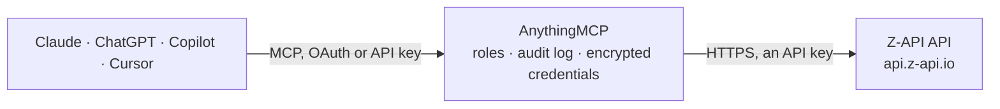

<!-- Generated by scripts/export-github-catalog.mjs in the anythingmcp-website repository. Do not edit by hand. -->

# Z-API MCP connector

Z-API WhatsApp gateway from Brazil: check the instance connection, browse chats and contacts, verify numbers on WhatsApp and send text, image and document messages through a WhatsApp number linked by QR code. The AnythingMCP connector gives Claude, ChatGPT, Microsoft Copilot, Cursor and Gemini 11 MCP tools for Z-API: 8 read and 3 can change data.

**Category:** [Messaging](../messaging.md) · **Tools:** 11 · **Setup guide:** [anythingmcp.com](https://anythingmcp.com/guides/z-api-to-mcp) · [Deutsch](https://anythingmcp.com/de/guides/z-api-to-mcp) · [Italiano](https://anythingmcp.com/it/guides/z-api-to-mcp) · [Español](https://anythingmcp.com/es/guides/z-api-to-mcp) · [日本語](https://anythingmcp.com/ja/guides/z-api-to-mcp) · [Русский](https://anythingmcp.com/ru/guides/z-api-to-mcp) · [中文](https://anythingmcp.com/zh/guides/z-api-to-mcp)

## Start without code

No installation and no terminal: AnythingMCP Cloud runs the Z-API connector for you, operated by helpcode.ai in Frankfurt, Germany.

1. **Click the button above** and create an account or sign in. The Z-API connector opens, ready to install.
2. **Paste the API key or token from your Z-API account.** Every click is in the [step-by-step guide](https://anythingmcp.com/guides/z-api-to-mcp).
3. **Click Install.** AnythingMCP shows the address of your MCP server.
4. **Add that address to your assistant:** [Claude](https://anythingmcp.com/guides/connect-z-api-to-claude) · [ChatGPT](https://anythingmcp.com/guides/connect-z-api-to-chatgpt) · [Microsoft Copilot](https://anythingmcp.com/guides/connect-z-api-to-copilot) · [Cursor](https://anythingmcp.com/guides/connect-z-api-to-cursor) · [Gemini CLI](https://anythingmcp.com/guides/connect-z-api-to-gemini) · [Meta Muse](https://anythingmcp.com/guides/connect-z-api-to-muse).
5. **Ask your first question**, for example: *Is our Z-API instance connected right now and which WhatsApp number is linked to it?*

Prefer help with the setup? [Talk to us](https://anythingmcp.com/contact).

## How it works

- **The AI client** speaks MCP (Streamable HTTP) to AnythingMCP and only sees tool names, descriptions and results. It never gets the Z-API credentials.
- **AnythingMCP** checks the client's role, builds the call from the tool definition, adds the credentials (an API key), calls Z-API, logs the call and returns the result.
- **Z-API** sees an ordinary API client with the rights of the account the credentials belong to.

## Tools

| Tool | What it does | Access |
|---|---|---|
| [`z_api_get_status`](#z_api_get_status) | Check whether the Z-API instance is linked to a WhatsApp account and whether the phone is online. | read |
| [`z_api_get_instance`](#z_api_get_instance) | Get the Z-API instance name, connection flag, payment status and expiry date (Unix timestamp in `due`). | read |
| [`z_api_get_device`](#z_api_get_device) | Get the phone linked to the instance: its number, profile name, device model and whether it is a WhatsApp Business account. | read |
| [`z_api_check_phone_exists`](#z_api_check_phone_exists) | Check whether a phone number has a WhatsApp account. | read |
| [`z_api_list_chats`](#z_api_list_chats) | List the WhatsApp chats of the linked number (people and groups) with phone or group ID, name, unread count and last message time. | read |
| [`z_api_get_chat`](#z_api_get_chat) | Get metadata of one chat: unread count, last message time, mute and spam flags, profile status and notes (WhatsApp Business only). | read |
| [`z_api_list_contacts`](#z_api_list_contacts) | List WhatsApp contacts known to the linked number, including people from shared groups, with phone, saved name and WhatsApp profile name. | read |
| [`z_api_list_queue`](#z_api_list_queue) | List messages still waiting in the instance's send queue, with phone, text and IDs. | read |
| [`z_api_send_text`](#z_api_send_text) | Send a WhatsApp text message to a contact or group from the linked number. | write |
| [`z_api_send_image`](#z_api_send_image) | Send an image by public HTTPS URL to a contact or group, with an optional caption. | write |
| [`z_api_send_document`](#z_api_send_document) | Send a document (PDF, XLSX, DOCX...) by public HTTPS URL to a contact or group. | write |

## Tool reference

Every parameter as the AI client sees it in `tools/list`. Source: [`packages/backend/src/adapters/br/z-api.json`](../../../packages/backend/src/adapters/br/z-api.json).

### `z_api_get_status`

Check whether the Z-API instance is linked to a WhatsApp account and whether the phone is online. Call this first: connected false means the QR code must be scanned again in the Z-API panel.

**Access:** read · **Call:** `GET /status`

No parameters.

### `z_api_get_instance`

Get the Z-API instance name, connection flag, payment status and expiry date (Unix timestamp in `due`). Use it to explain why sending stopped, e.g. an unpaid or expired instance.

**Access:** read · **Call:** `GET /me`

No parameters.

### `z_api_get_device`

Get the phone linked to the instance: its number, profile name, device model and whether it is a WhatsApp Business account. Tells you which number messages are sent from.

**Access:** read · **Call:** `GET /device`

No parameters.

### `z_api_check_phone_exists`

Check whether a phone number has a WhatsApp account. Returns exists, the number as WhatsApp formats it and its private lid. Use it to validate a number a user typed, not before every send.

**Access:** read · **Call:** `GET /phone-exists/{phone}`

| Parameter | Type | Required | Description |
|---|---|---|---|
| `phone` | string | yes | Digits only: country code + area code + number, no + or spaces, e.g. 5511999999999. |

### `z_api_list_chats`

List the WhatsApp chats of the linked number (people and groups) with phone or group ID, name, unread count and last message time. Page through with page and pageSize.

**Access:** read · **Call:** `GET /chats`

| Parameter | Type | Required | Description |
|---|---|---|---|
| `page` | integer | no | Page number to fetch: 1, then 2, 3 and so on. |
| `pageSize` | integer | no | Chats per page, e.g. 20. |

### `z_api_get_chat`

Get metadata of one chat: unread count, last message time, mute and spam flags, profile status and notes (WhatsApp Business only). Chat message history is not available through Z-API.

**Access:** read · **Call:** `GET /chats/{phone}`

| Parameter | Type | Required | Description |
|---|---|---|---|
| `phone` | string | yes | Contact number in digits only (e.g. 5511999999999) or a group ID from z_api_list_chats. |

### `z_api_list_contacts`

List WhatsApp contacts known to the linked number, including people from shared groups, with phone, saved name and WhatsApp profile name. Page through with page and pageSize.

**Access:** read · **Call:** `GET /contacts`

| Parameter | Type | Required | Description |
|---|---|---|---|
| `page` | integer | no | Page number to fetch: 1, then 2, 3 and so on. |
| `pageSize` | integer | no | Contacts per page, e.g. 50. |

### `z_api_list_queue`

List messages still waiting in the instance's send queue, with phone, text and IDs. Read-only. Continue with pagingState from the previous answer while hasMore is true.

**Access:** read · **Call:** `POST /queue`

| Parameter | Type | Required | Description |
|---|---|---|---|
| `pageSize` | integer | no | Messages per page, up to 30 (default 20). |
| `pagingState` | string | no | Cursor returned by the previous call; omit for the first page. |

### `z_api_send_text`

Send a WhatsApp text message to a contact or group from the linked number. This sends a real message: confirm the recipient number and the exact text with the user before calling, and do not retry after a messageId is returned.

**Access:** write · **Call:** `POST /send-text`

| Parameter | Type | Required | Description |
|---|---|---|---|
| `phone` | string | yes | Recipient in digits only (country code + area code + number, e.g. 5511999999999) or a group ID. |
| `message` | string | yes | Text to send. Supports *bold*, _italic_, ~strike~ and line breaks. |
| `delayMessage` | integer | no | Optional wait before sending, 1 to 15 seconds. |
| `delayTyping` | integer | no | Optional seconds to show 'typing...' before sending, 1 to 15. |

### `z_api_send_image`

Send an image by public HTTPS URL to a contact or group, with an optional caption. This sends a real message: confirm the recipient, the image and the caption with the user before calling.

**Access:** write · **Call:** `POST /send-image`

| Parameter | Type | Required | Description |
|---|---|---|---|
| `phone` | string | yes | Recipient in digits only (e.g. 5511999999999) or a group ID. |
| `image` | string | yes | Public HTTPS URL of the image, reachable by Z-API. |
| `caption` | string | no | Optional text shown under the image. |

### `z_api_send_document`

Send a document (PDF, XLSX, DOCX...) by public HTTPS URL to a contact or group. This sends a real message: confirm the recipient and the file with the user before calling.

**Access:** write · **Call:** `POST /send-document/{extension}`

| Parameter | Type | Required | Description |
|---|---|---|---|
| `extension` | string | yes | File extension without the dot, e.g. pdf, xlsx or docx. |
| `phone` | string | yes | Recipient in digits only (e.g. 5511999999999) or a group ID. |
| `document` | string | yes | Public HTTPS URL of the file, reachable by Z-API. |
| `fileName` | string | no | Optional name shown to the recipient, e.g. Invoice 1042. |
| `caption` | string | no | Optional description sent with the file. |

## Run it yourself

AnythingMCP is open source (AGPL-3.0). [Run it with Docker](../../../README.md#run-it-yourself), open **Connectors → Store**, pick **Z-API** and enter `ZAPI_INSTANCE_ID`, `ZAPI_INSTANCE_TOKEN`, `ZAPI_CLIENT_TOKEN`, then add your MCP server URL to the AI client.

[← Messaging connectors](../messaging.md) · [All categories](../README.md)
