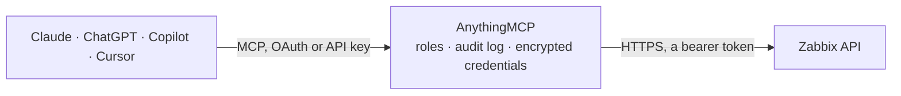

<!-- Generated by scripts/export-github-catalog.mjs in the anythingmcp-website repository. Do not edit by hand. -->

# Zabbix MCP connector

Zabbix monitoring: hosts, host groups, items, triggers, active problems, events and the latest measured values. The AnythingMCP connector gives Claude, ChatGPT, Microsoft Copilot, Cursor and Gemini 10 MCP tools for Zabbix, all read-only.

**Category:** [Monitoring](../monitoring.md) · **Tools:** 10 · **Setup guide:** [anythingmcp.com](https://anythingmcp.com/guides/zabbix-to-mcp) · [Deutsch](https://anythingmcp.com/de/guides/zabbix-to-mcp) · [Italiano](https://anythingmcp.com/it/guides/zabbix-to-mcp) · [Español](https://anythingmcp.com/es/guides/zabbix-to-mcp) · [日本語](https://anythingmcp.com/ja/guides/zabbix-to-mcp) · [Русский](https://anythingmcp.com/ru/guides/zabbix-to-mcp) · [中文](https://anythingmcp.com/zh/guides/zabbix-to-mcp)

## Start without code

No installation and no terminal: AnythingMCP Cloud runs the Zabbix connector for you, operated by helpcode.ai in Frankfurt, Germany.

1. **Click the button above** and create an account or sign in. The Zabbix connector opens, ready to install.
2. **Paste the API key or token from your Zabbix account.** Every click is in the [step-by-step guide](https://anythingmcp.com/guides/zabbix-to-mcp).
3. **Click Install.** AnythingMCP shows the address of your MCP server.
4. **Add that address to your assistant:** [Claude](https://anythingmcp.com/guides/connect-zabbix-to-claude) · [ChatGPT](https://anythingmcp.com/guides/connect-zabbix-to-chatgpt) · [Microsoft Copilot](https://anythingmcp.com/guides/connect-zabbix-to-copilot) · [Cursor](https://anythingmcp.com/guides/connect-zabbix-to-cursor) · [Gemini CLI](https://anythingmcp.com/guides/connect-zabbix-to-gemini) · [Meta Muse](https://anythingmcp.com/guides/connect-zabbix-to-muse).
5. **Ask your first question**, for example: *Any active problems for host web-prod-1 in host group web-servers in the last 60 minutes?*

Prefer help with the setup? [Talk to us](https://anythingmcp.com/contact).

## How it works

- **The AI client** speaks MCP (Streamable HTTP) to AnythingMCP and only sees tool names, descriptions and results. It never gets the Zabbix credentials.
- **AnythingMCP** checks the client's role, builds the call from the tool definition, adds the credentials (a bearer token), calls Zabbix, logs the call and returns the result.
- **Zabbix** sees an ordinary API client with the rights of the account the credentials belong to.

## Tools

| Tool | What it does | Access |
|---|---|---|
| [`zabbix_get_api_version`](#zabbix_get_api_version) | Check URL and token in one call: returns how many host groups this token can see. | read |
| [`zabbix_list_hosts`](#zabbix_list_hosts) | List monitored hosts with their name, status, interfaces and host groups. | read |
| [`zabbix_list_host_groups`](#zabbix_list_host_groups) | List host groups with their id, name and the number of hosts in each. | read |
| [`zabbix_list_problems`](#zabbix_list_problems) | List the problems that are active **right now**, with their severity, host, name and the time they started. | read |
| [`zabbix_list_events`](#zabbix_list_events) | List events from the history — including problems that have since resolved, which problem.get no longer shows. | read |
| [`zabbix_list_triggers`](#zabbix_list_triggers) | List triggers with their expression, severity, current value and the host they belong to — the rules that turn measurements into problems. | read |
| [`zabbix_list_items`](#zabbix_list_items) | List monitored items with their key, name, type, value type and units — what Zabbix actually measures on a host. | read |
| [`zabbix_get_latest_values`](#zabbix_get_latest_values) | Read the most recent value of specific items — the current disk usage, load average or temperature, rather than the alert about it. | read |
| [`zabbix_get_history`](#zabbix_get_history) | Read historical values of one item over a time range — the series behind a graph. | read |
| [`zabbix_list_maintenance_windows`](#zabbix_list_maintenance_windows) | List configured maintenance windows with their hosts, groups and periods — the explanation for why an alert did not fire. | read |

## Tool reference

Every parameter as the AI client sees it in `tools/list`. Source: [`packages/backend/src/adapters/intl/zabbix.json`](../../../packages/backend/src/adapters/intl/zabbix.json).

### `zabbix_get_api_version`

Check URL and token in one call: returns how many host groups this token can see. An error means the URL or the token is wrong; 0 means the token's user has no host-group visibility. (Zabbix's own apiinfo.version cannot be used here: it refuses any call that carries an Authorization header.)

**Access:** read · **Call:** `POST /api_jsonrpc.php`

No parameters.

### `zabbix_list_hosts`

List monitored hosts with their name, status, interfaces and host groups. The map of what Zabbix is actually watching. Host groups come back as `hostgroups` (Zabbix 6.2+) and/or `groups` (up to 7.0).

**Access:** read · **Call:** `POST /api_jsonrpc.php`

| Parameter | Type | Required | Description |
|---|---|---|---|
| `limit` | number | no | Maximum hosts to return. |
| `groupids` | string[] | no | Restrict to these host group ids. |
| `search_name` | string | no | Name fragment to search for (wildcard match). |

### `zabbix_list_host_groups`

List host groups with their id, name and the number of hosts in each. Needed to scope any other query to a part of the estate.

**Access:** read · **Call:** `POST /api_jsonrpc.php`

| Parameter | Type | Required | Description |
|---|---|---|---|
| `limit` | number | no | Maximum groups to return. |

### `zabbix_list_problems`

List the problems that are active **right now**, with their severity, host, name and the time they started. This is the live alert board.

**Access:** read · **Call:** `POST /api_jsonrpc.php`

| Parameter | Type | Required | Description |
|---|---|---|---|
| `limit` | number | no | Maximum problems to return. |
| `severities` | number[] | no | Severity levels to include: 0 not classified, 1 information, 2 warning, 3 average, 4 high, 5 disaster. |
| `groupids` | string[] | no | Restrict to these host group ids. |
| `hostids` | string[] | no | Restrict to these host ids. |
| `recent` | boolean | no | When true, also include recently resolved problems. |

### `zabbix_list_events`

List events from the history — including problems that have since resolved, which problem.get no longer shows. The tool for 'what happened last night'.

**Access:** read · **Call:** `POST /api_jsonrpc.php`

| Parameter | Type | Required | Description |
|---|---|---|---|
| `limit` | number | no | Maximum events to return. |
| `time_from` | number | no | Earliest event time, Unix seconds. |
| `time_till` | number | no | Latest event time, Unix seconds. |
| `severities` | number[] | no | Severity levels to include, 0-5. |
| `hostids` | string[] | no | Restrict to these host ids. |

### `zabbix_list_triggers`

List triggers with their expression, severity, current value and the host they belong to — the rules that turn measurements into problems.

**Access:** read · **Call:** `POST /api_jsonrpc.php`

| Parameter | Type | Required | Description |
|---|---|---|---|
| `limit` | number | no | Maximum triggers to return. |
| `hostids` | string[] | no | Restrict to these host ids. |
| `only_true` | boolean | no | When true, only triggers currently in a problem state. |

### `zabbix_list_items`

List monitored items with their key, name, type, value type and units — what Zabbix actually measures on a host.

**Access:** read · **Call:** `POST /api_jsonrpc.php`

| Parameter | Type | Required | Description |
|---|---|---|---|
| `limit` | number | no | Maximum items to return. |
| `hostids` | string[] | no | Restrict to these host ids. |
| `search_key` | string | no | Item key fragment to search for, e.g. vfs.fs.size. |

### `zabbix_get_latest_values`

Read the most recent value of specific items — the current disk usage, load average or temperature, rather than the alert about it.

**Access:** read · **Call:** `POST /api_jsonrpc.php`

| Parameter | Type | Required | Description |
|---|---|---|---|
| `itemids` | string[] | no | Item ids to read, from zabbix_list_items. |
| `hostids` | string[] | no | Or read every item on these hosts. |
| `limit` | number | no | Maximum items to return. |

### `zabbix_get_history`

Read historical values of one item over a time range — the series behind a graph. Pass the right history type or Zabbix returns nothing.

**Access:** read · **Call:** `POST /api_jsonrpc.php`

| Parameter | Type | Required | Description |
|---|---|---|---|
| `itemids` | string[] | yes | Item ids to read. |
| `history` | number | yes | Value type: 0 float, 1 character, 2 log, 3 unsigned integer, 4 text. Must match the item's value_type. |
| `time_from` | number | no | Start of the range, Unix seconds. |
| `time_till` | number | no | End of the range, Unix seconds. |
| `limit` | number | no | Maximum data points to return. |

### `zabbix_list_maintenance_windows`

List configured maintenance windows with their hosts, groups and periods — the explanation for why an alert did not fire.

**Access:** read · **Call:** `POST /api_jsonrpc.php`

| Parameter | Type | Required | Description |
|---|---|---|---|
| `limit` | number | no | Maximum maintenance windows to return. |

## Run it yourself

AnythingMCP is open source (AGPL-3.0). [Run it with Docker](../../../README.md#run-it-yourself), open **Connectors → Store**, pick **Zabbix** and enter `ZABBIX_URL`, `ZABBIX_API_TOKEN`, then add your MCP server URL to the AI client.

[← Monitoring connectors](../monitoring.md) · [All categories](../README.md)
