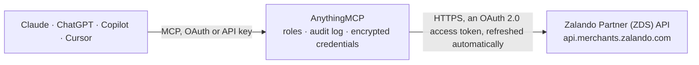

<!-- Generated by scripts/export-github-catalog.mjs in the anythingmcp-website repository. Do not edit by hand. -->

# Zalando Partner (ZDS) MCP connector

Zalando's zDirect partner APIs for Partner Fulfilment (Direct Ship) merchants: orders, order items, order shipments and announced returns. The AnythingMCP connector gives Claude, ChatGPT, Microsoft Copilot, Cursor and Gemini 5 MCP tools for Zalando Partner (ZDS), all read-only.

**Category:** [E-commerce](../e-commerce.md) · **Tools:** 5 · **Setup guide:** [anythingmcp.com](https://anythingmcp.com/guides/zalando-zds-to-mcp) · [Deutsch](https://anythingmcp.com/de/guides/zalando-zds-to-mcp) · [Italiano](https://anythingmcp.com/it/guides/zalando-zds-to-mcp) · [Español](https://anythingmcp.com/es/guides/zalando-zds-to-mcp) · [日本語](https://anythingmcp.com/ja/guides/zalando-zds-to-mcp) · [Русский](https://anythingmcp.com/ru/guides/zalando-zds-to-mcp) · [中文](https://anythingmcp.com/zh/guides/zalando-zds-to-mcp)

## Start without code

No installation and no terminal: AnythingMCP Cloud runs the Zalando Partner (ZDS) connector for you, operated by helpcode.ai in Frankfurt, Germany.

1. **Click the button above** and create an account or sign in. The Zalando Partner (ZDS) connector opens, ready to install.
2. **Sign in with your Zalando Partner (ZDS) account** when AnythingMCP asks. The first time, an admin creates a small app in the Zalando Partner (ZDS) developer console. Every click is in the [step-by-step guide](https://anythingmcp.com/guides/zalando-zds-to-mcp).
3. **Click Install.** AnythingMCP shows the address of your MCP server.
4. **Add that address to your assistant:** [Claude](https://anythingmcp.com/guides/connect-zalando-zds-to-claude) · [ChatGPT](https://anythingmcp.com/guides/connect-zalando-zds-to-chatgpt) · [Microsoft Copilot](https://anythingmcp.com/guides/connect-zalando-zds-to-copilot) · [Cursor](https://anythingmcp.com/guides/connect-zalando-zds-to-cursor) · [Gemini CLI](https://anythingmcp.com/guides/connect-zalando-zds-to-gemini) · [Meta Muse](https://anythingmcp.com/guides/connect-zalando-zds-to-muse).
5. **Ask your first question**, for example: *Show full order ZAL-2026-01987 so I can match the invoice for Sept 15 2026.*

Prefer help with the setup? [Talk to us](https://anythingmcp.com/contact).

## How it works

- **The AI client** speaks MCP (Streamable HTTP) to AnythingMCP and only sees tool names, descriptions and results. It never gets the Zalando Partner (ZDS) credentials.
- **AnythingMCP** checks the client's role, builds the call from the tool definition, adds the credentials (an OAuth 2.0 access token, refreshed automatically), calls Zalando Partner (ZDS), logs the call and returns the result.
- **Zalando Partner (ZDS)** sees an ordinary API client with the rights of the account the credentials belong to.

## Tools

| Tool | What it does | Access |
|---|---|---|
| [`zalando_zds_list_orders`](#zalando_zds_list_orders) | List orders for the merchant with their order number, date, status and totals. | read |
| [`zalando_zds_get_order`](#zalando_zds_get_order) | Read one order in full: its items with EAN and price, the delivery address, and the current fulfilment state of each item. | read |
| [`zalando_zds_list_order_items`](#zalando_zds_list_order_items) | List the individual items of one order with their EAN, article number, price and per-item status — the level Zalando actually fulfils and cancels at. | read |
| [`zalando_zds_list_shipments`](#zalando_zds_list_shipments) | List the shipments of one order, with their carrier, tracking number and the order items they cover. | read |
| [`zalando_zds_list_returns`](#zalando_zds_list_returns) | List announced returns (a customer created a return label for a Partner Fulfilled order) with their items, reason and the order they belong to. | read |

## Tool reference

Every parameter as the AI client sees it in `tools/list`. Source: [`packages/backend/src/adapters/de/zalando-zds.json`](../../../packages/backend/src/adapters/de/zalando-zds.json).

### `zalando_zds_list_orders`

List orders for the merchant with their order number, date, status and totals. Paged by number: page_size (1-1000) and a zero-based page_number. Default sort is -modified_at (latest first).

**Access:** read · **Call:** `GET /orders`

| Parameter | Type | Required | Description |
|---|---|---|---|
| `created_after` | string | no | Orders created after this ISO 8601 timestamp (exclusive), e.g. 2026-09-01T00:00:00Z. |
| `created_before` | string | no | Orders created before this ISO 8601 timestamp (exclusive). |
| `last_updated_after` | string | no | Orders modified after this ISO 8601 timestamp (exclusive). |
| `order_status` | `Initial` \| `Approved` \| `Fulfilled` | no | Restrict to one order status. |
| `order_number` | string | no | Find one order by its Zalando order number. |
| `exported` | boolean | no | true for orders already exported, false for not yet exported ones. |
| `sort` | string | no | Sort attribute, prefix with - for descending, e.g. -order_date. Default -modified_at. |
| `page_size` | number | no | Orders per page, 1-1000 (default 50). |
| `page_number` | number | no | Zero-based page number (default 0). |

### `zalando_zds_get_order`

Read one order in full: its items with EAN and price, the delivery address, and the current fulfilment state of each item.

**Access:** read · **Call:** `GET /orders/{orderId}`

| Parameter | Type | Required | Description |
|---|---|---|---|
| `orderId` | string | yes | Zalando order id (UUID, the `id` from zalando_zds_list_orders), not the order number. |

### `zalando_zds_list_order_items`

List the individual items of one order with their EAN, article number, price and per-item status — the level Zalando actually fulfils and cancels at.

**Access:** read · **Call:** `GET /orders/{orderId}/items`

| Parameter | Type | Required | Description |
|---|---|---|---|
| `orderId` | string | yes | Zalando order id (UUID, the `id` from zalando_zds_list_orders), not the order number. |

### `zalando_zds_list_shipments`

List the shipments of one order, with their carrier, tracking number and the order items they cover. Zalando exposes shipments per order only; every order has at least one.

**Access:** read · **Call:** `GET /orders/{orderId}/shipments`

| Parameter | Type | Required | Description |
|---|---|---|---|
| `orderId` | string | yes | Zalando order id (UUID) from zalando_zds_list_orders. |

### `zalando_zds_list_returns`

List announced returns (a customer created a return label for a Partner Fulfilled order) with their items, reason and the order they belong to. Cursor-paged.

**Access:** read · **Call:** `GET /announced-returns`

| Parameter | Type | Required | Description |
|---|---|---|---|
| `after` | string | no | Returns created at or after this ISO 8601 timestamp. |
| `before` | string | no | Returns created before this ISO 8601 timestamp. |
| `limit` | number | no | Rows per page, 1-1000 (default 50). |
| `cursor` | string | no | Cursor taken from the previous response's next link. |

## Run it yourself

AnythingMCP is open source (AGPL-3.0). [Run it with Docker](../../../README.md#run-it-yourself), open **Connectors → Store**, pick **Zalando Partner (ZDS)** and enter `ZALANDO_CLIENT_ID`, `ZALANDO_CLIENT_SECRET`, `ZALANDO_MERCHANT_ID`, then add your MCP server URL to the AI client.

[← E-commerce connectors](../e-commerce.md) · [All categories](../README.md)
