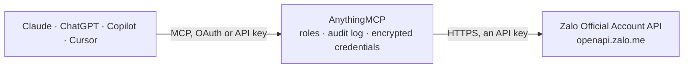

<!-- Generated by scripts/export-github-catalog.mjs in the anythingmcp-website repository. Do not edit by hand. -->

# Zalo Official Account MCP connector

Zalo Official Account (Vietnam): OA profile and message quota, followers and users with their details and labels, recent chats and conversations, consultation messages with text or an image, and the OA's articles. The AnythingMCP connector gives Claude, ChatGPT, Microsoft Copilot, Cursor and Gemini 17 MCP tools for Zalo Official Account: 11 read and 6 can change data.

**Category:** [Messaging](../messaging.md) · **Tools:** 17 · **Setup guide:** [anythingmcp.com](https://anythingmcp.com/guides/zalo-oa-to-mcp) · [Deutsch](https://anythingmcp.com/de/guides/zalo-oa-to-mcp) · [Italiano](https://anythingmcp.com/it/guides/zalo-oa-to-mcp) · [Español](https://anythingmcp.com/es/guides/zalo-oa-to-mcp) · [日本語](https://anythingmcp.com/ja/guides/zalo-oa-to-mcp) · [Русский](https://anythingmcp.com/ru/guides/zalo-oa-to-mcp) · [中文](https://anythingmcp.com/zh/guides/zalo-oa-to-mcp)

## Start without code

No installation and no terminal: AnythingMCP Cloud runs the Zalo Official Account connector for you, operated by helpcode.ai in Frankfurt, Germany.

1. **Click the button above** and create an account or sign in. The Zalo Official Account connector opens, ready to install.
2. **Paste the API key or token from your Zalo Official Account account.** Every click is in the [step-by-step guide](https://anythingmcp.com/guides/zalo-oa-to-mcp).
3. **Click Install.** AnythingMCP shows the address of your MCP server.
4. **Add that address to your assistant:** [Claude](https://anythingmcp.com/guides/connect-zalo-oa-to-claude) · [ChatGPT](https://anythingmcp.com/guides/connect-zalo-oa-to-chatgpt) · [Microsoft Copilot](https://anythingmcp.com/guides/connect-zalo-oa-to-copilot) · [Cursor](https://anythingmcp.com/guides/connect-zalo-oa-to-cursor) · [Gemini CLI](https://anythingmcp.com/guides/connect-zalo-oa-to-gemini) · [Meta Muse](https://anythingmcp.com/guides/connect-zalo-oa-to-muse).
5. **Ask your first question**, for example: *Show me the Zalo details for user 183920374 who messaged about invoice INV-2026-045.*

Prefer help with the setup? [Talk to us](https://anythingmcp.com/contact).

## How it works

- **The AI client** speaks MCP (Streamable HTTP) to AnythingMCP and only sees tool names, descriptions and results. It never gets the Zalo Official Account credentials.
- **AnythingMCP** checks the client's role, builds the call from the tool definition, adds the credentials (an API key), calls Zalo Official Account, logs the call and returns the result.
- **Zalo Official Account** sees an ordinary API client with the rights of the account the credentials belong to.

## Tools

| Tool | What it does | Access |
|---|---|---|
| [`zalo_oa_get_oa_info`](#zalo_oa_get_oa_info) | Profile of the Official Account the token belongs to: OA id (`oaid`), name, description, alias, verification status, OA type, category, number of followers,… | read |
| [`zalo_oa_get_quota`](#zalo_oa_get_quota) | Message quota of the OA or the app: one row per quota asset with the product type (cs = consultation, transaction), the quota source (package, purchased,… | read |
| [`zalo_oa_get_user_quota`](#zalo_oa_get_user_quota) | What the OA can still send to one user: the time of the user's last interaction with the OA (`last_interaction`, Unix milliseconds) and the daily and… | read |
| [`zalo_oa_list_users`](#zalo_oa_list_users) | Page through the users who interacted with the OA (followers and people who messaged it). | read |
| [`zalo_oa_filter_users`](#zalo_oa_filter_users) | Page through the OA's users with filters: by label (tag), by when they last interacted, or by whether they follow the OA. | read |
| [`zalo_oa_get_user`](#zalo_oa_get_user) | Details of one user: display name, alias, your own customer id (`user_external_id`), whether the user follows the OA, last interaction date (dd/MM/yyyy),… | read |
| [`zalo_oa_update_user`](#zalo_oa_update_user) | Update what the OA stores about a user: the alias, your own customer id (`user_external_id`, unique per user) and the shared information (name, phone,… | write |
| [`zalo_oa_list_tags`](#zalo_oa_list_tags) | All labels (tags) defined in the OA, as a list of label names. | read |
| [`zalo_oa_tag_user`](#zalo_oa_tag_user) | Put a label on a user. | write |
| [`zalo_oa_untag_user`](#zalo_oa_untag_user) | Remove a label from one user. | write |
| [`zalo_oa_delete_tag`](#zalo_oa_delete_tag) | Delete a label from the OA, which also takes it off every user who has it. | write |
| [`zalo_oa_list_recent_chats`](#zalo_oa_list_recent_chats) | The latest messages across all of the OA's conversations, newest first: sender and recipient ids and names, direction (`src` 1 = from the user, 0 = from the… | read |
| [`zalo_oa_get_conversation`](#zalo_oa_get_conversation) | Messages between the OA and one user, newest first, 10 at most per call: `message_id` (use it as `quote_message_id` to reply), direction (`src` 1 = from the… | read |
| [`zalo_oa_send_text`](#zalo_oa_send_text) | Send a consultation (customer care) text message from the OA to a user, optionally as a reply quoting one of the user's messages. | write |
| [`zalo_oa_send_image`](#zalo_oa_send_image) | Send a consultation message with one image (JPG or PNG, at most 1 MB, best at 16:9) and an optional caption. | write |
| [`zalo_oa_list_articles`](#zalo_oa_list_articles) | The OA's published content: articles (`type` normal) or videos (`type` video), with id, title, status, views, shares, creation and update time (Unix… | read |
| [`zalo_oa_get_article`](#zalo_oa_get_article) | One article with its title, author, cover, description, status, comment setting and body blocks (text, images, videos). | read |

## Tool reference

Every parameter as the AI client sees it in `tools/list`. Source: [`packages/backend/src/adapters/intl/zalo-oa.json`](../../../packages/backend/src/adapters/intl/zalo-oa.json).

### `zalo_oa_get_oa_info`

Profile of the Official Account the token belongs to: OA id (`oaid`), name, description, alias, verification status, OA type, category, number of followers, avatar, cover and the service package with its validity and renewal dates.

**Access:** read · **Call:** `GET /v2.0/oa/getoa`

No parameters.

### `zalo_oa_get_quota`

Message quota of the OA or the app: one row per quota asset with the product type (cs = consultation, transaction), the quota source (package, purchased, reward), expiry date, total and remaining messages. Read-only although sent as POST.

**Access:** read · **Call:** `POST /v3.0/oa/quota/message`

| Parameter | Type | Required | Description |
|---|---|---|---|
| `quota_owner` | `OA` \| `App` | no | Whose quota to read: OA (default) or App. |
| `product_type` | `cs` \| `transaction` | no | Only this message type: cs (consultation) or transaction. |
| `quota_type` | `sub_quota` \| `purchase_quota` \| `reward_quota` | no | Only this quota source: sub_quota (OA service package), purchase_quota (bought separately), reward_quota (from promotions). |

### `zalo_oa_get_user_quota`

What the OA can still send to one user: the time of the user's last interaction with the OA (`last_interaction`, Unix milliseconds) and the daily and monthly promotion message allowance left for that user. Check it before sending a consultation message. Read-only although sent as POST.

**Access:** read · **Call:** `POST /v3.0/oa/quota/message`

| Parameter | Type | Required | Description |
|---|---|---|---|
| `user_id` | string | yes | The user's id for this OA (`user_id` from zalo_oa_list_users, zalo_oa_list_recent_chats or a webhook), digits only. |

### `zalo_oa_list_users`

Page through the users who interacted with the OA (followers and people who messaged it). Returns `total` and the `user_id`s of this page only; call zalo_oa_get_user for names and details. For filters use zalo_oa_filter_users.

**Access:** read · **Call:** `GET /v3.0/oa/user/getlist`

| Parameter | Type | Required | Description |
|---|---|---|---|
| `offset` | integer | no | Position of the first user, 0 for the first page. At most 9951 (the API reaches the first 10,000 users). |
| `count` | integer | no | Users per page, at most 50. |

### `zalo_oa_filter_users`

Page through the OA's users with filters: by label (tag), by when they last interacted, or by whether they follow the OA. Returns `total` and the `user_id`s of this page. Pass the filter as one JSON object in `query`.

**Access:** read · **Call:** `GET /v3.0/oa/user/getlist`

| Parameter | Type | Required | Description |
|---|---|---|---|
| `query` | string | yes | JSON object with `offset` (required, 0 for the first page, at most 9951), `count` (required, at most 50) and any of: `tag_name` (a label from zalo_oa_list_tags), `last_interaction_period` (TODAY, YESTERDAY, L7D, L30D or a range YYYY_MM_DD:YYYY_MM_DD), `is_follower` ("true" or "false"). Example: {"offset":0,"count":50,"tag_name":"VIP","last_interaction_period":"L7D"} |

### `zalo_oa_get_user`

Details of one user: display name, alias, your own customer id (`user_external_id`), whether the user follows the OA, last interaction date (dd/MM/yyyy), whether the account belongs to a minor (`is_sensitive`), labels and notes, and the information the user shared with the OA (name, phone, address, city, district, date of birth), which is null when nothing was shared.

**Access:** read · **Call:** `GET /v3.0/oa/user/detail`

| Parameter | Type | Required | Description |
|---|---|---|---|
| `user_id` | string | yes | The user's id for this OA (`user_id` from zalo_oa_list_users, zalo_oa_list_recent_chats or a webhook), digits only. |

### `zalo_oa_update_user`

Update what the OA stores about a user: the alias, your own customer id (`user_external_id`, unique per user) and the shared information (name, phone, address, date of birth). Fields you leave out stay as they are. Confirm the changes with the user before calling.

**Access:** write · **Call:** `POST /v3.0/oa/user/update`

| Parameter | Type | Required | Description |
|---|---|---|---|
| `user_id` | string | yes | The user's id for this OA (`user_id` from zalo_oa_list_users, zalo_oa_list_recent_chats or a webhook), digits only. |
| `user_alias` | string | no | Alias the OA shows for this user. |
| `user_external_id` | string | no | The user's id in your own system. Each value can belong to one user only. |
| `name` | string | no | Name in the shared information. |
| `phone` | string | no | Phone number in the shared information. |
| `address` | string | no | Address in the shared information. |
| `user_dob` | string | no | Date of birth as dd/MM/yyyy, from 01/01/1970. |

### `zalo_oa_list_tags`

All labels (tags) defined in the OA, as a list of label names. Use them with zalo_oa_filter_users.

**Access:** read · **Call:** `GET /v2.0/oa/tag/gettagsofoa`

No parameters.

### `zalo_oa_tag_user`

Put a label on a user. A label that does not exist yet is created. Labels are visible to the OA's staff only, not to the user.

**Access:** write · **Call:** `POST /v2.0/oa/tag/tagfollower`

| Parameter | Type | Required | Description |
|---|---|---|---|
| `user_id` | string | yes | The user's id for this OA (`user_id` from zalo_oa_list_users, zalo_oa_list_recent_chats or a webhook), digits only. |
| `tag_name` | string | yes | Label name, e.g. VIP customer. |

### `zalo_oa_untag_user`

Remove a label from one user. The label itself stays in the OA.

**Access:** write · **Call:** `POST /v2.0/oa/tag/rmfollowerfromtag`

| Parameter | Type | Required | Description |
|---|---|---|---|
| `user_id` | string | yes | The user's id for this OA (`user_id` from zalo_oa_list_users, zalo_oa_list_recent_chats or a webhook), digits only. |
| `tag_name` | string | yes | Name of the label to take off, as listed by zalo_oa_list_tags. |

### `zalo_oa_delete_tag`

Delete a label from the OA, which also takes it off every user who has it. Cannot be undone. Installed switched off; confirm with the user first.

**Access:** write · **Call:** `POST /v2.0/oa/tag/rmtag`

| Parameter | Type | Required | Description |
|---|---|---|---|
| `tag_name` | string | yes | Name of the label to delete, as listed by zalo_oa_list_tags. |

### `zalo_oa_list_recent_chats`

The latest messages across all of the OA's conversations, newest first: sender and recipient ids and names, direction (`src` 1 = from the user, 0 = from the OA), type (text, photo, sticker, link, location, voice...), text or media URL and time (Unix milliseconds). At most 10 per call.

**Access:** read · **Call:** `GET /v2.0/oa/listrecentchat`

| Parameter | Type | Required | Description |
|---|---|---|---|
| `offset` | integer | no | Position of the first message, 0 = the newest. |
| `count` | integer | no | Messages to return, at most 10. |

### `zalo_oa_get_conversation`

Messages between the OA and one user, newest first, 10 at most per call: `message_id` (use it as `quote_message_id` to reply), direction (`src` 1 = from the user, 0 = from the OA), type, text or media URL and time (Unix milliseconds). Page back with `offset`.

**Access:** read · **Call:** `GET /v2.0/oa/conversation`

| Parameter | Type | Required | Description |
|---|---|---|---|
| `user_id` | string | yes | The user's id for this OA (`user_id` from zalo_oa_list_users, zalo_oa_list_recent_chats or a webhook), digits only. |
| `offset` | integer | no | Position of the first message, 0 = the newest. |
| `count` | integer | no | Messages to return, at most 10. |

### `zalo_oa_send_text`

Send a consultation (customer care) text message from the OA to a user, optionally as a reply quoting one of the user's messages. Only works for users who interacted with the OA in the last 7 days. This messages a real person: show the text and recipient and wait for a yes first. The answer carries the new `message_id` and which quota it used.

**Access:** write · **Call:** `POST /v3.0/oa/message/cs`

| Parameter | Type | Required | Description |
|---|---|---|---|
| `user_id` | string | yes | The user's id for this OA (`user_id` from zalo_oa_list_users, zalo_oa_list_recent_chats or a webhook), digits only. |
| `text` | string | yes | Message text, at most 2,000 characters. |
| `quote_message_id` | string | no | Optional `message_id` of the user's message to quote (from zalo_oa_get_conversation). |

### `zalo_oa_send_image`

Send a consultation message with one image (JPG or PNG, at most 1 MB, best at 16:9) and an optional caption. Give either a public `image_url` or an `attachment_id` of an image uploaded to Zalo, not both. Only works for users who interacted with the OA in the last 7 days. Show the image and caption to the user and wait for a yes first.

**Access:** write · **Call:** `POST /v3.0/oa/message/cs`

| Parameter | Type | Required | Description |
|---|---|---|---|
| `user_id` | string | yes | The user's id for this OA (`user_id` from zalo_oa_list_users, zalo_oa_list_recent_chats or a webhook), digits only. |
| `image_url` | string | no | Public https URL of a JPG or PNG image, at most 1 MB. |
| `attachment_id` | string | no | Id of an image already uploaded to Zalo (instead of image_url). |
| `text` | string | no | Optional caption, at most 2,000 characters. |

### `zalo_oa_list_articles`

The OA's published content: articles (`type` normal) or videos (`type` video), with id, title, status, views, shares, creation and update time (Unix milliseconds), thumbnail and link, plus the `total`.

**Access:** read · **Call:** `GET /v2.0/article/getslice`

| Parameter | Type | Required | Description |
|---|---|---|---|
| `type` | `normal` \| `video` | no | normal for articles (default), video for videos. |
| `offset` | integer | no | Position of the first item, 0 for the first page. |
| `limit` | integer | no | Items to return. |

### `zalo_oa_get_article`

One article with its title, author, cover, description, status, comment setting and body blocks (text, images, videos). For a video item the answer is its upload and conversion status.

**Access:** read · **Call:** `GET /v2.0/article/getdetail`

| Parameter | Type | Required | Description |
|---|---|---|---|
| `article_id` | string | yes | Article id (`id` from zalo_oa_list_articles). |

## Run it yourself

AnythingMCP is open source (AGPL-3.0). [Run it with Docker](../../../README.md#run-it-yourself), open **Connectors → Store**, pick **Zalo Official Account** and enter `ZALO_OA_ACCESS_TOKEN`, then add your MCP server URL to the AI client.

[← Messaging connectors](../messaging.md) · [All categories](../README.md)
