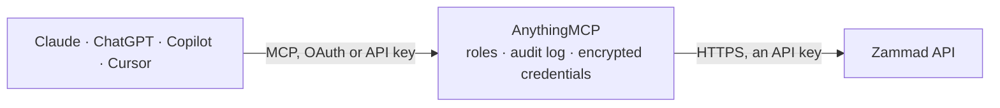

<!-- Generated by scripts/export-github-catalog.mjs in the anythingmcp-website repository. Do not edit by hand. -->

# Zammad MCP connector

Zammad open-source helpdesk: tickets, their articles, users, organizations and groups, full-text search across the ticket base, and ticket updates and merges. The AnythingMCP connector gives Claude, ChatGPT, Microsoft Copilot, Cursor and Gemini 13 MCP tools for Zammad: 9 read and 4 can change data.

**Category:** [Customer Support](../support.md) · **Tools:** 13 · **Setup guide:** [anythingmcp.com](https://anythingmcp.com/guides/zammad-to-mcp) · [Deutsch](https://anythingmcp.com/de/guides/zammad-to-mcp) · [Italiano](https://anythingmcp.com/it/guides/zammad-to-mcp) · [Español](https://anythingmcp.com/es/guides/zammad-to-mcp) · [日本語](https://anythingmcp.com/ja/guides/zammad-to-mcp) · [Русский](https://anythingmcp.com/ru/guides/zammad-to-mcp) · [中文](https://anythingmcp.com/zh/guides/zammad-to-mcp)

## Start without code

No installation and no terminal: AnythingMCP Cloud runs the Zammad connector for you, operated by helpcode.ai in Frankfurt, Germany.

1. **Click the button above** and create an account or sign in. The Zammad connector opens, ready to install.
2. **Paste the API key or token from your Zammad account.** Every click is in the [step-by-step guide](https://anythingmcp.com/guides/zammad-to-mcp).
3. **Click Install.** AnythingMCP shows the address of your MCP server.
4. **Add that address to your assistant:** [Claude](https://anythingmcp.com/guides/connect-zammad-to-claude) · [ChatGPT](https://anythingmcp.com/guides/connect-zammad-to-chatgpt) · [Microsoft Copilot](https://anythingmcp.com/guides/connect-zammad-to-copilot) · [Cursor](https://anythingmcp.com/guides/connect-zammad-to-cursor) · [Gemini CLI](https://anythingmcp.com/guides/connect-zammad-to-gemini) · [Meta Muse](https://anythingmcp.com/guides/connect-zammad-to-muse).
5. **Ask your first question**, for example: *Show ticket number 4527 — I need state, owner, customer and subject for the billing question.*

Prefer help with the setup? [Talk to us](https://anythingmcp.com/contact).

## How it works

- **The AI client** speaks MCP (Streamable HTTP) to AnythingMCP and only sees tool names, descriptions and results. It never gets the Zammad credentials.
- **AnythingMCP** checks the client's role, builds the call from the tool definition, adds the credentials (an API key), calls Zammad, logs the call and returns the result.
- **Zammad** sees an ordinary API client with the rights of the account the credentials belong to.

## Tools

| Tool | What it does | Access |
|---|---|---|
| [`zammad_get_me`](#zammad_get_me) | Read the user the token belongs to, with their roles, group memberships and permissions. | read |
| [`zammad_list_tickets`](#zammad_list_tickets) | List tickets, newest first, with state, priority, group, owner and customer. | read |
| [`zammad_search_tickets`](#zammad_search_tickets) | Full-text search across tickets. | read |
| [`zammad_get_ticket`](#zammad_get_ticket) | Read one ticket by number or id with all its attributes: state, priority, owner, customer, group, SLA and custom fields. | read |
| [`zammad_list_ticket_articles`](#zammad_list_ticket_articles) | Read the conversation on one ticket: every article in order, with sender, type, body and whether it is internal. | read |
| [`zammad_list_users`](#zammad_list_users) | List users (agents and customers) with their name, e-mail, organization and active flag. | read |
| [`zammad_search_users`](#zammad_search_users) | Find a user by name, e-mail or phone fragment — the usual first step before opening a ticket for somebody. | read |
| [`zammad_list_organizations`](#zammad_list_organizations) | List organizations (the customer companies tickets are grouped under) with their domain, note and VIP flag. | read |
| [`zammad_list_groups`](#zammad_list_groups) | List the groups (queues) tickets are routed into, with their assignment and follow-up settings. | read |
| [`zammad_create_ticket`](#zammad_create_ticket) | Open a real ticket in the live instance. | write |
| [`zammad_add_article`](#zammad_add_article) | Add an article to an existing ticket. | write |
| [`zammad_edit_ticket`](#zammad_edit_ticket) | Change a ticket: state, owner, group, priority, title or pending time. | write |
| [`zammad_merge_ticket`](#zammad_merge_ticket) | Merge a ticket into another one: the source ticket's articles move to the target and the source is closed as merged. | write |

## Tool reference

Every parameter as the AI client sees it in `tools/list`. Source: [`packages/backend/src/adapters/de/zammad.json`](../../../packages/backend/src/adapters/de/zammad.json).

### `zammad_get_me`

Read the user the token belongs to, with their roles, group memberships and permissions. The fastest way to see what this connector is actually allowed to do.

**Access:** read · **Call:** `GET /users/me`

No parameters.

### `zammad_list_tickets`

List tickets, newest first, with state, priority, group, owner and customer. Pass expand=true to get readable names instead of numeric ids.

**Access:** read · **Call:** `GET /tickets`

| Parameter | Type | Required | Description |
|---|---|---|---|
| `page` | number | no | Page number, starting at 1. |
| `per_page` | number | no | Rows per page (default 50, max 100). |
| `expand` | boolean | no | When true, resolve id references to names. |
| `sort_by` | string | no | Field to sort by, e.g. created_at or updated_at. |
| `order_by` | string | no | `asc` or `desc`. |

### `zammad_search_tickets`

Full-text search across tickets. With Elasticsearch attached, field queries like `state.name:open AND group.name:Support` work; without it, keep to plain words.

**Access:** read · **Call:** `GET /tickets/search`

| Parameter | Type | Required | Description |
|---|---|---|---|
| `query` | string | yes | Search query. Plain words always work; field syntax needs Elasticsearch. |
| `limit` | number | no | Maximum results to return (default 50). |
| `expand` | boolean | no | When true, resolve id references to names. |

### `zammad_get_ticket`

Read one ticket by number or id with all its attributes: state, priority, owner, customer, group, SLA and custom fields.

**Access:** read · **Call:** `GET /tickets/{id}`

| Parameter | Type | Required | Description |
|---|---|---|---|
| `id` | number | yes | Numeric ticket id (not the ticket number). |
| `expand` | boolean | no | When true, resolve id references to names. |

### `zammad_list_ticket_articles`

Read the conversation on one ticket: every article in order, with sender, type, body and whether it is internal.

**Access:** read · **Call:** `GET /ticket_articles/by_ticket/{ticketId}`

| Parameter | Type | Required | Description |
|---|---|---|---|
| `ticketId` | number | yes | Numeric ticket id. |

### `zammad_list_users`

List users (agents and customers) with their name, e-mail, organization and active flag.

**Access:** read · **Call:** `GET /users`

| Parameter | Type | Required | Description |
|---|---|---|---|
| `page` | number | no | Page number, starting at 1. |
| `per_page` | number | no | Rows per page (default 50, max 100). |
| `expand` | boolean | no | When true, resolve id references to names. |

### `zammad_search_users`

Find a user by name, e-mail or phone fragment — the usual first step before opening a ticket for somebody.

**Access:** read · **Call:** `GET /users/search`

| Parameter | Type | Required | Description |
|---|---|---|---|
| `query` | string | yes | Search term: part of a name, e-mail address or phone number. |
| `limit` | number | no | Maximum results to return. |

### `zammad_list_organizations`

List organizations (the customer companies tickets are grouped under) with their domain, note and VIP flag.

**Access:** read · **Call:** `GET /organizations`

| Parameter | Type | Required | Description |
|---|---|---|---|
| `page` | number | no | Page number, starting at 1. |
| `per_page` | number | no | Rows per page. |

### `zammad_list_groups`

List the groups (queues) tickets are routed into, with their assignment and follow-up settings. Needed to pick a group when opening a ticket.

**Access:** read · **Call:** `GET /groups`

No parameters.

### `zammad_create_ticket`

Open a real ticket in the live instance. Zammad notifies the customer according to the group's settings, so this is not a dry run.

**Access:** write · **Call:** `POST /tickets`

| Parameter | Type | Required | Description |
|---|---|---|---|
| `title` | string | yes | Ticket subject. |
| `group` | string | yes | Group (queue) name the ticket is routed to, e.g. Support. |
| `customer` | string | no | Customer's e-mail address (or login). Zammad looks the user up and creates them if they do not exist. Use this OR customer_id. |
| `customer_id` | integer | no | Numeric Zammad user id of the customer. Use this OR customer. |
| `body` | string | yes | Body of the first article. |
| `type` | string | no | Article type: `note`, `email` or `phone`. `email` actually sends mail. |
| `internal` | boolean | no | When true, the first article is internal and not shown to the customer. |
| `priority` | string | no | Priority name: `1 low`, `2 normal` or `3 high`. |

### `zammad_add_article`

Add an article to an existing ticket. With type `email` Zammad sends it to the customer; use type `note` with internal=true for a private comment.

**Access:** write · **Call:** `POST /ticket_articles`

| Parameter | Type | Required | Description |
|---|---|---|---|
| `ticket_id` | number | yes | Numeric ticket id. |
| `body` | string | yes | Article body. |
| `type` | string | no | `note`, `email` or `phone`. `email` actually sends mail. |
| `internal` | boolean | no | When true, the article is internal and invisible to the customer. |
| `subject` | string | no | Article subject; defaults to the ticket title. |

### `zammad_edit_ticket`

Change a ticket: state, owner, group, priority, title or pending time. Only the fields you send change. Names are accepted instead of ids for state ("new", "open", "pending reminder", "pending close", "closed"), group and priority ("1 low", "2 normal", "3 high"); the owner is set by owner_id (ids from zammad_list_users or zammad_search_users). A pending state needs pending_time. To add a reply or note, use zammad_add_article instead. Confirm the change with the user first.

**Access:** write · **Call:** `PUT /tickets/{id}`

| Parameter | Type | Required | Description |
|---|---|---|---|
| `id` | integer | yes | Numeric ticket id (not the ticket number). |
| `state` | string | no | State name, e.g. open or closed. |
| `owner_id` | integer | no | User id of the new owner (agent). |
| `group` | string | no | Group name, e.g. Sales. |
| `priority` | string | no | Priority name: 1 low, 2 normal, 3 high. |
| `title` | string | no | New ticket title. |
| `pending_time` | string | no | ISO 8601 date-time for pending reminder / pending close, e.g. 2026-10-26T07:00:00Z. |

### `zammad_merge_ticket`

Merge a ticket into another one: the source ticket's articles move to the target and the source is closed as merged. Cannot be undone. Note the asymmetry: the source is given by its numeric id, the target by its ticket number (the number shown in Zammad, e.g. 335269). Confirm both tickets with the user first.

**Access:** write · **Call:** `PUT /ticket_merge/{source_ticket_id}/{target_ticket_number}`

| Parameter | Type | Required | Description |
|---|---|---|---|
| `source_ticket_id` | integer | yes | Numeric id of the ticket to merge away. |
| `target_ticket_number` | string | yes | Ticket number (not id) of the ticket that remains. |

## Run it yourself

AnythingMCP is open source (AGPL-3.0). [Run it with Docker](../../../README.md#run-it-yourself), open **Connectors → Store**, pick **Zammad** and enter `ZAMMAD_URL`, `ZAMMAD_API_TOKEN`, then add your MCP server URL to the AI client.

[← Customer Support connectors](../support.md) · [All categories](../README.md)
