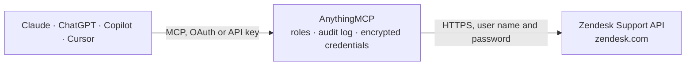

<!-- Generated by scripts/export-github-catalog.mjs in the anythingmcp-website repository. Do not edit by hand. -->

# Zendesk Support MCP connector

Drive Zendesk Support (the help-desk product) from any AI agent: tickets, users, organizations, groups, macros, views, search. 18 tools covering the most common agent workflows. The AnythingMCP connector gives Claude, ChatGPT, Microsoft Copilot, Cursor and Gemini 18 MCP tools for Zendesk Support: 13 read and 5 can change data.

**Category:** [Customer Support](../support.md) · **Tools:** 18 · **Setup guide:** [anythingmcp.com](https://anythingmcp.com/guides/zendesk-to-mcp) · [Deutsch](https://anythingmcp.com/de/guides/zendesk-to-mcp) · [Italiano](https://anythingmcp.com/it/guides/zendesk-to-mcp) · [Español](https://anythingmcp.com/es/guides/zendesk-to-mcp) · [日本語](https://anythingmcp.com/ja/guides/zendesk-to-mcp) · [Русский](https://anythingmcp.com/ru/guides/zendesk-to-mcp) · [中文](https://anythingmcp.com/zh/guides/zendesk-to-mcp)

## Start without code

No installation and no terminal: AnythingMCP Cloud runs the Zendesk Support connector for you, operated by helpcode.ai in Frankfurt, Germany.

1. **Click the button above** and create an account or sign in. The Zendesk Support connector opens, ready to install.
2. **Paste the API key or token from your Zendesk Support account.** Every click is in the [step-by-step guide](https://anythingmcp.com/guides/zendesk-to-mcp).
3. **Click Install.** AnythingMCP shows the address of your MCP server.
4. **Add that address to your assistant:** [Claude](https://anythingmcp.com/guides/connect-zendesk-to-claude) · [ChatGPT](https://anythingmcp.com/guides/connect-zendesk-to-chatgpt) · [Microsoft Copilot](https://anythingmcp.com/guides/connect-zendesk-to-copilot) · [Cursor](https://anythingmcp.com/guides/connect-zendesk-to-cursor) · [Gemini CLI](https://anythingmcp.com/guides/connect-zendesk-to-gemini) · [Meta Muse](https://anythingmcp.com/guides/connect-zendesk-to-muse).
5. **Ask your first question**, for example: *What’s the status and requester for ticket #527341 about 'API rate limit exceeded'?*

Prefer help with the setup? [Talk to us](https://anythingmcp.com/contact).

## How it works

- **The AI client** speaks MCP (Streamable HTTP) to AnythingMCP and only sees tool names, descriptions and results. It never gets the Zendesk Support credentials.
- **AnythingMCP** checks the client's role, builds the call from the tool definition, adds the credentials (user name and password), calls Zendesk Support, logs the call and returns the result.
- **Zendesk Support** sees an ordinary API client with the rights of the account the credentials belong to.

## Tools

| Tool | What it does | Access |
|---|---|---|
| [`zendesk_get_current_user`](#zendesk_get_current_user) | Return the agent user that the API credentials belong to (whoami). | read |
| [`zendesk_search`](#zendesk_search) | Universal search using Zendesk's Lucene-like query syntax. | read |
| [`zendesk_list_tickets`](#zendesk_list_tickets) | List tickets (cursor-paginated, newest first). | read |
| [`zendesk_get_ticket`](#zendesk_get_ticket) | Fetch a single ticket by ID with all fields including custom_fields, tags, requester_id, assignee_id, group_id, status, priority, satisfaction_rating. | read |
| [`zendesk_create_ticket`](#zendesk_create_ticket) | Create a new ticket. | write |
| [`zendesk_update_ticket`](#zendesk_update_ticket) | Update a ticket. | write |
| [`zendesk_delete_ticket`](#zendesk_delete_ticket) | Hard-delete a ticket (subject to GDPR retention policy). | write |
| [`zendesk_list_ticket_comments`](#zendesk_list_ticket_comments) | List all comments (public replies and internal notes) on a ticket, ordered by creation time. | read |
| [`zendesk_list_users`](#zendesk_list_users) | List users (end-users, agents, admins). | read |
| [`zendesk_get_user`](#zendesk_get_user) | Fetch a single user by ID. | read |
| [`zendesk_create_or_update_user`](#zendesk_create_or_update_user) | Upsert a user by email (matches existing if email already in system). | write |
| [`zendesk_list_organizations`](#zendesk_list_organizations) | List organizations. | read |
| [`zendesk_create_organization`](#zendesk_create_organization) | Create a new organization. | write |
| [`zendesk_list_groups`](#zendesk_list_groups) | List agent groups (used for ticket assignment routing). | read |
| [`zendesk_list_views`](#zendesk_list_views) | List views — Zendesk's saved filter+sort definitions for tickets. | read |
| [`zendesk_execute_view`](#zendesk_execute_view) | Run a view and return the tickets it currently matches. | read |
| [`zendesk_list_ticket_fields`](#zendesk_list_ticket_fields) | List all ticket fields including custom ones with their IDs, types and allowed values. | read |
| [`zendesk_list_macros`](#zendesk_list_macros) | List macros (saved sets of ticket updates an agent can apply with one click — e.g. 'Refund template', 'Escalate to L2'). | read |

## Tool reference

Every parameter as the AI client sees it in `tools/list`. Source: [`packages/backend/src/adapters/intl/zendesk.json`](../../../packages/backend/src/adapters/intl/zendesk.json).

### `zendesk_get_current_user`

Return the agent user that the API credentials belong to (whoami). Tells you which agent the requests are attributed to.

**Access:** read · **Call:** `GET /users/me`

No parameters.

### `zendesk_search`

Universal search using Zendesk's Lucene-like query syntax. Example queries: 'type:ticket status:open assignee:none', 'type:user email:*@acme.com', 'type:organization tags:vip'. Returns tickets, users, orgs, groups, topics in one paged response.

**Access:** read · **Call:** `GET /search.json`

| Parameter | Type | Required | Description |
|---|---|---|---|
| `query` | string | yes | Search query in Zendesk Search syntax. |
| `sort_by` | string | no | Sort field: updated_at, created_at, priority, status, ticket_type, etc. |
| `sort_order` | string | no | asc or desc. |
| `page` | integer | no | Page number (offset pagination on search). |
| `per_page` | integer | no | Results per page, default 100, max 100. |

### `zendesk_list_tickets`

List tickets (cursor-paginated, newest first). For filtered lists prefer zendesk_search with a query like 'type:ticket ...'. Returns full ticket objects.

**Access:** read · **Call:** `GET /tickets.json`

| Parameter | Type | Required | Description |
|---|---|---|---|
| `page_size` | integer | no | Max per page (default 100, max 100). |
| `page_after` | string | no | Cursor from prior meta.after_cursor. |
| `sort` | string | no | Sort field, prefix with - for descending: -updated_at, created_at. |
| `include` | string | no | Side-load related: users, organizations, groups, comma-separated. |

### `zendesk_get_ticket`

Fetch a single ticket by ID with all fields including custom_fields, tags, requester_id, assignee_id, group_id, status, priority, satisfaction_rating.

**Access:** read · **Call:** `GET /tickets/{ticketId}.json`

| Parameter | Type | Required | Description |
|---|---|---|---|
| `ticketId` | integer | yes | Numeric ticket ID. |
| `include` | string | no | Side-load: users, organizations, groups, last_audits. |

### `zendesk_create_ticket`

Create a new ticket. At minimum: subject + comment.body. `requester` lets you create the end user inline if they don't exist yet (provide their email + name).

**Access:** write · **Call:** `POST /tickets.json`

| Parameter | Type | Required | Description |
|---|---|---|---|
| `ticket` | object | yes | Ticket envelope: {subject, comment: {body, html_body?, public?}, requester_id? OR requester: {name,email}, assignee_id?, group_id?, priority?, type?, status?, tags?, custom_fields? [{id,value}], external_id?}. Wrap fields inside this object — Zendesk's API requires the {ticket: {...}} envelope. |

### `zendesk_update_ticket`

Update a ticket. To add a public reply, set ticket.comment={public:true, body:'...'}. For internal note, public:false. To close, set status:'solved' (then closed automatically after grace period). Required envelope: {ticket: {...}}.

**Access:** write · **Call:** `PUT /tickets/{ticketId}.json`

| Parameter | Type | Required | Description |
|---|---|---|---|
| `ticketId` | integer | yes | Numeric ticket ID. |
| `ticket` | object | yes | {comment?: {body,public,html_body?}, assignee_id?, status?, priority?, tags?, additional_tags?, remove_tags?, custom_fields?[{id,value}], collaborator_ids?, follower_ids?}. |

### `zendesk_delete_ticket`

Hard-delete a ticket (subject to GDPR retention policy). Cannot be undone. Use the UI's bulk archive for soft-delete behavior.

**Access:** write · **Call:** `DELETE /tickets/{ticketId}.json`

| Parameter | Type | Required | Description |
|---|---|---|---|
| `ticketId` | integer | yes | Ticket ID. |

### `zendesk_list_ticket_comments`

List all comments (public replies and internal notes) on a ticket, ordered by creation time. Each comment has body, html_body, public flag, author_id, attachments[], created_at.

**Access:** read · **Call:** `GET /tickets/{ticketId}/comments.json`

| Parameter | Type | Required | Description |
|---|---|---|---|
| `ticketId` | integer | yes | Ticket ID. |
| `sort_order` | string | no | asc or desc. |
| `include_inline_images` | boolean | no | Inline base64 images. |

### `zendesk_list_users`

List users (end-users, agents, admins). Cursor-paginated. For role filtering use ?role[]=end-user or ?role[]=agent.

**Access:** read · **Call:** `GET /users.json`

| Parameter | Type | Required | Description |
|---|---|---|---|
| `role` | string | no | Filter by role: end-user, agent, admin. |
| `permission_set` | string | no | Filter by custom permission set ID. |
| `page_size` | integer | no | Max per page (default 100, max 100). |
| `page_after` | string | no | Pagination cursor. |

### `zendesk_get_user`

Fetch a single user by ID. Returns email, phone, role, organization_id, tags, user_fields, time_zone, locale, last_login_at.

**Access:** read · **Call:** `GET /users/{userId}.json`

| Parameter | Type | Required | Description |
|---|---|---|---|
| `userId` | integer | yes | Numeric user ID. |

### `zendesk_create_or_update_user`

Upsert a user by email (matches existing if email already in system). Use to onboard requesters before they file their first ticket.

**Access:** write · **Call:** `POST /users/create_or_update.json`

| Parameter | Type | Required | Description |
|---|---|---|---|
| `user` | object | yes | {name, email, role?: end-user\|agent\|admin, phone?, organization_id?, tags?, user_fields?, time_zone?, locale_id?, verified?: true}. Wrap inside {user:{...}}. |

### `zendesk_list_organizations`

List organizations. Each org has name, domain_names[], group_id, shared_tickets/comments flags, organization_fields.

**Access:** read · **Call:** `GET /organizations.json`

| Parameter | Type | Required | Description |
|---|---|---|---|
| `page_size` | integer | no | Max per page. |
| `page_after` | string | no | Pagination cursor. |

### `zendesk_create_organization`

Create a new organization. `domain_names` array lets Zendesk auto-link end-users by email domain.

**Access:** write · **Call:** `POST /organizations.json`

| Parameter | Type | Required | Description |
|---|---|---|---|
| `organization` | object | yes | {name, domain_names?, tags?, organization_fields?, notes?, details?, group_id?}. Wrap inside {organization:{...}}. |

### `zendesk_list_groups`

List agent groups (used for ticket assignment routing).

**Access:** read · **Call:** `GET /groups.json`

No parameters.

### `zendesk_list_views`

List views — Zendesk's saved filter+sort definitions for tickets. Each view has id, title, conditions, execution.

**Access:** read · **Call:** `GET /views.json`

| Parameter | Type | Required | Description |
|---|---|---|---|
| `access` | string | no | personal or shared. |
| `active` | boolean | no | Only active views. |

### `zendesk_execute_view`

Run a view and return the tickets it currently matches. Faster than re-filtering manually for known canonical lists like 'My unsolved tickets' or 'High-priority queue'.

**Access:** read · **Call:** `GET /views/{viewId}/execute.json`

| Parameter | Type | Required | Description |
|---|---|---|---|
| `viewId` | integer | yes | View ID. |
| `page` | integer | no | Page number. |
| `per_page` | integer | no | Results per page. |

### `zendesk_list_ticket_fields`

List all ticket fields including custom ones with their IDs, types and allowed values. Required to compose custom_fields arrays in zendesk_create_ticket / zendesk_update_ticket.

**Access:** read · **Call:** `GET /ticket_fields.json`

No parameters.

### `zendesk_list_macros`

List macros (saved sets of ticket updates an agent can apply with one click — e.g. 'Refund template', 'Escalate to L2'). Returns id, title, actions[], restriction.

**Access:** read · **Call:** `GET /macros.json`

| Parameter | Type | Required | Description |
|---|---|---|---|
| `access` | string | no | personal or shared. |
| `active` | boolean | no | Only active. |

## Run it yourself

AnythingMCP is open source (AGPL-3.0). [Run it with Docker](../../../README.md#run-it-yourself), open **Connectors → Store**, pick **Zendesk Support** and enter `ZENDESK_SUBDOMAIN`, `ZENDESK_EMAIL`, `ZENDESK_API_TOKEN`, then add your MCP server URL to the AI client.

[← Customer Support connectors](../support.md) · [All categories](../README.md)
