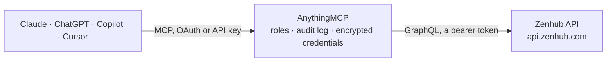

<!-- Generated by scripts/export-github-catalog.mjs in the anythingmcp-website repository. Do not edit by hand. -->

# Zenhub MCP connector

Work with Zenhub boards from an AI agent through the GraphQL API: workspaces, pipelines and the issues in them, issue details, sprints and their issues, epics and their child issues, estimates; move … The AnythingMCP connector gives Claude, ChatGPT, Microsoft Copilot, Cursor and Gemini 17 MCP tools for Zenhub: 12 read and 5 can change data.

**Category:** [Project Management](../project-management.md) · **Tools:** 17 · **Setup guide:** [anythingmcp.com](https://anythingmcp.com/guides/zenhub-to-mcp) · [Deutsch](https://anythingmcp.com/de/guides/zenhub-to-mcp) · [Italiano](https://anythingmcp.com/it/guides/zenhub-to-mcp) · [Español](https://anythingmcp.com/es/guides/zenhub-to-mcp) · [日本語](https://anythingmcp.com/ja/guides/zenhub-to-mcp) · [Русский](https://anythingmcp.com/ru/guides/zenhub-to-mcp) · [中文](https://anythingmcp.com/zh/guides/zenhub-to-mcp)

## Start without code

No installation and no terminal: AnythingMCP Cloud runs the Zenhub connector for you, operated by helpcode.ai in Frankfurt, Germany.

1. **Click the button above** and create an account or sign in. The Zenhub connector opens, ready to install.
2. **Paste the API key or token from your Zenhub account.** Every click is in the [step-by-step guide](https://anythingmcp.com/guides/zenhub-to-mcp).
3. **Click Install.** AnythingMCP shows the address of your MCP server.
4. **Add that address to your assistant:** [Claude](https://anythingmcp.com/guides/connect-zenhub-to-claude) · [ChatGPT](https://anythingmcp.com/guides/connect-zenhub-to-chatgpt) · [Microsoft Copilot](https://anythingmcp.com/guides/connect-zenhub-to-copilot) · [Cursor](https://anythingmcp.com/guides/connect-zenhub-to-cursor) · [Gemini CLI](https://anythingmcp.com/guides/connect-zenhub-to-gemini) · [Meta Muse](https://anythingmcp.com/guides/connect-zenhub-to-muse).
5. **Ask your first question**, for example: *What's the pipeline and estimate for issue #42 in the frontend repository this sprint?*

Prefer help with the setup? [Talk to us](https://anythingmcp.com/contact).

## How it works

- **The AI client** speaks MCP (Streamable HTTP) to AnythingMCP and only sees tool names, descriptions and results. It never gets the Zenhub credentials.
- **AnythingMCP** checks the client's role, builds the call from the tool definition, adds the credentials (a bearer token), calls Zenhub, logs the call and returns the result.
- **Zenhub** sees an ordinary API client with the rights of the account the credentials belong to.

## Tools

| Tool | What it does | Access |
|---|---|---|
| [`zenhub_get_viewer`](#zenhub_get_viewer) | Return the Zenhub user behind the API key (id, name, email, GitHub login) and the Zenhub organizations it belongs to. | read |
| [`zenhub_list_organizations`](#zenhub_list_organizations) | List the Zenhub organizations of the user with their workspaces (id, name, description). | read |
| [`zenhub_search_workspaces`](#zenhub_search_workspaces) | Find workspaces the user can access by name. | read |
| [`zenhub_get_workspace`](#zenhub_get_workspace) | Get one workspace: name, description, organization, default repository, connected repositories (Zenhub id, GitHub id, name), the active sprint and the… | read |
| [`zenhub_list_pipelines`](#zenhub_list_pipelines) | List the pipelines (board columns) of a workspace in board order: id, name, description and stage (BACKLOG, SPRINT_BACKLOG, DEVELOPMENT, REVIEW, COMPLETED). | read |
| [`zenhub_list_pipeline_issues`](#zenhub_list_pipeline_issues) | List the issues in one pipeline (board column), in board order: id, number, title, state, repository, estimate, plus the total count. | read |
| [`zenhub_get_issue`](#zenhub_get_issue) | Get one issue by repository and number: title, body, state, type, estimate, its pipeline in the workspace, sprints, labels, assignees and parent epics. | read |
| [`zenhub_list_sprints`](#zenhub_list_sprints) | List the sprints of a workspace, newest first: id, name, state, start and end, total and completed story points, closed issue count. | read |
| [`zenhub_list_sprint_issues`](#zenhub_list_sprint_issues) | List the issues in one sprint: id, number, title, state, repository and estimate, plus the sprint's points. | read |
| [`zenhub_list_epics`](#zenhub_list_epics) | List the Zenhub epics of a workspace: id, title, state (open, to do, in progress or closed), start and end dates, estimate, and issue count and estimate… | read |
| [`zenhub_list_epic_issues`](#zenhub_list_epic_issues) | List the child issues of one or more Zenhub epics: id, number, title, state, repository and estimate. | read |
| [`zenhub_get_estimate_values`](#zenhub_get_estimate_values) | List the estimate values (story point scale) allowed in each repository of a workspace, for example 1, 2, 3, 5, 8. | read |
| [`zenhub_move_issue`](#zenhub_move_issue) | Move an issue to another pipeline (board column) of the workspace that owns the pipeline, at a position (0 = top). | write |
| [`zenhub_set_estimate`](#zenhub_set_estimate) | Set the estimate (story points) of an issue, or clear it by leaving value out. | write |
| [`zenhub_add_issues_to_sprints`](#zenhub_add_issues_to_sprints) | Add one or more issues to one or more sprints. | write |
| [`zenhub_create_issue`](#zenhub_create_issue) | Create an issue in a repository of the workspace (a GitHub repository, or the workspace's Zenhub repository for a Zenhub issue). | write |
| [`zenhub_add_comment`](#zenhub_add_comment) | Post a comment on an issue or epic. | write |

## Tool reference

Every parameter as the AI client sees it in `tools/list`. Source: [`packages/backend/src/adapters/intl/zenhub.json`](../../../packages/backend/src/adapters/intl/zenhub.json).

### `zenhub_get_viewer`

Return the Zenhub user behind the API key (id, name, email, GitHub login) and the Zenhub organizations it belongs to. Cheap; use it to check the key and to find organization ids.

**Access:** read · **Call:** `query query Viewer { viewer { id name email githubUser { login } zenhubOrganizations(first: 20) { nodes { id name } } } }`

No parameters.

### `zenhub_list_organizations`

List the Zenhub organizations of the user with their workspaces (id, name, description). Use it to find a workspace id when the name is not known.

**Access:** read · **Call:** `query query Organizations($first: Int = 10, $workspacesFirst: Int = 10) { viewer { zenhubOrganizations(first: $first) { nodes { id name workspaces(first: $workspacesFirst) { totalCount nodes { id name description } } } } } }`

| Parameter | Type | Required | Description |
|---|---|---|---|
| `first` | integer | no | Items per page, default 10, at most 20 (Zenhub caps query complexity at 200 points). |
| `workspaces_first` | integer | no | Workspaces listed per organization, default 10. |

### `zenhub_search_workspaces`

Find workspaces the user can access by name. Returns id, name, display name, description, organization and last update. The workspace id is needed by most other tools.

**Access:** read · **Call:** `query query SearchWorkspaces($query: String!, $first: Int = 20, $after: String) { viewer { searchWorkspaces(query: $query, first: $first, after: $after) { totalCount pageInfo { hasNextPage endCursor } nodes { id name displayName description updatedAt zenhubOrganization { id name } } } } }`

| Parameter | Type | Required | Description |
|---|---|---|---|
| `query` | string | yes | Part of the workspace name, for example Backend. |
| `first` | integer | no | Items per page, default 20, at most 50 (Zenhub caps query complexity at 200 points). |
| `after` | string | no | Cursor for the next page: pageInfo.endCursor of the previous answer. |

### `zenhub_get_workspace`

Get one workspace: name, description, organization, default repository, connected repositories (Zenhub id, GitHub id, name), the active sprint and the average sprint velocity.

**Access:** read · **Call:** `query query Workspace($workspaceId: ID!, $repositoriesFirst: Int = 25) { workspace(id: $workspaceId) { id name displayName description updatedAt averageSprintVelocity zenhubOrganization { id name } defaultRepository { id ghId name ownerName } repositoriesConnection(first: $repositoriesFirst) { totalCount nodes { id ghId name ownerName } } activeSprint { id name startAt endAt totalPoints completedPoints } } }`

| Parameter | Type | Required | Description |
|---|---|---|---|
| `workspace_id` | string | yes | Workspace id, from zenhub_search_workspaces or zenhub_list_organizations (a 24-character hex string such as 66f9da05d91f86002fbd3023). |
| `repositories_first` | integer | no | Connected repositories to list, default 25. |

### `zenhub_list_pipelines`

List the pipelines (board columns) of a workspace in board order: id, name, description and stage (BACKLOG, SPRINT_BACKLOG, DEVELOPMENT, REVIEW, COMPLETED). Pipeline ids are needed to list or move issues.

**Access:** read · **Call:** `query query Pipelines($workspaceId: ID!, $first: Int = 30) { workspace(id: $workspaceId) { id name pipelinesConnection(first: $first) { totalCount nodes { id name description stage } } } }`

| Parameter | Type | Required | Description |
|---|---|---|---|
| `workspace_id` | string | yes | Workspace id, from zenhub_search_workspaces or zenhub_list_organizations (a 24-character hex string such as 66f9da05d91f86002fbd3023). |
| `first` | integer | no | Items per page, default 30, at most 40 (Zenhub caps query complexity at 200 points). |

### `zenhub_list_pipeline_issues`

List the issues in one pipeline (board column), in board order: id, number, title, state, repository, estimate, plus the total count. Optional text search and filters by label, assignee, sprint or estimate. Cursor-paginated.

**Access:** read · **Call:** `query query PipelineIssues($pipelineId: ID!, $query: String, $filters: IssueSearchFiltersInput! = {}, $first: Int = 15, $after: String) { searchIssuesByPipeline(pipelineId: $pipelineId, query: $query, filters: $filters, first: $first, after: $after) { totalCount pageInfo { hasNextPage endCursor } nodes { id number title state pullRequest htmlUrl repository { id ghId name } estimate { value } } } }`

| Parameter | Type | Required | Description |
|---|---|---|---|
| `pipeline_id` | string | yes | Pipeline id from zenhub_list_pipelines. |
| `query` | string | no | Optional text to match in issue titles, for example login bug. |
| `filters` | object | no | Optional IssueSearchFiltersInput, for example {"labels": {"in": ["Backend"]}}, {"assignees": {"in": ["github_login"]}}, {"sprints": {"in": ["SPRINT_ID"]}} or {"repositoryIds": ["REPO_ID"]}. Default: no filter. |
| `first` | integer | no | Items per page, default 15, at most 15 (Zenhub caps query complexity at 200 points). |
| `after` | string | no | Cursor for the next page: pageInfo.endCursor of the previous answer. |

### `zenhub_get_issue`

Get one issue by repository and number: title, body, state, type, estimate, its pipeline in the workspace, sprints, labels, assignees and parent epics. Give the GitHub repository id (ghId) or the Zenhub repository id.

**Access:** read · **Call:** `query query Issue($issueNumber: Int!, $repositoryGhId: Int, $repositoryId: ID, $workspaceId: ID!) { issueByInfo(issueNumber: $issueNumber, repositoryGhId: $repositoryGhId, repositoryId: $repositoryId) { id number title state pullRequest htmlUrl repository { id ghId name } estimate { value } body type createdAt closedAt pipelineIssue(workspaceId: $workspaceId) { pipeline { id name } priority { name } } sprints(first: 5) { nodes { id name state } } labels(first: 10) { nodes { name } } assignees(first: 10) { nodes { login } } parentZenhubEpics(first: 5) { nodes { id title } } } }`

| Parameter | Type | Required | Description |
|---|---|---|---|
| `issue_number` | integer | yes | Issue number in the repository, for example 42. |
| `repository_gh_id` | integer | no | GitHub repository id (ghId from zenhub_get_workspace). Give this or repository_id. |
| `repository_id` | string | no | Zenhub repository id (id from zenhub_get_workspace). Give this or repository_gh_id. |
| `workspace_id` | string | yes | Workspace id, from zenhub_search_workspaces or zenhub_list_organizations (a 24-character hex string such as 66f9da05d91f86002fbd3023). |

### `zenhub_list_sprints`

List the sprints of a workspace, newest first: id, name, state, start and end, total and completed story points, closed issue count. state OPEN (default) returns current and upcoming sprints, CLOSED past ones.

**Access:** read · **Call:** `query query Sprints($workspaceId: ID!, $state: SprintState!, $first: Int = 10, $after: String) { workspace(id: $workspaceId) { id activeSprint { id name } sprints(first: $first, after: $after, filters: { state: { eq: $state } }, orderBy: { field: END_AT, direction: DESC }) { totalCount pageInfo { hasNextPage endCursor } nodes { id name generatedName state startAt endAt totalPoints completedPoints closedIssuesCount } } } }`

| Parameter | Type | Required | Description |
|---|---|---|---|
| `workspace_id` | string | yes | Workspace id, from zenhub_search_workspaces or zenhub_list_organizations (a 24-character hex string such as 66f9da05d91f86002fbd3023). |
| `state` | `OPEN` \| `CLOSED` | no | OPEN for current and upcoming sprints, CLOSED for finished ones. |
| `first` | integer | no | Items per page, default 10, at most 25 (Zenhub caps query complexity at 200 points). |
| `after` | string | no | Cursor for the next page: pageInfo.endCursor of the previous answer. |

### `zenhub_list_sprint_issues`

List the issues in one sprint: id, number, title, state, repository and estimate, plus the sprint's points. Use for sprint reviews and to see what is left. Cursor-paginated.

**Access:** read · **Call:** `query query SprintIssues($sprintId: ID!, $first: Int = 15, $after: String) { node(id: $sprintId) { ... on Sprint { id name state startAt endAt totalPoints completedPoints issues(first: $first, after: $after) { totalCount pageInfo { hasNextPage endCursor } nodes { id number title state pullRequest htmlUrl repository { id ghId name } estimate { value } } } } } }`

| Parameter | Type | Required | Description |
|---|---|---|---|
| `sprint_id` | string | yes | Sprint id from zenhub_list_sprints. |
| `first` | integer | no | Items per page, default 15, at most 15 (Zenhub caps query complexity at 200 points). |
| `after` | string | no | Cursor for the next page: pageInfo.endCursor of the previous answer. |

### `zenhub_list_epics`

List the Zenhub epics of a workspace: id, title, state (open, to do, in progress or closed), start and end dates, estimate, and issue count and estimate progress. Optional title search.

**Access:** read · **Call:** `query query Epics($workspaceId: ID!, $query: String, $first: Int = 10, $after: String) { workspace(id: $workspaceId) { id zenhubEpics(query: $query, first: $first, after: $after, orderBy: { field: UPDATED_AT, direction: DESC }) { totalCount pageInfo { hasNextPage endCursor } nodes { id title state startOn endOn estimate { value } zenhubIssueCountProgress { open closed total } zenhubIssueEstimateProgress { open closed total } } } } }`

| Parameter | Type | Required | Description |
|---|---|---|---|
| `workspace_id` | string | yes | Workspace id, from zenhub_search_workspaces or zenhub_list_organizations (a 24-character hex string such as 66f9da05d91f86002fbd3023). |
| `query` | string | no | Optional text to match in epic titles. |
| `first` | integer | no | Items per page, default 10, at most 15 (Zenhub caps query complexity at 200 points). |
| `after` | string | no | Cursor for the next page: pageInfo.endCursor of the previous answer. |

### `zenhub_list_epic_issues`

List the child issues of one or more Zenhub epics: id, number, title, state, repository and estimate. Cursor-paginated.

**Access:** read · **Call:** `query query EpicIssues($epicIds: [ID!]!, $first: Int = 15, $after: String) { searchIssuesByZenhubEpics(zenhubEpicIds: $epicIds, filters: {}, first: $first, after: $after) { totalCount pageInfo { hasNextPage endCursor } nodes { id number title state pullRequest htmlUrl repository { id ghId name } estimate { value } } } }`

| Parameter | Type | Required | Description |
|---|---|---|---|
| `epic_ids` | string[] | yes | Zenhub epic ids from zenhub_list_epics. |
| `first` | integer | no | Items per page, default 15, at most 15 (Zenhub caps query complexity at 200 points). |
| `after` | string | no | Cursor for the next page: pageInfo.endCursor of the previous answer. |

### `zenhub_get_estimate_values`

List the estimate values (story point scale) allowed in each repository of a workspace, for example 1, 2, 3, 5, 8. Check before setting an estimate.

**Access:** read · **Call:** `query query EstimateValues($workspaceId: ID!, $first: Int = 10) { workspace(id: $workspaceId) { id repositoriesConnection(first: $first) { nodes { id name estimateSet { values } } } } }`

| Parameter | Type | Required | Description |
|---|---|---|---|
| `workspace_id` | string | yes | Workspace id, from zenhub_search_workspaces or zenhub_list_organizations (a 24-character hex string such as 66f9da05d91f86002fbd3023). |
| `first` | integer | no | Items per page, default 10, at most 20 (Zenhub caps query complexity at 200 points). |

### `zenhub_move_issue`

Move an issue to another pipeline (board column) of the workspace that owns the pipeline, at a position (0 = top). Returns the issue and its new pipeline.

**Access:** write · **Call:** `mutation mutation MoveIssue($issueId: ID!, $pipelineId: ID!, $position: Int) { moveIssue(input: { issueId: $issueId, pipelineId: $pipelineId, position: $position }) { issue { id number title } pipeline { id name } } }`

| Parameter | Type | Required | Description |
|---|---|---|---|
| `issue_id` | string | yes | Zenhub issue id (id from an issue listing, not the issue number). |
| `pipeline_id` | string | yes | Target pipeline id from zenhub_list_pipelines. |
| `position` | integer | no | Position in the pipeline, 0 for the top (default). |

### `zenhub_set_estimate`

Set the estimate (story points) of an issue, or clear it by leaving value out. The value should be one of the repository's estimate values (zenhub_get_estimate_values).

**Access:** write · **Call:** `mutation mutation SetEstimate($issueId: ID!, $value: Float) { setEstimate(input: { issueId: $issueId, value: $value }) { issue { id number title estimate { value } } } }`

| Parameter | Type | Required | Description |
|---|---|---|---|
| `issue_id` | string | yes | Zenhub issue id. |
| `value` | number | no | Estimate value, for example 3. Leave out to remove the estimate. |

### `zenhub_add_issues_to_sprints`

Add one or more issues to one or more sprints. Returns the created sprint-issue links. Use zenhub_list_sprints for sprint ids.

**Access:** write · **Call:** `mutation mutation AddIssuesToSprints($issueIds: [ID!]!, $sprintIds: [ID!]!) { addIssuesToSprints(input: { issueIds: $issueIds, sprintIds: $sprintIds }) { sprintIssues { id } } }`

| Parameter | Type | Required | Description |
|---|---|---|---|
| `issue_ids` | string[] | yes | Zenhub issue ids. |
| `sprint_ids` | string[] | yes | Sprint ids from zenhub_list_sprints. |

### `zenhub_create_issue`

Create an issue in a repository of the workspace (a GitHub repository, or the workspace's Zenhub repository for a Zenhub issue). Labels and assignees by name apply to GitHub issues only. Returns id, number and title.

**Access:** write · **Call:** `mutation mutation CreateIssue($repositoryId: ID!, $title: String!, $body: String, $labels: [String!], $assignees: [String!]) { createIssue(input: { repositoryId: $repositoryId, title: $title, body: $body, labels: $labels, assignees: $assignees }) { issue { id number title htmlUrl } } }`

| Parameter | Type | Required | Description |
|---|---|---|---|
| `repository_id` | string | yes | Zenhub repository id (id from zenhub_get_workspace). |
| `title` | string | yes | Issue title. |
| `body` | string | no | Issue description in Markdown. |
| `labels` | string[] | no | Label names (GitHub issues only). |
| `assignees` | string[] | no | GitHub logins to assign (GitHub issues only). |

### `zenhub_add_comment`

Post a comment on an issue or epic. The comment is visible to everyone with access, and for GitHub issues it is posted on GitHub too.

**Access:** write · **Call:** `mutation mutation CreateComment($commentableId: ID!, $body: String!) { createComment(input: { commentableId: $commentableId, body: $body }) { clientMutationId } }`

| Parameter | Type | Required | Description |
|---|---|---|---|
| `commentable_id` | string | yes | Zenhub id of the issue or epic to comment on. |
| `body` | string | yes | Comment text in Markdown. |

## Run it yourself

AnythingMCP is open source (AGPL-3.0). [Run it with Docker](../../../README.md#run-it-yourself), open **Connectors → Store**, pick **Zenhub** and enter `ZENHUB_API_KEY`, then add your MCP server URL to the AI client.

[← Project Management connectors](../project-management.md) · [All categories](../README.md)
