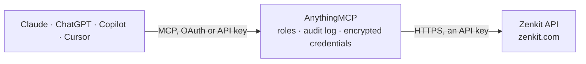

<!-- Generated by scripts/export-github-catalog.mjs in the anythingmcp-website repository. Do not edit by hand. -->

# Zenkit MCP connector

Let your AI work in Zenkit: browse workspaces and collections, read fields, entries, members and activity, search everywhere, and create or update entries and post comments with your confirmation. The AnythingMCP connector gives Claude, ChatGPT, Microsoft Copilot, Cursor and Gemini 16 MCP tools for Zenkit: 12 read and 4 can change data.

**Category:** [Project Management](../project-management.md) · **Tools:** 16 · **Setup guide:** [anythingmcp.com](https://anythingmcp.com/guides/zenkit-to-mcp) · [Deutsch](https://anythingmcp.com/de/guides/zenkit-to-mcp) · [Italiano](https://anythingmcp.com/it/guides/zenkit-to-mcp) · [Español](https://anythingmcp.com/es/guides/zenkit-to-mcp) · [日本語](https://anythingmcp.com/ja/guides/zenkit-to-mcp) · [Русский](https://anythingmcp.com/ru/guides/zenkit-to-mcp) · [中文](https://anythingmcp.com/zh/guides/zenkit-to-mcp)

## Start without code

No installation and no terminal: AnythingMCP Cloud runs the Zenkit connector for you, operated by helpcode.ai in Frankfurt, Germany.

1. **Click the button above** and create an account or sign in. The Zenkit connector opens, ready to install.
2. **Paste the API key or token from your Zenkit account.** Every click is in the [step-by-step guide](https://anythingmcp.com/guides/zenkit-to-mcp).
3. **Click Install.** AnythingMCP shows the address of your MCP server.
4. **Add that address to your assistant:** [Claude](https://anythingmcp.com/guides/connect-zenkit-to-claude) · [ChatGPT](https://anythingmcp.com/guides/connect-zenkit-to-chatgpt) · [Microsoft Copilot](https://anythingmcp.com/guides/connect-zenkit-to-copilot) · [Cursor](https://anythingmcp.com/guides/connect-zenkit-to-cursor) · [Gemini CLI](https://anythingmcp.com/guides/connect-zenkit-to-gemini) · [Meta Muse](https://anythingmcp.com/guides/connect-zenkit-to-muse).
5. **Ask your first question**, for example: *Find Zenkit entry for customer order ORD-2026-0917 from Bayview Retail and show its status and total.*

Prefer help with the setup? [Talk to us](https://anythingmcp.com/contact).

## How it works

- **The AI client** speaks MCP (Streamable HTTP) to AnythingMCP and only sees tool names, descriptions and results. It never gets the Zenkit credentials.
- **AnythingMCP** checks the client's role, builds the call from the tool definition, adds the credentials (an API key), calls Zenkit, logs the call and returns the result.
- **Zenkit** sees an ordinary API client with the rights of the account the credentials belong to.

## Tools

| Tool | What it does | Access |
|---|---|---|
| [`zenkit_get_current_user`](#zenkit_get_current_user) | Read the Zenkit user the API key belongs to: id, name, username, emails, locale and timezone. | read |
| [`zenkit_list_workspaces_with_lists`](#zenkit_list_workspaces_with_lists) | List every workspace the user can open, each with its collections (lists): ids, shortIds, uuids and names. | read |
| [`zenkit_get_workspace`](#zenkit_get_workspace) | Read one workspace with its name, description, settings and creation date. | read |
| [`zenkit_list_workspace_users`](#zenkit_list_workspace_users) | List the members of a workspace with user id, name and username. | read |
| [`zenkit_get_list`](#zenkit_get_list) | Read one collection (list) with its name, workspace, description and settings. | read |
| [`zenkit_list_list_users`](#zenkit_list_list_users) | List the users who have access to a collection (list), with user id, name and username. | read |
| [`zenkit_list_fields`](#zenkit_list_fields) | List the fields (elements) of a collection: id, uuid, name, type (elementcategory), whether it is the primary title field, and for label fields the… | read |
| [`zenkit_filter_entries`](#zenkit_filter_entries) | List the entries (items) of a collection with all field values, page by page, optionally filtered. | read |
| [`zenkit_search_entries`](#zenkit_search_entries) | Search entries by text across every workspace and collection the user can open. | read |
| [`zenkit_get_entry`](#zenkit_get_entry) | Read one entry with all its field values, keyed by field uuid (for example <uuid>_text), plus displayString, comment count and dates. | read |
| [`zenkit_list_entry_activities`](#zenkit_list_entry_activities) | List the comments and change history of one entry, newest first, with total for paging. | read |
| [`zenkit_list_list_activities`](#zenkit_list_list_activities) | List the comments and changes across a whole collection, newest first, with total for paging. | read |
| [`zenkit_create_entry`](#zenkit_create_entry) | Create an entry (item) in a collection with the given field values. | write |
| [`zenkit_update_entry`](#zenkit_update_entry) | Change field values of an entry. | write |
| [`zenkit_comment_on_entry`](#zenkit_comment_on_entry) | Post a comment on an entry as the API key's user. | write |
| [`zenkit_archive_entries`](#zenkit_archive_entries) | Delete entries of a collection by moving them to the archive (Zenkit's soft delete; they can be restored in the Zenkit app). | write |

## Tool reference

Every parameter as the AI client sees it in `tools/list`. Source: [`packages/backend/src/adapters/intl/zenkit.json`](../../../packages/backend/src/adapters/intl/zenkit.json).

### `zenkit_get_current_user`

Read the Zenkit user the API key belongs to: id, name, username, emails, locale and timezone. Checks the key.

**Access:** read · **Call:** `GET /users/me`

No parameters.

### `zenkit_list_workspaces_with_lists`

List every workspace the user can open, each with its collections (lists): ids, shortIds, uuids and names. Start here to find a list.

**Access:** read · **Call:** `GET /users/me/workspacesWithLists`

No parameters.

### `zenkit_get_workspace`

Read one workspace with its name, description, settings and creation date.

**Access:** read · **Call:** `GET /workspaces/{workspace_id}`

| Parameter | Type | Required | Description |
|---|---|---|---|
| `workspace_id` | string | yes | Workspace id, shortId or uuid. |

### `zenkit_list_workspace_users`

List the members of a workspace with user id, name and username. Use the user ids for member fields (_persons).

**Access:** read · **Call:** `GET /workspaces/{workspace_id}/users`

| Parameter | Type | Required | Description |
|---|---|---|---|
| `workspace_id` | integer | yes | Numeric workspace id (not the shortId), from zenkit_list_workspaces_with_lists. |

### `zenkit_get_list`

Read one collection (list) with its name, workspace, description and settings.

**Access:** read · **Call:** `GET /lists/{list_id}`

| Parameter | Type | Required | Description |
|---|---|---|---|
| `list_id` | string | yes | List id: the numeric id, shortId or uuid, e.g. from zenkit_list_workspaces_with_lists. |

### `zenkit_list_list_users`

List the users who have access to a collection (list), with user id, name and username.

**Access:** read · **Call:** `GET /lists/{list_id}/users`

| Parameter | Type | Required | Description |
|---|---|---|---|
| `list_id` | string | yes | List id: the numeric id, shortId or uuid, e.g. from zenkit_list_workspaces_with_lists. |

### `zenkit_list_fields`

List the fields (elements) of a collection: id, uuid, name, type (elementcategory), whether it is the primary title field, and for label fields the predefined categories with their ids. Needed before reading or writing entry values.

**Access:** read · **Call:** `GET /lists/{list_id}/elements`

| Parameter | Type | Required | Description |
|---|---|---|---|
| `list_id` | string | yes | List id: the numeric id, shortId or uuid, e.g. from zenkit_list_workspaces_with_lists. |

### `zenkit_filter_entries`

List the entries (items) of a collection with all field values, page by page, optionally filtered. Returns countData (total and filteredTotal) and listEntries; displayString is each entry's title. Read-only although it is a POST.

**Access:** read · **Call:** `POST /lists/{list_id}/entries/filter/list`

| Parameter | Type | Required | Description |
|---|---|---|---|
| `list_id` | string | yes | List id: the numeric id, shortId or uuid, e.g. from zenkit_list_workspaces_with_lists. |
| `filter` | object | no | Optional filter, e.g. {"AND": {"TERMS": [{"elementId": 230, "modus": "contains", "text": "invoice"}]}}. elementId is the numeric field id; modus is isEmpty, contains, equals, startsWith, endsWith, inRange, greaterOrEqual, lessOrEqual or containsCurrentUser; negated: true inverts a term. |
| `limit` | integer | no | Entries per page. Default 50. |
| `skip` | integer | no | Entries to skip, for paging. |
| `allowDeprecated` | boolean | no | true to include archived (deleted) entries. |

### `zenkit_search_entries`

Search entries by text across every workspace and collection the user can open. Returns matching entries, lists and workspaces, and thereAreMoreResults.

**Access:** read · **Call:** `GET /entries/search`

| Parameter | Type | Required | Description |
|---|---|---|---|
| `query` | string | yes | Text to search for. |
| `limit` | integer | no | Maximum results. Default 20. |
| `searchInArchive` | boolean | no | true to include archived entries. |

### `zenkit_get_entry`

Read one entry with all its field values, keyed by field uuid (for example <uuid>_text), plus displayString, comment count and dates.

**Access:** read · **Call:** `GET /lists/{list_id}/entries/{entry_id}`

| Parameter | Type | Required | Description |
|---|---|---|---|
| `list_id` | string | yes | List id: the numeric id, shortId or uuid, e.g. from zenkit_list_workspaces_with_lists. |
| `entry_id` | string | yes | Entry id: the numeric id, shortId or uuid of the entry. |

### `zenkit_list_entry_activities`

List the comments and change history of one entry, newest first, with total for paging. A comment has type 0 and its text in message.

**Access:** read · **Call:** `GET /lists/{list_id}/entries/{entry_id}/activities`

| Parameter | Type | Required | Description |
|---|---|---|---|
| `list_id` | string | yes | List id: the numeric id, shortId or uuid, e.g. from zenkit_list_workspaces_with_lists. |
| `entry_id` | string | yes | Entry id: the numeric id, shortId or uuid of the entry. |
| `filter` | `0` \| `2` \| `3` | no | 0 all activities (default), 2 comments only, 3 deleted items. |
| `limit` | integer | no | Activities per page. Default 20. |
| `skip` | integer | no | Activities to skip, for paging. |

### `zenkit_list_list_activities`

List the comments and changes across a whole collection, newest first, with total for paging.

**Access:** read · **Call:** `GET /lists/{list_id}/activities`

| Parameter | Type | Required | Description |
|---|---|---|---|
| `list_id` | string | yes | List id: the numeric id, shortId or uuid, e.g. from zenkit_list_workspaces_with_lists. |
| `filter` | `0` \| `2` \| `3` | no | 0 all activities (default), 2 comments only, 3 deleted items. |
| `limit` | integer | no | Activities per page. Default 20. |
| `skip` | integer | no | Activities to skip, for paging. |

### `zenkit_create_entry`

Create an entry (item) in a collection with the given field values. Read the field uuids with zenkit_list_fields first; the primary text field is the title. Show the values and confirm with the user first.

**Access:** write · **Call:** `POST /lists/{list_id}/entries`

| Parameter | Type | Required | Description |
|---|---|---|---|
| `list_id` | string | yes | List id: the numeric id, shortId or uuid, e.g. from zenkit_list_workspaces_with_lists. |
| `values` | object | yes | Field values keyed by <field uuid>_<value key>, using the uuids from zenkit_list_fields. Text: {"<uuid>_text": "Call supplier"}; number: _number; link: _link; date: _date (ISO 8601, optional _endDate and _hasTime); checkbox: _checked (true or false); labels: _categories (array of category ids from the field's elementData.predefinedCategories); members: _persons (array of user ids); references: _references (array of entry uuids). Unknown keys are refused. |

### `zenkit_update_entry`

Change field values of an entry. Only the keys sent change. For array fields (labels, members, references) update_action decides whether the values replace, are added to or are removed from the current ones. Show the change and confirm with the user first.

**Access:** write · **Call:** `PUT /lists/{list_id}/entries/{entry_id}`

| Parameter | Type | Required | Description |
|---|---|---|---|
| `list_id` | string | yes | List id: the numeric id, shortId or uuid, e.g. from zenkit_list_workspaces_with_lists. |
| `entry_id` | string | yes | Entry id: the numeric id, shortId or uuid of the entry. |
| `values` | object | yes | Field values keyed by <field uuid>_<value key>, using the uuids from zenkit_list_fields. Text: {"<uuid>_text": "Call supplier"}; number: _number; link: _link; date: _date (ISO 8601, optional _endDate and _hasTime); checkbox: _checked (true or false); labels: _categories (array of category ids from the field's elementData.predefinedCategories); members: _persons (array of user ids); references: _references (array of entry uuids). Unknown keys are refused. |
| `update_action` | `replace` \| `append` \| `remove` | no | For array fields: replace (default), append or remove. |

### `zenkit_comment_on_entry`

Post a comment on an entry as the API key's user. Members following the entry may be notified. Show the user the text and confirm with the user first.

**Access:** write · **Call:** `POST /users/me/lists/{list_id}/entries/{entry_id}/activities`

| Parameter | Type | Required | Description |
|---|---|---|---|
| `list_id` | string | yes | List id: the numeric id, shortId or uuid, e.g. from zenkit_list_workspaces_with_lists. |
| `entry_id` | string | yes | Entry id: the numeric id, shortId or uuid of the entry. |
| `message` | string | yes | Comment text. |

### `zenkit_archive_entries`

Delete entries of a collection by moving them to the archive (Zenkit's soft delete; they can be restored in the Zenkit app). Takes numeric entry ids. Installed switched off. Name the entries and confirm with the user first.

**Access:** write · **Call:** `POST /lists/{list_id}/entries/delete/filter`

| Parameter | Type | Required | Description |
|---|---|---|---|
| `list_id` | string | yes | List id: the numeric id, shortId or uuid, e.g. from zenkit_list_workspaces_with_lists. |
| `entry_ids` | integer[] | yes | Numeric ids (the id field, not shortId or uuid) of the entries to archive. |

## Run it yourself

AnythingMCP is open source (AGPL-3.0). [Run it with Docker](../../../README.md#run-it-yourself), open **Connectors → Store**, pick **Zenkit** and enter `ZENKIT_API_KEY`, then add your MCP server URL to the AI client.

[← Project Management connectors](../project-management.md) · [All categories](../README.md)
