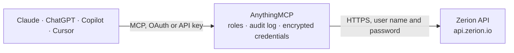

<!-- Generated by scripts/export-github-catalog.mjs in the anythingmcp-website repository. Do not edit by hand. -->

# Zerion MCP connector

Onchain wallet data from the Zerion API for EVM chains and Solana: portfolio value, token and DeFi positions, decoded transaction history, profit and loss, balance charts, NFTs, token prices and … The AnythingMCP connector gives Claude, ChatGPT, Microsoft Copilot, Cursor and Gemini 15 MCP tools for Zerion, all read-only.

**Category:** [Finance](../finance.md) · **Tools:** 15 · **Setup guide:** [anythingmcp.com](https://anythingmcp.com/guides/zerion-to-mcp) · [Deutsch](https://anythingmcp.com/de/guides/zerion-to-mcp) · [Italiano](https://anythingmcp.com/it/guides/zerion-to-mcp) · [Español](https://anythingmcp.com/es/guides/zerion-to-mcp) · [日本語](https://anythingmcp.com/ja/guides/zerion-to-mcp) · [Русский](https://anythingmcp.com/ru/guides/zerion-to-mcp) · [中文](https://anythingmcp.com/zh/guides/zerion-to-mcp)

## Start without code

No installation and no terminal: AnythingMCP Cloud runs the Zerion connector for you, operated by helpcode.ai in Frankfurt, Germany.

1. **Click the button above** and create an account or sign in. The Zerion connector opens, ready to install.
2. **Paste the API key or token from your Zerion account.** Every click is in the [step-by-step guide](https://anythingmcp.com/guides/zerion-to-mcp).
3. **Click Install.** AnythingMCP shows the address of your MCP server.
4. **Add that address to your assistant:** [Claude](https://anythingmcp.com/guides/connect-zerion-to-claude) · [ChatGPT](https://anythingmcp.com/guides/connect-zerion-to-chatgpt) · [Microsoft Copilot](https://anythingmcp.com/guides/connect-zerion-to-copilot) · [Cursor](https://anythingmcp.com/guides/connect-zerion-to-cursor) · [Gemini CLI](https://anythingmcp.com/guides/connect-zerion-to-gemini) · [Meta Muse](https://anythingmcp.com/guides/connect-zerion-to-muse).
5. **Ask your first question**, for example: *What's the current portfolio value and chain split for wallet 0xA1b2c3d4e5f67890ABCDEF1234567890aBcDeF01?*

Prefer help with the setup? [Talk to us](https://anythingmcp.com/contact).

## How it works

- **The AI client** speaks MCP (Streamable HTTP) to AnythingMCP and only sees tool names, descriptions and results. It never gets the Zerion credentials.
- **AnythingMCP** checks the client's role, builds the call from the tool definition, adds the credentials (user name and password), calls Zerion, logs the call and returns the result.
- **Zerion** sees an ordinary API client with the rights of the account the credentials belong to.

## Tools

| Tool | What it does | Access |
|---|---|---|
| [`zerion_get_wallet_portfolio`](#zerion_get_wallet_portfolio) | Total value of a wallet across all chains, split by position type (wallet, deposited, borrowed, locked, staked) and by chain, with the absolute and percent… | read |
| [`zerion_list_wallet_positions`](#zerion_list_wallet_positions) | Every token and DeFi position of a wallet across chains: name, symbol, chain (relationships.chain.data.id), position type, quantity, price, value and 24… | read |
| [`zerion_list_wallet_transactions`](#zerion_list_wallet_transactions) | Decoded transaction history of a wallet across chains, newest first: hash, chain, time (mined_at), operation type (send, receive, trade, deposit, withdraw,… | read |
| [`zerion_get_wallet_pnl`](#zerion_get_wallet_pnl) | Profit and loss of a wallet (FIFO): realized and unrealized gain, total gain, net invested, cost basis, fees, and relative gains in percent. | read |
| [`zerion_get_wallet_chart`](#zerion_get_wallet_chart) | Balance of a wallet over time for a period: begin_at, end_at and points as [unix_seconds, value]. | read |
| [`zerion_list_wallet_nft_positions`](#zerion_list_wallet_nft_positions) | NFTs held by an EVM wallet: token id, collection, name, amount, media and floor price. | read |
| [`zerion_list_wallet_nft_collections`](#zerion_list_wallet_nft_collections) | NFT collections held by an EVM wallet with the number of NFTs and the total floor price per collection. | read |
| [`zerion_get_wallet_nft_portfolio`](#zerion_get_wallet_nft_portfolio) | Total value of the NFTs of an EVM wallet, summed from floor prices across chains. | read |
| [`zerion_list_fungibles`](#zerion_list_fungibles) | Search and list tokens: name, symbol, price, market cap, supply, price changes over 1, 30, 90 and 365 days, volume, asset class, and the contract per chain… | read |
| [`zerion_get_fungible`](#zerion_get_fungible) | One token by its Zerion fungible id: name, symbol, description, price, market cap, supply, price changes, volume and contracts per chain. | read |
| [`zerion_get_fungible_by_implementation`](#zerion_get_fungible_by_implementation) | One token by chain and contract address, without knowing its Zerion id: same data as zerion_get_fungible. | read |
| [`zerion_get_fungible_chart`](#zerion_get_fungible_chart) | Price chart of a token for a period: begin_at, end_at, stats (first, min, avg, max, last) and points as [unix_seconds, price]. | read |
| [`zerion_list_chains`](#zerion_list_chains) | List the chains Zerion supports: chain id (the value other tools take in chain_ids), name, native token, explorer and flags telling which data (positions,… | read |
| [`zerion_get_chain`](#zerion_get_chain) | One chain by its id: name, native token, explorer and supported features. | read |
| [`zerion_list_gas_prices`](#zerion_list_gas_prices) | Current gas prices per chain at each speed (slow, standard, fast, ...), by gas type (classic, eip1559, optimistic). | read |

## Tool reference

Every parameter as the AI client sees it in `tools/list`. Source: [`packages/backend/src/adapters/intl/zerion.json`](../../../packages/backend/src/adapters/intl/zerion.json).

### `zerion_get_wallet_portfolio`

Total value of a wallet across all chains, split by position type (wallet, deposited, borrowed, locked, staked) and by chain, with the absolute and percent change over 24 hours.

**Access:** read · **Call:** `GET /v1/wallets/{address}/portfolio`

| Parameter | Type | Required | Description |
|---|---|---|---|
| `address` | string | yes | Wallet address: an EVM address (0x...) or a Solana address. ENS names are not resolved. |
| `positions` | `only_simple` \| `only_complex` \| `no_filter` | no | only_simple (default): tokens held directly in the wallet; only_complex: DeFi protocol positions only; no_filter: both. only_complex and no_filter count toward Zerion's advanced-request quota. |
| `currency` | `usd` \| `eur` \| `gbp` \| `chf` \| `jpy` \| `cad` \| `aud` \| `nzd` \| `inr` \| `krw` \| `cny` \| `try` \| `zar` \| `rub` \| `eth` \| `btc` | no | Currency for values and prices: usd (default), eur, gbp, chf, eth, btc, ... |

### `zerion_list_wallet_positions`

Every token and DeFi position of a wallet across chains: name, symbol, chain (relationships.chain.data.id), position type, quantity, price, value and 24 hour change, protocol and dapp for DeFi positions. Sorted by value, highest first. Spam tokens are left out by default.

**Access:** read · **Call:** `GET /v1/wallets/{address}/positions/`

| Parameter | Type | Required | Description |
|---|---|---|---|
| `address` | string | yes | Wallet address: an EVM address (0x...) or a Solana address. ENS names are not resolved. |
| `positions` | `only_simple` \| `only_complex` \| `no_filter` | no | only_simple (default): tokens held directly in the wallet; only_complex: DeFi protocol positions only; no_filter: both. only_complex and no_filter count toward Zerion's advanced-request quota. |
| `position_types` | string | no | Only these position types, comma-separated: wallet, deposit, loan, locked, staked, reward, investment. |
| `chain_ids` | string | no | Only these chains, comma-separated chain ids from zerion_list_chains, e.g. ethereum,base,arbitrum,solana. |
| `fungible_ids` | string | no | Only these fungible ids, comma-separated (the id from zerion_list_fungibles or a position's fungible_info.id). |
| `dapp_ids` | string | no | Only positions in these dapps, comma-separated dapp ids (e.g. aave-v3, uniswap-v3). |
| `trash` | `only_non_trash` \| `only_trash` \| `no_filter` | no | Spam filter: only_non_trash (default) leaves spam out, only_trash shows only spam, no_filter shows both. |
| `sort` | `value` \| `-value` | no | value (default) for highest value first, -value for lowest first. |
| `currency` | `usd` \| `eur` \| `gbp` \| `chf` \| `jpy` \| `cad` \| `aud` \| `nzd` \| `inr` \| `krw` \| `cny` \| `try` \| `zar` \| `rub` \| `eth` \| `btc` | no | Currency for values and prices: usd (default), eur, gbp, chf, eth, btc, ... |

### `zerion_list_wallet_transactions`

Decoded transaction history of a wallet across chains, newest first: hash, chain, time (mined_at), operation type (send, receive, trade, deposit, withdraw, approve, mint, ...), status, fee, every transfer with token, direction, quantity and value, and the dapp. Page with page_after from links.next.

**Access:** read · **Call:** `GET /v1/wallets/{address}/transactions/`

| Parameter | Type | Required | Description |
|---|---|---|---|
| `address` | string | yes | Wallet address: an EVM address (0x...) or a Solana address. ENS names are not resolved. |
| `operation_types` | string | no | Only these operation types, comma-separated: approve, bid, burn, claim, delegate, deploy, deposit, execute, mint, receive, revoke, revoke_delegation, send, trade, withdraw. |
| `asset_types` | string | no | Only transactions moving these asset types, comma-separated: fungible, nft. |
| `chain_ids` | string | no | Only these chains, comma-separated chain ids from zerion_list_chains, e.g. ethereum,base,arbitrum,solana. |
| `fungible_ids` | string | no | Only these fungible ids, comma-separated (the id from zerion_list_fungibles or a position's fungible_info.id). |
| `fungible_implementations` | string | no | Only these tokens by chain and contract, comma-separated chain_id:address pairs, e.g. ethereum:0xa0b86991c6218b36c1d19d4a2e9eb0ce3606eb48. |
| `min_mined_at` | string | no | Only transactions mined at or after this time, Unix milliseconds. |
| `max_mined_at` | string | no | Only transactions mined at or before this time, Unix milliseconds. |
| `search_query` | string | no | Full-text search, 2 to 64 characters (token, dapp or address). |
| `trash` | `no_filter` \| `only_non_trash` \| `only_trash` | no | Spam filter: no_filter (default) returns all, only_non_trash leaves spam out, only_trash shows only spam. |
| `currency` | `usd` \| `eur` \| `gbp` \| `chf` \| `jpy` \| `cad` \| `aud` \| `nzd` \| `inr` \| `krw` \| `cny` \| `try` \| `zar` \| `rub` \| `eth` \| `btc` | no | Currency for values and prices: usd (default), eur, gbp, chf, eth, btc, ... |
| `page_size` | integer | no | Items per page, maximum 100 (default 100). |
| `page_after` | string | no | Cursor for the next page: the page[after] value inside links.next of the previous answer. Leave empty for the first page. |

### `zerion_get_wallet_pnl`

Profit and loss of a wallet (FIFO): realized and unrealized gain, total gain, net invested, cost basis, fees, and relative gains in percent. Optionally only some chains or tokens, or sales in a time window. Needs a wallet Zerion tracks (not a token contract or exchange hot wallet).

**Access:** read · **Call:** `GET /v1/wallets/{address}/pnl`

| Parameter | Type | Required | Description |
|---|---|---|---|
| `address` | string | yes | Wallet address: an EVM address (0x...) or a Solana address. ENS names are not resolved. |
| `chain_ids` | string | no | Only these chains, comma-separated chain ids from zerion_list_chains, e.g. ethereum,base,arbitrum,solana. |
| `fungible_ids` | string | no | Only these fungible ids, comma-separated (the id from zerion_list_fungibles or a position's fungible_info.id). |
| `fungible_implementations` | string | no | Only these tokens by chain and contract, comma-separated chain_id:address pairs, e.g. ethereum:0xa0b86991c6218b36c1d19d4a2e9eb0ce3606eb48. |
| `since` | string | no | Count only sales since this time, Unix milliseconds. |
| `till` | string | no | Count only sales until this time, Unix milliseconds. |
| `currency` | `usd` \| `eur` \| `gbp` \| `chf` \| `jpy` \| `cad` \| `aud` \| `nzd` \| `inr` \| `krw` \| `cny` \| `try` \| `zar` \| `rub` \| `eth` \| `btc` | no | Currency for values and prices: usd (default), eur, gbp, chf, eth, btc, ... |

### `zerion_get_wallet_chart`

Balance of a wallet over time for a period: begin_at, end_at and points as [unix_seconds, value]. Optionally only some chains or tokens, or including DeFi positions.

**Access:** read · **Call:** `GET /v1/wallets/{address}/charts/{chart_period}`

| Parameter | Type | Required | Description |
|---|---|---|---|
| `address` | string | yes | Wallet address: an EVM address (0x...) or a Solana address. ENS names are not resolved. |
| `chart_period` | `hour` \| `day` \| `week` \| `month` \| `3months` \| `6months` \| `year` \| `5years` \| `max` | yes | Chart period; it sets both the window and the spacing of the points. |
| `chain_ids` | string | no | Only these chains, comma-separated chain ids from zerion_list_chains, e.g. ethereum,base,arbitrum,solana. |
| `fungible_ids` | string | no | Only these fungible ids, comma-separated (the id from zerion_list_fungibles or a position's fungible_info.id). |
| `exclude_fungible_ids` | string | no | Leave these fungible ids out, comma-separated. Not together with fungible_ids. |
| `positions` | `only_simple` \| `only_complex` \| `no_filter` | no | only_simple (default): tokens held directly in the wallet; only_complex: DeFi protocol positions only; no_filter: both. only_complex and no_filter count toward Zerion's advanced-request quota. |
| `currency` | `usd` \| `eur` \| `gbp` \| `chf` \| `jpy` \| `cad` \| `aud` \| `nzd` \| `inr` \| `krw` \| `cny` \| `try` \| `zar` \| `rub` \| `eth` \| `btc` | no | Currency for values and prices: usd (default), eur, gbp, chf, eth, btc, ... |

### `zerion_list_wallet_nft_positions`

NFTs held by an EVM wallet: token id, collection, name, amount, media and floor price. Page with page_after from links.next.

**Access:** read · **Call:** `GET /v1/wallets/{address}/nft-positions/`

| Parameter | Type | Required | Description |
|---|---|---|---|
| `address` | string | yes | EVM wallet address (0x...). |
| `chain_ids` | string | no | Only these chains, comma-separated chain ids from zerion_list_chains, e.g. ethereum,base,arbitrum,solana. |
| `collections_ids` | string | no | Only these collection ids, comma-separated. |
| `sort` | `created_at` \| `-created_at` \| `floor_price` \| `-floor_price` | no | created_at or floor_price, with a leading minus for descending. |
| `include` | string | no | Related data to include, comma-separated: nfts, nft_collections, wallet_nft_collections. |
| `currency` | `usd` \| `eur` \| `gbp` \| `chf` \| `jpy` \| `cad` \| `aud` \| `nzd` \| `inr` \| `krw` \| `cny` \| `try` \| `zar` \| `rub` \| `eth` \| `btc` | no | Currency for values and prices: usd (default), eur, gbp, chf, eth, btc, ... |
| `page_size` | integer | no | Items per page, maximum 500 (default 50). |
| `page_after` | string | no | Cursor for the next page: the page[after] value inside links.next of the previous answer. Leave empty for the first page. |

### `zerion_list_wallet_nft_collections`

NFT collections held by an EVM wallet with the number of NFTs and the total floor price per collection.

**Access:** read · **Call:** `GET /v1/wallets/{address}/nft-collections/`

| Parameter | Type | Required | Description |
|---|---|---|---|
| `address` | string | yes | EVM wallet address (0x...). |
| `chain_ids` | string | no | Only these chains, comma-separated chain ids from zerion_list_chains, e.g. ethereum,base,arbitrum,solana. |
| `sort` | `-max_changed_at` \| `min_changed_at` \| `total_floor_price` \| `-total_floor_price` | no | Order: -max_changed_at, min_changed_at, total_floor_price or -total_floor_price. |
| `include` | string | no | nft_collections to include the collection details. |
| `currency` | `usd` \| `eur` \| `gbp` \| `chf` \| `jpy` \| `cad` \| `aud` \| `nzd` \| `inr` \| `krw` \| `cny` \| `try` \| `zar` \| `rub` \| `eth` \| `btc` | no | Currency for values and prices: usd (default), eur, gbp, chf, eth, btc, ... |

### `zerion_get_wallet_nft_portfolio`

Total value of the NFTs of an EVM wallet, summed from floor prices across chains.

**Access:** read · **Call:** `GET /v1/wallets/{address}/nft-portfolio`

| Parameter | Type | Required | Description |
|---|---|---|---|
| `address` | string | yes | EVM wallet address (0x...). |
| `currency` | `usd` \| `eur` \| `gbp` \| `chf` \| `jpy` \| `cad` \| `aud` \| `nzd` \| `inr` \| `krw` \| `cny` \| `try` \| `zar` \| `rub` \| `eth` \| `btc` | no | Currency for values and prices: usd (default), eur, gbp, chf, eth, btc, ... |

### `zerion_list_fungibles`

Search and list tokens: name, symbol, price, market cap, supply, price changes over 1, 30, 90 and 365 days, volume, asset class, and the contract per chain (implementations). Use search_query to find a token's fungible id. Page with page_after from links.next.

**Access:** read · **Call:** `GET /v1/fungibles/`

| Parameter | Type | Required | Description |
|---|---|---|---|
| `search_query` | string | no | Name, symbol or address to search, 1 to 66 characters. |
| `implementation_chain_id` | string | no | Only tokens on this chain id. |
| `implementation_address` | string | no | Only tokens deployed at this contract address. |
| `fungible_implementations` | string | no | Only these tokens by chain and contract, comma-separated chain_id:address pairs, e.g. ethereum:0xa0b86991c6218b36c1d19d4a2e9eb0ce3606eb48. |
| `fungible_ids` | string | no | Only these fungible ids, comma-separated (the id from zerion_list_fungibles or a position's fungible_info.id). |
| `asset_class` | string | no | Only these asset classes, comma-separated: stablecoin, tokenized_stock, tokenized_treasury, commodity, other_financial, other_non_financial, unknown. |
| `sort` | `-market_data.market_cap` \| `market_data.market_cap` \| `-market_data.price.last` \| `market_data.price.last` \| `-market_data.price.percent_change_1d` \| `market_data.price.percent_change_1d` \| `-market_data.price.percent_change_30d` \| `market_data.price.percent_change_30d` \| `-market_data.price.percent_change_90d` \| `market_data.price.percent_change_90d` \| `-market_data.price.percent_change_365d` \| `market_data.price.percent_change_365d` \| `-market_data.trading_volumes.volume_1d` \| `market_data.trading_volumes.volume_1d` | no | Sort, e.g. -market_data.market_cap (largest first), -market_data.price.percent_change_1d, -market_data.trading_volumes.volume_1d. |
| `currency` | `usd` \| `eur` \| `gbp` \| `chf` \| `jpy` \| `cad` \| `aud` \| `nzd` \| `inr` \| `krw` \| `cny` \| `try` \| `zar` \| `rub` \| `eth` \| `btc` | no | Currency for values and prices: usd (default), eur, gbp, chf, eth, btc, ... |
| `page_size` | integer | no | Items per page, maximum 100 (default 100). |
| `page_after` | string | no | Cursor for the next page: the page[after] value inside links.next of the previous answer. Leave empty for the first page. |

### `zerion_get_fungible`

One token by its Zerion fungible id: name, symbol, description, price, market cap, supply, price changes, volume and contracts per chain.

**Access:** read · **Call:** `GET /v1/fungibles/{fungible_id}`

| Parameter | Type | Required | Description |
|---|---|---|---|
| `fungible_id` | string | yes | Zerion fungible id, e.g. eth or the id from zerion_list_fungibles. |
| `currency` | `usd` \| `eur` \| `gbp` \| `chf` \| `jpy` \| `cad` \| `aud` \| `nzd` \| `inr` \| `krw` \| `cny` \| `try` \| `zar` \| `rub` \| `eth` \| `btc` | no | Currency for values and prices: usd (default), eur, gbp, chf, eth, btc, ... |

### `zerion_get_fungible_by_implementation`

One token by chain and contract address, without knowing its Zerion id: same data as zerion_get_fungible.

**Access:** read · **Call:** `GET /v1/fungibles/by-implementation`

| Parameter | Type | Required | Description |
|---|---|---|---|
| `implementation` | string | yes | chain_id:address, e.g. ethereum:0xa0b86991c6218b36c1d19d4a2e9eb0ce3606eb48, or just the chain id for its native coin. |
| `currency` | `usd` \| `eur` \| `gbp` \| `chf` \| `jpy` \| `cad` \| `aud` \| `nzd` \| `inr` \| `krw` \| `cny` \| `try` \| `zar` \| `rub` \| `eth` \| `btc` | no | Currency for values and prices: usd (default), eur, gbp, chf, eth, btc, ... |

### `zerion_get_fungible_chart`

Price chart of a token for a period: begin_at, end_at, stats (first, min, avg, max, last) and points as [unix_seconds, price].

**Access:** read · **Call:** `GET /v1/fungibles/{fungible_id}/charts/{chart_period}`

| Parameter | Type | Required | Description |
|---|---|---|---|
| `fungible_id` | string | yes | Zerion fungible id. |
| `chart_period` | `hour` \| `day` \| `week` \| `month` \| `3months` \| `6months` \| `year` \| `5years` \| `max` | yes | Chart period; it sets both the window and the spacing of the points. |
| `currency` | `usd` \| `eur` \| `gbp` \| `chf` \| `jpy` \| `cad` \| `aud` \| `nzd` \| `inr` \| `krw` \| `cny` \| `try` \| `zar` \| `rub` \| `eth` \| `btc` | no | Currency for values and prices: usd (default), eur, gbp, chf, eth, btc, ... |

### `zerion_list_chains`

List the chains Zerion supports: chain id (the value other tools take in chain_ids), name, native token, explorer and flags telling which data (positions, transactions, NFTs) the chain supports.

**Access:** read · **Call:** `GET /v1/chains/`

No parameters.

### `zerion_get_chain`

One chain by its id: name, native token, explorer and supported features.

**Access:** read · **Call:** `GET /v1/chains/{chain_id}`

| Parameter | Type | Required | Description |
|---|---|---|---|
| `chain_id` | string | yes | Chain id, e.g. ethereum, base, arbitrum, solana. |

### `zerion_list_gas_prices`

Current gas prices per chain at each speed (slow, standard, fast, ...), by gas type (classic, eip1559, optimistic).

**Access:** read · **Call:** `GET /v1/gas-prices/`

| Parameter | Type | Required | Description |
|---|---|---|---|
| `chain_ids` | string | no | Only these chains, comma-separated chain ids from zerion_list_chains, e.g. ethereum,base,arbitrum,solana. |
| `gas_types` | string | no | Only these gas types, comma-separated: classic, eip1559, optimistic. |

## Run it yourself

AnythingMCP is open source (AGPL-3.0). [Run it with Docker](../../../README.md#run-it-yourself), open **Connectors → Store**, pick **Zerion** and enter `ZERION_API_KEY`, then add your MCP server URL to the AI client.

[← Finance connectors](../finance.md) · [All categories](../README.md)
