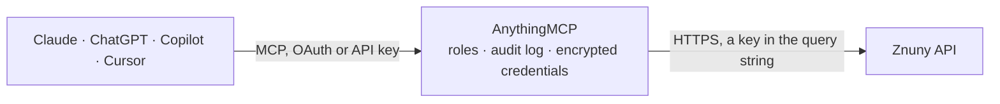

<!-- Generated by scripts/export-github-catalog.mjs in the anythingmcp-website repository. Do not edit by hand. -->

# Znuny MCP connector

Znuny (the maintained OTRS fork, and the same API as OTOBO): search and read tickets with their articles, open tickets and add articles, over the GenericInterface REST web service on your own instance. The AnythingMCP connector gives Claude, ChatGPT, Microsoft Copilot, Cursor and Gemini 6 MCP tools for Znuny: 3 read and 3 can change data.

**Category:** [Customer Support](../support.md) · **Tools:** 6 · **Setup guide:** [anythingmcp.com](https://anythingmcp.com/guides/znuny-to-mcp) · [Deutsch](https://anythingmcp.com/de/guides/znuny-to-mcp) · [Italiano](https://anythingmcp.com/it/guides/znuny-to-mcp) · [Español](https://anythingmcp.com/es/guides/znuny-to-mcp) · [日本語](https://anythingmcp.com/ja/guides/znuny-to-mcp) · [Русский](https://anythingmcp.com/ru/guides/znuny-to-mcp) · [中文](https://anythingmcp.com/zh/guides/znuny-to-mcp)

## Start without code

No installation and no terminal: AnythingMCP Cloud runs the Znuny connector for you, operated by helpcode.ai in Frankfurt, Germany.

1. **Click the button above** and create an account or sign in. The Znuny connector opens, ready to install.
2. **Paste the API key or token from your Znuny account.** Every click is in the [step-by-step guide](https://anythingmcp.com/guides/znuny-to-mcp).
3. **Click Install.** AnythingMCP shows the address of your MCP server.
4. **Add that address to your assistant:** [Claude](https://anythingmcp.com/guides/connect-znuny-to-claude) · [ChatGPT](https://anythingmcp.com/guides/connect-znuny-to-chatgpt) · [Microsoft Copilot](https://anythingmcp.com/guides/connect-znuny-to-copilot) · [Cursor](https://anythingmcp.com/guides/connect-znuny-to-cursor) · [Gemini CLI](https://anythingmcp.com/guides/connect-znuny-to-gemini) · [Meta Muse](https://anythingmcp.com/guides/connect-znuny-to-muse).
5. **Ask your first question**, for example: *Show me the ticket for customer GmbH Consulting about invoice INV-2026-114, if any.*

Prefer help with the setup? [Talk to us](https://anythingmcp.com/contact).

## How it works

- **The AI client** speaks MCP (Streamable HTTP) to AnythingMCP and only sees tool names, descriptions and results. It never gets the Znuny credentials.
- **AnythingMCP** checks the client's role, builds the call from the tool definition, adds the credentials (a key in the query string), calls Znuny, logs the call and returns the result.
- **Znuny** sees an ordinary API client with the rights of the account the credentials belong to.

## Tools

| Tool | What it does | Access |
|---|---|---|
| [`znuny_search_tickets`](#znuny_search_tickets) | Search tickets by queue, state, customer or title fragment (TicketSearch). | read |
| [`znuny_get_ticket`](#znuny_get_ticket) | Read one ticket by TicketID (TicketGet) with its queue, state, priority, owner, customer and SLA. | read |
| [`znuny_get_ticket_articles`](#znuny_get_ticket_articles) | Read one ticket's full conversation: every article in order with its sender, channel, subject, body and customer visibility. | read |
| [`znuny_create_ticket`](#znuny_create_ticket) | Open a real ticket with its first article (TicketCreate). | write |
| [`znuny_add_article`](#znuny_add_article) | Add an article to an existing ticket (TicketUpdate). | write |
| [`znuny_update_ticket`](#znuny_update_ticket) | Change a ticket's state, queue, priority or owner (TicketUpdate) — the move that closes a ticket or hands it to another team. | write |

## Tool reference

Every parameter as the AI client sees it in `tools/list`. Source: [`packages/backend/src/adapters/de/znuny.json`](../../../packages/backend/src/adapters/de/znuny.json).

### `znuny_search_tickets`

Search tickets by queue, state, customer or title fragment (TicketSearch). Returns TicketIDs only — feed them to znuny_get_ticket for the detail.

**Access:** read · **Call:** `GET /Ticket`

| Parameter | Type | Required | Description |
|---|---|---|---|
| `Title` | string | no | Title to match. Use `*` as a wildcard for a fragment, e.g. `*Drucker*`: Znuny adds the wildcards itself only when the web service's ExtendedSearchCondition setting is on. |
| `Queues` | string | no | Queue name to search, e.g. Raw or Support. |
| `States` | string | no | State name, e.g. new or open. |
| `CustomerID` | string | no | Restrict to one customer company id. |
| `CustomerUserLogin` | string | no | Restrict to one customer user login. |
| `Limit` | number | no | Maximum TicketIDs to return. |

### `znuny_get_ticket`

Read one ticket by TicketID (TicketGet) with its queue, state, priority, owner, customer and SLA. Set AllArticles to 1 to include the conversation.

**Access:** read · **Call:** `GET /Ticket/{TicketID}`

| Parameter | Type | Required | Description |
|---|---|---|---|
| `TicketID` | number | yes | Numeric ticket id from znuny_search_tickets. |
| `AllArticles` | number | no | 1 to include every article, 0 for the ticket header only. |
| `DynamicFields` | number | no | 1 to include dynamic field values. |
| `Attachments` | number | no | 1 to include article attachment metadata. |

### `znuny_get_ticket_articles`

Read one ticket's full conversation: every article in order with its sender, channel, subject, body and customer visibility.

**Access:** read · **Call:** `GET /Ticket/{TicketID}`

| Parameter | Type | Required | Description |
|---|---|---|---|
| `TicketID` | number | yes | Numeric ticket id. |

### `znuny_create_ticket`

Open a real ticket with its first article (TicketCreate). Znuny applies the queue's notification rules, so the customer may be e-mailed immediately. State and Priority are required; Type too when ticket types are enabled.

**Access:** write · **Call:** `POST /Ticket`

| Parameter | Type | Required | Description |
|---|---|---|---|
| `Title` | string | yes | Ticket title. |
| `Queue` | string | yes | Queue name the ticket is placed in, e.g. Raw. |
| `State` | string | yes | Initial state name, e.g. `new` or `open`. Required: Znuny has no default. |
| `Priority` | string | yes | Priority name, e.g. `3 normal`. Required: Znuny has no default. |
| `Type` | string | no | Ticket type name, e.g. `Unclassified`. Required only when ticket types are enabled (SysConfig Ticket::Type); otherwise omit. |
| `CustomerUser` | string | yes | Customer user login or e-mail address. |
| `Subject` | string | yes | Subject of the first article. |
| `Body` | string | yes | Body of the first article. |
| `CommunicationChannel` | string | no | `Internal`, `Email` or `Phone`. `Email` actually sends mail. |
| `SenderType` | string | no | `agent`, `system` or `customer`. |

### `znuny_add_article`

Add an article to an existing ticket (TicketUpdate). With the Email channel Znuny actually sends it, so use Internal for anything the customer should not see.

**Access:** write · **Call:** `PATCH /Ticket/{TicketID}`

| Parameter | Type | Required | Description |
|---|---|---|---|
| `TicketID` | number | yes | Numeric ticket id. |
| `Subject` | string | yes | Article subject. |
| `Body` | string | yes | Article body. |
| `CommunicationChannel` | string | no | `Internal`, `Email` or `Phone`. `Email` actually sends mail. |
| `SenderType` | string | no | `agent`, `system` or `customer`. |
| `IsVisibleForCustomer` | number | no | 1 to show the article to the customer, 0 to keep it internal. |

### `znuny_update_ticket`

Change a ticket's state, queue, priority or owner (TicketUpdate) — the move that closes a ticket or hands it to another team.

**Access:** write · **Call:** `PATCH /Ticket/{TicketID}`

| Parameter | Type | Required | Description |
|---|---|---|---|
| `TicketID` | number | yes | Numeric ticket id. |
| `State` | string | no | New state name, e.g. `closed successful`. |
| `Queue` | string | no | New queue name. |
| `Priority` | string | no | New priority name. |
| `Owner` | string | no | Login of the new owner. |

## Run it yourself

AnythingMCP is open source (AGPL-3.0). [Run it with Docker](../../../README.md#run-it-yourself), open **Connectors → Store**, pick **Znuny** and enter `ZNUNY_URL`, `ZNUNY_WEBSERVICE`, `ZNUNY_USERNAME`, `ZNUNY_PASSWORD`, then add your MCP server URL to the AI client.

[← Customer Support connectors](../support.md) · [All categories](../README.md)
