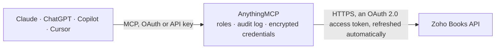

<!-- Generated by scripts/export-github-catalog.mjs in the anythingmcp-website repository. Do not edit by hand. -->

# Zoho Books MCP connector

Let your AI work in Zoho Books: look up and manage customers, vendors and items, create, email, mark as sent and void invoices, create estimates, record customer payments, bills and expenses, and … The AnythingMCP connector gives Claude, ChatGPT, Microsoft Copilot, Cursor and Gemini 45 MCP tools for Zoho Books: 24 read and 21 can change data.

**Category:** [Accounting](../accounting.md) · **Tools:** 45 · **Setup guide:** [anythingmcp.com](https://anythingmcp.com/guides/zoho-books-to-mcp) · [Deutsch](https://anythingmcp.com/de/guides/zoho-books-to-mcp) · [Italiano](https://anythingmcp.com/it/guides/zoho-books-to-mcp) · [Español](https://anythingmcp.com/es/guides/zoho-books-to-mcp) · [日本語](https://anythingmcp.com/ja/guides/zoho-books-to-mcp) · [Русский](https://anythingmcp.com/ru/guides/zoho-books-to-mcp) · [中文](https://anythingmcp.com/zh/guides/zoho-books-to-mcp)

## Start without code

No installation and no terminal: AnythingMCP Cloud runs the Zoho Books connector for you, operated by helpcode.ai in Frankfurt, Germany.

1. **Click the button above** and create an account or sign in. The Zoho Books connector opens, ready to install.
2. **Sign in with your Zoho Books account** when AnythingMCP asks. The first time, an admin creates a small app in the Zoho Books developer console. Every click is in the [step-by-step guide](https://anythingmcp.com/guides/zoho-books-to-mcp).
3. **Click Install.** AnythingMCP shows the address of your MCP server.
4. **Add that address to your assistant:** [Claude](https://anythingmcp.com/guides/connect-zoho-books-to-claude) · [ChatGPT](https://anythingmcp.com/guides/connect-zoho-books-to-chatgpt) · [Microsoft Copilot](https://anythingmcp.com/guides/connect-zoho-books-to-copilot) · [Cursor](https://anythingmcp.com/guides/connect-zoho-books-to-cursor) · [Gemini CLI](https://anythingmcp.com/guides/connect-zoho-books-to-gemini) · [Meta Muse](https://anythingmcp.com/guides/connect-zoho-books-to-muse).
5. **Ask your first question**, for example: *What outstanding invoices does customer Nordica Energy GmbH have as of 2026-10-15?*

Prefer help with the setup? [Talk to us](https://anythingmcp.com/contact).

## How it works

- **The AI client** speaks MCP (Streamable HTTP) to AnythingMCP and only sees tool names, descriptions and results. It never gets the Zoho Books credentials.
- **AnythingMCP** checks the client's role, builds the call from the tool definition, adds the credentials (an OAuth 2.0 access token, refreshed automatically), calls Zoho Books, logs the call and returns the result.
- **Zoho Books** sees an ordinary API client with the rights of the account the credentials belong to.

## Tools

| Tool | What it does | Access |
|---|---|---|
| [`zoho_books_list_organizations`](#zoho_books_list_organizations) | List the Zoho Books organizations this sign-in can reach: organization_id, name, country, currency, time zone and whether it is the default. | read |
| [`zoho_books_get_organization`](#zoho_books_get_organization) | Read the connected organization: name, address, base currency, fiscal year start, time zone, tax settings and contact details. | read |
| [`zoho_books_list_contacts`](#zoho_books_list_contacts) | List contacts (customers and vendors) with contact_id, name, company, email, status and outstanding receivables or payables. | read |
| [`zoho_books_get_contact`](#zoho_books_get_contact) | Read one contact with addresses, contact persons, payment terms, currency, balances and custom fields. | read |
| [`zoho_books_create_contact`](#zoho_books_create_contact) | Create a customer or vendor. | write |
| [`zoho_books_update_contact`](#zoho_books_update_contact) | Update a contact. | write |
| [`zoho_books_mark_contact_inactive`](#zoho_books_mark_contact_inactive) | Mark a contact inactive: it stays in the books but is hidden from lists and cannot be used on new transactions. | write |
| [`zoho_books_delete_contact`](#zoho_books_delete_contact) | Delete a contact for good. | write |
| [`zoho_books_list_items`](#zoho_books_list_items) | List items (products and services) with item_id, name, SKU, rate, unit, tax and status. | read |
| [`zoho_books_get_item`](#zoho_books_get_item) | Read one item with selling and purchase prices, accounts, tax, unit and stock details. | read |
| [`zoho_books_create_item`](#zoho_books_create_item) | Create an item (product or service). | write |
| [`zoho_books_update_item`](#zoho_books_update_item) | Update an item. | write |
| [`zoho_books_mark_item_inactive`](#zoho_books_mark_item_inactive) | Mark an item inactive so it can no longer be added to new documents. | write |
| [`zoho_books_list_invoices`](#zoho_books_list_invoices) | List invoices with invoice_id, number, customer, status, date, due date, total and balance. | read |
| [`zoho_books_get_invoice`](#zoho_books_get_invoice) | Read one invoice with line items, taxes, totals, balance, payments, customer and status. | read |
| [`zoho_books_create_invoice`](#zoho_books_create_invoice) | Create an invoice (a draft, unless send is true, which also emails it to the customer: confirm that with the user first). | write |
| [`zoho_books_email_invoice`](#zoho_books_email_invoice) | Email an invoice to the customer from the organization, with the invoice attached. | write |
| [`zoho_books_mark_invoice_sent`](#zoho_books_mark_invoice_sent) | Mark a draft invoice as sent without emailing it (for invoices delivered another way). | write |
| [`zoho_books_void_invoice`](#zoho_books_void_invoice) | Void an invoice: it stays on record with status void but no longer counts as receivable or revenue. | write |
| [`zoho_books_mark_invoice_draft`](#zoho_books_mark_invoice_draft) | Turn a void invoice back into a draft, for example to correct and reissue it. | write |
| [`zoho_books_delete_invoice`](#zoho_books_delete_invoice) | Delete an invoice for good: only a draft without recorded payments. | write |
| [`zoho_books_list_estimates`](#zoho_books_list_estimates) | List estimates (quotes) with estimate_id, number, customer, status, date, expiry date and total. | read |
| [`zoho_books_get_estimate`](#zoho_books_get_estimate) | Read one estimate with line items, taxes, totals and status. | read |
| [`zoho_books_create_estimate`](#zoho_books_create_estimate) | Create an estimate (quote) as a draft. | write |
| [`zoho_books_delete_estimate`](#zoho_books_delete_estimate) | Delete an estimate (quote) for good; it cannot be restored. | write |
| [`zoho_books_list_customer_payments`](#zoho_books_list_customer_payments) | List payments received from customers with payment_id, customer, date, amount, payment mode and the invoices they paid. | read |
| [`zoho_books_get_customer_payment`](#zoho_books_get_customer_payment) | Read one customer payment with the invoices it was applied to. | read |
| [`zoho_books_create_customer_payment`](#zoho_books_create_customer_payment) | Record a payment received from a customer and apply it to invoices (bookkeeping only; no money is collected). | write |
| [`zoho_books_delete_customer_payment`](#zoho_books_delete_customer_payment) | Delete a recorded customer payment; the invoices become unpaid again. | write |
| [`zoho_books_list_bills`](#zoho_books_list_bills) | List bills (vendor invoices) with bill_id, number, vendor, status, date, due date, total and balance. | read |
| [`zoho_books_get_bill`](#zoho_books_get_bill) | Read one bill with line items, accounts, taxes, totals, balance and payments. | read |
| [`zoho_books_create_bill`](#zoho_books_create_bill) | Record a bill received from a vendor (it posts to the ledger as payable). | write |
| [`zoho_books_delete_bill`](#zoho_books_delete_bill) | Delete a bill for good (only without recorded payments). | write |
| [`zoho_books_list_expenses`](#zoho_books_list_expenses) | List expenses with expense_id, date, account, amount, vendor, customer and status (billable, invoiced, ...). | read |
| [`zoho_books_get_expense`](#zoho_books_get_expense) | Read one expense with account, paid-through account, tax, vendor, customer and receipts. | read |
| [`zoho_books_create_expense`](#zoho_books_create_expense) | Record an expense paid from a bank, cash or credit card account (it posts to the ledger). | write |
| [`zoho_books_delete_expense`](#zoho_books_delete_expense) | Delete an expense for good; its ledger postings are removed. | write |
| [`zoho_books_list_chart_of_accounts`](#zoho_books_list_chart_of_accounts) | List the chart of accounts: account_id, name, code, type (asset, liability, equity, income, expense, bank, cash, ...), active flag and, with showbalance,… | read |
| [`zoho_books_get_account`](#zoho_books_get_account) | Read one account of the chart of accounts: name, code, type, currency, description and balance. | read |
| [`zoho_books_list_account_transactions`](#zoho_books_list_account_transactions) | List the transactions booked on one account (invoices, payments, bills, expenses, journals) with date, debit, credit and reference: a ledger view of the… | read |
| [`zoho_books_list_bank_accounts`](#zoho_books_list_bank_accounts) | List bank, cash and credit card accounts with account_id, name, type, currency, balance and bank name. | read |
| [`zoho_books_get_bank_account`](#zoho_books_get_bank_account) | Read one bank or credit card account with balance and bank details. | read |
| [`zoho_books_list_bank_transactions`](#zoho_books_list_bank_transactions) | List bank transactions (deposits, withdrawals, transfers and feed lines) with date, amount, type, status (categorized, uncategorized, matched, excluded) and… | read |
| [`zoho_books_get_bank_transaction`](#zoho_books_get_bank_transaction) | Read one bank transaction with its accounts, amounts and the documents it is matched to. | read |
| [`zoho_books_list_taxes`](#zoho_books_list_taxes) | List the organization's taxes and tax groups with tax_id, name, percentage and type, for line items and expenses. | read |

## Tool reference

Every parameter as the AI client sees it in `tools/list`. Source: [`packages/backend/src/adapters/intl/zoho-books.json`](../../../packages/backend/src/adapters/intl/zoho-books.json).

### `zoho_books_list_organizations`

List the Zoho Books organizations this sign-in can reach: organization_id, name, country, currency, time zone and whether it is the default. Use it to check ZOHO_BOOKS_ORGANIZATION_ID.

**Access:** read · **Call:** `GET /organizations`

No parameters.

### `zoho_books_get_organization`

Read the connected organization: name, address, base currency, fiscal year start, time zone, tax settings and contact details.

**Access:** read · **Call:** `GET /organizations/{ZOHO_BOOKS_ORGANIZATION_ID}`

No parameters.

### `zoho_books_list_contacts`

List contacts (customers and vendors) with contact_id, name, company, email, status and outstanding receivables or payables.

**Access:** read · **Call:** `GET /contacts`

| Parameter | Type | Required | Description |
|---|---|---|---|
| `contact_type` | `customer` \| `vendor` | no | customer or vendor. |
| `search_text` | string | no | Text in name, company, email or phone. |
| `contact_name_contains` | string | no | Part of the contact name. |
| `email_contains` | string | no | Part of the email address. |
| `filter_by` | string | no | Status.All, Status.Active, Status.Inactive, Status.Duplicate, Invoice.OverDue, Invoice.Unpaid, Status.CreditLimitExceed. |
| `sort_column` | string | no | contact_name, email, outstanding_receivable_amount, created_time or last_modified_time. |
| `sort_order` | `A` \| `D` | no | A (ascending) or D (descending). |
| `page` | integer | no | Page number, starting at 1. |
| `per_page` | integer | no | Records per page, up to 200 (default 200). |

### `zoho_books_get_contact`

Read one contact with addresses, contact persons, payment terms, currency, balances and custom fields.

**Access:** read · **Call:** `GET /contacts/{contact_id}`

| Parameter | Type | Required | Description |
|---|---|---|---|
| `contact_id` | string | yes | The contact_id. |

### `zoho_books_create_contact`

Create a customer or vendor. Returns the contact with its contact_id.

**Access:** write · **Call:** `POST /contacts`

| Parameter | Type | Required | Description |
|---|---|---|---|
| `contact_name` | string | yes | Display name of the contact (required, unique). |
| `company_name` | string | no | Company name. |
| `contact_type` | `customer` \| `vendor` | no | customer or vendor. |
| `customer_sub_type` | `business` \| `individual` | no | business or individual (customers). |
| `contact_persons` | object[] | no | People, e.g. [{"first_name": "Ana", "last_name": "Diaz", "email": "ana@example.com", "phone": "+49 761 1234567", "is_primary_contact": true}]. The primary person's email is where invoices are emailed. |
| `billing_address` | object | no | e.g. {"attention": "Accounts", "address": "Hauptstr. 1", "city": "Freiburg", "zip": "79098", "country": "Germany"}. |
| `shipping_address` | object | no | Same shape as billing_address. |
| `currency_id` | string | no | Currency id (default: base currency). |
| `payment_terms` | integer | no | Payment terms in days, e.g. 30. |
| `payment_terms_label` | string | no | Label for the terms, e.g. "Net 30". |
| `vat_reg_no` | string | no | VAT registration number (EU organizations). |
| `website` | string | no | Website. |
| `notes` | string | no | Internal notes. |

### `zoho_books_update_contact`

Update a contact. Zoho requires contact_name and contact_type on every update (send the current values if they do not change); other fields are only changed when given. contact_persons replaces the list.

**Access:** write · **Call:** `PUT /contacts/{contact_id}`

| Parameter | Type | Required | Description |
|---|---|---|---|
| `contact_id` | string | yes | The contact_id. |
| `contact_name` | string | yes | Display name of the contact (required, unique). |
| `company_name` | string | no | Company name. |
| `contact_type` | `customer` \| `vendor` | yes | customer or vendor. |
| `customer_sub_type` | `business` \| `individual` | no | business or individual (customers). |
| `contact_persons` | object[] | no | People, e.g. [{"first_name": "Ana", "last_name": "Diaz", "email": "ana@example.com", "phone": "+49 761 1234567", "is_primary_contact": true}]. The primary person's email is where invoices are emailed. |
| `billing_address` | object | no | e.g. {"attention": "Accounts", "address": "Hauptstr. 1", "city": "Freiburg", "zip": "79098", "country": "Germany"}. |
| `shipping_address` | object | no | Same shape as billing_address. |
| `currency_id` | string | no | Currency id (default: base currency). |
| `payment_terms` | integer | no | Payment terms in days, e.g. 30. |
| `payment_terms_label` | string | no | Label for the terms, e.g. "Net 30". |
| `vat_reg_no` | string | no | VAT registration number (EU organizations). |
| `website` | string | no | Website. |
| `notes` | string | no | Internal notes. |

### `zoho_books_mark_contact_inactive`

Mark a contact inactive: it stays in the books but is hidden from lists and cannot be used on new transactions.

**Access:** write · **Call:** `POST /contacts/{contact_id}/inactive`

| Parameter | Type | Required | Description |
|---|---|---|---|
| `contact_id` | string | yes | The contact_id. |

### `zoho_books_delete_contact`

Delete a contact for good. Not possible while transactions refer to it (mark it inactive instead). Confirm with the user first.

**Access:** write · **Call:** `DELETE /contacts/{contact_id}`

| Parameter | Type | Required | Description |
|---|---|---|---|
| `contact_id` | string | yes | The contact_id. |

### `zoho_books_list_items`

List items (products and services) with item_id, name, SKU, rate, unit, tax and status.

**Access:** read · **Call:** `GET /items`

| Parameter | Type | Required | Description |
|---|---|---|---|
| `search_text` | string | no | Text in name, SKU or description. |
| `name_contains` | string | no | Part of the item name. |
| `filter_by` | string | no | Status.All, Status.Active or Status.Inactive. |
| `sort_column` | string | no | name, rate or tax_name. |
| `sort_order` | `A` \| `D` | no | A (ascending) or D (descending). |
| `page` | integer | no | Page number, starting at 1. |
| `per_page` | integer | no | Records per page, up to 200 (default 200). |

### `zoho_books_get_item`

Read one item with selling and purchase prices, accounts, tax, unit and stock details.

**Access:** read · **Call:** `GET /items/{item_id}`

| Parameter | Type | Required | Description |
|---|---|---|---|
| `item_id` | string | yes | The item_id. |

### `zoho_books_create_item`

Create an item (product or service). Returns the item with its item_id.

**Access:** write · **Call:** `POST /items`

| Parameter | Type | Required | Description |
|---|---|---|---|
| `name` | string | yes | Item name (unique). |
| `rate` | number | yes | Selling price per unit. |
| `description` | string | no | Description printed on documents. |
| `sku` | string | no | SKU. |
| `unit` | string | no | Unit, e.g. "pcs" or "hrs". |
| `product_type` | `goods` \| `service` \| `digital_service` | no | goods, service or digital_service. |
| `item_type` | `sales` \| `purchases` \| `sales_and_purchases` \| `inventory` | no | sales (default), purchases, sales_and_purchases or inventory. |
| `tax_id` | string | no | Default tax id. |
| `account_id` | string | no | Income account id. |
| `purchase_rate` | number | no | Purchase price per unit. |
| `purchase_account_id` | string | no | Expense account id for purchases. |

### `zoho_books_update_item`

Update an item. Zoho requires name and rate on every update (send the current values if they do not change).

**Access:** write · **Call:** `PUT /items/{item_id}`

| Parameter | Type | Required | Description |
|---|---|---|---|
| `item_id` | string | yes | The item_id. |
| `name` | string | yes | Item name (unique). |
| `rate` | number | yes | Selling price per unit. |
| `description` | string | no | Description printed on documents. |
| `sku` | string | no | SKU. |
| `unit` | string | no | Unit, e.g. "pcs" or "hrs". |
| `product_type` | `goods` \| `service` \| `digital_service` | no | goods, service or digital_service. |
| `item_type` | `sales` \| `purchases` \| `sales_and_purchases` \| `inventory` | no | sales (default), purchases, sales_and_purchases or inventory. |
| `tax_id` | string | no | Default tax id. |
| `account_id` | string | no | Income account id. |
| `purchase_rate` | number | no | Purchase price per unit. |
| `purchase_account_id` | string | no | Expense account id for purchases. |

### `zoho_books_mark_item_inactive`

Mark an item inactive so it can no longer be added to new documents.

**Access:** write · **Call:** `POST /items/{item_id}/inactive`

| Parameter | Type | Required | Description |
|---|---|---|---|
| `item_id` | string | yes | The item_id. |

### `zoho_books_list_invoices`

List invoices with invoice_id, number, customer, status, date, due date, total and balance.

**Access:** read · **Call:** `GET /invoices`

| Parameter | Type | Required | Description |
|---|---|---|---|
| `status` | `sent` \| `draft` \| `overdue` \| `paid` \| `void` \| `unpaid` \| `partially_paid` \| `viewed` | no | sent, draft, overdue, paid, void, unpaid, partially_paid or viewed. |
| `customer_id` | string | no | Only this customer. |
| `search_text` | string | no | Text in number, reference or customer name. |
| `invoice_number` | string | no | Exact invoice number. |
| `reference_number` | string | no | Reference number. |
| `date_start` | string | no | Invoice date from, YYYY-MM-DD. |
| `date_end` | string | no | Invoice date until, YYYY-MM-DD. |
| `due_date_start` | string | no | Due date from, YYYY-MM-DD. |
| `due_date_end` | string | no | Due date until, YYYY-MM-DD. |
| `sort_column` | string | no | customer_name, invoice_number, date, due_date, total, balance or created_time. |
| `sort_order` | `A` \| `D` | no | A (ascending) or D (descending). |
| `page` | integer | no | Page number, starting at 1. |
| `per_page` | integer | no | Records per page, up to 200 (default 200). |

### `zoho_books_get_invoice`

Read one invoice with line items, taxes, totals, balance, payments, customer and status.

**Access:** read · **Call:** `GET /invoices/{invoice_id}`

| Parameter | Type | Required | Description |
|---|---|---|---|
| `invoice_id` | string | yes | The invoice_id. |

### `zoho_books_create_invoice`

Create an invoice (a draft, unless send is true, which also emails it to the customer: confirm that with the user first). Returns the invoice with invoice_id and invoice_number.

**Access:** write · **Call:** `POST /invoices`

| Parameter | Type | Required | Description |
|---|---|---|---|
| `customer_id` | string | yes | The customer contact_id. |
| `line_items` | object[] | yes | Line items, e.g. [{"item_id": "460000000017088", "quantity": 2, "rate": 120}] or with a free description [{"name": "Consulting", "description": "October", "quantity": 1, "rate": 500, "tax_id": "..."}]. |
| `date` | string | no | Invoice date, YYYY-MM-DD (default today). |
| `due_date` | string | no | Due date, YYYY-MM-DD. |
| `payment_terms` | integer | no | Payment terms in days. |
| `reference_number` | string | no | Reference, e.g. an order number. |
| `invoice_number` | string | no | Own number; only together with ignore_auto_number_generation true. |
| `ignore_auto_number_generation` | boolean | no | true to use invoice_number instead of the next automatic number. |
| `currency_id` | string | no | Currency id (default: the customer's). |
| `discount` | number | no | Discount, an amount or percentage depending on discount_type. |
| `is_inclusive_tax` | boolean | no | true when rates include tax. |
| `notes` | string | no | Notes printed on the invoice. |
| `terms` | string | no | Terms and conditions printed on the invoice. |
| `custom_fields` | object[] | no | Custom field values, e.g. [{"customfield_id": "...", "value": "..."}]. |
| `send` | boolean | no | true to email the invoice to the customer right away (default false). |

### `zoho_books_email_invoice`

Email an invoice to the customer from the organization, with the invoice attached. This reaches the customer: confirm recipients and text with the user first.

**Access:** write · **Call:** `POST /invoices/{invoice_id}/email`

| Parameter | Type | Required | Description |
|---|---|---|---|
| `invoice_id` | string | yes | The invoice_id. |
| `to_mail_ids` | string[] | yes | Recipient email addresses. |
| `cc_mail_ids` | string[] | no | CC email addresses. |
| `subject` | string | no | Subject; the template's when omitted. |
| `body` | string | no | Message text (HTML allowed); the template's when omitted. |

### `zoho_books_mark_invoice_sent`

Mark a draft invoice as sent without emailing it (for invoices delivered another way). It then counts as receivable.

**Access:** write · **Call:** `POST /invoices/{invoice_id}/status/sent`

| Parameter | Type | Required | Description |
|---|---|---|---|
| `invoice_id` | string | yes | The invoice_id. |

### `zoho_books_void_invoice`

Void an invoice: it stays on record with status void but no longer counts as receivable or revenue. Confirm with the user first.

**Access:** write · **Call:** `POST /invoices/{invoice_id}/status/void`

| Parameter | Type | Required | Description |
|---|---|---|---|
| `invoice_id` | string | yes | The invoice_id. |

### `zoho_books_mark_invoice_draft`

Turn a void invoice back into a draft, for example to correct and reissue it. Zoho only allows this for void invoices. Confirm with the user first.

**Access:** write · **Call:** `POST /invoices/{invoice_id}/status/draft`

| Parameter | Type | Required | Description |
|---|---|---|---|
| `invoice_id` | string | yes | The invoice_id. |

### `zoho_books_delete_invoice`

Delete an invoice for good: only a draft without recorded payments. A sent invoice is refused (code 4529); void it instead. Confirm with the user first.

**Access:** write · **Call:** `DELETE /invoices/{invoice_id}`

| Parameter | Type | Required | Description |
|---|---|---|---|
| `invoice_id` | string | yes | The invoice_id. |

### `zoho_books_list_estimates`

List estimates (quotes) with estimate_id, number, customer, status, date, expiry date and total.

**Access:** read · **Call:** `GET /estimates`

| Parameter | Type | Required | Description |
|---|---|---|---|
| `status` | `draft` \| `sent` \| `invoiced` \| `accepted` \| `declined` \| `expired` | no | draft, sent, invoiced, accepted, declined or expired. |
| `customer_id` | string | no | Only this customer. |
| `search_text` | string | no | Text in number, reference or customer name. |
| `date_start` | string | no | Date from, YYYY-MM-DD. |
| `date_end` | string | no | Date until, YYYY-MM-DD. |
| `sort_column` | string | no | customer_name, estimate_number, date, total or created_time. |
| `sort_order` | `A` \| `D` | no | A (ascending) or D (descending). |
| `page` | integer | no | Page number, starting at 1. |
| `per_page` | integer | no | Records per page, up to 200 (default 200). |

### `zoho_books_get_estimate`

Read one estimate with line items, taxes, totals and status.

**Access:** read · **Call:** `GET /estimates/{estimate_id}`

| Parameter | Type | Required | Description |
|---|---|---|---|
| `estimate_id` | string | yes | The estimate_id. |

### `zoho_books_create_estimate`

Create an estimate (quote) as a draft. Returns the estimate with estimate_id and number.

**Access:** write · **Call:** `POST /estimates`

| Parameter | Type | Required | Description |
|---|---|---|---|
| `customer_id` | string | yes | The customer contact_id. |
| `line_items` | object[] | yes | Line items, e.g. [{"item_id": "460000000017088", "quantity": 2, "rate": 120}] or with a free description [{"name": "Consulting", "description": "October", "quantity": 1, "rate": 500, "tax_id": "..."}]. |
| `date` | string | no | Estimate date, YYYY-MM-DD. |
| `expiry_date` | string | no | Valid until, YYYY-MM-DD. |
| `reference_number` | string | no | Reference. |
| `notes` | string | no | Notes printed on the estimate. |
| `terms` | string | no | Terms printed on the estimate. |

### `zoho_books_delete_estimate`

Delete an estimate (quote) for good; it cannot be restored. Confirm with the user first.

**Access:** write · **Call:** `DELETE /estimates/{estimate_id}`

| Parameter | Type | Required | Description |
|---|---|---|---|
| `estimate_id` | string | yes | The estimate_id. |

### `zoho_books_list_customer_payments`

List payments received from customers with payment_id, customer, date, amount, payment mode and the invoices they paid.

**Access:** read · **Call:** `GET /customerpayments`

| Parameter | Type | Required | Description |
|---|---|---|---|
| `customer_id` | string | no | Only this customer. |
| `search_text` | string | no | Text in reference, customer name or payment number. |
| `date` | string | no | Payment date, YYYY-MM-DD. |
| `filter_by` | string | no | PaymentMode.All, PaymentMode.Check, PaymentMode.Cash, PaymentMode.BankTransfer, PaymentMode.CreditCard, ... |
| `sort_column` | string | no | customer_name, payment_number, date, amount or created_time. |
| `sort_order` | `A` \| `D` | no | A (ascending) or D (descending). |
| `page` | integer | no | Page number, starting at 1. |
| `per_page` | integer | no | Records per page, up to 200 (default 200). |

### `zoho_books_get_customer_payment`

Read one customer payment with the invoices it was applied to.

**Access:** read · **Call:** `GET /customerpayments/{payment_id}`

| Parameter | Type | Required | Description |
|---|---|---|---|
| `payment_id` | string | yes | The payment_id. |

### `zoho_books_create_customer_payment`

Record a payment received from a customer and apply it to invoices (bookkeeping only; no money is collected). Confirm amount and invoices with the user first. Returns the payment with payment_id.

**Access:** write · **Call:** `POST /customerpayments`

| Parameter | Type | Required | Description |
|---|---|---|---|
| `customer_id` | string | yes | The customer contact_id. |
| `amount` | number | yes | Amount received. |
| `date` | string | yes | Payment date, YYYY-MM-DD. |
| `payment_mode` | string | yes | check, cash, creditcard, banktransfer, bankremittance, autotransaction or others. |
| `invoices` | object[] | yes | Invoices paid, e.g. [{"invoice_id": "...", "amount_applied": 119.0}]. Amounts not applied stay as customer credit. |
| `account_id` | string | no | Deposit-to account id (bank or cash account). |
| `reference_number` | string | no | Reference, e.g. the bank transfer id. |
| `description` | string | no | Note. |
| `bank_charges` | number | no | Bank charges deducted. |

### `zoho_books_delete_customer_payment`

Delete a recorded customer payment; the invoices become unpaid again. Confirm with the user first.

**Access:** write · **Call:** `DELETE /customerpayments/{payment_id}`

| Parameter | Type | Required | Description |
|---|---|---|---|
| `payment_id` | string | yes | The payment_id. |

### `zoho_books_list_bills`

List bills (vendor invoices) with bill_id, number, vendor, status, date, due date, total and balance.

**Access:** read · **Call:** `GET /bills`

| Parameter | Type | Required | Description |
|---|---|---|---|
| `status` | string | no | paid, open, overdue, void, partially_paid, unpaid or draft. |
| `vendor_id` | string | no | Only this vendor. |
| `search_text` | string | no | Text in number, reference or vendor name. |
| `date_start` | string | no | Bill date from, YYYY-MM-DD. |
| `date_end` | string | no | Bill date until, YYYY-MM-DD. |
| `sort_column` | string | no | vendor_name, bill_number, date, due_date, total or balance. |
| `sort_order` | `A` \| `D` | no | A (ascending) or D (descending). |
| `page` | integer | no | Page number, starting at 1. |
| `per_page` | integer | no | Records per page, up to 200 (default 200). |

### `zoho_books_get_bill`

Read one bill with line items, accounts, taxes, totals, balance and payments.

**Access:** read · **Call:** `GET /bills/{bill_id}`

| Parameter | Type | Required | Description |
|---|---|---|---|
| `bill_id` | string | yes | The bill_id. |

### `zoho_books_create_bill`

Record a bill received from a vendor (it posts to the ledger as payable). Confirm with the user first. Returns the bill with bill_id.

**Access:** write · **Call:** `POST /bills`

| Parameter | Type | Required | Description |
|---|---|---|---|
| `vendor_id` | string | yes | The vendor contact_id. |
| `bill_number` | string | yes | The vendor's invoice number. |
| `date` | string | no | Bill date, YYYY-MM-DD. |
| `due_date` | string | no | Due date, YYYY-MM-DD. |
| `line_items` | object[] | yes | Lines, e.g. [{"account_id": "<expense account>", "description": "Office chairs", "quantity": 2, "rate": 150, "tax_id": "..."}] or with item_id. |
| `reference_number` | string | no | Reference, e.g. your purchase order. |
| `is_inclusive_tax` | boolean | no | true when rates include tax. |
| `notes` | string | no | Notes. |

### `zoho_books_delete_bill`

Delete a bill for good (only without recorded payments). Confirm with the user first.

**Access:** write · **Call:** `DELETE /bills/{bill_id}`

| Parameter | Type | Required | Description |
|---|---|---|---|
| `bill_id` | string | yes | The bill_id. |

### `zoho_books_list_expenses`

List expenses with expense_id, date, account, amount, vendor, customer and status (billable, invoiced, ...).

**Access:** read · **Call:** `GET /expenses`

| Parameter | Type | Required | Description |
|---|---|---|---|
| `status` | string | no | unbilled, invoiced, reimbursed, non-billable or billable. |
| `search_text` | string | no | Text in description, reference or account name. |
| `vendor_id` | string | no | Only this vendor. |
| `customer_id` | string | no | Only this customer. |
| `date_start` | string | no | Date from, YYYY-MM-DD. |
| `date_end` | string | no | Date until, YYYY-MM-DD. |
| `sort_column` | string | no | date, account_name, total, reference_number, customer_name or created_time. |
| `sort_order` | `A` \| `D` | no | A (ascending) or D (descending). |
| `page` | integer | no | Page number, starting at 1. |
| `per_page` | integer | no | Records per page, up to 200 (default 200). |

### `zoho_books_get_expense`

Read one expense with account, paid-through account, tax, vendor, customer and receipts.

**Access:** read · **Call:** `GET /expenses/{expense_id}`

| Parameter | Type | Required | Description |
|---|---|---|---|
| `expense_id` | string | yes | The expense_id. |

### `zoho_books_create_expense`

Record an expense paid from a bank, cash or credit card account (it posts to the ledger). Confirm with the user first. Returns the expense with expense_id.

**Access:** write · **Call:** `POST /expenses`

| Parameter | Type | Required | Description |
|---|---|---|---|
| `account_id` | string | yes | Expense account id (chart of accounts, type expense). |
| `paid_through_account_id` | string | yes | Account it was paid from (bank, cash or credit card account id). |
| `date` | string | yes | Date, YYYY-MM-DD. |
| `amount` | number | yes | Amount. |
| `description` | string | no | Description. |
| `reference_number` | string | no | Reference, e.g. receipt number. |
| `vendor_id` | string | no | Vendor contact_id. |
| `customer_id` | string | no | Customer to bill it to. |
| `is_billable` | boolean | no | true if it should be billed to the customer. |
| `tax_id` | string | no | Tax id. |
| `is_inclusive_tax` | boolean | no | true when the amount includes tax. |

### `zoho_books_delete_expense`

Delete an expense for good; its ledger postings are removed. Confirm with the user first.

**Access:** write · **Call:** `DELETE /expenses/{expense_id}`

| Parameter | Type | Required | Description |
|---|---|---|---|
| `expense_id` | string | yes | The expense_id. |

### `zoho_books_list_chart_of_accounts`

List the chart of accounts: account_id, name, code, type (asset, liability, equity, income, expense, bank, cash, ...), active flag and, with showbalance, the current balance.

**Access:** read · **Call:** `GET /chartofaccounts`

| Parameter | Type | Required | Description |
|---|---|---|---|
| `filter_by` | string | no | AccountType.All, AccountType.Active, AccountType.Inactive, AccountType.Asset, AccountType.Liability, AccountType.Equity, AccountType.Income or AccountType.Expense. |
| `showbalance` | boolean | no | true to include each account's current balance. |
| `search_text` | string | no | Text in account name or code. |
| `sort_column` | string | no | account_name, account_type or account_code. |
| `sort_order` | `A` \| `D` | no | A (ascending) or D (descending). |

### `zoho_books_get_account`

Read one account of the chart of accounts: name, code, type, currency, description and balance.

**Access:** read · **Call:** `GET /chartofaccounts/{account_id}`

| Parameter | Type | Required | Description |
|---|---|---|---|
| `account_id` | string | yes | The account_id. |

### `zoho_books_list_account_transactions`

List the transactions booked on one account (invoices, payments, bills, expenses, journals) with date, debit, credit and reference: a ledger view of the account.

**Access:** read · **Call:** `GET /chartofaccounts/accounttransactions`

| Parameter | Type | Required | Description |
|---|---|---|---|
| `account_id` | string | yes | The account_id (required). |
| `date_start` | string | no | Date from, YYYY-MM-DD. |
| `date_end` | string | no | Date until, YYYY-MM-DD. |
| `transaction_type` | string | no | Only one type, e.g. invoice, customer_payment, bills, expense, journal. |
| `sort_column` | string | no | transaction_date, debit_amount or credit_amount. |
| `sort_order` | `A` \| `D` | no | A (ascending) or D (descending). |
| `page` | integer | no | Page number, starting at 1. |
| `per_page` | integer | no | Records per page, up to 200 (default 200). |

### `zoho_books_list_bank_accounts`

List bank, cash and credit card accounts with account_id, name, type, currency, balance and bank name.

**Access:** read · **Call:** `GET /bankaccounts`

| Parameter | Type | Required | Description |
|---|---|---|---|
| `filter_by` | string | no | Status.All, Status.Active or Status.Inactive. |
| `sort_column` | string | no | account_name, account_type or account_code. |

### `zoho_books_get_bank_account`

Read one bank or credit card account with balance and bank details.

**Access:** read · **Call:** `GET /bankaccounts/{account_id}`

| Parameter | Type | Required | Description |
|---|---|---|---|
| `account_id` | string | yes | The bank account_id. |

### `zoho_books_list_bank_transactions`

List bank transactions (deposits, withdrawals, transfers and feed lines) with date, amount, type, status (categorized, uncategorized, matched, excluded) and reference.

**Access:** read · **Call:** `GET /banktransactions`

| Parameter | Type | Required | Description |
|---|---|---|---|
| `account_id` | string | no | Only this bank account. |
| `filter_by` | string | no | Status.All, Status.Uncategorized, Status.Categorized, Status.ManuallyAdded, Status.Excluded or Status.Matched. |
| `transaction_type` | string | no | e.g. deposit, expense, transfer_fund, card_payment. |
| `date_start` | string | no | Date from, YYYY-MM-DD. |
| `date_end` | string | no | Date until, YYYY-MM-DD. |
| `search_text` | string | no | Text in reference, payee or description. |
| `sort_column` | string | no | date. |
| `page` | integer | no | Page number, starting at 1. |
| `per_page` | integer | no | Records per page, up to 200 (default 200). |

### `zoho_books_get_bank_transaction`

Read one bank transaction with its accounts, amounts and the documents it is matched to.

**Access:** read · **Call:** `GET /banktransactions/{bank_transaction_id}`

| Parameter | Type | Required | Description |
|---|---|---|---|
| `bank_transaction_id` | string | yes | The bank_transaction_id. |

### `zoho_books_list_taxes`

List the organization's taxes and tax groups with tax_id, name, percentage and type, for line items and expenses.

**Access:** read · **Call:** `GET /settings/taxes`

No parameters.

## Run it yourself

AnythingMCP is open source (AGPL-3.0). [Run it with Docker](../../../README.md#run-it-yourself), open **Connectors → Store**, pick **Zoho Books** and enter `ZOHO_BOOKS_CLIENT_ID`, `ZOHO_BOOKS_CLIENT_SECRET`, `ZOHO_BOOKS_ORGANIZATION_ID`, `ZOHO_BOOKS_ACCOUNTS_URL`, `ZOHO_BOOKS_API_URL`, then add your MCP server URL to the AI client.

[← Accounting connectors](../accounting.md) · [All categories](../README.md)
