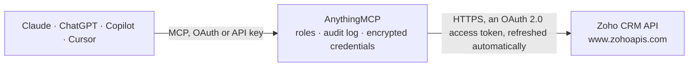

<!-- Generated by scripts/export-github-catalog.mjs in the anythingmcp-website repository. Do not edit by hand. -->

# Zoho CRM MCP connector

Manage Zoho CRM (leads, contacts, accounts, deals, tasks, notes, custom modules) from any AI agent. 10 tools, OAuth refresh-token auth. The AnythingMCP connector gives Claude, ChatGPT, Microsoft Copilot, Cursor and Gemini 10 MCP tools for Zoho CRM: 5 read and 5 can change data.

**Category:** [CRM](../crm.md) · **Tools:** 10 · **Setup guide:** [anythingmcp.com](https://anythingmcp.com/guides/zoho-crm-to-mcp) · [Deutsch](https://anythingmcp.com/de/guides/zoho-crm-to-mcp) · [Italiano](https://anythingmcp.com/it/guides/zoho-crm-to-mcp) · [Español](https://anythingmcp.com/es/guides/zoho-crm-to-mcp) · [日本語](https://anythingmcp.com/ja/guides/zoho-crm-to-mcp) · [Русский](https://anythingmcp.com/ru/guides/zoho-crm-to-mcp) · [中文](https://anythingmcp.com/zh/guides/zoho-crm-to-mcp)

## Start without code

No installation and no terminal: AnythingMCP Cloud runs the Zoho CRM connector for you, operated by helpcode.ai in Frankfurt, Germany.

1. **Click the button above** and create an account or sign in. The Zoho CRM connector opens, ready to install.
2. **Sign in with your Zoho CRM account** when AnythingMCP asks. The first time, an admin creates a small app in the Zoho CRM developer console. Every click is in the [step-by-step guide](https://anythingmcp.com/guides/zoho-crm-to-mcp).
3. **Click Install.** AnythingMCP shows the address of your MCP server.
4. **Add that address to your assistant:** [Claude](https://anythingmcp.com/guides/connect-zoho-crm-to-claude) · [ChatGPT](https://anythingmcp.com/guides/connect-zoho-crm-to-chatgpt) · [Microsoft Copilot](https://anythingmcp.com/guides/connect-zoho-crm-to-copilot) · [Cursor](https://anythingmcp.com/guides/connect-zoho-crm-to-cursor) · [Gemini CLI](https://anythingmcp.com/guides/connect-zoho-crm-to-gemini) · [Meta Muse](https://anythingmcp.com/guides/connect-zoho-crm-to-muse).
5. **Ask your first question**, for example: *Find contact with email lucia.martin@solpartner.ee and return their account, phone and lead source*

Prefer help with the setup? [Talk to us](https://anythingmcp.com/contact).

## How it works

- **The AI client** speaks MCP (Streamable HTTP) to AnythingMCP and only sees tool names, descriptions and results. It never gets the Zoho CRM credentials.
- **AnythingMCP** checks the client's role, builds the call from the tool definition, adds the credentials (an OAuth 2.0 access token, refreshed automatically), calls Zoho CRM, logs the call and returns the result.
- **Zoho CRM** sees an ordinary API client with the rights of the account the credentials belong to.

## Tools

| Tool | What it does | Access |
|---|---|---|
| [`zoho_crm_list_records`](#zoho_crm_list_records) | List records of any module (Leads, Contacts, Accounts, Deals, Tasks, custom). | read |
| [`zoho_crm_get_record`](#zoho_crm_get_record) | Get a single record by ID from any module. | read |
| [`zoho_crm_search_records`](#zoho_crm_search_records) | Search records using one of three modes: `criteria` (Zoho's COQL-like criteria syntax), `email`, `phone`, or `word` (text search). | read |
| [`zoho_crm_create_records`](#zoho_crm_create_records) | Create one or more records in a module. | write |
| [`zoho_crm_update_records`](#zoho_crm_update_records) | Update one or more records. | write |
| [`zoho_crm_upsert_records`](#zoho_crm_upsert_records) | Insert OR update by duplicate-check fields. | write |
| [`zoho_crm_delete_record`](#zoho_crm_delete_record) | Delete a single record by ID. | write |
| [`zoho_crm_list_notes`](#zoho_crm_list_notes) | List notes attached to a record (works on any module). | read |
| [`zoho_crm_create_note`](#zoho_crm_create_note) | Add a note to a record. | write |
| [`zoho_crm_list_modules`](#zoho_crm_list_modules) | List all modules in the org (standard + custom) with their API names, display names, and whether they're CRM-modifiable. | read |

## Tool reference

Every parameter as the AI client sees it in `tools/list`. Source: [`packages/backend/src/adapters/intl/zoho-crm.json`](../../../packages/backend/src/adapters/intl/zoho-crm.json).

### `zoho_crm_list_records`

List records of any module (Leads, Contacts, Accounts, Deals, Tasks, custom). Pass module API name. Use `fields` to project specific fields and limit payload size.

**Access:** read · **Call:** `GET /{module}`

| Parameter | Type | Required | Description |
|---|---|---|---|
| `module` | string | yes | Module API name: Leads, Contacts, Accounts, Deals, Tasks, Calls, Notes, ... |
| `fields` | string | no | Comma-separated field API names to return (highly recommended for performance). |
| `page` | integer | no | 1-based page index. |
| `per_page` | integer | no | Max 200, default 200. |
| `sort_by` | string | no | Field API name to sort by. |
| `sort_order` | string | no | 'asc' or 'desc'. |

### `zoho_crm_get_record`

Get a single record by ID from any module.

**Access:** read · **Call:** `GET /{module}/{record_id}`

| Parameter | Type | Required | Description |
|---|---|---|---|
| `module` | string | yes | Module API name. |
| `record_id` | string | yes | Record ID (Zoho's internal numeric/string ID). |
| `fields` | string | no | Comma-separated field API names. |

### `zoho_crm_search_records`

Search records using one of three modes: `criteria` (Zoho's COQL-like criteria syntax), `email`, `phone`, or `word` (text search). Returns matching records with all fields.

**Access:** read · **Call:** `GET /{module}/search`

| Parameter | Type | Required | Description |
|---|---|---|---|
| `module` | string | yes | Module API name. |
| `criteria` | string | no | Criteria expression, e.g. '(Last_Name:equals:Doe)'. |
| `email` | string | no | Exact-email match. |
| `phone` | string | no | Exact-phone match. |
| `word` | string | no | Substring search across primary fields. |
| `page` | integer | no | 1-based page. |
| `per_page` | integer | no | Max 200. |

### `zoho_crm_create_records`

Create one or more records in a module. Pass `data` as an array even for one record. Returns per-record success/failure with the new record IDs.

**Access:** write · **Call:** `POST /{module}`

| Parameter | Type | Required | Description |
|---|---|---|---|
| `module` | string | yes | Module API name. |
| `data` | any[] | yes | Array of record objects with field-API-name → value pairs. |
| `trigger` | any[] | no | Array of triggers to fire: 'approval', 'workflow', 'blueprint'. Empty to skip all. |

### `zoho_crm_update_records`

Update one or more records. Each item in `data` must include `id` of the record to update.

**Access:** write · **Call:** `PUT /{module}`

| Parameter | Type | Required | Description |
|---|---|---|---|
| `module` | string | yes | Module API name. |
| `data` | any[] | yes | Array of record objects, each must include `id` + the fields to change. |
| `trigger` | any[] | no | Triggers to fire (see create). |

### `zoho_crm_upsert_records`

Insert OR update by duplicate-check fields. Useful when sync'ing from external systems. Pass `duplicate_check_fields` (comma-separated field API names) to define how matches are detected.

**Access:** write · **Call:** `POST /{module}/upsert`

| Parameter | Type | Required | Description |
|---|---|---|---|
| `module` | string | yes | Module API name. |
| `data` | any[] | yes | Array of record objects. |
| `duplicate_check_fields` | any[] | no | Field API names used to detect duplicates. |
| `trigger` | any[] | no | Triggers. |

### `zoho_crm_delete_record`

Delete a single record by ID. Optionally trigger workflows.

**Access:** write · **Call:** `DELETE /{module}/{record_id}`

| Parameter | Type | Required | Description |
|---|---|---|---|
| `module` | string | yes | Module API name. |
| `record_id` | string | yes | Record ID. |
| `wf_trigger` | boolean | no | Fire workflows on delete. |

### `zoho_crm_list_notes`

List notes attached to a record (works on any module).

**Access:** read · **Call:** `GET /{module}/{record_id}/Notes`

| Parameter | Type | Required | Description |
|---|---|---|---|
| `module` | string | yes | Parent module API name. |
| `record_id` | string | yes | Parent record ID. |
| `page` | integer | no | 1-based. |
| `per_page` | integer | no | Max 200. |

### `zoho_crm_create_note`

Add a note to a record.

**Access:** write · **Call:** `POST /{module}/{record_id}/Notes`

| Parameter | Type | Required | Description |
|---|---|---|---|
| `module` | string | yes | Parent module API name. |
| `record_id` | string | yes | Parent record ID. |
| `note_title` | string | no | Note title. |
| `note_content` | string | yes | Note body. |

### `zoho_crm_list_modules`

List all modules in the org (standard + custom) with their API names, display names, and whether they're CRM-modifiable. Use this to discover which `module` strings you can pass to the other tools.

**Access:** read · **Call:** `GET /settings/modules`

No parameters.

## Run it yourself

AnythingMCP is open source (AGPL-3.0). [Run it with Docker](../../../README.md#run-it-yourself), open **Connectors → Store**, pick **Zoho CRM** and enter `ZOHO_CLIENT_ID`, `ZOHO_CLIENT_SECRET`, then add your MCP server URL to the AI client.

[← CRM connectors](../crm.md) · [All categories](../README.md)
