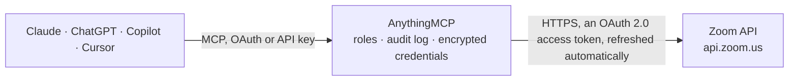

<!-- Generated by scripts/export-github-catalog.mjs in the anythingmcp-website repository. Do not edit by hand. -->

# Zoom MCP connector

Let your AI work with Zoom: find and read your meetings, schedule, change and cancel them, manage registrants, see who attended past meetings, list cloud recordings and webinars, and pull usage reports. The AnythingMCP connector gives Claude, ChatGPT, Microsoft Copilot, Cursor and Gemini 21 MCP tools for Zoom: 16 read and 5 can change data.

**Category:** [Scheduling](../scheduling.md) · **Tools:** 21 · **Setup guide:** [anythingmcp.com](https://anythingmcp.com/guides/zoom-to-mcp) · [Deutsch](https://anythingmcp.com/de/guides/zoom-to-mcp) · [Italiano](https://anythingmcp.com/it/guides/zoom-to-mcp) · [Español](https://anythingmcp.com/es/guides/zoom-to-mcp) · [日本語](https://anythingmcp.com/ja/guides/zoom-to-mcp) · [Русский](https://anythingmcp.com/ru/guides/zoom-to-mcp) · [中文](https://anythingmcp.com/zh/guides/zoom-to-mcp)

## Start without code

No installation and no terminal: AnythingMCP Cloud runs the Zoom connector for you, operated by helpcode.ai in Frankfurt, Germany.

1. **Click the button above** and create an account or sign in. The Zoom connector opens, ready to install.
2. **Sign in with your Zoom account** when AnythingMCP asks. The first time, an admin creates a small app in the Zoom developer console. Every click is in the [step-by-step guide](https://anythingmcp.com/guides/zoom-to-mcp).
3. **Click Install.** AnythingMCP shows the address of your MCP server.
4. **Add that address to your assistant:** [Claude](https://anythingmcp.com/guides/connect-zoom-to-claude) · [ChatGPT](https://anythingmcp.com/guides/connect-zoom-to-chatgpt) · [Microsoft Copilot](https://anythingmcp.com/guides/connect-zoom-to-copilot) · [Cursor](https://anythingmcp.com/guides/connect-zoom-to-cursor) · [Gemini CLI](https://anythingmcp.com/guides/connect-zoom-to-gemini) · [Meta Muse](https://anythingmcp.com/guides/connect-zoom-to-muse).
5. **Ask your first question**, for example: *For meeting 8421, what's the registration status and join_url for registrant with email laura.merten@solari.de?*

Prefer help with the setup? [Talk to us](https://anythingmcp.com/contact).

## How it works

- **The AI client** speaks MCP (Streamable HTTP) to AnythingMCP and only sees tool names, descriptions and results. It never gets the Zoom credentials.
- **AnythingMCP** checks the client's role, builds the call from the tool definition, adds the credentials (an OAuth 2.0 access token, refreshed automatically), calls Zoom, logs the call and returns the result.
- **Zoom** sees an ordinary API client with the rights of the account the credentials belong to.

## Tools

| Tool | What it does | Access |
|---|---|---|
| [`zoom_get_current_user`](#zoom_get_current_user) | Read the signed-in Zoom user: id, first and last name, display name, email, type (1 Basic, 2 Licensed), role, time zone, personal meeting id (pmi), account… | read |
| [`zoom_list_users`](#zoom_list_users) | List the users of the Zoom account (admin only, scope user:read:list_users:admin): id, name, email, type, status, role_id, department, time zone, last login. | read |
| [`zoom_get_user`](#zoom_get_user) | Read one Zoom user by id or email: name, email, type, role, department, time zone, language, personal meeting id and URL, status and last login. | read |
| [`zoom_list_meetings`](#zoom_list_meetings) | List a host's scheduled meetings (not instant ones): id, uuid, topic, type, start_time, duration, timezone, agenda, join_url, created_at. | read |
| [`zoom_get_meeting`](#zoom_get_meeting) | Read one meeting: topic, type, status, start_time, duration, timezone, agenda, join_url, passcode, host, occurrences of a recurring meeting, recurrence and… | read |
| [`zoom_create_meeting`](#zoom_create_meeting) | Schedule a Zoom meeting for a host. | write |
| [`zoom_update_meeting`](#zoom_update_meeting) | Change a meeting: only the fields given are changed, settings are merged. | write |
| [`zoom_delete_meeting`](#zoom_delete_meeting) | Delete a meeting, or one occurrence of a recurring meeting with occurrence_id; without it the whole series is deleted. | write |
| [`zoom_list_meeting_registrants`](#zoom_list_meeting_registrants) | List the registrants of a meeting with registration (Pro plan): id, first_name, last_name, email, status, create_time, join_url and answers. | read |
| [`zoom_add_meeting_registrant`](#zoom_add_meeting_registrant) | Register a person for a meeting that has registration on. | write |
| [`zoom_update_meeting_registrant_status`](#zoom_update_meeting_registrant_status) | Approve or deny pending registrants, or cancel approved ones. | write |
| [`zoom_get_past_meeting`](#zoom_get_past_meeting) | Read a meeting that has ended: uuid, topic, host name and email, start_time, end_time, duration, total_minutes, participants_count and has_meeting_summary. | read |
| [`zoom_list_past_meeting_participants`](#zoom_list_past_meeting_participants) | List who took part in an ended meeting (paid plan): name, user_email, join_time, leave_time, duration in seconds, status and internal_user. | read |
| [`zoom_list_past_meeting_instances`](#zoom_list_past_meeting_instances) | List the ended occurrences of a meeting id, each with uuid and start_time, to read one occurrence with the UUID tools. | read |
| [`zoom_list_recordings`](#zoom_list_recordings) | List a user's cloud recordings in a date range of at most one month (Pro plan): per meeting uuid, id, topic, start_time, duration, total_size, share_url and… | read |
| [`zoom_get_meeting_recordings`](#zoom_get_meeting_recordings) | Read the cloud recording of one meeting or webinar: topic, start_time, duration, total_size, share_url, recording_play_passcode and recording_files… | read |
| [`zoom_list_webinars`](#zoom_list_webinars) | List a host's unexpired webinars (Webinars add-on): id, uuid, topic, type, start_time, duration, timezone, agenda, join_url, created_at. | read |
| [`zoom_get_webinar`](#zoom_get_webinar) | Read one webinar: topic, type, start_time, duration, timezone, agenda, join_url, registration_url, occurrences, recurrence and settings (approval, panelists… | read |
| [`zoom_get_user_meetings_report`](#zoom_get_user_meetings_report) | Report of the meetings and webinars a user held in up to one month within the last 6 months (Pro plan, admin scope report:read:user:admin): uuid, id, topic,… | read |
| [`zoom_get_meeting_report`](#zoom_get_meeting_report) | Report on one ended meeting (Pro plan, admin scope report:read:meeting:admin): uuid, topic, host user_name and user_email, start_time, end_time, duration,… | read |
| [`zoom_get_meeting_participants_report`](#zoom_get_meeting_participants_report) | Participant report of an ended meeting with 2 or more people (Pro plan, admin scope report:read:list_meeting_participants:admin): name, user_email,… | read |

## Tool reference

Every parameter as the AI client sees it in `tools/list`. Source: [`packages/backend/src/adapters/intl/zoom.json`](../../../packages/backend/src/adapters/intl/zoom.json).

### `zoom_get_current_user`

Read the signed-in Zoom user: id, first and last name, display name, email, type (1 Basic, 2 Licensed), role, time zone, personal meeting id (pmi), account id and status. A cheap check that the authorization works.

**Access:** read · **Call:** `GET /users/me`

No parameters.

### `zoom_list_users`

List the users of the Zoom account (admin only, scope user:read:list_users:admin): id, name, email, type, status, role_id, department, time zone, last login. Returns users with total_records and next_page_token; an empty answer may carry no users key.

**Access:** read · **Call:** `GET /users`

| Parameter | Type | Required | Description |
|---|---|---|---|
| `status` | `active` \| `inactive` \| `pending` | no | active (default), inactive (deactivated) or pending (invited, not yet activated). |
| `role_id` | string | no | Only users with this role id. |
| `page_size` | integer | no | Users per page, 1 to 2000 (default 30 here). |
| `next_page_token` | string | no | The next_page_token of the previous page, to fetch the next one (expires after 15 minutes). |

### `zoom_get_user`

Read one Zoom user by id or email: name, email, type, role, department, time zone, language, personal meeting id and URL, status and last login. Other users than "me" need the user:read:user:admin scope.

**Access:** read · **Call:** `GET /users/{user_id}`

| Parameter | Type | Required | Description |
|---|---|---|---|
| `user_id` | string | yes | "me", or a user id or email address. |

### `zoom_list_meetings`

List a host's scheduled meetings (not instant ones): id, uuid, topic, type, start_time, duration, timezone, agenda, join_url, created_at. type upcoming shows what is coming, previous_meetings what has ended (both at most 6 months). Returns meetings with total_records and next_page_token; an empty calendar returns an empty list.

**Access:** read · **Call:** `GET /users/{user_id}/meetings`

| Parameter | Type | Required | Description |
|---|---|---|---|
| `user_id` | string | no | "me" for the signed-in user (default), or another user's id or email (needs the :admin scopes). |
| `type` | `scheduled` \| `live` \| `upcoming` \| `upcoming_meetings` \| `previous_meetings` | no | scheduled (default: unexpired past, live and upcoming), live, upcoming, upcoming_meetings or previous_meetings. |
| `from` | string | no | Start date "yyyy-mm-dd" of the range to list. |
| `to` | string | no | End date "yyyy-mm-dd" of the range to list. |
| `timezone` | string | no | Time zone of from and to, e.g. "Europe/Berlin". |
| `page_size` | integer | no | Records per page, 1 to 300 (Zoom's default 30). |
| `next_page_token` | string | no | The next_page_token of the previous page, to fetch the next one (expires after 15 minutes). |

### `zoom_get_meeting`

Read one meeting: topic, type, status, start_time, duration, timezone, agenda, join_url, passcode, host, occurrences of a recurring meeting, recurrence and settings (waiting room, registration approval_type, alternative hosts, auto recording). start_url is left out because it starts the meeting as the host.

**Access:** read · **Call:** `GET /meetings/{meeting_id}`

| Parameter | Type | Required | Description |
|---|---|---|---|
| `meeting_id` | string | yes | The meeting id, the 9 to 11 digit number, as text (e.g. "85746065432"). |
| `occurrence_id` | string | no | One occurrence of a recurring meeting (occurrence_id from zoom_get_meeting). |
| `show_previous_occurrences` | boolean | no | true to include the past occurrences of a recurring meeting. |

### `zoom_create_meeting`

Schedule a Zoom meeting for a host. Returns id, uuid, topic, start_time, join_url, password and settings (start_url is left out). Zoom emails alternative hosts and meeting_invitees in settings: confirm topic, time and anyone notified with the user first. At most 100 creates or updates a day per host.

**Access:** write · **Call:** `POST /users/{user_id}/meetings`

| Parameter | Type | Required | Description |
|---|---|---|---|
| `user_id` | string | no | "me" for the signed-in user (default), or another user's id or email (needs the :admin scopes). |
| `topic` | string | yes | The meeting topic (title), up to 200 characters. |
| `type` | `1` \| `2` \| `3` \| `8` | no | 1 instant, 2 scheduled, 3 recurring without fixed time, 8 recurring with fixed time (needs recurrence). |
| `start_time` | string | no | Start, e.g. "2026-10-20T15:00:00Z" (UTC) or "2026-10-20T17:00:00" with timezone. For types 2 and 8. |
| `duration` | integer | no | Planned length in minutes, 1 to 1440. For types 2 and 8. |
| `timezone` | string | no | Time zone of start_time, e.g. "Europe/Berlin" or "America/New_York". |
| `agenda` | string | no | The meeting description, up to 2,000 characters. |
| `password` | string | no | Meeting passcode, up to 10 characters (letters, digits, @ - _ *). Zoom generates one when the account requires it and none is given. |
| `schedule_for` | string | no | Email or user id of the user to schedule for (needs scheduling privilege for that user). |
| `recurrence` | object | no | For type 8 (and 3 when it recurs): e.g. {"type": 2, "repeat_interval": 1, "weekly_days": "2,4", "end_times": 6} (weekly on Monday and Wednesday, 6 times). type 1 daily, 2 weekly, 3 monthly; weekly_days 1 = Sunday ... 7 = Saturday; end_times (max 60) or end_date_time. |
| `settings` | object | no | Meeting settings, e.g. {"waiting_room": true, "join_before_host": false, "mute_upon_entry": true, "auto_recording": "none", "approval_type": 2}. approval_type 0 or 1 turns on registration (Pro plan), 2 means none. alternative_hosts (emails separated by ";") and meeting_invitees ([{"email": "..."}]) are notified by email; registrants_confirmation_email and registrants_email_notification set to false keep registration emails off. |

### `zoom_update_meeting`

Change a meeting: only the fields given are changed, settings are merged. Answers 204 with no body; read it again with zoom_get_meeting. start_time must lie in the future. A change can email alternative hosts and registrants: confirm with the user first.

**Access:** write · **Call:** `PATCH /meetings/{meeting_id}`

| Parameter | Type | Required | Description |
|---|---|---|---|
| `meeting_id` | string | yes | The meeting id, the 9 to 11 digit number, as text (e.g. "85746065432"). |
| `occurrence_id` | string | no | Change only this occurrence of a recurring meeting (agenda, start_time, duration and a few settings). |
| `topic` | string | no | The meeting topic (title), up to 200 characters. |
| `type` | `1` \| `2` \| `3` \| `8` | no | 1 instant, 2 scheduled, 3 recurring without fixed time, 8 recurring with fixed time (needs recurrence). |
| `start_time` | string | no | Start, e.g. "2026-10-20T15:00:00Z" (UTC) or "2026-10-20T17:00:00" with timezone. For types 2 and 8. |
| `duration` | integer | no | Planned length in minutes, 1 to 1440. For types 2 and 8. |
| `timezone` | string | no | Time zone of start_time, e.g. "Europe/Berlin" or "America/New_York". |
| `agenda` | string | no | The meeting description, up to 2,000 characters. |
| `password` | string | no | Meeting passcode, up to 10 characters (letters, digits, @ - _ *). Zoom generates one when the account requires it and none is given. |
| `schedule_for` | string | no | Email or user id of the user to schedule for (needs scheduling privilege for that user). |
| `recurrence` | object | no | For type 8 (and 3 when it recurs): e.g. {"type": 2, "repeat_interval": 1, "weekly_days": "2,4", "end_times": 6} (weekly on Monday and Wednesday, 6 times). type 1 daily, 2 weekly, 3 monthly; weekly_days 1 = Sunday ... 7 = Saturday; end_times (max 60) or end_date_time. |
| `settings` | object | no | Meeting settings, e.g. {"waiting_room": true, "join_before_host": false, "mute_upon_entry": true, "auto_recording": "none", "approval_type": 2}. approval_type 0 or 1 turns on registration (Pro plan), 2 means none. alternative_hosts (emails separated by ";") and meeting_invitees ([{"email": "..."}]) are notified by email; registrants_confirmation_email and registrants_email_notification set to false keep registration emails off. |

### `zoom_delete_meeting`

Delete a meeting, or one occurrence of a recurring meeting with occurrence_id; without it the whole series is deleted. Cannot be undone. No cancellation email goes out unless the reminder flags are true. Confirm the meeting with the user first.

**Access:** write · **Call:** `DELETE /meetings/{meeting_id}`

| Parameter | Type | Required | Description |
|---|---|---|---|
| `meeting_id` | string | yes | The meeting id, the 9 to 11 digit number, as text (e.g. "85746065432"). |
| `occurrence_id` | string | no | Delete only this occurrence of a recurring meeting. |
| `schedule_for_reminder` | boolean | no | true to email the host and alternative hosts about the cancellation (default false here). |
| `cancel_meeting_reminder` | boolean | no | true to email registrants about the cancellation (default false). |

### `zoom_list_meeting_registrants`

List the registrants of a meeting with registration (Pro plan): id, first_name, last_name, email, status, create_time, join_url and answers. Approved ones by default; status pending shows who waits for approval. Returns registrants with total_records and next_page_token; an empty list when nobody registered.

**Access:** read · **Call:** `GET /meetings/{meeting_id}/registrants`

| Parameter | Type | Required | Description |
|---|---|---|---|
| `meeting_id` | string | yes | The meeting id, the 9 to 11 digit number, as text (e.g. "85746065432"). |
| `status` | `approved` \| `pending` \| `denied` | no | approved (default), pending or denied. |
| `occurrence_id` | string | no | One occurrence of a recurring meeting (occurrence_id from zoom_get_meeting). |
| `page_size` | integer | no | Records per page, 1 to 300 (Zoom's default 30). |
| `next_page_token` | string | no | The next_page_token of the previous page, to fetch the next one (expires after 15 minutes). |

### `zoom_add_meeting_registrant`

Register a person for a meeting that has registration on. Returns registrant_id, join_url (personal link), topic, start_time and occurrences. Zoom emails the person a confirmation unless the meeting turns that off: confirm with the user first.

**Access:** write · **Call:** `POST /meetings/{meeting_id}/registrants`

| Parameter | Type | Required | Description |
|---|---|---|---|
| `meeting_id` | string | yes | The meeting id, the 9 to 11 digit number, as text (e.g. "85746065432"). |
| `email` | string | yes | The registrant's email address. |
| `first_name` | string | yes | First name, up to 64 characters. |
| `last_name` | string | no | Last name, up to 64 characters. |
| `phone` | string | no | Phone number. |
| `org` | string | no | Organization. |
| `job_title` | string | no | Job title. |
| `country` | string | no | Two-letter country code, e.g. "DE". |
| `comments` | string | no | Questions or comments from the registrant. |
| `custom_questions` | object[] | no | Answers to the meeting's custom questions, e.g. [{"title": "Company size", "value": "10-50"}]. |
| `language` | string | no | Language of the confirmation email, e.g. en-US, de-DE, fr-FR, es-ES, it-IT. |
| `occurrence_ids` | string | no | Comma-separated occurrence ids, to register for only these occurrences of a recurring meeting. |

### `zoom_update_meeting_registrant_status`

Approve or deny pending registrants, or cancel approved ones. Answers 204 with no body. Zoom emails each registrant about the decision (unless the meeting turns registration emails off), and a denial or cancellation removes their access: confirm with the user first.

**Access:** write · **Call:** `PUT /meetings/{meeting_id}/registrants/status`

| Parameter | Type | Required | Description |
|---|---|---|---|
| `meeting_id` | string | yes | The meeting id, the 9 to 11 digit number, as text (e.g. "85746065432"). |
| `action` | `approve` \| `deny` \| `cancel` | yes | approve, deny or cancel. |
| `registrants` | object[] | yes | Who, by id from zoom_list_meeting_registrants and email, e.g. [{"id": "9tboDiHUQAeOnbmudzWa5g", "email": "ana@example.com"}]. Up to 30 per call. |
| `occurrence_id` | string | no | One occurrence of a recurring meeting (occurrence_id from zoom_get_meeting). |

### `zoom_get_past_meeting`

Read a meeting that has ended: uuid, topic, host name and email, start_time, end_time, duration, total_minutes, participants_count and has_meeting_summary. With a meeting id it is the latest occurrence; with a UUID that one. Up to 12 months back.

**Access:** read · **Call:** `GET /past_meetings/{meeting_id}`

| Parameter | Type | Required | Description |
|---|---|---|---|
| `meeting_id` | string | yes | A meeting id (latest occurrence) or one occurrence's UUID. A UUID that starts with "/" or contains "//" must be passed URL-encoded once (e.g. "%2FajXp112QmuoKj4854875%3D%3D"); the connector encodes it a second time as Zoom requires. Pass every other UUID unchanged. |

### `zoom_list_past_meeting_participants`

List who took part in an ended meeting (paid plan): name, user_email, join_time, leave_time, duration in seconds, status and internal_user. One row per join, so a person can appear more than once. Returns participants with total_records and next_page_token; meetings with a single person return nothing.

**Access:** read · **Call:** `GET /past_meetings/{meeting_id}/participants`

| Parameter | Type | Required | Description |
|---|---|---|---|
| `meeting_id` | string | yes | A meeting id (latest occurrence) or one occurrence's UUID. A UUID that starts with "/" or contains "//" must be passed URL-encoded once (e.g. "%2FajXp112QmuoKj4854875%3D%3D"); the connector encodes it a second time as Zoom requires. Pass every other UUID unchanged. |
| `page_size` | integer | no | Records per page, 1 to 300 (Zoom's default 30). |
| `next_page_token` | string | no | The next_page_token of the previous page, to fetch the next one (expires after 15 minutes). |

### `zoom_list_past_meeting_instances`

List the ended occurrences of a meeting id, each with uuid and start_time, to read one occurrence with the UUID tools. Returns meetings; an empty list when the meeting never took place. Up to 15 months back.

**Access:** read · **Call:** `GET /past_meetings/{meeting_id}/instances`

| Parameter | Type | Required | Description |
|---|---|---|---|
| `meeting_id` | string | yes | The meeting id, the 9 to 11 digit number, as text (e.g. "85746065432"). |
| `from` | string | no | From date "yyyy-mm-dd" (UTC); only used together with to. |
| `to` | string | no | To date "yyyy-mm-dd" (UTC); only used together with from. Keep the range to about a month. |

### `zoom_list_recordings`

List a user's cloud recordings in a date range of at most one month (Pro plan): per meeting uuid, id, topic, start_time, duration, total_size, share_url and recording_files (type, size, play_url, download_url). Without from and to only today is covered. Returns meetings with total_records and next_page_token; often an empty list.

**Access:** read · **Call:** `GET /users/{user_id}/recordings`

| Parameter | Type | Required | Description |
|---|---|---|---|
| `user_id` | string | no | "me" for the signed-in user (default), or another user's id or email (needs the :admin scopes). |
| `from` | string | no | Start date "yyyy-mm-dd" (UTC). Default today. |
| `to` | string | no | End date "yyyy-mm-dd" (UTC), at most one month after from. |
| `meeting_id` | string | no | Only recordings of this meeting id. |
| `trash` | boolean | no | true to list recordings in the trash instead. |
| `trash_type` | `meeting_recordings` \| `recording_file` | no | With trash: meeting_recordings (default) or recording_file. |
| `page_size` | integer | no | Records per page, 1 to 300 (Zoom's default 30). |
| `next_page_token` | string | no | The next_page_token of the previous page, to fetch the next one (expires after 15 minutes). |

### `zoom_get_meeting_recordings`

Read the cloud recording of one meeting or webinar: topic, start_time, duration, total_size, share_url, recording_play_passcode and recording_files (recording_type, file_type, file_size, recording_start, recording_end, status, play_url, download_url). Metadata only: files are not downloaded.

**Access:** read · **Call:** `GET /meetings/{meeting_id}/recordings`

| Parameter | Type | Required | Description |
|---|---|---|---|
| `meeting_id` | string | yes | A meeting id (latest occurrence) or one occurrence's UUID. A UUID that starts with "/" or contains "//" must be passed URL-encoded once (e.g. "%2FajXp112QmuoKj4854875%3D%3D"); the connector encodes it a second time as Zoom requires. Pass every other UUID unchanged. A webinar id or UUID works too. |

### `zoom_list_webinars`

List a host's unexpired webinars (Webinars add-on): id, uuid, topic, type, start_time, duration, timezone, agenda, join_url, created_at. Returns webinars with total_records, page_count and page_number; without the add-on Zoom answers code 200 "Webinar plan is missing".

**Access:** read · **Call:** `GET /users/{user_id}/webinars`

| Parameter | Type | Required | Description |
|---|---|---|---|
| `user_id` | string | no | "me" for the signed-in user (default), or another user's id or email (needs the :admin scopes). |
| `type` | `scheduled` \| `upcoming` | no | scheduled (default: past unexpired, live and upcoming) or upcoming. |
| `page_size` | integer | no | Records per page, 1 to 300 (Zoom's default 30). |
| `page_number` | integer | no | Page to read, starting at 1 (this endpoint still pages by number). |

### `zoom_get_webinar`

Read one webinar: topic, type, start_time, duration, timezone, agenda, join_url, registration_url, occurrences, recurrence and settings (approval, panelists video, Q&A). Needs the Webinars add-on.

**Access:** read · **Call:** `GET /webinars/{webinar_id}`

| Parameter | Type | Required | Description |
|---|---|---|---|
| `webinar_id` | string | yes | The webinar id (a number, as text) or UUID. |
| `occurrence_id` | string | no | One occurrence of a recurring webinar. |
| `show_previous_occurrences` | boolean | no | true to include the past occurrences of a recurring webinar. |

### `zoom_get_user_meetings_report`

Report of the meetings and webinars a user held in up to one month within the last 6 months (Pro plan, admin scope report:read:user:admin): uuid, id, topic, start_time, end_time, duration, total_minutes, participants_count, has_recording, has_screen_share. Only meetings with 2 or more participants. Returns meetings with next_page_token; may be empty.

**Access:** read · **Call:** `GET /report/users/{user_id}/meetings`

| Parameter | Type | Required | Description |
|---|---|---|---|
| `user_id` | string | no | "me" for the signed-in user (default), or another user's id or email (needs the :admin scopes). |
| `from` | string | yes | Start date "yyyy-mm-dd". |
| `to` | string | yes | End date "yyyy-mm-dd", at most one month after from. |
| `type` | `past` \| `pastOne` \| `pastJoined` | no | past (default: meetings the user hosted), pastOne (single-person meetings) or pastJoined (hosted or joined). |
| `page_size` | integer | no | Records per page, 1 to 300 (Zoom's default 30). |
| `next_page_token` | string | no | The next_page_token of the previous page, to fetch the next one (expires after 15 minutes). |

### `zoom_get_meeting_report`

Report on one ended meeting (Pro plan, admin scope report:read:meeting:admin): uuid, topic, host user_name and user_email, start_time, end_time, duration, total_minutes, participants_count, tracking fields and custom keys.

**Access:** read · **Call:** `GET /report/meetings/{meeting_id}`

| Parameter | Type | Required | Description |
|---|---|---|---|
| `meeting_id` | string | yes | A meeting id (latest occurrence) or one occurrence's UUID. A UUID that starts with "/" or contains "//" must be passed URL-encoded once (e.g. "%2FajXp112QmuoKj4854875%3D%3D"); the connector encodes it a second time as Zoom requires. Pass every other UUID unchanged. |

### `zoom_get_meeting_participants_report`

Participant report of an ended meeting with 2 or more people (Pro plan, admin scope report:read:list_meeting_participants:admin): name, user_email, join_time, leave_time, duration in seconds, status, and with include_fields the registrant_id. Returns participants with next_page_token.

**Access:** read · **Call:** `GET /report/meetings/{meeting_id}/participants`

| Parameter | Type | Required | Description |
|---|---|---|---|
| `meeting_id` | string | yes | A meeting id (latest occurrence) or one occurrence's UUID. A UUID that starts with "/" or contains "//" must be passed URL-encoded once (e.g. "%2FajXp112QmuoKj4854875%3D%3D"); the connector encodes it a second time as Zoom requires. Pass every other UUID unchanged. |
| `include_fields` | `registrant_id` | no | registrant_id to add each participant's registrant id. |
| `page_size` | integer | no | Records per page, 1 to 300 (Zoom's default 30). |
| `next_page_token` | string | no | The next_page_token of the previous page, to fetch the next one (expires after 15 minutes). |

## Run it yourself

AnythingMCP is open source (AGPL-3.0). [Run it with Docker](../../../README.md#run-it-yourself), open **Connectors → Store**, pick **Zoom** and enter `ZOOM_CLIENT_ID`, `ZOOM_CLIENT_SECRET`, then add your MCP server URL to the AI client.

[← Scheduling connectors](../scheduling.md) · [All categories](../README.md)
