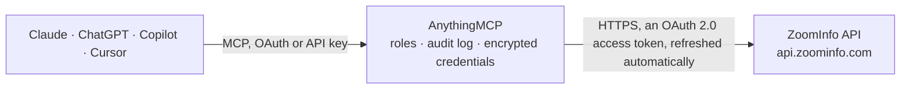

<!-- Generated by scripts/export-github-catalog.mjs in the anythingmcp-website repository. Do not edit by hand. -->

# ZoomInfo MCP connector

Give your AI ZoomInfo B2B data: search contacts and companies by role, seniority, industry, size and location for free, look up the exact filter values ZoomInfo accepts, check your credit usage, and … The AnythingMCP connector gives Claude, ChatGPT, Microsoft Copilot, Cursor and Gemini 8 MCP tools for ZoomInfo: 6 read and 2 can change data.

**Category:** [Data Enrichment](../enrichment.md) · **Tools:** 8 · **Setup guide:** [anythingmcp.com](https://anythingmcp.com/guides/zoominfo-to-mcp) · [Deutsch](https://anythingmcp.com/de/guides/zoominfo-to-mcp) · [Italiano](https://anythingmcp.com/it/guides/zoominfo-to-mcp) · [Español](https://anythingmcp.com/es/guides/zoominfo-to-mcp) · [日本語](https://anythingmcp.com/ja/guides/zoominfo-to-mcp) · [Русский](https://anythingmcp.com/ru/guides/zoominfo-to-mcp) · [中文](https://anythingmcp.com/zh/guides/zoominfo-to-mcp)

## Start without code

No installation and no terminal: AnythingMCP Cloud runs the ZoomInfo connector for you, operated by helpcode.ai in Frankfurt, Germany.

1. **Click the button above** and create an account or sign in. The ZoomInfo connector opens, ready to install.
2. **Sign in with your ZoomInfo account** when AnythingMCP asks. The first time, an admin creates a small app in the ZoomInfo developer console. Every click is in the [step-by-step guide](https://anythingmcp.com/guides/zoominfo-to-mcp).
3. **Click Install.** AnythingMCP shows the address of your MCP server.
4. **Add that address to your assistant:** [Claude](https://anythingmcp.com/guides/connect-zoominfo-to-claude) · [ChatGPT](https://anythingmcp.com/guides/connect-zoominfo-to-chatgpt) · [Microsoft Copilot](https://anythingmcp.com/guides/connect-zoominfo-to-copilot) · [Cursor](https://anythingmcp.com/guides/connect-zoominfo-to-cursor) · [Gemini CLI](https://anythingmcp.com/guides/connect-zoominfo-to-gemini) · [Meta Muse](https://anythingmcp.com/guides/connect-zoominfo-to-muse).
5. **Ask your first question**, for example: *Find the ZoomInfo company record for NovaTherm GmbH in Munich, give headcount and revenue.*

Prefer help with the setup? [Talk to us](https://anythingmcp.com/contact).

## How it works

- **The AI client** speaks MCP (Streamable HTTP) to AnythingMCP and only sees tool names, descriptions and results. It never gets the ZoomInfo credentials.
- **AnythingMCP** checks the client's role, builds the call from the tool definition, adds the credentials (an OAuth 2.0 access token, refreshed automatically), calls ZoomInfo, logs the call and returns the result.
- **ZoomInfo** sees an ordinary API client with the rights of the account the credentials belong to.

## Tools

| Tool | What it does | Access |
|---|---|---|
| [`zoominfo_get_usage`](#zoominfo_get_usage) | Show the ZoomInfo API usage of this account: for each limit type (requests, records, unique ids and so on) the total allowed, how much is used and what… | read |
| [`zoominfo_lookup_values`](#zoominfo_lookup_values) | List the exact values ZoomInfo accepts for a search filter, with their ids: industries, management levels, departments, job functions, countries, states,… | read |
| [`zoominfo_list_search_fields`](#zoominfo_list_search_fields) | List the filter fields a ZoomInfo search accepts (field_type input) or the fields a search result returns (field_type output), with a description of each. | read |
| [`zoominfo_list_enrich_fields`](#zoominfo_list_enrich_fields) | List the match inputs (field_type input) or the output fields (field_type output) of a ZoomInfo enrichment, with a description and, for inputs, whether your… | read |
| [`zoominfo_search_contacts`](#zoominfo_search_contacts) | Search ZoomInfo's contacts by role and company criteria and get a page of matches: ZoomInfo person id, name, job title, company, accuracy score and hints of… | read |
| [`zoominfo_search_companies`](#zoominfo_search_companies) | Search ZoomInfo's companies by firmographic criteria and get a page of matches: ZoomInfo company id, name, website, city, state, country, employee count and… | read |
| [`zoominfo_enrich_contacts`](#zoominfo_enrich_contacts) | Get the full ZoomInfo record of up to 25 contacts, including business email and direct and mobile phone numbers, by ZoomInfo person id (best, from… | write |
| [`zoominfo_enrich_companies`](#zoominfo_enrich_companies) | Get the full ZoomInfo profile of up to 25 companies: description, industry and codes, employee count and range, revenue, founding year, headquarters address… | write |

## Tool reference

Every parameter as the AI client sees it in `tools/list`. Source: [`packages/backend/src/adapters/intl/zoominfo.json`](../../../packages/backend/src/adapters/intl/zoominfo.json).

### `zoominfo_get_usage`

Show the ZoomInfo API usage of this account: for each limit type (requests, records, unique ids and so on) the total allowed, how much is used and what remains in the contract period. Use it before a larger enrichment to check the credits left. Free: uses no credits. Read-only.

**Access:** read · **Call:** `GET /data/v1/users/usage`

No parameters.

### `zoominfo_lookup_values`

List the exact values ZoomInfo accepts for a search filter, with their ids: industries, management levels, departments, job functions, countries, states, metro regions, employee counts, revenue ranges, company types, technologies and more. Use it before a search to turn the user's words (for example SaaS or VP) into valid ZoomInfo values; search answers 400 PFAPI0006 for unknown values. Tech products need a vendor from tech-vendors first. Free: uses no credits. Read-only.

**Access:** read · **Call:** `GET /data/v1/lookup/{field_name}`

| Parameter | Type | Required | Description |
|---|---|---|---|
| `field_name` | `board-members` \| `buying-groups` \| `company-rankings` \| `company-types` \| `continents` \| `countries` \| `departments` \| `employee-count` \| `funding-round-types` \| `hashtags` \| `industries` \| `intent-topics` \| `job-functions` \| `job-titles` \| `management-levels` \| `metro-regions` \| `naics-codes` \| `news-categories` \| `revenue-ranges` \| `scoop-departments` \| `scoop-topics` \| `scoop-types` \| `sic-codes` \| `states` \| `sub-unit-types` \| `tech-categories` \| `tech-products` \| `tech-skills` \| `tech-vendors` \| `years-of-experience` | yes | Which list of values to return, e.g. industries, management-levels, departments, metro-regions or employee-count. |
| `vendor` | string | no | Only for tech-products and hashtags: the vendor name as tech-vendors returns it, e.g. microsoft corporation. |
| `category` | string | no | Only for hashtags: the category, e.g. Unified Communications. |
| `parent_category` | string | no | Only for hashtags and technology lists: the parent category, e.g. Communication and Collaboration. |
| `sub_category` | string | no | Only for hashtags and technology lists: the sub-category. |

### `zoominfo_list_search_fields`

List the filter fields a ZoomInfo search accepts (field_type input) or the fields a search result returns (field_type output), with a description of each. Use it when the user asks for a filter not covered by the common ones. Free: uses no credits. Read-only.

**Access:** read · **Call:** `GET /data/v1/lookup/search`

| Parameter | Type | Required | Description |
|---|---|---|---|
| `entity` | `contact` \| `company` \| `scoop` \| `news` \| `intent` | yes | Which search: contact or company (scoop, news and intent need those ZoomInfo packages). |
| `field_type` | `input` \| `output` | no | input for the filters you can send, output for the fields that come back. |

### `zoominfo_list_enrich_fields`

List the match inputs (field_type input) or the output fields (field_type output) of a ZoomInfo enrichment, with a description and, for inputs, whether your plan grants access. Use output with entity contact or company to choose outputFields for zoominfo_enrich_contacts and zoominfo_enrich_companies. Free: uses no credits. Read-only.

**Access:** read · **Call:** `GET /data/v1/lookup/enrich`

| Parameter | Type | Required | Description |
|---|---|---|---|
| `entity` | `contact` \| `company` \| `scoop` \| `news` \| `intent` \| `technology` \| `hashtag` \| `orgChart` \| `corporate-hierarchy` | yes | Which enrichment: contact or company for the tools of this connector. |
| `field_type` | `input` \| `output` | no | output for the fields an enrichment can return, input for the fields you can match on. |

### `zoominfo_search_contacts`

Search ZoomInfo's contacts by role and company criteria and get a page of matches: ZoomInfo person id, name, job title, company, accuracy score and hints of what can be enriched (hasEmail, hasDirectPhone, hasMobilePhone). Never returns the emails or phone numbers themselves. Put the criteria in filters, using ZoomInfo field names, e.g. {"jobTitle": "head of procurement", "managementLevel": "Director,VP Level Exec", "companyName": "Bosch", "country": "Germany"}. Common fields: firstName, lastName, fullName, emailAddress, jobTitle, exactJobTitle, managementLevel, department, jobFunction, companyId, companyName, companyWebsite, industryCodes, employeeRangeMin, employeeRangeMax, revenueMin, revenueMax (thousands of USD), country, state, metroRegion, zipCode with zipCodeRadiusMiles, contactAccuracyScoreMin, requiredFields (e.g. email). Get valid values with zoominfo_lookup_values and every field with zoominfo_list_search_fields. Free: uses no credits. Read-only. Returns personal data: use it only for a legitimate B2B purpose.

**Access:** read · **Call:** `POST /data/v1/contacts/search`

| Parameter | Type | Required | Description |
|---|---|---|---|
| `filters` | object | yes | Search criteria as ZoomInfo contact search fields (at least one), e.g. {"jobTitle": "CFO", "companyWebsite": "https://www.example.com"}. Lists such as managementLevel or department are comma-separated strings. |
| `page` | integer | no | Page number, from 1 (ZoomInfo serves at most 100 pages). |
| `page_size` | integer | no | Contacts per page, 1 to 100 (default 10 here). |
| `sort` | string | no | Sort field: contactAccuracyScore, lastName, companyName, hierarchy, sourceCount, lastMentioned or relevance; prefix with - for descending, e.g. -contactAccuracyScore. Default relevance. |

### `zoominfo_search_companies`

Search ZoomInfo's companies by firmographic criteria and get a page of matches: ZoomInfo company id, name, website, city, state, country, employee count and revenue (thousands of USD). Put the criteria in filters, using ZoomInfo field names, e.g. {"industryCodes": "software", "country": "Germany", "employeeRangeMin": "50", "employeeRangeMax": "500"}. Common fields: companyId, companyName, companyWebsite, companyTicker, companyType, industryCodes, industryKeywords, employeeRangeMin, employeeRangeMax, revenueMin, revenueMax, country, state, metroRegion, zipCode with zipCodeRadiusMiles, techAttributeTagList. Get valid values with zoominfo_lookup_values and every field with zoominfo_list_search_fields. Free: uses no credits. Read-only.

**Access:** read · **Call:** `POST /data/v1/companies/search`

| Parameter | Type | Required | Description |
|---|---|---|---|
| `filters` | object | yes | Search criteria as ZoomInfo company search fields (at least one), e.g. {"companyName": "Siemens"} or {"industryCodes": "manufacturing", "state": "Bavaria"}. |
| `page` | integer | no | Page number, from 1 (ZoomInfo serves at most 100 pages). |
| `page_size` | integer | no | Companies per page, 1 to 100 (default 10 here). |
| `sort` | string | no | Sort field: name, employeeCount or revenue; prefix with - for descending, e.g. -revenue. Default relevance. |

### `zoominfo_enrich_contacts`

Get the full ZoomInfo record of up to 25 contacts, including business email and direct and mobile phone numbers, by ZoomInfo person id (best, from zoominfo_search_contacts) or by match details such as emailAddress, or firstName, lastName and companyName. COSTS CREDITS: 1 bulk data credit for every contact returned that is not already under management in your account; no match, no charge. Before calling, show the user which contacts you will enrich and how many credits that can cost, and wait for their yes. Returns each record with matchStatus. Returns personal data: use it only for a legitimate B2B purpose, under GDPR and CAN-SPAM, and respect the Do Not Call flags.

**Access:** write · **Call:** `POST /data/v1/contacts/enrich`

| Parameter | Type | Required | Description |
|---|---|---|---|
| `contacts` | object[] | yes | 1 to 25 people to enrich, each as {"personId": 123} or with match details, e.g. {"firstName": "Anna", "lastName": "Schmidt", "companyName": "Example GmbH"}. |
| `output_fields` | `city` \| `companyAlternateLogos` \| `companyCity` \| `companyContinent` \| `companyCountry` \| `companyDescription` \| `companyDivision` \| `companyEmployeeCount` \| `companyEmployeeGrowth` \| `companyEmployeeRange` \| `companyFax` \| `companyId` \| `companyIndustries` \| `companyIndustryCodes` \| `companyLogo` \| `companyNaicsCodes` \| `companyName` \| `companyPhone` \| `companyPrimaryIndustry` \| `companyPrimaryIndustryCode` \| `companyPrimarySubIndustryCode` \| `companyRanking` \| `companyRevenue` \| `companyRevenueNumeric` \| `companyRevenueRange` \| `companySicCodes` \| `companySocialMediaUrls` \| `companyState` \| `companyStreet` \| `companyTicker` \| `companyType` \| `companyWebsite` \| `companyZipCode` \| `contactAccuracyScore` \| `continent` \| `country` \| `directPhoneAlt` \| `directPhoneDoNotCall` \| `education` \| `email` \| `emailAlt` \| `employmentHistory` \| `engagements` \| `externalUrls` \| `firstName` \| `hasCanadianEmail` \| `hashedEmails` \| `id` \| `isDefunct` \| `jobFunction` \| `jobTitle` \| `lastName` \| `lastUpdatedDate` \| `locationCompanyId` \| `managementLevel` \| `metroArea` \| `middleName` \| `mobilePhone` \| `mobilePhoneAlt` \| `mobilePhoneDoNotCall` \| `noticeProvidedDate` \| `personHasMoved` \| `phone` \| `picture` \| `positionStartDate` \| `region` \| `salutation` \| `state` \| `street` \| `suffix` \| `supplementalEmail` \| `techSkills` \| `validDate` \| `withinCalifornia` \| `withinCanada` \| `withinEu` \| `yearsOfExperience` \| `zipCode`[] | no | Fields to return. The charge is the same whatever you pick; asking for a field your plan does not include answers 400. See zoominfo_list_enrich_fields with entity contact and field_type output. |
| `required_fields` | string[] | no | Only return a contact that has these fields, e.g. ["email"]. Contacts without them are not returned and not charged. |

### `zoominfo_enrich_companies`

Get the full ZoomInfo profile of up to 25 companies: description, industry and codes, employee count and range, revenue, founding year, headquarters address and phone, parent company, funding and more, by ZoomInfo company id (best, from zoominfo_search_companies) or by companyWebsite, companyName or companyTicker. COSTS CREDITS: 1 bulk data credit for every company returned that is not already under management in your account; no match, no charge. Before calling, tell the user which companies you will enrich and how many credits that can cost, and wait for their yes. Returns each record with matchStatus.

**Access:** write · **Call:** `POST /data/v1/companies/enrich`

| Parameter | Type | Required | Description |
|---|---|---|---|
| `companies` | object[] | yes | 1 to 25 companies to enrich, each as {"companyId": 123} or with match details, e.g. {"companyWebsite": "http://www.example.com"}. |
| `output_fields` | `alternateLogos` \| `businessModel` \| `certificationDate` \| `certified` \| `city` \| `companyFunding` \| `companyStatus` \| `companyStatusDate` \| `competitors` \| `continent` \| `country` \| `createdDate` \| `departmentBudgets` \| `description` \| `domainList` \| `employeeCount` \| `employeeCountByDepartment` \| `employeeGrowth` \| `employeeRange` \| `engagements` \| `fax` \| `foundedYear` \| `id` \| `industries` \| `industryCodes` \| `isDefunct` \| `lastUpdatedDate` \| `locationCount` \| `locationMatch` \| `logo` \| `metroArea` \| `naicsCodes` \| `name` \| `numberOfContactsInZoomInfo` \| `parentId` \| `parentName` \| `phone` \| `primaryIndustry` \| `primaryIndustryCode` \| `primarySubIndustryCode` \| `products` \| `recentFundingAmount` \| `recentFundingDate` \| `revenue` \| `revenueRange` \| `sicCodes` \| `socialMediaUrls` \| `state` \| `street` \| `subUnitIndustries` \| `subUnitType` \| `ticker` \| `totalFundingAmount` \| `type` \| `ultimateParentEmployees` \| `ultimateParentId` \| `ultimateParentName` \| `ultimateParentRevenue` \| `website` \| `zipCode`[] | no | Fields to return. The charge is the same whatever you pick; asking for a field your plan does not include answers 400. See zoominfo_list_enrich_fields with entity company and field_type output. |

## Run it yourself

AnythingMCP is open source (AGPL-3.0). [Run it with Docker](../../../README.md#run-it-yourself), open **Connectors → Store**, pick **ZoomInfo** and enter `ZOOMINFO_CLIENT_ID`, `ZOOMINFO_CLIENT_SECRET`, then add your MCP server URL to the AI client.

[← Data Enrichment connectors](../enrichment.md) · [All categories](../README.md)
