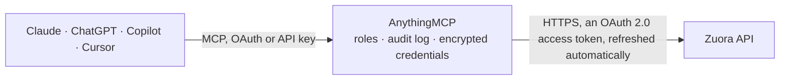

<!-- Generated by scripts/export-github-catalog.mjs in the anythingmcp-website repository. Do not edit by hand. -->

# Zuora MCP connector

Zuora subscription billing: customer accounts, subscriptions and orders (preview, create, renew, suspend, resume, cancel), invoices with items and PDFs, payments, refunds and credit memos, the … The AnythingMCP connector gives Claude, ChatGPT, Microsoft Copilot, Cursor and Gemini 44 MCP tools for Zuora: 32 read and 12 can change data.

**Category:** [Payments](../payments.md) · **Tools:** 44 · **Setup guide:** [anythingmcp.com](https://anythingmcp.com/guides/zuora-to-mcp) · [Deutsch](https://anythingmcp.com/de/guides/zuora-to-mcp) · [Italiano](https://anythingmcp.com/it/guides/zuora-to-mcp) · [Español](https://anythingmcp.com/es/guides/zuora-to-mcp) · [日本語](https://anythingmcp.com/ja/guides/zuora-to-mcp) · [Русский](https://anythingmcp.com/ru/guides/zuora-to-mcp) · [中文](https://anythingmcp.com/zh/guides/zuora-to-mcp)

## Start without code

No installation and no terminal: AnythingMCP Cloud runs the Zuora connector for you, operated by helpcode.ai in Frankfurt, Germany.

1. **Click the button above** and create an account or sign in. The Zuora connector opens, ready to install.
2. **Sign in with your Zuora account** when AnythingMCP asks. The first time, an admin creates a small app in the Zuora developer console. Every click is in the [step-by-step guide](https://anythingmcp.com/guides/zuora-to-mcp).
3. **Click Install.** AnythingMCP shows the address of your MCP server.
4. **Add that address to your assistant:** [Claude](https://anythingmcp.com/guides/connect-zuora-to-claude) · [ChatGPT](https://anythingmcp.com/guides/connect-zuora-to-chatgpt) · [Microsoft Copilot](https://anythingmcp.com/guides/connect-zuora-to-copilot) · [Cursor](https://anythingmcp.com/guides/connect-zuora-to-cursor) · [Gemini CLI](https://anythingmcp.com/guides/connect-zuora-to-gemini) · [Meta Muse](https://anythingmcp.com/guides/connect-zuora-to-muse).
5. **Ask your first question**, for example: *Show account details for customer 'Nordic Solar AS' account number NS-2026-014, including balance and last payment.*

Prefer help with the setup? [Talk to us](https://anythingmcp.com/contact).

## How it works

- **The AI client** speaks MCP (Streamable HTTP) to AnythingMCP and only sees tool names, descriptions and results. It never gets the Zuora credentials.
- **AnythingMCP** checks the client's role, builds the call from the tool definition, adds the credentials (an OAuth 2.0 access token, refreshed automatically), calls Zuora, logs the call and returns the result.
- **Zuora** sees an ordinary API client with the rights of the account the credentials belong to.

## Tools

| Tool | What it does | Access |
|---|---|---|
| [`zuora_list_accounts`](#zuora_list_accounts) | List customer accounts with Object Query: filter (e.g. status.EQ:Active, name.SW:Acme, balance.GT:0), choose fields, expand bill-to contact or… | read |
| [`zuora_get_account`](#zuora_get_account) | Get one customer account by number or id: basic info, billing and payment settings, bill-to and sold-to contacts, balance and metrics. | read |
| [`zuora_get_account_summary`](#zuora_get_account_summary) | Get an account summary in one call: basic info, contacts, subscriptions, recent invoices, payments and usage, with balance and last payment. | read |
| [`zuora_list_account_payment_methods`](#zuora_list_account_payment_methods) | List the payment methods of an account (cards, bank accounts, PayPal) with type, masked number, expiry, default flag and status. | read |
| [`zuora_create_account`](#zuora_create_account) | Create a customer account with name, currency and bill-to contact, plus billing settings (bill cycle day, payment term, batch, auto-pay) and custom fields. | write |
| [`zuora_update_account`](#zuora_update_account) | Update an account: name, notes, contacts, billing settings, auto-pay, default payment method, CRM id or custom fields. | write |
| [`zuora_list_subscriptions`](#zuora_list_subscriptions) | List subscriptions with Object Query: filter by account, status (Active, Cancelled, Suspended, Expired, Draft), term dates or latest version, expand rate… | read |
| [`zuora_list_account_subscriptions`](#zuora_list_account_subscriptions) | List the subscriptions of one account with rate plans, charges, prices, quantities, terms and status, as Zuora shows them on the account. | read |
| [`zuora_get_subscription`](#zuora_get_subscription) | Get one subscription by number or id with term, renewal settings, status, rate plans, charges (price, quantity, billing period) and owner accounts. | read |
| [`zuora_list_orders`](#zuora_list_orders) | List orders (the records of subscription changes: new subscription, add product, update, renew, cancel) by status and date range, with order actions and… | read |
| [`zuora_get_order`](#zuora_get_order) | Get one order by order number with its order actions, the subscriptions it created or changed, and the order metrics. | read |
| [`zuora_preview_order`](#zuora_preview_order) | Preview an order without saving it: the invoice items, charge metrics and amounts a new subscription or a change would produce. | read |
| [`zuora_create_order`](#zuora_create_order) | Create an order: new subscription, add or remove a product, change quantity or price, renew or change terms. | write |
| [`zuora_renew_subscription`](#zuora_renew_subscription) | Renew a termed subscription for another renewal term now, without billing. | write |
| [`zuora_suspend_subscription`](#zuora_suspend_subscription) | Suspend an active subscription: billing stops from the suspend date until it is resumed. | write |
| [`zuora_resume_subscription`](#zuora_resume_subscription) | Resume a suspended subscription today, on a date or after a number of periods; billing restarts from the resume date. | write |
| [`zuora_cancel_subscription`](#zuora_cancel_subscription) | Cancel a subscription at the end of the term, at the end of the last invoiced period or on a date. | write |
| [`zuora_list_invoices`](#zuora_list_invoices) | List invoices with Object Query: filter by account, status (Draft, Posted, Canceled), balance, invoice or due date, expand invoice items or payments, page… | read |
| [`zuora_get_invoice`](#zuora_get_invoice) | Get one invoice by number or id with account, dates, amounts, tax, balance, status and payment and credit applications. | read |
| [`zuora_list_invoice_items`](#zuora_list_invoice_items) | List the items of an invoice: charge name, subscription, service period, quantity, unit price, amount and tax per line. | read |
| [`zuora_list_invoice_files`](#zuora_list_invoice_files) | List the PDF files generated for an invoice with their download URLs (the newest first). | read |
| [`zuora_email_invoice`](#zuora_email_invoice) | Email a posted invoice as PDF to the bill-to contact, to the extra addresses of the account or to given addresses. | write |
| [`zuora_list_payments`](#zuora_list_payments) | List payments with amount, applied and unapplied amount, status, type, effective date and account. | read |
| [`zuora_get_payment`](#zuora_get_payment) | Get one payment by number or id with amount, applied, unapplied and refunded amounts, gateway state, payment method and dates. | read |
| [`zuora_create_payment`](#zuora_create_payment) | Create a payment: an External payment records money received, an Electronic one charges the payment method through the gateway. | write |
| [`zuora_refund_payment`](#zuora_refund_payment) | Refund a payment: Electronic sends money back through the gateway, External records a refund made elsewhere. | write |
| [`zuora_list_refunds`](#zuora_list_refunds) | List refunds with amount, status, type, method, refund date, account and the payment or credit memo they come from. | read |
| [`zuora_get_refund`](#zuora_get_refund) | Get one refund by number or id with amount, status, method, gateway state, reason code and source payment or credit memo. | read |
| [`zuora_list_credit_memos`](#zuora_list_credit_memos) | List credit memos with amount, applied, refunded and unapplied amounts, status, date, account and the invoice they refer to. | read |
| [`zuora_get_credit_memo`](#zuora_get_credit_memo) | Get one credit memo by number or id with amounts, status, reason code, dates and the invoice it refers to. | read |
| [`zuora_list_credit_memo_items`](#zuora_list_credit_memo_items) | List the items of a credit memo: charge, service period, amount, applied and refunded amount and tax per line. | read |
| [`zuora_create_credit_memo_from_invoice`](#zuora_create_credit_memo_from_invoice) | Create a credit memo from a posted invoice, for all or some of its items. | write |
| [`zuora_list_products`](#zuora_list_products) | List the product catalog: products with their rate plans and charges (model, billing period, prices per currency and tiers). | read |
| [`zuora_get_product`](#zuora_get_product) | Get one catalog product by SKU or id with its rate plans and charges, prices per currency and tiers. | read |
| [`zuora_list_product_rate_plans`](#zuora_list_product_rate_plans) | List the rate plans of one product with effective dates, status and, with charge definitions, the charges and prices. | read |
| [`zuora_get_product_rate_plan`](#zuora_get_product_rate_plan) | Get one product rate plan by id or number with its charges, prices, billing periods and effective dates. | read |
| [`zuora_list_usages`](#zuora_list_usages) | List usage records with Object Query: filter by account, unit of measure, start date or rating status, page with a cursor. | read |
| [`zuora_create_usage`](#zuora_create_usage) | Upload one usage record for usage-based charges: account, unit of measure, quantity and start time, optionally tied to a subscription or charge. | write |
| [`zuora_query`](#zuora_query) | Run a ZOQL query (SELECT fields FROM object WHERE ...), e.g. SELECT Id, Name, Balance FROM Account WHERE Status = 'Active'. | read |
| [`zuora_query_more`](#zuora_query_more) | Get the next batch of a ZOQL query: pass the queryLocator of the previous answer while done is false. | read |
| [`zuora_create_data_query`](#zuora_create_data_query) | Start a Data Query job: SQL across objects with joins and aggregates, e.g. SELECT account.name, SUM(invoice.balance) FROM invoice JOIN account ... | read |
| [`zuora_get_data_query`](#zuora_get_data_query) | Get a Data Query job: queryStatus (accepted, in_progress, completed, failed) and, when completed, dataFile (a temporary download link) and outputRows. | read |
| [`zuora_list_data_queries`](#zuora_list_data_queries) | List recent Data Query jobs with their query, status, row count and result link, newest first. | read |
| [`zuora_describe_object`](#zuora_describe_object) | Describe a Zuora object for ZOQL and Data Query: its fields with type, label, whether they are filterable, and related objects. | read |

## Tool reference

Every parameter as the AI client sees it in `tools/list`. Source: [`packages/backend/src/adapters/intl/zuora.json`](../../../packages/backend/src/adapters/intl/zuora.json).

### `zuora_list_accounts`

List customer accounts with Object Query: filter (e.g. status.EQ:Active, name.SW:Acme, balance.GT:0), choose fields, expand bill-to contact or subscriptions, sort and page with a cursor.

**Access:** read · **Call:** `GET /object-query/accounts`

| Parameter | Type | Required | Description |
|---|---|---|---|
| `filter` | string[] | no | Conditions combined with AND, each field.OPERATOR:value. Operators EQ, NE, LT, LE, GT, GE, SW (starts with), IN (e.g. currency.IN:[USD,EUR]). Dates as 2026-01-31, timestamps as 2026-01-31T00:00:00Z, no quotes. Filterable: id, accountnumber, name, status, currency, balance, billcycleday, batch, crmid, parentid, lastinvoicedate, updateddate, indexed custom fields (name__c). |
| `sort` | string | no | One field and direction, e.g. updateddate.DESC. Sortable: id, accountnumber, name, balance, currency, status, lastinvoicedate, updateddate. |
| `expand` | string[] | no | Related objects to include: billto, soldto, shipto, defaultpaymentmethod, subscriptions, subscriptions.rateplans, subscriptions.rateplans.rateplancharges, invoices, payments, refunds, creditmemos, debitmemos, usages, paymentmethods. |
| `fields` | string[] | no | Only these fields of the base object, e.g. ["id", "name", "accountnumber", "balance"]. Leave out for all fields. |
| `page_size` | integer | no | Records per page, 1 to 99 (default 10). |
| `cursor` | string | no | The nextPage value of the previous response, to get the next page. nextPage is absent on the last page. |

### `zuora_get_account`

Get one customer account by number or id: basic info, billing and payment settings, bill-to and sold-to contacts, balance and metrics.

**Access:** read · **Call:** `GET /v1/accounts/{account_key}`

| Parameter | Type | Required | Description |
|---|---|---|---|
| `account_key` | string | yes | Account number (e.g. A00000001) or account id. |

### `zuora_get_account_summary`

Get an account summary in one call: basic info, contacts, subscriptions, recent invoices, payments and usage, with balance and last payment.

**Access:** read · **Call:** `GET /v1/accounts/{account_key}/summary`

| Parameter | Type | Required | Description |
|---|---|---|---|
| `account_key` | string | yes | Account number (e.g. A00000001) or account id. |
| `exclude_usage` | boolean | no | true to leave usage out of the summary (faster). |

### `zuora_list_account_payment_methods`

List the payment methods of an account (cards, bank accounts, PayPal) with type, masked number, expiry, default flag and status.

**Access:** read · **Call:** `GET /v1/accounts/{account_key}/payment-methods`

| Parameter | Type | Required | Description |
|---|---|---|---|
| `account_key` | string | yes | Account number (e.g. A00000001) or account id. |

### `zuora_create_account`

Create a customer account with name, currency and bill-to contact, plus billing settings (bill cycle day, payment term, batch, auto-pay) and custom fields.

**Access:** write · **Call:** `POST /v1/accounts`

| Parameter | Type | Required | Description |
|---|---|---|---|
| `name` | string | yes | Account name. |
| `currency` | string | yes | Billing currency, ISO 4217, e.g. USD. Must be enabled in the tenant. |
| `bill_to_contact` | object | yes | Contact: {firstName, lastName, workEmail, workPhone, address1, address2, city, state, zipCode, country}. firstName and lastName are required. |
| `sold_to_contact` | object | no | Sold-to contact, same shape as the bill-to contact. Leave out with sold_to_same_as_bill_to. |
| `sold_to_same_as_bill_to` | boolean | no | Use the bill-to contact as sold-to contact. |
| `account_number` | string | no | Account number; generated when left out. |
| `bill_cycle_day` | integer | no | Day of the month invoices are generated, 1 to 31 (0 = set by the first subscription). |
| `payment_term` | string | no | Payment term name as configured, e.g. Net 30 or Due Upon Receipt. |
| `auto_pay` | boolean | no | Charge the default payment method automatically when invoices are due. |
| `batch` | string | no | Billing batch, e.g. Batch1. |
| `crm_id` | string | no | Id of the account in the CRM. |
| `invoice_delivery_email` | boolean | no | Email invoices to the bill-to contact. |
| `purchase_order_number` | string | no | Purchase order number printed on invoices. |
| `notes` | string | no | Notes. |
| `custom_fields` | object | no | Custom fields of the account, e.g. {"Segment__c": "Enterprise"}. |

### `zuora_update_account`

Update an account: name, notes, contacts, billing settings, auto-pay, default payment method, CRM id or custom fields. Fields left out keep their value.

**Access:** write · **Call:** `PUT /v1/accounts/{account_key}`

| Parameter | Type | Required | Description |
|---|---|---|---|
| `account_key` | string | yes | Account number (e.g. A00000001) or account id. |
| `name` | string | no | Account name. |
| `notes` | string | no | Notes. |
| `bill_to_contact` | object | no | Bill-to contact fields to change: {firstName, lastName, workEmail, address1, city, state, zipCode, country}. |
| `sold_to_contact` | object | no | Sold-to contact fields to change, same shape. |
| `bill_cycle_day` | integer | no | Bill cycle day, 1 to 31. |
| `payment_term` | string | no | Payment term name, e.g. Net 30. |
| `auto_pay` | boolean | no | Charge automatically when invoices are due. |
| `default_payment_method_id` | string | no | Id of the payment method to make the default. |
| `batch` | string | no | Billing batch. |
| `crm_id` | string | no | CRM account id. |
| `sales_rep` | string | no | Sales representative. |
| `purchase_order_number` | string | no | Purchase order number. |
| `invoice_delivery_email` | boolean | no | Email invoices to the bill-to contact. |
| `custom_fields` | object | no | Custom fields of the account, e.g. {"Segment__c": "Enterprise"}. |

### `zuora_list_subscriptions`

List subscriptions with Object Query: filter by account, status (Active, Cancelled, Suspended, Expired, Draft), term dates or latest version, expand rate plans and charges, page with a cursor.

**Access:** read · **Call:** `GET /object-query/subscriptions`

| Parameter | Type | Required | Description |
|---|---|---|---|
| `filter` | string[] | no | Conditions combined with AND, each field.OPERATOR:value. Operators EQ, NE, LT, LE, GT, GE, SW (starts with), IN (e.g. currency.IN:[USD,EUR]). Dates as 2026-01-31, timestamps as 2026-01-31T00:00:00Z, no quotes. Filterable: id, name (the subscription number), accountid, invoiceownerid, status, version, islatestversion, termstartdate, termenddate, contracteffectivedate, renewalterm, cmrr, updateddate. |
| `sort` | string | no | One field and direction, e.g. updateddate.DESC. Sortable: id, name, status, termstartdate, termenddate, contracteffectivedate, updateddate. |
| `expand` | string[] | no | Related objects to include: account, invoiceowner, billtocontact, soldtocontact, rateplans, rateplans.rateplancharges, rateplans.rateplancharges.rateplanchargetiers, invoiceitems, order. |
| `fields` | string[] | no | Only these fields of the base object, e.g. ["id", "name", "accountnumber", "balance"]. Leave out for all fields. |
| `page_size` | integer | no | Records per page, 1 to 99 (default 10). |
| `cursor` | string | no | The nextPage value of the previous response, to get the next page. nextPage is absent on the last page. |

### `zuora_list_account_subscriptions`

List the subscriptions of one account with rate plans, charges, prices, quantities, terms and status, as Zuora shows them on the account.

**Access:** read · **Call:** `GET /v1/subscriptions/accounts/{account_key}`

| Parameter | Type | Required | Description |
|---|---|---|---|
| `account_key` | string | yes | Account number (e.g. A00000001) or account id. |
| `page` | integer | no | Page number, starting at 1. |
| `page_size` | integer | no | Records per page (default 20, at most 40 for most lists). |
| `charge_detail` | string | no | Charge detail to include: last-segment, current-segment, all-segments or specific-segment&as-of-date=YYYY-MM-DD. |
| `exclude_empty_rate_plans` | boolean | no | Leave out rate plans that have no charges. |

### `zuora_get_subscription`

Get one subscription by number or id with term, renewal settings, status, rate plans, charges (price, quantity, billing period) and owner accounts.

**Access:** read · **Call:** `GET /v1/subscriptions/{subscription_key}`

| Parameter | Type | Required | Description |
|---|---|---|---|
| `subscription_key` | string | yes | Subscription number (e.g. A-S00000001) or subscription id. |
| `charge_detail` | string | no | last-segment (default), current-segment or all-segments. |
| `as_of_date` | string | no | Show charges as of this date, YYYY-MM-DD. |
| `include_owner_details` | boolean | no | Include subscription owner account details. |

### `zuora_list_orders`

List orders (the records of subscription changes: new subscription, add product, update, renew, cancel) by status and date range, with order actions and subscriptions.

**Access:** read · **Call:** `GET /v1/orders`

| Parameter | Type | Required | Description |
|---|---|---|---|
| `page` | integer | no | Page number, starting at 1. |
| `page_size` | integer | no | Records per page (default 20, at most 40 for most lists). |
| `status` | `all` \| `cancelled` \| `completed` \| `draft` \| `executing` \| `failed` \| `pending` \| `scheduled` | no | Order status. |
| `date_filter_option` | string | no | Which date start_date and end_date refer to: orderDate (default) or updatedDate. |
| `start_date` | string | no | From this date, YYYY-MM-DD. |
| `end_date` | string | no | Up to this date, YYYY-MM-DD. |

### `zuora_get_order`

Get one order by order number with its order actions, the subscriptions it created or changed, and the order metrics.

**Access:** read · **Call:** `GET /v1/orders/{order_number}`

| Parameter | Type | Required | Description |
|---|---|---|---|
| `order_number` | string | yes | Order number, e.g. O-00000001. |
| `include_account_details` | boolean | no | Include the account details in the response. |

### `zuora_preview_order`

Preview an order without saving it: the invoice items, charge metrics and amounts a new subscription or a change would produce. Use it to quote before zuora_create_order.

**Access:** read · **Call:** `POST /v1/orders/preview`

| Parameter | Type | Required | Description |
|---|---|---|---|
| `order_date` | string | yes | Order date, YYYY-MM-DD. |
| `existing_account_number` | string | no | Account number the order is for. |
| `preview_account_info` | object | no | For a customer without an account: {currency, billCycleDay, soldToContact: {country, state}}. |
| `subscriptions` | object[] | yes | Subscriptions and their order actions, same shape as zuora_create_order. |
| `preview_options` | object | yes | {previewThruType: SpecificDate\|NumberOfPeriods\|TermEnd, previewNumberOfPeriods?, specificPreviewThruDate?, previewTypes: [ChargeMetrics, BillingDocs, OrderDeltaMetrics, OrderMetrics]}. |

### `zuora_create_order`

Create an order: new subscription, add or remove a product, change quantity or price, renew or change terms. With processingOptions it can bill and collect a payment at once, so show the user what will happen and wait for a yes.

**Access:** write · **Call:** `POST /v1/orders`

| Parameter | Type | Required | Description |
|---|---|---|---|
| `order_date` | string | yes | Order date, YYYY-MM-DD. |
| `existing_account_number` | string | no | Account number the order is for. |
| `new_account` | object | no | Create the account in the same call: {name, currency, billCycleDay, billToContact, ...}. |
| `order_number` | string | no | Your own order number; generated when left out. |
| `reason_code` | string | no | Reason code for the order, as configured in the tenant. |
| `subscriptions` | object[] | yes | Per subscription: {subscriptionNumber? (to change an existing one), orderActions: [{type: CreateSubscription\|AddProduct\|RemoveProduct\|UpdateProduct\|TermsAndConditions\|RenewSubscription\|Suspend\|Resume, triggerDates: [{name: ContractEffective, triggerDate}], createSubscription?: {terms, subscribeToRatePlans: [{productRatePlanId}]}, addProduct?: {productRatePlanId}, removeProduct?: {ratePlanId}, updateProduct?: {ratePlanId, chargeUpdates}}]}. |
| `processing_options` | object | no | {runBilling: true to invoice now, collectPayment: true to charge the default payment method, billingOptions: {targetDate}}. Leave out to only change the subscription. |

### `zuora_renew_subscription`

Renew a termed subscription for another renewal term now, without billing. The new term end date is in the response.

**Access:** write · **Call:** `PUT /v1/subscriptions/{subscription_key}/renew`

| Parameter | Type | Required | Description |
|---|---|---|---|
| `subscription_key` | string | yes | Subscription number (e.g. A-S00000001) or subscription id. |
| `order_date` | string | no | Order date, YYYY-MM-DD (default today). |

### `zuora_suspend_subscription`

Suspend an active subscription: billing stops from the suspend date until it is resumed. Can be resumed with zuora_resume_subscription; confirm with the user first.

**Access:** write · **Call:** `PUT /v1/subscriptions/{subscription_key}/suspend`

| Parameter | Type | Required | Description |
|---|---|---|---|
| `subscription_key` | string | yes | Subscription number (e.g. A-S00000001) or subscription id. |
| `suspend_policy` | `Today` \| `EndOfLastInvoicePeriod` \| `SpecificDate` \| `FixedPeriodsFromToday` | yes | When the suspension starts. |
| `suspend_date` | string | no | With SpecificDate: the date, YYYY-MM-DD. |
| `suspend_periods` | integer | no | With FixedPeriodsFromToday: number of periods. |
| `suspend_periods_type` | `Day` \| `Week` \| `Month` \| `Year` | no | Unit of suspend_periods. |
| `auto_resume` | boolean | no | Also schedule the resume. |
| `resume_policy` | `SpecificDate` \| `FixedPeriodsFromSuspendDate` | no | With auto_resume: when to resume. |
| `resume_date` | string | no | With resume_policy SpecificDate: the date, YYYY-MM-DD. |

### `zuora_resume_subscription`

Resume a suspended subscription today, on a date or after a number of periods; billing restarts from the resume date.

**Access:** write · **Call:** `PUT /v1/subscriptions/{subscription_key}/resume`

| Parameter | Type | Required | Description |
|---|---|---|---|
| `subscription_key` | string | yes | Subscription number (e.g. A-S00000001) or subscription id. |
| `resume_policy` | `Today` \| `SpecificDate` \| `FixedPeriodsFromSuspendDate` \| `SuspendDate` | yes | When to resume. |
| `resume_date` | string | no | With SpecificDate: the date, YYYY-MM-DD. |
| `resume_periods` | integer | no | With FixedPeriodsFromSuspendDate: number of periods. |
| `resume_periods_type` | `Day` \| `Week` \| `Month` \| `Year` | no | Unit of resume_periods. |
| `extends_term` | boolean | no | Extend the term by the length of the suspension. |

### `zuora_cancel_subscription`

Cancel a subscription at the end of the term, at the end of the last invoiced period or on a date. Credits may be issued; it cannot be undone. Show the subscription first and wait for a yes.

**Access:** write · **Call:** `PUT /v1/subscriptions/{subscription_key}/cancel`

| Parameter | Type | Required | Description |
|---|---|---|---|
| `subscription_key` | string | yes | Subscription number (e.g. A-S00000001) or subscription id. |
| `cancellation_policy` | `EndOfCurrentTerm` \| `EndOfLastInvoicePeriod` \| `SpecificDate` | yes | When the cancellation takes effect. |
| `cancellation_date` | string | no | With SpecificDate: the date, YYYY-MM-DD. |
| `run_billing` | boolean | no | Generate the credit or final invoice now. |

### `zuora_list_invoices`

List invoices with Object Query: filter by account, status (Draft, Posted, Canceled), balance, invoice or due date, expand invoice items or payments, page with a cursor.

**Access:** read · **Call:** `GET /object-query/invoices`

| Parameter | Type | Required | Description |
|---|---|---|---|
| `filter` | string[] | no | Conditions combined with AND, each field.OPERATOR:value. Operators EQ, NE, LT, LE, GT, GE, SW (starts with), IN (e.g. currency.IN:[USD,EUR]). Dates as 2026-01-31, timestamps as 2026-01-31T00:00:00Z, no quotes. Filterable: id, invoicenumber, accountid, status, amount, balance, invoicedate, duedate, reversed, sourcetype, updateddate. |
| `sort` | string | no | One field and direction, e.g. updateddate.DESC. Sortable: id, invoicenumber, invoicedate, duedate, amount, balance, updateddate. |
| `expand` | string[] | no | Related objects to include: account, billtocontact, invoiceitems, invoiceitems.subscription, paymentapplications, paymentapplications.payment, creditmemoapplications. |
| `fields` | string[] | no | Only these fields of the base object, e.g. ["id", "name", "accountnumber", "balance"]. Leave out for all fields. |
| `page_size` | integer | no | Records per page, 1 to 99 (default 10). |
| `cursor` | string | no | The nextPage value of the previous response, to get the next page. nextPage is absent on the last page. |

### `zuora_get_invoice`

Get one invoice by number or id with account, dates, amounts, tax, balance, status and payment and credit applications.

**Access:** read · **Call:** `GET /v1/invoices/{invoice_key}`

| Parameter | Type | Required | Description |
|---|---|---|---|
| `invoice_key` | string | yes | Invoice number (e.g. INV00000001) or invoice id. |

### `zuora_list_invoice_items`

List the items of an invoice: charge name, subscription, service period, quantity, unit price, amount and tax per line.

**Access:** read · **Call:** `GET /v1/invoices/{invoice_key}/items`

| Parameter | Type | Required | Description |
|---|---|---|---|
| `invoice_key` | string | yes | Invoice number (e.g. INV00000001) or invoice id. |
| `page` | integer | no | Page number, starting at 1. |
| `page_size` | integer | no | Records per page (default 20, at most 40 for most lists). |

### `zuora_list_invoice_files`

List the PDF files generated for an invoice with their download URLs (the newest first).

**Access:** read · **Call:** `GET /v1/invoices/{invoice_key}/files`

| Parameter | Type | Required | Description |
|---|---|---|---|
| `invoice_key` | string | yes | Invoice number (e.g. INV00000001) or invoice id. |
| `page` | integer | no | Page number, starting at 1. |
| `page_size` | integer | no | Records per page (default 20, at most 40 for most lists). |

### `zuora_email_invoice`

Email a posted invoice as PDF to the bill-to contact, to the extra addresses of the account or to given addresses.

**Access:** write · **Call:** `POST /v1/invoices/{invoice_key}/emails`

| Parameter | Type | Required | Description |
|---|---|---|---|
| `invoice_key` | string | yes | Invoice number (e.g. INV00000001) or invoice id. |
| `email_addresses` | string | no | Comma-separated addresses to send to, instead of the bill-to contact. |
| `include_additional_emails` | boolean | no | Also send to the additional email addresses of the account. |
| `use_template_setting` | boolean | no | Send to the recipients set in the email template of the invoice. |

### `zuora_list_payments`

List payments with amount, applied and unapplied amount, status, type, effective date and account. Filter by account id, status, type or number.

**Access:** read · **Call:** `GET /v1/payments`

| Parameter | Type | Required | Description |
|---|---|---|---|
| `page` | integer | no | Page number, starting at 1. |
| `page_size` | integer | no | Records per page (default 20, at most 40 for most lists). |
| `account_id` | string | no | Only payments of this account id (32-character id, not the number). |
| `status` | `Draft` \| `Processing` \| `Processed` \| `Error` \| `Canceled` \| `Posted` | no | Payment status. |
| `type` | `External` \| `Electronic` | no | External (recorded) or Electronic (through a gateway). |
| `number` | string | no | Payment number, e.g. P-00000001. |
| `currency` | string | no | Currency, ISO 4217. |
| `sort` | string | no | Sort, e.g. -effectiveDate for newest first or +number. |

### `zuora_get_payment`

Get one payment by number or id with amount, applied, unapplied and refunded amounts, gateway state, payment method and dates.

**Access:** read · **Call:** `GET /v1/payments/{payment_key}`

| Parameter | Type | Required | Description |
|---|---|---|---|
| `payment_key` | string | yes | Payment number (e.g. P-00000001) or id. |

### `zuora_create_payment`

Create a payment: an External payment records money received, an Electronic one charges the payment method through the gateway. It moves real money, so confirm the amount and invoices with the user.

**Access:** write · **Call:** `POST /v1/payments`

| Parameter | Type | Required | Description |
|---|---|---|---|
| `account_id` | string | no | Account id the payment belongs to. |
| `account_number` | string | no | Account number, instead of account_id. |
| `amount` | number | yes | Amount in the currency, e.g. 99.50. |
| `currency` | string | yes | Currency, ISO 4217. |
| `type` | `External` \| `Electronic` | yes | External or Electronic. |
| `payment_method_id` | string | no | Payment method id (required for Electronic). |
| `effective_date` | string | no | Payment date, YYYY-MM-DD (default today). |
| `invoices` | object[] | no | Apply to invoices: [{invoiceId, amount}]. |
| `comment` | string | no | Comment. |
| `reference_id` | string | no | Reference, e.g. a bank transfer number, for External payments. |

### `zuora_refund_payment`

Refund a payment: Electronic sends money back through the gateway, External records a refund made elsewhere. It cannot be undone; confirm the amount with the user.

**Access:** write · **Call:** `POST /v1/payments/{payment_key}/refunds`

| Parameter | Type | Required | Description |
|---|---|---|---|
| `payment_key` | string | yes | Payment number or id. |
| `total_amount` | number | yes | Amount to refund. |
| `type` | `External` \| `Electronic` | yes | External or Electronic. |
| `method_type` | `ACH` \| `Cash` \| `Check` \| `CreditCard` \| `PayPal` \| `WireTransfer` \| `DebitCard` \| `CreditCardReferenceTransaction` \| `BankTransfer` \| `Other` | no | For External refunds: how the money was returned. |
| `refund_date` | string | no | Refund date, YYYY-MM-DD. |
| `reason_code` | string | no | Reason code as configured, e.g. Standard Refund. |
| `comment` | string | no | Comment. |

### `zuora_list_refunds`

List refunds with amount, status, type, method, refund date, account and the payment or credit memo they come from.

**Access:** read · **Call:** `GET /v1/refunds`

| Parameter | Type | Required | Description |
|---|---|---|---|
| `page` | integer | no | Page number, starting at 1. |
| `page_size` | integer | no | Records per page (default 20, at most 40 for most lists). |
| `account_id` | string | no | Only refunds of this account id. |
| `payment_id` | string | no | Only refunds of this payment id. |
| `status` | `Processed` \| `Canceled` \| `Error` \| `Processing` | no | Refund status. |
| `type` | `External` \| `Electronic` | no | External or Electronic. |
| `sort` | string | no | Sort, e.g. -refundDate. |

### `zuora_get_refund`

Get one refund by number or id with amount, status, method, gateway state, reason code and source payment or credit memo.

**Access:** read · **Call:** `GET /v1/refunds/{refund_key}`

| Parameter | Type | Required | Description |
|---|---|---|---|
| `refund_key` | string | yes | Refund number (e.g. R-00000001) or id. |

### `zuora_list_credit_memos`

List credit memos with amount, applied, refunded and unapplied amounts, status, date, account and the invoice they refer to.

**Access:** read · **Call:** `GET /v1/credit-memos`

| Parameter | Type | Required | Description |
|---|---|---|---|
| `page` | integer | no | Page number, starting at 1. |
| `page_size` | integer | no | Records per page (default 20, at most 40 for most lists). |
| `account_id` | string | no | Only credit memos of this account id. |
| `account_number` | string | no | Only credit memos of this account number. |
| `status` | `Draft` \| `Posted` \| `Canceled` \| `Error` \| `PendingForTax` \| `Generating` \| `CancelInProgress` | no | Credit memo status. |
| `invoice_id` | string | no | Only credit memos created from this invoice id. |
| `credit_memo_date` | string | no | Only credit memos of this date, YYYY-MM-DD. |
| `sort` | string | no | Sort, e.g. -creditMemoDate. |

### `zuora_get_credit_memo`

Get one credit memo by number or id with amounts, status, reason code, dates and the invoice it refers to.

**Access:** read · **Call:** `GET /v1/credit-memos/{credit_memo_key}`

| Parameter | Type | Required | Description |
|---|---|---|---|
| `credit_memo_key` | string | yes | Credit memo number (e.g. CM00000001) or id. |

### `zuora_list_credit_memo_items`

List the items of a credit memo: charge, service period, amount, applied and refunded amount and tax per line.

**Access:** read · **Call:** `GET /v1/credit-memos/{credit_memo_key}/items`

| Parameter | Type | Required | Description |
|---|---|---|---|
| `credit_memo_key` | string | yes | Credit memo number or id. |
| `page` | integer | no | Page number, starting at 1. |
| `page_size` | integer | no | Records per page (default 20, at most 40 for most lists). |

### `zuora_create_credit_memo_from_invoice`

Create a credit memo from a posted invoice, for all or some of its items. It starts as Draft unless auto_post is true; confirm amounts with the user.

**Access:** write · **Call:** `POST /v1/credit-memos/invoice/{invoice_key}`

| Parameter | Type | Required | Description |
|---|---|---|---|
| `invoice_key` | string | yes | Invoice number (e.g. INV00000001) or invoice id. |
| `invoice_id` | string | yes | Id of the same invoice (32 characters), required by the API. |
| `items` | object[] | no | Items to credit: [{invoiceItemId, amount, skuName?, serviceStartDate?, serviceEndDate?}]. Leave out to credit the whole invoice. |
| `reason_code` | string | no | Reason code as configured, e.g. Correcting invoice error. |
| `comment` | string | no | Comment. |
| `effective_date` | string | no | Credit memo date, YYYY-MM-DD. |
| `auto_post` | boolean | no | Post the credit memo immediately. |
| `auto_apply` | boolean | no | Apply it to the invoice when posted. |

### `zuora_list_products`

List the product catalog: products with their rate plans and charges (model, billing period, prices per currency and tiers).

**Access:** read · **Call:** `GET /v1/catalog/products`

| Parameter | Type | Required | Description |
|---|---|---|---|
| `page` | integer | no | Page number, starting at 1. |
| `page_size` | integer | no | Records per page (default 20, at most 40 for most lists). |

### `zuora_get_product`

Get one catalog product by SKU or id with its rate plans and charges, prices per currency and tiers.

**Access:** read · **Call:** `GET /v1/catalog/products/{product_key}`

| Parameter | Type | Required | Description |
|---|---|---|---|
| `product_key` | string | yes | Product SKU or id. |

### `zuora_list_product_rate_plans`

List the rate plans of one product with effective dates, status and, with charge definitions, the charges and prices.

**Access:** read · **Call:** `GET /v1/products/{product_key}/product-rate-plans`

| Parameter | Type | Required | Description |
|---|---|---|---|
| `product_key` | string | yes | Product SKU or id. |
| `page` | integer | no | Page number, starting at 1. |
| `page_size` | integer | no | Records per page (default 20, at most 40 for most lists). |
| `show_charge_definitions` | boolean | no | Include the charge definitions of each rate plan. |

### `zuora_get_product_rate_plan`

Get one product rate plan by id or number with its charges, prices, billing periods and effective dates.

**Access:** read · **Call:** `GET /v1/product-rate-plans/{rate_plan_id}`

| Parameter | Type | Required | Description |
|---|---|---|---|
| `rate_plan_id` | string | yes | Product rate plan id or number. |

### `zuora_list_usages`

List usage records with Object Query: filter by account, unit of measure, start date or rating status, page with a cursor.

**Access:** read · **Call:** `GET /object-query/usages`

| Parameter | Type | Required | Description |
|---|---|---|---|
| `filter` | string[] | no | Conditions combined with AND, each field.OPERATOR:value. Operators EQ, NE, LT, LE, GT, GE, SW (starts with), IN (e.g. currency.IN:[USD,EUR]). Dates as 2026-01-31, timestamps as 2026-01-31T00:00:00Z, no quotes. Filterable: id, accountid, accountnumber, uom, quantity, startdatetime, enddatetime, rbestatus, updateddate. |
| `sort` | string | no | One field and direction, e.g. updateddate.DESC. Sortable: id, startdatetime, quantity, updateddate. |
| `expand` | string[] | no | Related objects to include: account. |
| `fields` | string[] | no | Only these fields of the base object, e.g. ["id", "name", "accountnumber", "balance"]. Leave out for all fields. |
| `page_size` | integer | no | Records per page, 1 to 99 (default 10). |
| `cursor` | string | no | The nextPage value of the previous response, to get the next page. nextPage is absent on the last page. |

### `zuora_create_usage`

Upload one usage record for usage-based charges: account, unit of measure, quantity and start time, optionally tied to a subscription or charge.

**Access:** write · **Call:** `POST /v1/object/usage`

| Parameter | Type | Required | Description |
|---|---|---|---|
| `account_number` | string | no | Account number, e.g. A00000001 (or give account_id). |
| `account_id` | string | no | Account id. |
| `uom` | string | yes | Unit of measure as configured, e.g. Each or GB. |
| `quantity` | number | yes | Quantity used. |
| `start_date_time` | string | yes | Usage start, ISO 8601, e.g. 2026-10-01T00:00:00. |
| `end_date_time` | string | no | Usage end, ISO 8601. |
| `subscription_number` | string | no | Subscription number the usage belongs to. |
| `charge_number` | string | no | Charge number, e.g. C-00000001. |
| `description` | string | no | Description. |
| `unique_key` | string | no | Unique key to avoid duplicates. |

### `zuora_query`

Run a ZOQL query (SELECT fields FROM object WHERE ...), e.g. SELECT Id, Name, Balance FROM Account WHERE Status = 'Active'. Returns up to 2,000 records and a queryLocator for more. Read-only.

**Access:** read · **Call:** `POST /v1/action/query`

| Parameter | Type | Required | Description |
|---|---|---|---|
| `query` | string | yes | ZOQL statement. No joins, no SELECT *, no ORDER BY; values in single quotes. |

### `zuora_query_more`

Get the next batch of a ZOQL query: pass the queryLocator of the previous answer while done is false. Read-only.

**Access:** read · **Call:** `POST /v1/action/queryMore`

| Parameter | Type | Required | Description |
|---|---|---|---|
| `query_locator` | string | yes | queryLocator from the previous zuora_query or zuora_query_more answer. |

### `zuora_create_data_query`

Start a Data Query job: SQL across objects with joins and aggregates, e.g. SELECT account.name, SUM(invoice.balance) FROM invoice JOIN account ... GROUP BY 1. Read-only; fetch the result with zuora_get_data_query.

**Access:** read · **Call:** `POST /query/jobs`

| Parameter | Type | Required | Description |
|---|---|---|---|
| `query` | string | yes | SQL (Trino dialect) over the Zuora tables, e.g. SELECT id, name, balance FROM account WHERE status = 'Active' LIMIT 100. |
| `output_format` | `JSON` \| `CSV` \| `TSV` | no | Result format. |
| `read_deleted` | boolean | no | Also read deleted records. |

### `zuora_get_data_query`

Get a Data Query job: queryStatus (accepted, in_progress, completed, failed) and, when completed, dataFile (a temporary download link) and outputRows.

**Access:** read · **Call:** `GET /query/jobs/{job_id}`

| Parameter | Type | Required | Description |
|---|---|---|---|
| `job_id` | string | yes | Job id (UUID) from zuora_create_data_query. |

### `zuora_list_data_queries`

List recent Data Query jobs with their query, status, row count and result link, newest first.

**Access:** read · **Call:** `GET /query/jobs`

| Parameter | Type | Required | Description |
|---|---|---|---|
| `status` | `accepted` \| `in_progress` \| `completed` \| `failed` \| `cancelled` | no | Only jobs in this status. |
| `page_size` | integer | no | Jobs per page. |

### `zuora_describe_object`

Describe a Zuora object for ZOQL and Data Query: its fields with type, label, whether they are filterable, and related objects. Returns XML.

**Access:** read · **Call:** `GET /v1/describe/{object}`

| Parameter | Type | Required | Description |
|---|---|---|---|
| `object` | string | yes | Object name, e.g. Account, Subscription, Invoice, Payment, Usage, RatePlanCharge. |
| `show_relationships` | boolean | no | Also list the related objects. |

## Run it yourself

AnythingMCP is open source (AGPL-3.0). [Run it with Docker](../../../README.md#run-it-yourself), open **Connectors → Store**, pick **Zuora** and enter `ZUORA_CLIENT_ID`, `ZUORA_CLIENT_SECRET`, `ZUORA_API_URL`, then add your MCP server URL to the AI client.

[← Payments connectors](../payments.md) · [All categories](../README.md)
