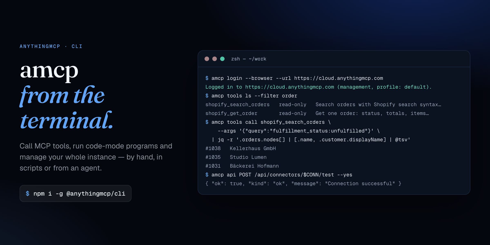
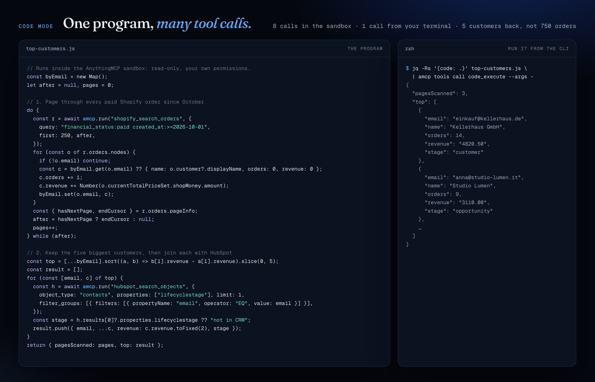

<p align="center">
  <a href="https://anythingmcp.com/developers/cli">
    
  </a>
</p>

<h1 align="center">AnythingMCP CLI (<code>amcp</code>)</h1>

<p align="center">
  <b>Call MCP tools, run code-mode programs and manage your whole MCP gateway from the terminal.</b><br />
  The official command-line client for <a href="https://anythingmcp.com">AnythingMCP</a>, the open-source agent harness and MCP gateway.
</p>

<p align="center">
  <a href="https://www.npmjs.com/package/@anythingmcp/cli"></a>
  <a href="https://www.npmjs.com/package/@anythingmcp/cli"></a>
  
  <a href="https://github.com/HelpCode-ai/anythingmcp/blob/main/LICENSE"></a>
</p>

<p align="center">
  <a href="https://anythingmcp.com/developers/cli">Website</a> ·
  <a href="https://anythingmcp.com/guides/anythingmcp-cli">Guide with examples</a> ·
  <a href="https://anythingmcp.com/developers/api">API reference</a> ·
  <a href="https://github.com/HelpCode-ai/anythingmcp">AnythingMCP on GitHub</a>
</p>

---

`amcp` does two jobs with one binary:

- **Calls MCP tools.** These are the same tools your AI clients use (Shopify, HubSpot, SAP, Odoo, Postgres, an SFTP share…). You can run them by hand, in shell scripts, from cron and CI, or as a **code-mode program** that loops over dozens of tool calls in a single step.
- **Drives the management API.** With a management-scoped key, everything the dashboard does — connectors, MCP servers, users, roles, SSO, memory, skills, audit — is one `amcp api` command away, for a person or for a connected AI agent.

It works with [AnythingMCP Cloud](https://cloud.anythingmcp.com) and self-hosted instances.

```bash
npm i -g @anythingmcp/cli
```

Requires Node.js 22.12 or newer. The examples below use real commands, flags, endpoints and tool names (the Shopify, HubSpot and Slack tools come from the built-in catalogue connectors). Only the data in the output is invented.

## Contents

- [Quick start](#quick-start)
- [Recipes](#recipes)
  - [Call a tool with real arguments](#call-a-tool-with-real-arguments)
  - [Pipe results into jq, cron and CI](#pipe-results-into-jq-cron-and-ci)
  - [Code mode: one program, many tool calls](#code-mode-one-program-many-tool-calls)
  - [Stand up a workspace in one script](#stand-up-a-workspace-in-one-script)
  - [Turn your own API into MCP tools](#turn-your-own-api-into-mcp-tools)
  - [See what your agents did](#see-what-your-agents-did)
- [Command reference](#command-reference)
- [Management API (`amcp api`)](#management-api-amcp-api)
- [Shell completion](#shell-completion)
- [Security](#security)
- [About AnythingMCP](#about-anythingmcp)

## Quick start

`amcp` uses two kinds of key, each in its own profile:

| You want to… | Key | Log in with |
|---|---|---|
| Call the tools of one MCP server | an **MCP key** for that server | `amcp login --url … --server SERVER_ID` |
| Manage the instance (`amcp api`) | a **management key** (read-only or admin) | `amcp login --browser` |

```console
$ amcp login --url https://cloud.anythingmcp.com --server cmob60dvv00c01zrpeujwmnep
MCP API key:
Logged in to https://cloud.anythingmcp.com (profile: default).

$ amcp tools ls --filter order
shopify_search_orders   read-only   Search orders with Shopify search syntax (for example `financial_status:paid …
shopify_get_order       read-only   Get one order: status, totals (subtotal, shipping, tax, discounts, refunds) …

$ amcp login --browser --scope admin --url https://cloud.anythingmcp.com
Logged in to https://cloud.anythingmcp.com (management, profile: default).

$ amcp api GET /api/mcp-servers | jq -r '.[] | "\(.id)  \(.name)"'
cmob60dvv00c01zrpeujwmnep  Default
cmoc2k4hd00f11zrp9xq3vbnw  Sales
```

## Recipes

### Call a tool with real arguments

`tools describe` prints a tool's full description and input JSON schema. `tools call` runs the tool with arguments that match it:

```console
$ amcp tools describe shopify_search_orders
$ amcp tools call shopify_search_orders \
    --args '{"query":"financial_status:paid created_at:>=2026-11-01","first":2}'
{
  "orders": {
    "pageInfo": { "hasNextPage": true, "endCursor": "eyJsYXN0X2lkIjo2…" },
    "nodes": [
      {
        "name": "#1043",
        "displayFinancialStatus": "PAID",
        "displayFulfillmentStatus": "UNFULFILLED",
        "currentTotalPriceSet": { "shopMoney": { "amount": "412.80", "currencyCode": "EUR" } },
        "customer": { "displayName": "Kellerhaus GmbH" }
      },
      …
```

Arguments can also come from a file (`--args @args.json`) or from stdin (`--args -`).

### Pipe results into jq, cron and CI

A tool's text output is its JSON on stdout. Errors go to stderr with a distinct exit code, so `amcp` composes like any Unix tool:

```console
$ amcp tools call shopify_search_orders \
    --args '{"query":"fulfillment_status:unfulfilled created_at:<2026-11-03"}' \
  | jq -r '.orders.nodes[] | [.name, .customer.displayName, .createdAt[:10]] | @tsv'
#1038   Kellerhaus GmbH     2026-10-30
#1035   Studio Lumen        2026-10-29
#1031   Bäckerei Hofmann    2026-10-28
```

A daily job that posts late orders to Slack (the Slack connector sits on the same MCP server):

```bash
#!/usr/bin/env bash
# late-orders.sh — run from cron: 0 8 * * 1-5
set -euo pipefail
SINCE=$(date -d '-2 days' +%F)     # GNU date; on macOS: date -v-2d +%F
LATE=$(amcp tools call shopify_search_orders \
  --args "{\"query\":\"fulfillment_status:unfulfilled created_at:<$SINCE\"}" \
  | jq -r '.orders.nodes[] | "• \(.name) — \(.customer.displayName)"')
[ -z "$LATE" ] && exit 0
jq -n --arg text "Orders waiting more than 2 days:
$LATE" '{channel: "#fulfilment", text: $text}' \
  | amcp tools call slack_post_message --args - --yes
```

### Code mode: one program, many tool calls

<p align="center">
  
</p>

When an MCP server's `codeMode` is `inline`, it offers a `code_execute` tool. You send it a short JavaScript program, and a sandbox next to your tools runs it with three helpers: `amcp.search(query)`, `amcp.describe(tool)` and `amcp.run(tool, args)`.

The question here: *who are our five biggest Shopify customers since October, and where is each one in HubSpot?*

```js
// top-customers.js — runs inside the AnythingMCP sandbox: read-only, your own permissions
const byEmail = new Map();
let after = null, pages = 0;

// 1. Page through every paid Shopify order since October
do {
  const r = await amcp.run("shopify_search_orders", {
    query: "financial_status:paid created_at:>=2026-10-01",
    first: 250, after,
  });
  for (const o of r.orders.nodes) {
    if (!o.email) continue;
    const c = byEmail.get(o.email)
      ?? { name: o.customer?.displayName, orders: 0, revenue: 0 };
    c.orders += 1;
    c.revenue += Number(o.currentTotalPriceSet.shopMoney.amount);
    byEmail.set(o.email, c);
  }
  const { hasNextPage, endCursor } = r.orders.pageInfo;
  after = hasNextPage ? endCursor : null;
  pages++;
} while (after);

// 2. Keep the five biggest customers
const top = [...byEmail]
  .sort((a, b) => b[1].revenue - a[1].revenue)
  .slice(0, 5);

// 3. Join each one with its HubSpot contact
const result = [];
for (const [email, c] of top) {
  const h = await amcp.run("hubspot_search_objects", {
    object_type: "contacts",
    filter_groups: [{ filters: [
      { propertyName: "email", operator: "EQ", value: email },
    ] }],
    properties: ["lifecyclestage"],
    limit: 1,
  });
  const stage = h.results[0]?.properties.lifecyclestage ?? "not in CRM";
  result.push({ email, ...c, revenue: c.revenue.toFixed(2), stage });
}
return { pagesScanned: pages, top: result };
```

```console
$ amcp api PUT /api/mcp-servers/$SRV --yes --data '{"codeMode":"inline"}'   # once, admin key
$ jq -Rs '{code: .}' top-customers.js | amcp tools call code_execute --args -
{
  "pagesScanned": 3,
  "top": [
    {
      "email": "einkauf@kellerhaus.de",
      "name": "Kellerhaus GmbH",
      "orders": 14,
      "revenue": "4820.50",
      "stage": "customer"
    },
    …
  ]
}
```

That's **8 tool calls** (3 pages of orders and 5 CRM lookups) for **one** call from your terminal. You get back five customers instead of 750 raw orders, which also matters when the caller is an AI agent: it reads one short answer, so it spends fewer tokens and makes fewer mistakes.

The guardrails:

- Programs can only call **read-only** tools, with the permissions of the calling key.
- They run in an **isolated sandbox**: no filesystem, network or environment access, a deadline, and a cap on tool calls per run.
- Every inner call is **audited**.
- Inline code needs the server's `codeMode` set to `inline` *and* a role with the inline-code capability. It's available on the Team plan and above.

When a program is worth keeping, `code_propose_tool` records it as a proposal for an admin. Once approved, it becomes a named tool for every AI client on the server:

```console
$ jq -Rs '{
    name: "top_customers_with_crm_stage",
    description: "Top 5 Shopify customers since October, with their HubSpot lifecycle stage",
    rationale: "Sales asks for this every Monday",
    code: .
  }' top-customers.js | amcp tools call code_propose_tool --args -
{"ok":true,"proposalId":"cmh4k2…","message":"Proposal recorded for admin review. It will not run or become a tool until an admin approves it."}
```

### Stand up a workspace in one script

Install a catalogue connector with its token, give the sales team its own MCP server, attach the connector, turn on code mode and test the connection:

```bash
#!/usr/bin/env bash
# bootstrap.sh — needs: amcp login --browser --scope admin
set -euo pipefail

CONN=$(jq -n --arg t "$HUBSPOT_TOKEN" '{credentials: {HUBSPOT_ACCESS_TOKEN: $t}}' \
  | amcp api POST /api/adapters/hubspot/import --data - --yes | jq -r .connectorId)

SRV=$(amcp api POST /api/mcp-servers --yes \
  --data '{"name":"Sales","description":"CRM tools for the sales team"}' | jq -r .id)

amcp api PUT /api/mcp-servers/$SRV/connectors --yes --data "{\"connectorIds\":[\"$CONN\"]}"
amcp api PUT /api/mcp-servers/$SRV --yes --data '{"codeMode":"inline"}'
amcp api POST /api/connectors/$CONN/test --yes
# → { "ok": true, "kind": "ok", "message": "Connection successful" }
```

The token travels through `jq --arg` and stdin, so it never shows up in `ps` or your shell history. Every non-GET call in a script needs an explicit `--yes`.

### Turn your own API into MCP tools

Create a REST connector, then import its OpenAPI spec. WSDL, GraphQL, Postman, cURL and HAR work the same way, through `source`:

```bash
ID=$(amcp api POST /api/connectors --yes --data '{
  "name": "Acme Billing", "type": "REST",
  "baseUrl": "https://api.acme.example/v1",
  "authType": "BEARER_TOKEN", "authConfig": { "token": "'"$ACME_TOKEN"'" }
}' | jq -r .id)

amcp api POST /api/connectors/$ID/import --yes \
  --data '{"source":"openapi","url":"https://api.acme.example/v1/openapi.json"}'
```

### See what your agents did

Every tool call, from people or agents, is audited:

```console
$ amcp api GET "/api/audit/invocations?status=ERROR&limit=3" \
  | jq -r '.[] | [.createdAt[11:16], .tool.name, .user.email, .error[:40]] | @tsv'
08:41   hubspot_search_objects   lea@acme.io         HTTP 429: retry after 1s
07:02   shopify_get_order        ops-agent@acme.io   Order not found
06:55   zendesk_get_ticket       marco@acme.io       HTTP 404: RecordNotFound
```

`GET /api/audit/breakdowns?days=30` returns usage and cost by connector, MCP server and user.

## Command reference

| Command | What it does |
|---|---|
| `amcp login --url URL --server ID` | Save an MCP key for one server's tools (prompted, never echoed) |
| `amcp login --browser [--scope admin] --url URL` | Mint a management key through the dashboard |
| `amcp login --management --url URL --key-stdin` | Save an existing management key |
| `amcp whoami` / `amcp logout` | Show / remove the current profile |
| `amcp tools ls [--filter TEXT]` | List tools with their read-only/destructive hint |
| `amcp tools describe TOOL` | Full description and input JSON schema |
| `amcp tools call TOOL [--args JSON\|@file\|-] [--yes] [--timeout S]` | Call a tool |
| `amcp api METHOD PATH [--data JSON\|@file\|-] [--yes]` | Call the management API |
| `amcp api --list [RESOURCE]` | List management operations offline |
| `amcp completion bash\|zsh\|fish` | Print a shell completion script |

Every command accepts `--profile NAME` and `--json`.

### Logging in with an MCP key

`login` prompts for an MCP API key without displaying it. For scripts, use `--key-stdin` or the `AMCP_API_KEY` environment variable. Never put the key in a command argument. The CLI checks the key by requesting `tools/list` before saving it.

It always connects to `/mcp/<serverId>`, including on Cloud, because the bare `/mcp` endpoint exposes a different tool set there. Pass the instance base URL to `--url`, without `/mcp/<serverId>`. HTTPS is required except for `localhost`, `127.0.0.0/8` and `::1` during local development. Redirects are refused, so the API key can't follow a request to another origin.

```bash
printf '%s\n' "$AMCP_API_KEY" | amcp login --url https://cloud.anythingmcp.com \
  --server YOUR_SERVER_ID --key-stdin --profile cloud
amcp tools ls --profile cloud --filter customer
amcp whoami --profile cloud
amcp logout --profile cloud
```

### Profiles and environment

For CI, `AMCP_URL`, `AMCP_SERVER` and `AMCP_API_KEY` provide the connection without saving a profile. `--url` and `--server` take precedence over their matching environment variables. If a URL comes from `--url` or `AMCP_URL`, supply `AMCP_API_KEY` too: a saved profile key is used only with its saved origin.

Profiles live in `$XDG_CONFIG_HOME/amcp/config.json` or `~/.config/amcp/config.json`, with file mode `0600` on Unix. Relative `XDG_CONFIG_HOME` values are ignored. `whoami` shows only a key prefix.

### Tool calls

`tools ls` shows each tool's name, its read-only/destructive hint and the first line of its description. `tools describe` shows the full description and input JSON schema.

- Without `--args`, the CLI sends an empty object. Arguments must be a JSON object.
- Calls time out after 300 seconds by default. Set `--timeout <seconds>` for a different positive timeout (fractional seconds are allowed). A timeout exits with code 4 and reports `Tool call timed out after <seconds>s`.
- A tool annotated as destructive asks for confirmation in an interactive terminal. In a non-interactive script, pass `--yes` explicitly.
- Tool text goes to stdout. Non-text content is available with `--json`.

### JSON output and exit codes

`--json` works with every command. It writes one JSON object to stdout:

| Command | JSON output |
|---|---|
| `login` / `logout` | the profile |
| `whoami` | the instance URL, MCP `endpoint` and masked key |
| `tools ls` | `{ "tools": [...] }` |
| `tools describe` | `{ "tool": {...} }` |
| `tools call` | `{ "tool": "name", "result": {...} }` |
| `api` | `{ "status": 200, "data": ... }` |

CLI usage and connection errors go to stderr, also as JSON when `--json` is set, with the shape `{ "error": "message", "exitCode": 4 }`. A tool's `isError` result goes to stdout in JSON mode and to stderr in text mode.

| Exit code | Meaning |
|---|---|
| `0` | success |
| `1` | the tool returned `isError`, or the API answered 4xx |
| `2` | invalid usage or JSON arguments |
| `3` | authentication failed (401/403) |
| `4` | connection failure, server error (5xx) or timeout |

## Management API (`amcp api`)

`amcp api` calls the instance's management API (`/api/*`) with a **management-scoped** key. That covers connectors, MCP servers, roles, users, SSO, settings, memory, skills, the knowledge graph and more. It works like `gh api`, but for AnythingMCP.

A management key is an ordinary MCP API key minted with a management scope: `MANAGEMENT_READ` or `MANAGEMENT_ADMIN`. You can mint one from the dashboard or with `POST /api/mcp-keys`. The key carries its owner's identity and role, and it never grants privilege, so admin-only routes still need an admin owner. `MANAGEMENT_READ` keys can only call safe methods (GET/HEAD).

### Getting a management key

Mint one from the dashboard (Settings → Management API keys), choosing read-only or admin, or let the CLI do it through the browser:

```bash
amcp login --browser --url https://cloud.anythingmcp.com            # read-only
amcp login --browser --scope admin --url https://cloud.anythingmcp.com
```

`--browser` opens the instance's authorization page, where you approve the request under your existing dashboard session (SSO included). The CLI prints a short verification code; check that it matches the page before you approve.

The dashboard mints the key and returns it to the CLI over a one-shot `127.0.0.1` loopback, so it never appears in a URL, log or shell history. It's an ordinary management key that you can see and revoke in Settings. On a headless machine, set `AMCP_NO_BROWSER=1` and open the printed URL yourself. The admin scope is available only to workspace admins.

### Using a management key

Log in with a management key (no server needed), then call any endpoint:

```bash
printf '%s\n' "$AMCP_API_KEY" | amcp login --management --url https://cloud.anythingmcp.com --key-stdin
amcp api GET /api/connectors
amcp api GET /api/mcp-servers
amcp api POST /api/mcp-servers --data '{"name":"ops","description":"Ops server"}'
amcp api PUT  /api/mcp-servers/SERVER_ID --data '{"codeMode":"inline"}'
```

For CI, skip the profile and pass the key in the environment:

```bash
AMCP_URL=https://cloud.anythingmcp.com AMCP_API_KEY=mcp_… amcp api GET /api/users --json
```

The key comes from `AMCP_API_KEY`, `--key-stdin` or a saved management profile, never from a command argument.

- A non-safe method asks for confirmation in a terminal. Pass `--yes` in scripts.
- `--data` accepts inline JSON, `@file.json` or `-` (stdin).
- Output is the parsed JSON body. `--json` wraps it with the status.
- Exit codes match the rest of the CLI: `1` for a 4xx result, `3` for 401/403, `4` for 5xx or a connection failure.
- The management API applies a per-key rate limit, so a runaway client gets HTTP 429 instead of overloading the instance.

### Discovering operations

The catalogue of management operations ships with the CLI, so listing it needs no key and no network:

```console
$ amcp api --list mcp-servers
mcp-servers
  GET    /api/mcp-servers  — List MCP servers for current organization
  POST   /api/mcp-servers [body]  — Create a new MCP server
  DELETE /api/mcp-servers/:id  — Delete MCP server
  GET    /api/mcp-servers/:id  — Get MCP server detail
  PUT    /api/mcp-servers/:id [body]  — Update MCP server
  …
$ amcp api --list --json   # { "operations": [ { method, path, summary, admin, … } ] }
```

Each line shows the method, the path, an `[admin]` tag when the route needs an admin owner, a `[body]` tag when it takes a request body, and the summary. The catalogue is generated from the backend controllers, and CI fails if a management route is added without regenerating it, so `amcp api --list` always matches the instance's API. The interactive reference with request examples is in the instance's Swagger UI at `/api/docs`.

## Shell completion

`amcp completion <bash|zsh|fish>` prints a completion script for commands, `tools` subcommands and each command's flags. Install it once for your shell:

```bash
amcp completion bash > ~/.local/share/bash-completion/completions/amcp
amcp completion zsh > "${fpath[1]}/_amcp"
amcp completion fish > ~/.config/fish/completions/amcp.fish
```

- **Bash** needs the `bash-completion` package for the directory above. Without it, add `source <(amcp completion bash)` to `~/.bashrc`.
- **Zsh** needs `compinit` enabled. To load the script without writing a file, add `source <(amcp completion zsh)` to `~/.zshrc` after `compinit`.

Open a new shell afterwards. The scripts are static: they don't read the config file or contact a server, so profile and tool names aren't completed. `completion` always prints the script as plain text, even with `--json`. Any shell other than `bash`, `zsh` or `fish` exits with code `2`.

## Security

- The API key is never accepted as a command argument and never printed in status output.
- Keys are stored with file mode `0600`.
- HTTPS is required except on loopback.
- Redirects are refused, so a key can't follow a request to another origin.
- Writes in scripts need an explicit `--yes`.
- Management keys are capped by their scope and by their owner's role, rate-limited per key, and audited.

## About AnythingMCP

[AnythingMCP](https://anythingmcp.com) is an open-source, enterprise **agent harness and MCP gateway**. It turns any API, SaaS or data source into [Model Context Protocol](https://modelcontextprotocol.io) tools your AI agents can use: Claude, ChatGPT, Copilot, Cursor, Gemini and others.

You can connect hundreds of catalogue services (Odoo, SAP, Shopify, HubSpot, Etsy and more), SQL and NoSQL databases, and SFTP/FTP or SMB file shares. You can also import your own OpenAPI, WSDL, GraphQL or Postman definitions. Then you decide which people and which agents may reach each tool, with roles, SSO and a full audit log.

Run it on [AnythingMCP Cloud](https://cloud.anythingmcp.com) or self-host it. Source and docs: [github.com/HelpCode-ai/anythingmcp](https://github.com/HelpCode-ai/anythingmcp).

### Developing the CLI

From the repository root:

```bash
npm install
npm run build -w packages/cli
node packages/cli/dist/index.js --help
npm test -w packages/cli
```

## License

[AGPL-3.0-only](https://github.com/HelpCode-ai/anythingmcp/blob/main/LICENSE)
